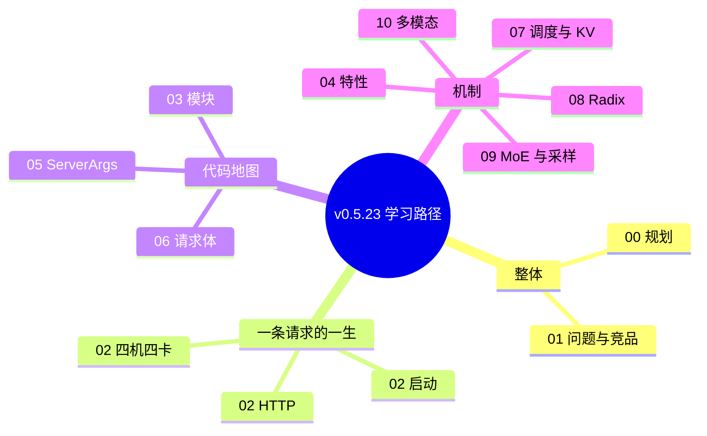

# 00 规划与学习路径

本文是写后续笔记之前定下的拆解。范围只限本仓库已经同步的 v0.5.23 树（commit `297e54fd105e974cdf401e5b4d20253a22c16f90`）。不补上游文档站里有、但这棵树里没有的行为。

## 目标

1. 工作区是完整的 v0.5.23 源码，而不是空 README。
2. 在 `docs/my_docs/` 下写一套从整体到模块、再到特性和请求路径的中文笔记。
3. 重要结构用表，调用关系用 mermaid。每个结论能指回文件和函数。

## 约束

- 不发明源码里不存在的文件、类、旗标。
- Server / Client 选项从 AST 抽取，避免手抄漏项。
- 并行部分以 `arg_groups/parallel_hook.py`、`validation_hook.py`、`runtime_context.py` 里的 assert 和强制改写为准。
- 用户点名的 “DeepSeek-V3.1-Flash / deepseekv4.1 flash”：这棵树和魔搭上对应的官方模型是 `deepseek-ai/DeepSeek-V4.1-Flash`。没有名为 V3.1-Flash 的架构。细节和 config 来源写在 02。
- 代码里没有 `pcp_size` 这个符号。预填充上下文并行是 `enable_prefill_cp` + `attn_cp_size` + `cp_strategy`。笔记里 PCP 指这一组。

## 执行步骤

| 步 | 做什么 | 产出 |
| --- | --- | --- |
| 1 | 确认本仓库只有初始 README，再拉取上游 tag | commit 记录同步方式 |
| 2 | 核对 `python/sglang/launch_server.py`、`srt/`、模型与入口 | 02、03 的锚点 |
| 3 | 取 DeepSeek-V4.1-Flash 的 config，对照 `configs/deepseek_v41.py` 与 `models/deepseek_v4.py` | 02 第 1 节 |
| 4 | 顺着 `run_server` → `resolve_once` → `Engine._launch_subprocesses` → `Scheduler` → `ModelRunner` 写启动链 | 02 第 2–3 节 |
| 5 | 顺着 HTTP 路由 → `TokenizerManager` → ZMQ → `Scheduler.event_loop_*` → `ModelRunner.forward` 写请求链 | 02 第 4 节 |
| 6 | 把 TP/DP/EP/PP/DCP/PCP、DP Attention、DeepEP 的约束和 4×4 拓扑建议写清 | 02 第 5 节、04 |
| 7 | 模块职责与扩展点 | 03 |
| 8 | AST 生成 Server / Client 全表 | 05、06 |
| 9 | 调度、KV、Radix、MoE、采样、多模态补到能独立阅读 | 07–10 |

## 文档地图

## 建议阅读顺序

第一次读：00 → 01 → 02 的启动和 HTTP → 03 里和这两条链同名的类。

第二次读：02 的并行约束，对照 04 的 DP Attention / DeepEP / DSPARK，再查 05 里 `parallel` 与 `exec.moe` 两节的默认值。

要把服务接进自己的网关：06 的 `GenerateReqInput` 和 `ChatCompletionRequest`，加上 02 的路由表。

要改调度或缓存：07 → 08。要改专家并行：09，并回到 02 第 5 节核对非法组合。

## 源码入口（后面每篇都会反复用到）

| 角色 | 位置 |
| --- | --- |
| 推荐 CLI | `python/sglang/cli/main.py` 的 `main`，子命令 `serve` |
| 兼容入口 | `python/sglang/launch_server.py` 的 `run_server` |
| 参数 | `python/sglang/srt/server_args.py` 的 `prepare_server_args`、`ServerArgs.resolve_once` |
| 解析流水线 | `python/sglang/srt/arg_groups/pipeline.py` 的 `run_resolution_pipeline` |
| HTTP | `python/sglang/srt/entrypoints/http_server.py` 的 `launch_server` |
| 进程编排 | `python/sglang/srt/entrypoints/engine.py` 的 `Engine._launch_subprocesses` |
| 调度 | `python/sglang/srt/managers/scheduler.py` 的 `Scheduler` |
| 执行 | `python/sglang/srt/model_executor/model_runner.py` 的 `ModelRunner` |

## 本系列不覆盖

- 把 SGLang 编出来并在 BW1100 上跑通。仓库里没有这块卡的设备分支，02 只根据 HIP 路径上的 assert 给配置，不假装已经实测。
- `sgl-router/` 与 `sgl-model-gateway/` 的部署手册。03 只说明它们站在 worker 前面。
- 上游 `docs/` 里的英文文档站。那是另一套材料，本系列以 Python 实现为准。
