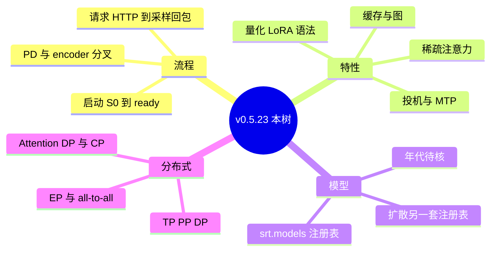
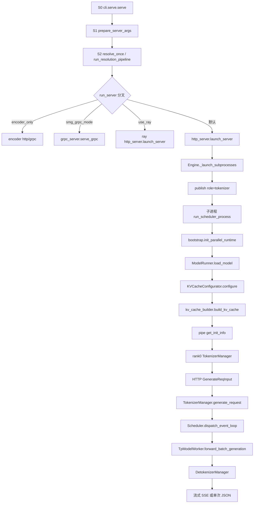

# 00 规划与学习路径

本页是活地图。深文还不在这里写。Batch 1 的交付物是知识点清单，后面每一批只加深一条轨道，并回改本页的状态表。

范围仍是本仓库这棵树：上游 commit `297e54fd105e974cdf401e5b4d20253a22c16f90`，标签 `v0.5.23`。历史是浅克隆，文件修改时间不能当合入日期。

证据约定：

- 每个知识点要能指到本树里的路径和符号（文件 + 类 / 函数 / 旗标）。
- 说不准的标 **待核**。
- 本环境不能跑多卡或 DeepEP。凡是运行时行为，标 **源码路径推断，未实测**。

## 四批计划

| 批次 | 做什么 | 状态 |
| --- | --- | --- |
| 1 清单 | 流程、特性、模型、分布式的全量知识点。不重写深文 | 本 PR |
| 2 启动链路 | 按清单 A 的启动段，把 CLI 到 scheduler ready 写成可核对的阶段说明 | 未开始 |
| 3 请求推理 | HTTP 入、请求对象、调度、prefill/decode、KV、采样、回包 | 未开始 |
| 4 特性 / 分布式 / 模型 | 按清单 B/C/D 逐条加深；模型按家族而不是按 README | 未开始 |

主清单：[调研笔记/00-全量知识点清单.md](调研笔记/00-全量知识点清单.md)。S2 的 hook 全序以那份清单为准。`调研笔记/解析流水线.md` 是更早的压缩表，漏了后来加进 `pipeline.py` 的 hook，Batch 2 以源码和清单对照，不要只抄那张旧表。

`05-Server选项大全.md` 和 `06-Client请求选项大全.md` 保持附录，本轮不改。01–04、07–10 先留着，清单里写了它们哪里薄、哪一批替换。

## 总图

阶段编号沿用上一版，方便和 02 对照。Batch 2 要补的是每一段里面的调用序，不是再发明一套编号。

| 阶段 | 完成的工作 | 主符号 | 清单 |
| --- | --- | --- | --- |
| S0 | 选 LLM 或扩散，装插件 | `cli/main.py` `main`，`cli/serve.py` `serve` | A.2 |
| S1 | argparse 收成未解析的 `ServerArgs` | `prepare_server_args` | A.3 |
| S2 | 按依赖改写并封口 | `run_resolution_pipeline` | A.4 |
| S3 | tokenizer 进程、scheduler 子进程、detokenizer | `Engine._launch_subprocesses` | A.5 |
| S4 | 分词器与 chat template | `init_tokenizer_manager`，`TemplateManager` | A.13 |
| S5 | config、架构类、权重 | `ModelRunner.load_model` | A.7 |
| S6 | KV 池与前缀树 | `KVCacheConfigurator.configure`，`build_kv_cache` | A.8 |
| ready | 子进程 pipe 回报 | `Scheduler.get_init_info` | A.9 |
| S7 | HTTP 体变成内部请求 | `http_server.generate_request` | A.10 |
| S8 | 分词并 ZMQ 下发 | `TokenizerManager._tokenize_one_request` | A.10 |
| S9 | 组 batch，选 extend 或 decode | `dispatch_event_loop`，`get_next_batch_to_run` | A.11 |
| S10 | 前向、写 KV、采样 | `ForwardBatch`，`process_batch_result` | A.11–A.12 |
| S11 | token 变文本，SSE 或一次 JSON | `DetokenizerManager`，`_stream_one_response` | A.12 |

`node_rank >= 1` 停在 scheduler ready，不起 HTTP。`SGLANG_RUST_SERVER` 时主进程不做 Python tokenizer / detokenizer。这两条都在 `Engine._launch_subprocesses`。

## 现有笔记怎么处理

| 文件 | 现在有什么 | 后面哪一批动 |
| --- | --- | --- |
| 00 | 本页。活地图 | 每批改状态 |
| 01 | 问题定义和竞品，阶段地图很短 | 不作为 Batch 2 的文件地图 |
| 02 | S0–S11 散文，例子绑在 DeepSeek-V4.1-Flash | Batch 2 按清单重写启动段 |
| 03 | 目录和类名，字段表不完整 | Batch 2/3 补结构 |
| 04 | 少数特性的插点说明，不是全量 | Batch 4 按清单 B 逐条写 |
| 05 | LLM 与 Diffusion 的 ServerArgs 中文附录 | 保持附录 |
| 06 | 请求字段中文附录 | 保持附录 |
| 07 | 调度循环摘要 | Batch 3 |
| 08 | Radix 摘要 | Batch 3，特性原理留到 Batch 4 |
| 09 | MoE 路由和采样摘要 | Batch 3/4 |
| 10 | VLM 与扩散的分叉点 | Batch 4 |
| 调研笔记/解析流水线.md | S2 的旧压缩表 | Batch 2 对照 `pipeline.py` 刷新 |

## Batch 2 开工时先打开这些文件

不要从仓库根重新搜。启动链的锚点：

| 顺序 | 文件 | 符号 |
| --- | --- | --- |
| 1 | `python/sglang/cli/main.py` | `main` |
| 2 | `python/sglang/cli/serve.py` | `serve` |
| 3 | `python/sglang/launch_server.py` | `run_server` |
| 4 | `python/sglang/srt/server_args.py` | `prepare_server_args`，`ServerArgs.resolve_once` |
| 5 | `python/sglang/srt/arg_groups/pipeline.py` | `run_resolution_pipeline` |
| 6 | `python/sglang/srt/entrypoints/http_server.py` | `launch_server` |
| 7 | `python/sglang/srt/entrypoints/engine.py` | `Engine._launch_subprocesses`，`_launch_scheduler_processes` |
| 8 | `python/sglang/srt/managers/scheduler.py` | `run_scheduler_process`，`Scheduler.__init__`，`init_model_worker` |
| 9 | `python/sglang/srt/distributed/bootstrap.py` | `init_parallel_runtime` |
| 10 | `python/sglang/srt/model_executor/model_runner.py` | `initialize`，`load_model`，`alloc_memory_pool` |
| 11 | `python/sglang/srt/mem_cache/kv_cache_configurator.py` | `KVCacheConfigurator.configure` |
| 12 | `python/sglang/srt/mem_cache/kv_cache_builder.py` | `build_kv_cache` |

hook 的逐项次序、进程拓扑、以及「为何」问题，都在清单 A，不在本页展开。

## 阅读顺序

1. 本页的四批表和总图。
2. 清单 A，确认启动和请求各自有哪些符号。
3. 清单 B/D，确认特性和并行轴不要混进 Batch 2 的散文。
4. 清单 C，确认模型注册方式和年代表仍是占位。
5. 要查某个旗标的中文说明时再翻 05；查请求字段翻 06。
