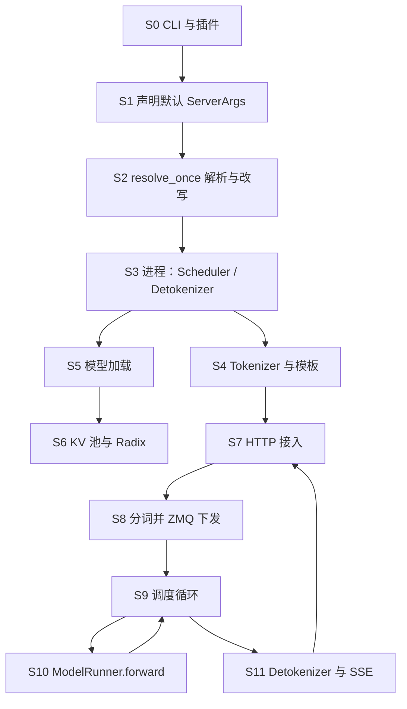

# 00 规划与学习路径

本文有两层。第一层是已经落地的 v0.5.23 同步。第二层是这一轮的加深计划：上一版把链路和选项列出来了，但阶段职责、数据结构、选项之间的约束写得太短。本轮按下面的清单重写，不另起一套文档名。

范围仍是本仓库里的树，上游 commit `297e54fd105e974cdf401e5b4d20253a22c16f90`（标签 `v0.5.23`）。

## 这一轮要补上的东西

| 缺口 | 改法 |
| --- | --- |
| 总流程像一张缩略图 | 02 把启动和请求拆成阶段。每个阶段写清：谁在做、做完什么、产出交给谁 |
| 模块只有目录名 | 03 每个子系统写位置、目的、原理、关键类和成员字段表 |
| 特性只有开关 | 04 每个特性写它插在哪一段流程、原理、相关结构 |
| 05/06 的「含义」是英文 help 原文 | 改成中文四段：作用、默认与效果、交互或强制改写、易错 |
| 07–10 像摘要 | 补上 `Req`、`ReqKvInfo`、`ScheduleBatch`、`ForwardBatch`、`TreeNode`、MoE 路由字段 |

表达约定：流程图和思维导图用 mermaid，字段用表。正文点文件、类、函数的名字，不贴大段源码。

## 加深清单

| 文档 | 要扩成什么样 | 状态 |
| --- | --- | --- |
| 00 | 本计划 + 阅读顺序 | 已重写 |
| 01 | 保留问题定义，补上「阶段地图」，让后面的篇有共同坐标 | 已重写 |
| 02 | 阶段 S0–S11；config 用表；四机四卡约束保留并写清每个并行轴在哪一阶段生效 | 已重写 |
| 03 | 按流程位置重排模块，每个模块一张职责表和一张结构表 | 已重写 |
| 04 | MTP/DSPARK、DeepEP、mori、DP Attention、CP、DCP、Radix、HiCache、PD、LoRA、CUDA graph、Engram | 已重写 |
| 05 | 584 个 LLM 字段 + Diffusion 字段，含义列为详细中文 | 已重写 |
| 06 | 原生 / OpenAI / Anthropic / Ollama 字段，含义列为详细中文 | 已重写 |
| 07 | 调度循环每一步的输入输出，加上 `Req` / `ScheduleBatch` / `ForwardBatch` | 已重写 |
| 08 | 匹配、插入、锁、驱逐的数据流 | 已重写 |
| 09 | gate → top-k → all-to-all → runner，以及采样参数如何进 sampler | 已重写 |
| 10 | VLM 与扩散两条栈在流程中的分叉点 | 已重写 |
| 调研笔记 | 解析流水线 hook 顺序，给 02/05 对照 | 本轮新增 |

## 阶段坐标（后面每篇都用这套编号）

| 阶段 | 完成的工作 | 主类型 |
| --- | --- | --- |
| S0 | 选定 LLM 还是扩散，装上插件 | `cli.serve.serve`，`load_plugins` |
| S1 | 把 CLI 收成尚未解析的 `ServerArgs` | `prepare_server_args` |
| S2 | 按依赖改写默认值、拒绝非法组合 | `run_resolution_pipeline` |
| S3 | 拉起 scheduler / detokenizer 子进程和 ZMQ 端口 | `Engine._launch_subprocesses` |
| S4 | 加载分词器和 chat template，准备回包通道 | `init_tokenizer_manager` |
| S5 | 读 config，建模型，加载权重 | `ModelRunner.load_model` |
| S6 | 按剩余显存建 KV 池，挂上前缀树 | `KVCacheConfigurator`，`build_kv_cache` |
| S7 | 把 HTTP 体变成内部请求或管理调用 | `http_server` 路由，`OpenAIServing*` |
| S8 | 分词、多模态预处理，发给对应 scheduler | `TokenizerManager.generate_request` |
| S9 | 组 batch、选 extend 或 decode | `Scheduler.event_loop_*` |
| S10 | 一次 GPU 前向，写 KV，采样 | `TpModelWorker.forward_batch_generation` |
| S11 | token id 变文本，写成 SSE | `DetokenizerManager`，`_stream_one_response` |

并行宽度在 S2 定稿，在 S3 变成进程数，在 S5/S10 变成 rank 上的张量切分。请求级字段在 S7 进入，到 S8 变成 `TokenizedGenerateReqInput`，到 S9 变成 `Req`。

## 阅读顺序

1. 本页的阶段表。
2. 01 的问题定义，确认你要看的是运行时而不是前端 DSL。
3. 02 顺着 S0–S11 走一遍，分布式放在最后，因为它是 S2 的一组约束而不是另一条进程模型。
4. 03 按阶段回查类。04 看特性插在哪一段。
5. 真要改启动参数时翻 05，改请求体时翻 06。07–10 是 S6、S8、S9、S10 的展开。

## 源码入口

| 角色 | 位置 |
| --- | --- |
| 推荐 CLI | `python/sglang/cli/main.py` 的 `main` |
| 兼容入口 | `python/sglang/launch_server.py` 的 `run_server` |
| 参数 | `server_args.py` 的 `prepare_server_args`、`ServerArgs.resolve_once` |
| 解析 | `arg_groups/pipeline.py` 的 `run_resolution_pipeline` |
| HTTP | `entrypoints/http_server.py` 的 `launch_server` |
| 进程 | `entrypoints/engine.py` 的 `Engine._launch_subprocesses` |
| 调度 | `managers/scheduler.py` 的 `Scheduler` |
| 执行 | `model_executor/model_runner.py` 的 `ModelRunner` |

## 仍然不做的事

- 不在 BW1100 上实跑。海光卡在这棵树里没有专用分支，02 的建议建立在 `is_hip` 与 `mori` 的断言上。
- 不把 `sgl-router` / `sgl-model-gateway` 写成部署手册。它们在 S7 之前，把请求送进 worker。
- 代码里没有 `pcp_size`。PCP 指 `enable_prefill_cp`、`attn_cp_size`、`cp_strategy`。
