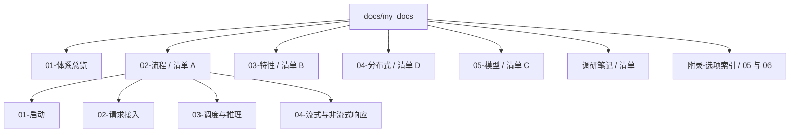
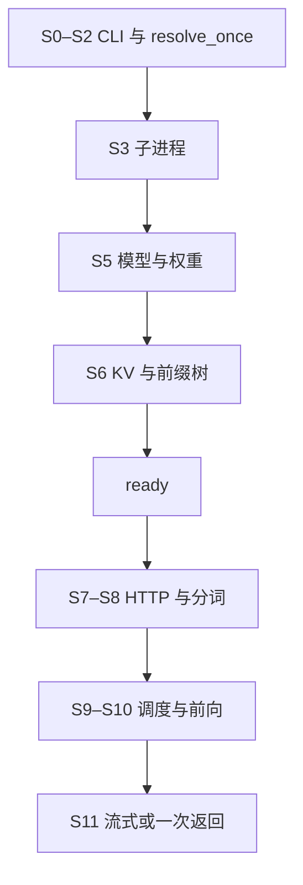

# 地图

本页只导航，不写条目。阶段名和符号摘自清单 A.1，细表仍以 [清单](../调研笔记/00-全量知识点清单.md) 为准。启动的正文在 [02-流程/01-启动](../02-流程/01-启动/README.md)。请求接入的正文在 [02-流程/02-请求接入](../02-流程/02-请求接入/README.md)。调度与推理的正文在 [02-流程/03-调度与推理](../02-流程/03-调度与推理/README.md)。

## 目录

归档在 `docs/my_docs_archive/`，不在这张图里。

## S0 到回包

清单开篇那张图的阶段，对到本套目录。F10–F14 是粗粒度阶段的后半，和 A.10 以后的细表一起归请求侧。

| 阶段 | 清单 | 目录 |
| --- | --- | --- |
| S0–S6、ready、S4 的启动侧 | F01–F09，A.2–A.9 | [02-流程/01-启动](../02-流程/01-启动/README.md) |
| S7–S8 | F10、F11，A.10，A.13 | [02-流程/02-请求接入](../02-流程/02-请求接入/README.md) |
| S9–S10，以及 PD 事件循环 | F12、F13，A.11，A.14 | [02-流程/03-调度与推理](../02-流程/03-调度与推理/README.md) |
| S11 | F14，A.12 | [02-流程/04-流式与非流式响应](../02-流程/04-流式与非流式响应/README.md) |

特性、并行轴、模型注册不画进这条链路。它们分别在 [03-特性](../03-特性/README.md)、[04-分布式](../04-分布式/README.md)、[05-模型](../05-模型/README.md)。
