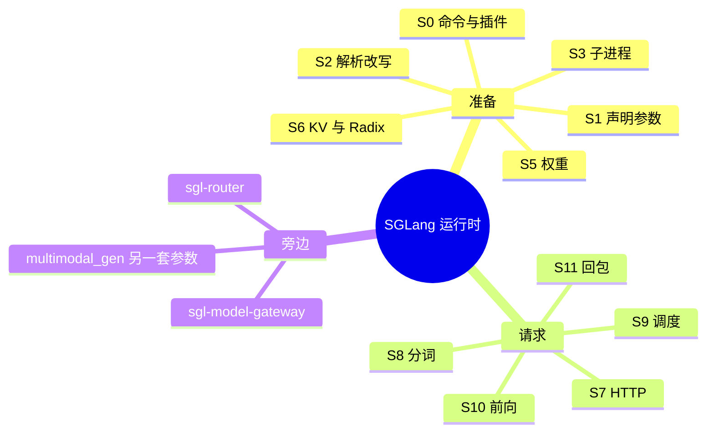

# 01 概览：作用与竞品对比

## 它在整条链路里的位置

SGLang v0.5.23 的主体是 `python/sglang/srt/`。一次服务同时占着 00 里的 S0–S11：S0–S6 把进程和显存准备好，S7–S11 让一条请求转一圈。前端 DSL（`python/sglang/lang/`）只是 S7 的一个客户端，它把程序编译成对 `/generate` 的多次调用，不进 scheduler。

## 它解决的问题

连续批处理的推理服务要同时搞定四件事，而且这四件事互相卡预算：

| 问题 | 在本树里由谁做完 | 阶段 |
| --- | --- | --- |
| 协议很多 | 同一个 FastAPI 进程上的 `/generate`、OpenAI、Anthropic、Ollama | S7 |
| 前缀重复 | Radix / Unified radix 按 token 共享 KV 页 | S6 建树，S9 匹配，请求结束时 `checkpoint` |
| Attention 和 MoE 的切分方式不同 | `tp = attn_tp * attn_dp * attn_cp`，同时 `tp = moe_ep * moe_dp * moe_tp` | S2 定宽度，S10 执行 |
| 长提示与短解码叠在一起 | `Scheduler.get_next_batch_to_run`，chunked prefill，可选 overlap | S9 |

V4.1-Flash 把第三件事推到台前：`num_key_value_heads = 1`，`n_routed_experts = 384`。KV 头切不开，专家必须摊开。所以「整模一种 TP」不够用。`attn_dp_size` 让每个 attention 组有自己的 scheduler（S3 里多个 scheduler），MoE 仍在全部 rank 上做 all-to-all（S10）。

## 和别的框架比，比的是结构

| 维度 | 本树里的做法 | 这意味着什么 |
| --- | --- | --- |
| 进程 | 主进程是 HTTP + `TokenizerManager`；`Scheduler` 和 `DetokenizerManager` 是子进程，ZMQ 相连 | 分词失败不会占着 GPU 进程；多 DP 组时每个 scheduler 一块 GPU 子集 |
| 前缀 | `TreeNode` 上挂 KV 页下标，`lock_ref` 保护正在使用的节点 | 分叉的系统提示能共享分叉点之前的页。块哈希做不到中间分叉 |
| 并行 | 宽度在 S2 用断言和强制改写定死，S3 才 `mp.Process` | 非法组合起不来，而不是跑起来算错。DeepEP 一类后端会把 `ep_size` 改成 `tp_size` |
| 投机 | draft worker 在 `Scheduler.init_model_worker` 里和目标模型一起建池 | V4.1 只允许 DSPARK。这是 S2 的 `validate_deepseek_v41_features`，不是文档约定 |
| PD | `disaggregation_mode` 取 `null` / `prefill` / `decode` | 同一套 ServerArgs，S9 换事件循环，KV 经 mooncake 或 nixl 传 |
| 扩散 | `multimodal_gen` 另一份 dataclass | 不走 LLM 的 S2。05 后半是它的字段 |

vLLM 也做连续批处理和分页 KV，差别在前缀是不是一等公民、attention DP 和 expert all-to-all 是不是同一条 `tp_size` 上的两个因子。TensorRT-LLM 把形状更多留在构建好的 engine 里；这里把形状留到 S2 和 S6（显存 profiling 决定能放多少 token）。TGI 的边界在 HTTP 和 shard 之间；这里把 grammar、LoRA、PD bootstrap、多模态哈希都收进 `GenerateReqInput`，到 S9 才拆开。

这些比较不包含吞吐数字。数字取决于卡和权重，本树给的是分支和断言。
