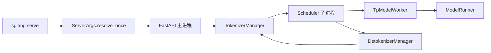

# 01 概览：作用与竞品对比

## 0.1 SGLang 在解决什么

SGLang 是一个大模型推理运行时。v0.5.23 的主体在 `python/sglang/srt/`（SGLang Runtime）。它把三件事放在一个进程组里：

1. **服务协议**。FastAPI 同时提供原生 `/generate` 和 OpenAI `/v1/chat/completions`、Anthropic `/v1/messages`、Ollama `/api/chat`。入口是 `entrypoints/http_server.py`。
2. **连续批处理与前缀缓存**。`Scheduler` 决定下一批请求，`RadixCache` / `UnifiedRadixCache` 按 token 前缀复用 KV，而不是每个请求从零写 cache。
3. **模型执行**。`ModelRunner` 加载权重、分配 KV 池、捕获 CUDA Graph，再按 `ForwardBatch` 调具体架构（`srt/models/`）。

它仍然值得单独看，是因为 vLLM 出现之后，推理系统的差异已经不在“能不能做 PagedAttention”，而在这些能从本树里直接指出来的结构：

- **Radix 前缀树是一等公民**。请求结束走 `tree_cache.checkpoint`，不是可选的后加缓存。见 `mem_cache/radix_cache.py` 的 `RadixCache` 与 `mem_cache/common.py` 的 `release_kv_cache`。
- **Attention 与 MoE 可以拆开并行**。`attn_dp_size` 把 attention 按数据切分（每个 DP 组一个 scheduler），FFN/MoE 仍在 TP 组里做专家并行。字段说明写在 `arg_groups/fields/parallel.py` 的 `attn_dp_size`。这是 DeepSeek 这类「KV 头数 = 1、专家数上百」的模型在多卡上的主路径，而不是把所有矩阵都做同一种 TP。
- **投机解码是调度器里的 draft worker，不是外挂脚本**。`Scheduler.init_model_worker` 里 `maybe_init_draft_worker`。v0.5.23 的算法名在 `arg_groups/fields/spec.py`：`EAGLE`、`EAGLE3`、`NEXTN`、`STANDALONE`、`NGRAM`、`DFLASH`、`DSPARK`、`UNO`。DeepSeek-V4.1 只放行 `DSPARK`（`deepseek_v4_hook.py` 的 `validate_deepseek_v41_features`）。
- **PD 分离是调度器的模式，不是另一套服务**。`disaggregation_mode` 取 `null | prefill | decode`（`arg_groups/fields/disagg.py`），传输后端在同一套参数里选。
- **前面还可以再挂路由**。`sgl-router/` 是 KV-aware 的 Rust 路由器；`sgl-model-gateway/` 是多 worker 的网关。它们转发到 worker 的 `/generate` 或 OpenAI 路径，不替代 worker 内部的 Tokenizer → Scheduler → Detokenizer。

语言前端 `python/sglang/lang/` 仍然在：`@function` 把程序编译成多次 `/generate`。v0.5.23 的服务主路径已经是 OpenAI 兼容 HTTP，前端 DSL 是客户端，不是 scheduler 的一部分。

## 0.2 和其它推理框架比

下表只比较能在本仓库里看见的设计。其它框架的行为按它们公开的架构来写，不用本仓库没有的数字做性能结论。

| 维度 | SGLang v0.5.23 里实际的做法 | vLLM | TensorRT-LLM | TGI |
| --- | --- | --- | --- | --- |
| 进程模型 | 主进程跑 HTTP + `TokenizerManager`；`Scheduler`、`DetokenizerManager` 是子进程，ZMQ IPC（`engine.py` 文档与 `_launch_subprocesses`） | 常见是 API 进程 + EngineCore / worker，调度和执行的边界与这里不同 | 构建期生成引擎，运行期是 runtime + executor，Python 层更薄 | Router + WebServer + 推理 shard，协议层和模型进程分开 |
| 批调度 | `Scheduler.get_next_batch_to_run`，可 overlap（`event_loop_overlap`） | continuous batching，scheduler 在 engine 内 | inflight batching，和 CUDA graph / 静态 shape 绑得更紧 | 连续批处理，扩展点比前两者少 |
| KV | 分页池 + Radix/Unified radix 前缀树；DeepSeek-V4 另有 `DeepSeekV4TokenToKVPool` | PagedAttention，前缀缓存是 hash 块 | KV 在 runtime 的 pool / block 里，图捕获更重 | 块缓存，前缀复用能力弱于 Radix |
| 并行分解 | `tp = attn_tp * attn_dp * attn_cp`，同时 `tp = moe_ep * moe_dp * moe_tp`（`runtime_context.py` `ParallelContext._validate_parallel`） | TP/PP/DP/EP 都有，attention DP 与 expert EP 的组合约束另一套 | TP/PP 为主，MoE EP 依赖自己的 alltoall | 以 TP/分片为主 |
| MoE all-to-all | `moe_a2a_backend`：`deepep`、`deepep_v2`、`mori`、`megamoe`、`flashinfer` 等。spanning 后端会把 `ep_size` 改成 `tp_size`（`overrides.py` `_a2a_ep_size`） | 自有 expert parallel 通信 | 自有 MoE plugin | 没有对等的 DeepEP/MoRI 开关 |
| 投机 | draft worker 与 target 共用 scheduler；V4.1 强制 DSPARK | 多种 speculative 方法，接口在 engine | Medusa / draft 等，和图一起编译 | 支持有限 |
| 约束解码 | `constrained/`：xgrammar、llguidance、outlines，挂在 scheduler 的 grammar 队列 | 类似的 grammar 后端 | 更多在 tokenizer/runtime 插件 | 有 grammar，后端更少 |
| 多框架协议 | 同一 FastAPI app 上的 OpenAI、Anthropic、Ollama、SageMaker | OpenAI 为主 | Triton / Python runtime | 自有 HTTP + 部分 OpenAI |
| 扩散模型 | 另一套 `multimodal_gen` ServerArgs，不进 LLM `ServerArgs` | 另有扩散项目，不在 LLM engine 内 | 不以此为主 | 不以此为主 |

### 这些差异从哪来

**前缀缓存为什么是 Radix，而不是“再做一层 block hash”。**  
`RadixCache.insert` 按 token 序列走树。共享前缀只占一份 KV 页。调度器在 `match_prefix` 时拿到已有长度，prefill 从第一个未命中 token 开始。这和「整段 prompt 先 hash 再决定是否跳过」不同：分叉的系统 prompt、few-shot 中间不同，仍然能共享分叉点之前的页。实现见 08。

**为什么 DeepSeek 之后还要 DP Attention。**  
V4.1 的文本 config 里 `num_key_value_heads = 1`（见 02 的 config）。`models/deepseek_v4.py` 在层构造时 `assert config.num_key_value_heads == 1`。KV 头不能按 16 路 TP 切开。代码的办法是：attention 用 `attn_dp_size` 把不同请求分到不同 scheduler，每个组只对自己的序列做 attention；MoE 用 EP 把 384 个 routed expert 摊到全部 rank。两条轴相乘必须回到同一个 `tp_size`，否则 `ParallelContext._validate_parallel` 失败。

**DeepEP 不是“SGLang 的 MoE”。**  
它是 `moe_a2a_backend=deepep` 时选用的 token dispatcher（`layers/moe/token_dispatcher/deepep.py` 的 `DeepEPBuffer`）。AMD/ROCm 路径在同一枚举里还有 `mori`。开了 spanning 后端却手写一个更小的 `ep_size`，解析阶段会改掉，见 `overrides.py` `_a2a_ep_size`。所以竞品对比里不能把 “支持 EP” 写成一个开关，要写成「选了哪种 all-to-all，EP 宽度就被定成多少」。

**和 TensorRT-LLM 的取舍。**  
TRT-LLM 把大量 shape 固定在构建好的 engine 里。SGLang 把 shape 留在运行时：chunked prefill（`chunked_prefill_size`）、CUDA graph 分 decode/prefill 两相（`exec.graph`）、DeepEP normal 模式会关掉 CUDA graph（`moe_hook.py`，`deepep_mode == normal`）。灵活的是动态 batch 和临时改并行；代价是启动时要做显存 profiling（`KVCacheConfigurator._profile_available_bytes`）和一串 resolution hook。

**和 TGI 的取舍。**  
TGI 的边界是 HTTP 与 shard。SGLang 把 grammar、LoRA、PD bootstrap、多模态 hash、投机 draft 都放进同一个 `GenerateReqInput`（`managers/io_struct.py`），再由 scheduler 分发。协议面更宽，进程内状态也更多。

## 启动之后你面对的对象

下一篇用 DeepSeek-V4.1-Flash 的 config 把这条链走完，并给出 4 节点 × 4 卡上哪些并行组合会被 assert 拒绝。
