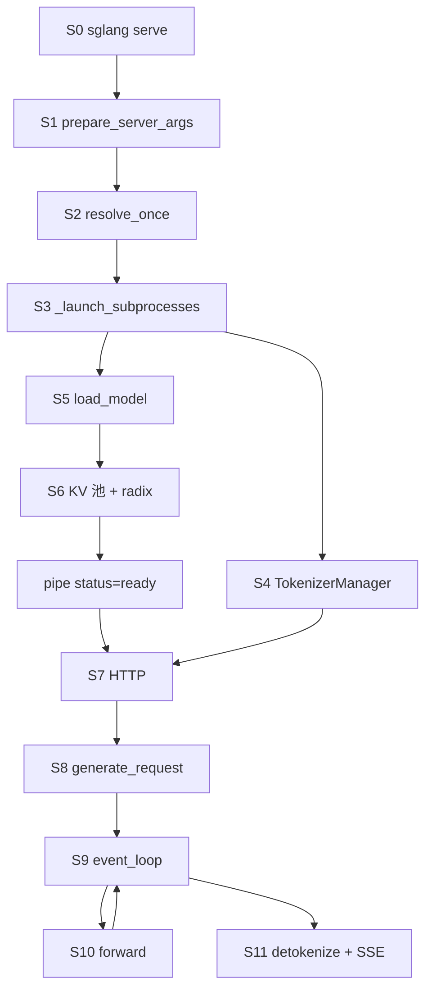
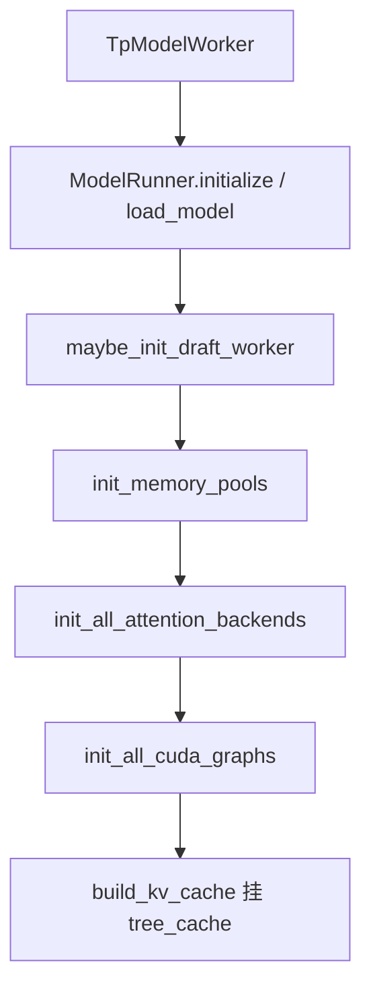
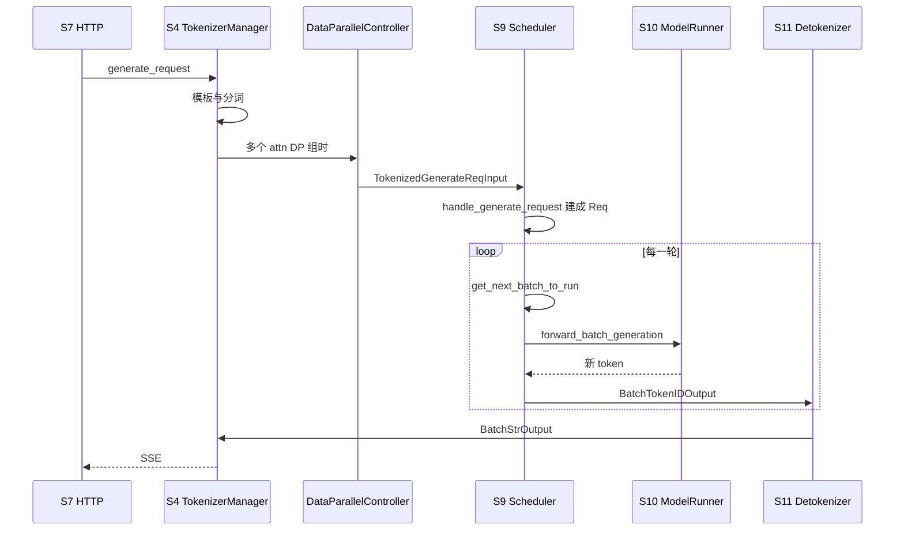
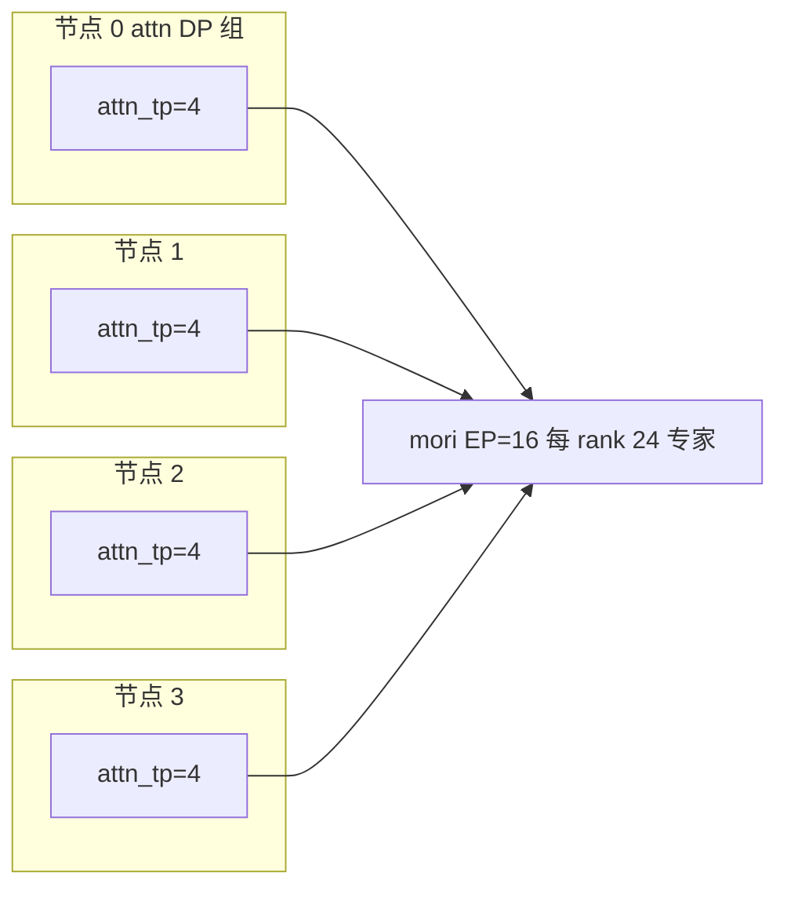

# 02 启动到 HTTP 请求完整流程

坐标用 00 的 S0–S11。模型例子是 `deepseek-ai/DeepSeek-V4.1-Flash`（本树没有名为 V3.1-Flash 的架构）。config 原文在 [assets/deepseek-ai_DeepSeek-V4.1-Flash_config.json](assets/deepseek-ai_DeepSeek-V4.1-Flash_config.json)。魔搭模型页确认架构是 `DeepseekV41ForCausalLM`；匿名文件接口拿不到正文，这份 JSON 来自同一模型 id 的 Hugging Face `main`。

## 总流程



| 阶段 | 角色 | 做完的工作 | 交给下游 |
| --- | --- | --- | --- |
| S0 | `cli.serve.serve` | 区分 LLM / 扩散，`load_plugins`，位置参数改成 `--model-path` | argv |
| S1 | `prepare_server_args` | argparse，可选 YAML `--config`，得到未解析的 `ServerArgs` | 原始字段 |
| S2 | `run_resolution_pipeline` | 改写默认、拒绝非法组合，然后封口 | 解析后的视图 `resolving_view` |
| S3 | `Engine._launch_subprocesses` | 端口、scheduler 子进程、detokenizer、可选 DP controller | ZMQ 名字，子进程 pid |
| S4 | `init_tokenizer_manager` | 分词器、chat template、reasoning/tool parser | 主进程里的 `TokenizerManager` |
| S5 | `ModelRunner.load_model` | `get_config`，注册表找到 `DeepseekV4ForCausalLM`，加载权重 | `self.model` |
| S6 | `KVCacheConfigurator.configure` | 用剩余显存算页数，V4 用 `DeepSeekV4TokenToKVPool`，再 `build_kv_cache` 挂树 | 池 + `tree_cache` |
| S7 | FastAPI | 路由到原生生成或 OpenAI serving | `GenerateReqInput` 或管理调用 |
| S8 | `TokenizerManager.generate_request` | 模板展开、分词、多模态特征，ZMQ 送出 | `TokenizedGenerateReqInput` |
| S9 | `event_loop_normal` 或 overlap | 收请求、`get_next_batch_to_run`、处理结果 | `ScheduleBatch` |
| S10 | `forward_batch_generation` | `ForwardBatch`，写 KV，采样 | token id 与 logprob |
| S11 | `DetokenizerManager` | 文本块，唤醒 `_stream_one_response` | SSE |

`node_rank >= 1` 的进程只做 S3 的 scheduler 半段和 S5–S6，不起 HTTP。`SGLANG_RUST_SERVER` 时主进程不做 S4/S7。

## S0 命令

`python/pyproject.toml` 把 `sglang` 指到 `sglang.cli.main:main`。`serve` 进 `cli/serve.py`。`--model-type` 为 `auto` 时 `ServeBackendRegistry.auto_detect` 选择 LLM 或扩散。LLM 调用 `launch_server.run_server`。`python -m sglang.launch_server` 仍可用，会先 `load_plugins` 再 `prepare_server_args`。

`run_server` 在 `resolve_once` 之后分叉：`encoder_only` 去 encoder 进程；`smg_grpc_mode` 去 `grpc_server.serve_grpc`；`use_ray` 去 Ray HTTP；其余去 `http_server.launch_server`。

## S1 声明默认

`ServerArgs.add_cli_args` 用 `add_cli_args_from_dataclass` 把 `arg_groups/fields/` 里的 `A[...]` 注册成旗标。少量旗标手写在 `add_cli_args`：`--config`、动态 choices 的 `--sampling-backend` / `--reasoning-parser` / `--tool-call-parser`，以及废弃的 `--disable-cuda-graph`、`--enable-dp-attention`。

这一步结束时，DeepSeek 相关的默认还是声明值：`attention_backend` 仍可能是 `auto`，`page_size` 还没变成 256。不要用 S1 的值解释运行时行为。

## S2 解析

`resolve_once` 只成功一次。失败对象不能重试。成功之后给字段赋值会在 `ServerArgs.__setattr__` 里抛错。改写必须走 `declare_resolution`，记在 `_resolved_overrides`。

hook 全表在 [调研笔记/解析流水线.md](调研笔记/解析流水线.md)。和 V4.1-Flash 直接相关的几步：

| 步骤 | 函数 | 对这份模型做的事 |
| --- | --- | --- |
| 模型特化 | `handle_model_specific_adjustments` → `model_overrides/deepseek_v4.py` | `attention_backend=dsv4`，`page_size=256`。仅 CUDA、非 HIP、SM100、FP8 块 32×32 且 `ue8m0` 时，dense GEMM 改成 `flashinfer_cutedsl` |
| V4.1 特征 | `validate_deepseek_v41_features` | 拒绝非 DSPARK 的投机、HiSparse、unified KV triton、two-batch overlap、PP |
| attention DP | `handle_data_parallelism` | `tp` 必须整除 `attn_dp`；`dp_size` 与 `attn_dp_size` 不能同时大于 1；保守系数乘 0.3；chunk 大小除以 `attn_dp` |
| prefill CP | `handle_context_parallelism` 与 `validate_deepseek_v4_cp` | HIP 上 V4.1、多节点、`tp>8` 都会失败 |
| MoE | `handle_a2a_moe` 触发的 `_a2a_ep_size` | `mori` / `deepep` 等把 `ep_size` 改成 `tp_size` |
| 投机 | `handle_speculative_decoding` → `_handle_dspark` | 草稿路径、`num_steps=1`、DP attention 时的后端白名单 |
| 封口后的检查 | `check_server_args` | `(tp*pp) % nnodes == 0`；多节点禁止模型副本 DP |

## 配置字段怎样落到 S5

| config 字段 | 值 | 谁消费 | 影响的阶段 |
| --- | --- | --- | --- |
| `architectures` | `DeepseekV41ForCausalLM` | `get_model_architecture` | S5。运行时类是 `models/deepseek_v4.py` 的 `DeepseekV4ForCausalLM`，映射在 `configs/deepseek_v41.py` |
| `model_type` | `deepseek_v41` | `DeepseekV41Config`，`normalize_deepseek_v41_config` | S5 拆成 text / vision |
| `quantization_config` | fp8、块 32×32、`ue8m0`，专家 `fp4` | V4 override | S2 选 GEMM；S5 选权重 loader |
| `num_hidden_layers` | 40 | 逐层建模块 | S5。另有 3 层 next-n，给 DSPARK，不是 `--speculative-algorithm NEXTN` |
| `num_key_value_heads` | 1 | 层构造 assert | S10 不能按 GQA 把头切给 TP |
| `num_attention_heads` / `head_dim` | 64 / 512 | Q 投影 | S10。`q_lora_rank=1280`，`o_lora_rank=1024` |
| `n_routed_experts` / `num_experts_per_tok` | 384 / 6 | MoE gate | S10。EP=16 时每 rank 24 个专家 |
| `scoring_func` / `topk_method` | `sqrtsoftplus` / `noaux_tc` | `layers/moe/topk.py` 的 `TopKConfig` | S10 路由 |
| `compress_ratios` | 0/1/2 的层数组，长度覆盖 40+3 | 层 `__init__`，只接受 0、1、2、4、128 | S6 的池要同时放下压缩 KV 和 SWA |
| `sliding_window` | 128 | SWA 池 | S6、S10 |
| `engram_*` | 层 1 和 14，两张约 3.84e8 行的表 | `layers/engram.py` | S5 建表。测试用 `SGLANG_ENABLE_DSV41_ENGRAM_HOST_TABLE` 把表放 host |
| `dspark_*` | block 5，目标层 37–39，草稿专家 128 | `_handle_dspark`，`models/deepseek_v4_dspark.py` | S2 校验，S5 建 draft worker |
| `vision_config` | 32 层 ViT，patch 14 | `DeepseekV4ForCausalLM.__init__` | S5。`--language-model-only` 则不建 |
| `max_position_embeddings` | 1048576 | `ModelConfig` 上下文 | S8 拒超长。YaRN factor 16，原始 65536 |

魔搭 README 写的是 552B backbone、最多一百万 token、20 层 encoder 加 20 层 decoder。这和 40 层、上下文 1048576 一致。decoder 的全局 KV 来自 encoder 隐状态，而不是每层各留一份全长 KV，所以 `compress_ratios` 前半大量为 2、后半为 1。

## S3 进程

`http_server.launch_server` 调 `Engine._launch_subprocesses`。

1. 再次 `resolve_once`（已完成则返回）。
2. `publish(role="tokenizer")`。`PortArgs.init_new` 分配 ZMQ。单机默认 Unix 套接字；attention DP 改 TCP，因为多个 scheduler 不在同一网络命名空间的假设下仍要互通。`nccl_port` 为空则选临时端口以下的空闲端口。
3. `_launch_scheduler_processes` 按 TP×PP 起 `mp.Process(run_scheduler_process)`。`num_dp_ranks = dp_size * attn_dp_size`。大于 1 时再起 `DataParallelController`。attention DP 不增加 GPU，但增加 scheduler。
4. rank 0 起 detokenizer（`DetokenizerManager.event_loop`），再 S4。
5. `wait_for_ready` 读 pipe。消息来自 `Scheduler.get_init_info`，此时 S5 和 S6 已经结束。

子进程入口 `run_scheduler_process`：`publish(role="scheduler")` → `Scheduler(...)` → `pipe_writer.send` → `run_event_loop`。

## S4 Tokenizer

`init_tokenizer_manager` 构造 `TokenizerManager`，再 `TemplateManager.initialize_templates`。`--reasoning-parser auto` 和 `--tool-call-parser auto` 按模板写回具体名字。V4.1 的 reasoning 名字是 `deepseek-v41`（`reasoning_parser_names.py`）。

`TokenizerManager.__init__`：`ModelConfig.from_server_args`，多模态用 `get_mm_processor`，否则 `get_tokenizer`。ZMQ PUSH 到 scheduler，PULL 从 detokenizer。

## S5 与 S6 模型与池

`Scheduler.init_model_worker` 的顺序：



`get_config`（`utils/hf_transformers/config.py`）读 JSON。V4.1 走 `normalize_deepseek_v41_config`。权重架构经 `ModelRegistry.resolve_model_cls`。

`KVCacheConfigurator.configure`：`_profile_available_bytes` 在加载后读空闲显存，减去 static 比例和多模态预留，得到 KV 预算；`_init_pools` 里 V4 走 `_build_dsv4_kv_pool`。统一内存池明确排除 DeepSeek-V4。页大小已被 S2 改成 256，所以 S8/S9 的前缀命中按 256 token 对齐。

Engram 不在 KV 池里。两张表按测试注释大约 189 GiB FP8。144GB 的卡放不下完整表，需要 host 表环境变量，除非确认分片之后放得下。

父进程看到 ready，表示池和（若开启）CUDA graph 已经建完。

## S7 HTTP 进入

路由在 `http_server.py`。OpenAI 对象在 `lifespan` 里挂到 `app.state`。

| 路径 | 处理函数 | 产出 |
| --- | --- | --- |
| `POST /generate` | `serve_generate_request` | 直接 `GenerateReqInput` |
| `POST /v1/chat/completions` | `openai_v1_chat_completions` | `OpenAIServingChat.handle_request` 再变成 `GenerateReqInput` |
| `POST /v1/completions` | `openai_v1_completions` | `OpenAIServingCompletion` |
| `POST /v1/embeddings` | `openai_v1_embeddings` | `EmbeddingReqInput` |
| `POST /v1/messages` | Anthropic serving | 同样落到生成或计数 |
| `POST /api/chat` | Ollama serving | 同上 |
| `GET /health`、`/server_info` | 同名函数 | 不进 S9 |

字段表在 06。chat 与原生生成在 S8 汇合。

## S8 到 S11 一条请求



1. `OpenAIServingBase.handle_request` 校验，`_convert_to_internal_request` 得到 `GenerateReqInput`。chat template、tool、reasoning 在这一层完成，sampler 只看见 token。
2. `generate_request`：`normalize_batch_and_arguments`，`_tokenize_one_request`，`_dispatch_to_scheduler`。`routed_dp_rank` 可以指定 attention DP 组。
3. `ingest_requests` → `SchedulerRequestReceiver`。`handle_generate_request` 建 `schedule_batch.py` 的 `Req`。带 grammar 的请求先进 `GrammarManager` 队列。
4. `dispatch_event_loop` 选择 `event_loop_normal`、`event_loop_overlap`，或 PP / PD / MLX 变体。普通一轮是收包、组 batch、`run_batch`、`process_batch_result`。
5. `TpModelWorker.forward_batch_generation` 建 `ForwardBatch`。PP 的最后一段调 `ModelRunner.forward`。V4.1 按层走 SWA、压缩 KV、indexer、MoE。
6. `SchedulerOutputStreamer` 把 `BatchTokenIDOutput` 送给 detokenizer。`DetokenizerManager.handle_batch_token_id_out` 得到 `BatchStrOutput`。
7. `TokenizerManager.handle_loop` 唤醒 `_stream_one_response`。`/generate` 的帧是 `data: ` 加 JSON，结束是 `data: [DONE]`。

`skip_tokenizer_init` 时 scheduler 把 token id 直接送回，跳过 detokenizer。

`ForwardMode`（`forward_batch_info.py`）决定 S10 这一轮算什么：`EXTEND` 预填充，`DECODE` 每请求一个 token，`MIXED` 是 chunked prefill 时两者同批，`IDLE` 是 attention DP 下这组没有请求但仍要参加集合通信，`TARGET_VERIFY` / `DRAFT_EXTEND_V2` 是投机，`PREBUILT` 是 PD decode 侧 KV 已经传来。

## 四机四卡

拓扑：4 节点 × 4 张 AMD/海光 BW1100，每张 144GB，共 16 卡。树里没有 `BW1100` 或 `Hygon`。下面假定运行时 `get_platform().is_hip` 为真。若不是 HIP，这些拒绝不会触发，初始化会走 CUDA 分支然后在别处失败。

### 每个轴在哪一阶段生效

| 轴 | 字段 | 默认 | 增加 GPU | 定稿阶段 | 执行阶段 |
| --- | --- | --- | --- | --- | --- |
| TP | `tp_size` | 1 | 是，与 PP 相乘 | S1 声明，S3 起进程 | S10 切分线性层 |
| PP | `pp_size` | 1 | 是 | S2 若大于 1 关 overlap；V4.1 直接拒绝 | S9 微批 |
| 模型副本 DP | `dp_size` | 1 | 是 | S3 的 `check_server_args`：多节点禁止大于 1 | 每副本一套权重 |
| DP Attention | `attn_dp_size` | 1 | 否 | S2 `handle_data_parallelism` | S3 多个 scheduler，S10 组内 attention |
| EP | `ep_size` | 1 | 否 | S2，spanning 后端改成等于 `tp_size` | S10 all-to-all |
| MoE DP | `moe_dp_size` | 1 | 否 | S2，与 `ep` 相乘必须回到 `tp` | S10 |
| DCP | `dcp_size` | 1 | 否 | S2 `handle_decode_context_parallelism` | S10 decode KV |
| PCP | `enable_prefill_cp` + `attn_cp_size` + `cp_strategy` | 关，宽度 1 | 否 | S2 | S10 预填充切序列 |

恒等式在 `runtime_context.py` 的 `derive_attn_tp_size`、`derive_parallel_widths`，并由 `ParallelContext._validate_parallel` 检查：

```text
attn_tp = tp / attn_dp / attn_cp
moe_tp  = tp / moe_ep / moe_dp
```

rank 布局：`tp_rank = (attn_dp_rank * attn_cp + attn_cp_rank) * attn_tp + attn_tp_rank`。连续 4 个 rank 在一个节点上时，`attn_dp=4`、`attn_tp=4` 表示每个节点一个 attention 组。

### 建议配置

```text
SGLANG_ENABLE_DSV41_ENGRAM_HOST_TABLE=1
SGLANG_RAGGED_VERIFY_MODE=static

sglang serve deepseek-ai/DeepSeek-V4.1-Flash
  --trust-remote-code
  --nnodes 4 --node-rank $NODE_RANK --dist-init-addr $HEAD:29500
  --tp 16 --pp-size 1 --dp-size 1
  --attn-dp-size 4 --ep-size 16 --moe-a2a-backend mori
  --enable-dp-lm-head
  --speculative-algorithm DSPARK --speculative-dspark-block-size 5
  --reasoning-parser auto --tool-call-parser auto
```

| 选择 | 原因 |
| --- | --- |
| `tp=16, pp=1, nnodes=4` | `(16*1)%4==0`，过 `check_server_args` |
| `dp-size=1` | 多节点禁止模型副本 |
| `attn-dp-size=4` | 节点内 4 路 attention，不把 KV 头为 1 的 attention 打到跨节点 all-reduce |
| `mori` 且 EP=16 | spanning 列表会强制 `ep=tp`。DSPARK 加 DP attention 的白名单只有 `none`、`megamoe`、`mori` |
| 不开 DeepEP | 不在上述白名单。`deepep_v2` 的 `direct` 还禁止 `nnodes>1` |
| 不开 prefill CP | `validate_deepseek_v4_cp`：HIP 上的 V4.1、多节点、`tp>8` |
| 不开 DCP | 与 prefill CP 互斥是另一条规则；`fi_a2a` 还要 CUDA Blackwell |
| 不开 PP | `validate_deepseek_v41_features` |
| block size 5 | config 的 `dspark_block_size`。草稿若打在主 checkpoint 里，hook 会把草稿路径设成 `model_path` |
| ragged static | a2a 不是 `none` 时 `_handle_dspark` 要求这个环境变量 |
| host Engram | 两张表远大于 144GB |

纯 TP（`attn-dp-size 1`，仍用 `mori`）能通过节点整除，但 16 路 attention 跨 4 个节点，而 KV 头是 1。树没有把它 assert 死。它合法，和模型形状拧着。

### 会失败的组合

| 组合 | 结果 | 函数 |
| --- | --- | --- |
| `dp-size 4` 且 `nnodes 4` | assert | `check_server_args` |
| `dp-size>1` 且 `attn-dp-size>1` | ValueError | `handle_data_parallelism` |
| `pp-size>1` 且 V4.1 | ValueError | `validate_deepseek_v41_features` |
| 投机不是 DSPARK | ValueError | 同上。更早的 V4 检查还允许 EAGLE topk=1，V4.1 再拒掉 |
| two-batch overlap | ValueError | 同上 |
| HIP 上 V4.1 的 prefill CP | ValueError | `validate_deepseek_v4_cp` |
| 非 NPU 的 V4 CP 且 `tp>8` 或 attention DP | assert | 同上 |
| zigzag CP 且不是 NPU | ValueError | 同上 |
| `dcp>1` 且 prefill CP | ValueError | `handle_decode_context_parallelism` |
| `deepep_v2` direct 且多节点 | ValueError | `moe_hook` |
| `deepep_mode=normal` | 关掉两相 CUDA graph | `moe_hook` |
| DSPARK + DP attention 却用 deepep | ValueError | `_handle_dspark` |
| 同上但没开 `--enable-dp-lm-head` | ValueError | 同上 |
| `moe_dp>1` 且 `pp>1` | assert | `parallel_hook` |
| `ep>1` 且 `moe_dp>1` 但乘积不等于 `tp` | assert | 同上 |
| FlashInfer MegaMOE 且 `attn_dp != tp` | assert | `moe_hook` |



打开 attention DP 之后，S2 还会把 `schedule_conservativeness` 乘 0.3，把 `chunked_prefill_size` 除以 4。这是副作用，不是你在命令行里写的那个默认值。每个组有自己的 radix，相同前缀打到两个组会算两次。外部路由要用 `routed_dp_rank` 或 `routing_key` 把前缀粘在一个组上。
