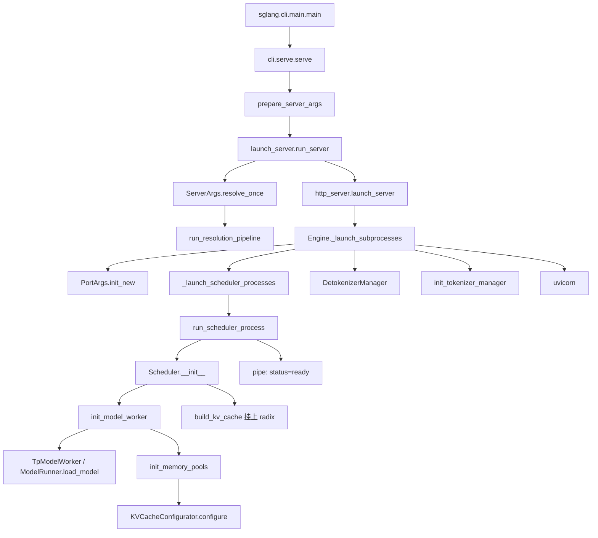
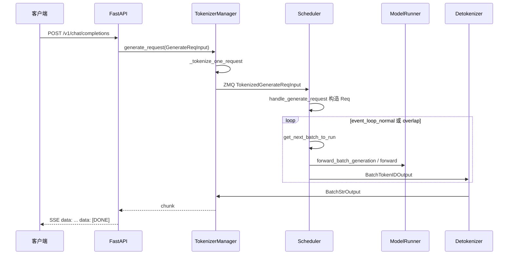
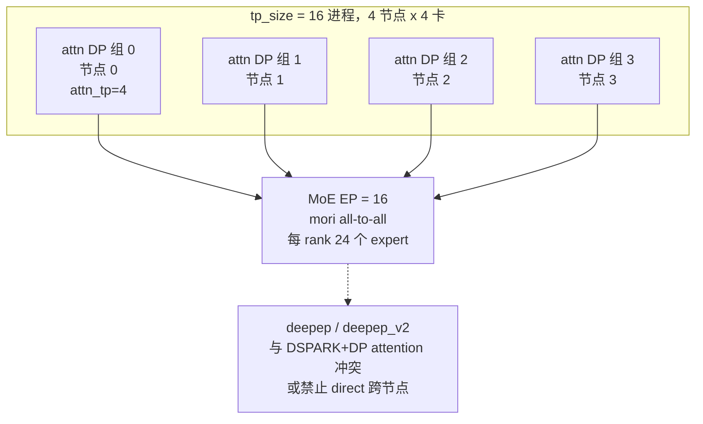

# 02 启动到 HTTP 请求完整流程

锚点 commit：`297e54fd105e974cdf401e5b4d20253a22c16f90`。

## 1.1 用哪份模型 config

用户要求拿 DeepSeek-V3.1-Flash，或最接近的 “deepseekv4.1 flash”。本树里的测试、recipe 和模型类都指向：

| 项 | 值 | 依据 |
| --- | --- | --- |
| 模型 id | `deepseek-ai/DeepSeek-V4.1-Flash` | `python/sglang/test/dsv41_flash_common.py` 的 `MODEL` |
| 魔搭页 | `deepseek-ai/DeepSeek-V4.1-Flash` | 2026-11-02 魔搭模型 API，`Architectures = ["DeepseekV41ForCausalLM"]`，`ModelType = ["deepseek_v41"]`，Revision `master` |
| HF 架构名 | `DeepseekV41ForCausalLM` | config 与魔搭元数据一致 |
| 运行时类 | `DeepseekV4ForCausalLM` | `configs/deepseek_v41.py` 把 HF 架构映射到 V4 实现 |

本树没有 `DeepseekV31Flash` 这类架构。V3.1 仍是 `DeepseekV3ForCausalLM`。因此后文全部对着 V4.1-Flash。

**config.json 怎么拿到的。** 魔搭模型元数据接口可用。匿名文件接口 `.../repo?Revision=master&FilePath=config.json` 返回「获取模型文件失败，文件内容为空」；同一接口对 `deepseek-ai/DeepSeek-V3.1` 的 `config.json` 同样失败，目录树接口则是魔搭内部 401。所以下面这份不是从魔搭 blob 直接下到的。它是同一模型 id 在 Hugging Face `main` 上的 `config.json` 原文，架构名与魔搭声明一致。原文另存为 [assets/deepseek-ai_DeepSeek-V4.1-Flash_config.json](assets/deepseek-ai_DeepSeek-V4.1-Flash_config.json)。

### config 原文

```json
{
  "architectures": ["DeepseekV41ForCausalLM"],
  "model_type": "deepseek_v41",
  "dtype": "bfloat16",
  "transformers_version": "5.6.0",
  "bos_token_id": 0,
  "eos_token_id": 1,
  "pad_token_id": 2,
  "image_token_id": 129264,
  "quantization_config": {
    "quant_method": "fp8",
    "activation_scheme": "dynamic",
    "weight_block_size": [32, 32],
    "scale_fmt": "ue8m0",
    "expert_dtype": "fp4"
  },
  "text_config": {
    "model_type": "deepseek_v41_text",
    "vocab_size": 129280,
    "hidden_size": 5120,
    "moe_intermediate_size": 2304,
    "num_hidden_layers": 40,
    "num_attention_heads": 64,
    "num_key_value_heads": 1,
    "head_dim": 512,
    "qk_rope_head_dim": 64,
    "q_lora_rank": 1280,
    "o_lora_rank": 1024,
    "o_groups": 8,
    "hidden_act": "silu",
    "swiglu_limit": 10.0,
    "rms_norm_eps": 1e-20,
    "attention_bias": false,
    "attention_dropout": 0.0,
    "initializer_range": 0.02,
    "use_cache": true,
    "tie_word_embeddings": false,
    "max_position_embeddings": 1048576,
    "rope_theta": 10000,
    "rope_scaling": {
      "rope_type": "yarn",
      "factor": 16,
      "beta_fast": 32,
      "beta_slow": 1,
      "original_max_position_embeddings": 65536
    },
    "n_routed_experts": 384,
    "n_shared_experts": 1,
    "num_experts_per_tok": 6,
    "scoring_func": "sqrtsoftplus",
    "topk_method": "noaux_tc",
    "norm_topk_prob": true,
    "routed_scaling_factor": 1.5,
    "sliding_window": 128,
    "compress_ratios": [0, 0, 2, 2, 2, 2, 2, 2, 2, 2, 2, 2, 2, 2, 2, 2, 2, 2, 2, 2, 1, 1, 1, 1, 1, 1, 1, 1, 1, 1, 1, 1, 1, 1, 1, 1, 1, 1, 1, 1, 0, 0, 0],
    "compress_rope_theta": 160000,
    "kv_source_layer_ids": [2, 8, 14, 20],
    "index_source_layer_ids": [2, 8, 14, 20, 24, 28, 32, 36],
    "index_n_heads": 32,
    "index_head_dim": 128,
    "index_topk": 512,
    "candidate_source_layer_id": 20,
    "candidate_topk_blocks": 2048,
    "candidate_block_size": 8,
    "hc_mult": 4,
    "hc_sinkhorn_iters": 20,
    "hc_eps": 1e-06,
    "engram_layer_ids": [1, 14],
    "engram_num_embeddings": [384006168, 384016682],
    "engram_max_ngram_size": 4,
    "engram_vocab_size": 16000000,
    "engram_n_heads": 8,
    "engram_head_dim": 256,
    "engram_pad_token_id": 2,
    "engram_compressed_vocab_size": 99092,
    "num_nextn_predict_layers": 3,
    "dspark_block_size": 5,
    "dspark_noise_token_id": 128799,
    "dspark_target_layer_ids": [37, 38, 39],
    "dspark_markov_rank": 256,
    "dspark_n_routed_experts": 128,
    "dspark_num_experts_per_tok": 3
  },
  "vision_config": {
    "model_type": "deepseek_v41_vision",
    "num_hidden_layers": 32,
    "hidden_size": 1024,
    "num_attention_heads": 16,
    "intermediate_size": 2816,
    "patch_size": 14,
    "rope_theta": 10000,
    "downsample_ratio": 3,
    "max_image_tokens": 1024,
    "min_pixels": 295936,
    "max_wh_ratio": null
  }
}
```

`compress_ratios` 长度是 43：40 个 decoder/encoder 层再加 3 个 nextn 层（`num_nextn_predict_layers = 3`）。前两层 ratio 0，接着一长段 2，再一段 1，最后三个 0。层构造时只接受 `0, 1, 2, 4, 128`（`models/deepseek_v4.py` 约 1044–1057 行的 `assert`）。

### 这些字段在启动时落到哪里

| config 字段 | 启动时谁读 | 后果 |
| --- | --- | --- |
| `architectures[0] = DeepseekV41ForCausalLM` | `get_model_architecture` → `ModelRegistry.resolve_model_cls` | 实例化 `models/deepseek_v4.py` 的 `DeepseekV4ForCausalLM` |
| `model_type = deepseek_v41` | `configs/deepseek_v41.py` 的 `DeepseekV41Config`；`get_config` 里 `normalize_deepseek_v41_config` | 文本/视觉拆成两个子 config |
| `quantization_config` | `model_overrides/deepseek_v4.py` `_deepseek_v4_overrides` | `attention_backend` 被改成 `dsv4`，`page_size` 被改成 256。仅当设备是 CUDA、非 HIP、SM100、`fp8` + `weight_block_size=[32,32]` + `ue8m0` 时，dense GEMM 才改成 `flashinfer_cutedsl` |
| `text_config.num_hidden_layers = 40` | 模型按层建 `DeepseekV4DecoderLayer` | 层号决定 `compress_ratios[layer_id]` |
| `num_key_value_heads = 1` | 层 `__init__` assert | 不能靠把 KV 头切给 TP。多卡 attention 走 DP Attention 或 MLA 吸收，而不是 GQA 头切分 |
| `n_routed_experts = 384`，`num_experts_per_tok = 6` | MoE gate | EP 把 384 个 expert 分到 `ep_size` 个 rank，每 token 6 个 |
| `sliding_window = 128` | SWA 池 | 与 compress ratio 一起决定哪些层是窗口、哪些层是压缩 KV |
| `engram_*` | `layers/engram.py`，层 id 1 和 14 | 两张约 3.84e8 行的表。`SGLANG_ENABLE_DSV41_ENGRAM_HOST_TABLE=1` 把表放在 host（`environ.py`） |
| `dspark_*`，`num_nextn_predict_layers = 3` | `speculative_hook.py` `_handle_dspark`，草稿模型 `models/deepseek_v4_dspark.py` | 只有 `--speculative-algorithm DSPARK` 合法。block size 与 config 的 5 对齐 |
| `vision_config` | `DeepseekV4ForCausalLM.__init__`：`model_type == deepseek_v41` 且 `vision_n_layers > 0` 且未设 `language_model_only` | 构建 `models/deepseek_v41_vit.py` 的 ViT 和 Aligner |
| `max_position_embeddings = 1048576` | `ModelConfig` 的 context length | YaRN：`rope_scaling.factor = 16`，原始 65536 |

魔搭 README 对这份权重的自述（元数据里的 ReadMe，不是本仓库文档）是：552B backbone、上下文最多一百万 token、Causal Encoder-Decoder（20 层 encoder + 20 层 decoder）。这和 `num_hidden_layers = 40`、`max_position_embeddings = 1048576` 对得上。CED 的含义在实现里是：decoder 的全局 KV 来自 encoder 隐状态的投影，而不是每层各自堆一份全局 KV。压缩比数组前半段大量为 2、后半段为 1，就是这条 cache 压缩路径的层配置。

## 1.1 续：从命令行到内存池

下面是默认 HTTP、rank 0、不走 Rust server 的路径。



### 参数

1. `python/pyproject.toml` 把命令 `sglang` 指到 `sglang.cli.main:main`。`serve` 进入 `cli/serve.py`。位置参数会被改成 `--model-path`。
2. `prepare_server_args`（`server_args.py`）建 argparse，`ServerArgs.add_cli_args`，可选 `--config` YAML 合并，然后 `ServerArgs.from_cli_args`。这一步**不**解析模型相关默认值。
3. `launch_server.run_server` 先处理 gRPC 的 `tokenizer_path`，再 `resolve_once()`。
4. `resolve_once` 调 `run_resolution_pipeline`（`arg_groups/pipeline.py`）。流水线按固定顺序跑 hook：模型路径、PD、显存、`handle_model_specific_adjustments`、attention、MoE a2a、`handle_speculative_decoding`。失败不可在同一对象上重试。
5. 对这份 config，`_deepseek_v4_overrides` 写入 `attention_backend=dsv4`、`page_size=256`。`validate_deepseek_v41_features` 拒绝 PP、two-batch overlap、非 DSPARK 的投机、HiSparse、unified KV triton。

`run_server` 之后的分支：

| 条件 | 去哪 |
| --- | --- |
| `encoder_only` | `disaggregation/encoder` 的 HTTP 或 gRPC |
| `smg_grpc_mode` | `entrypoints/grpc_server.py` `serve_grpc` |
| `use_ray` | `srt/ray/http_server.py` |
| 其余 | `entrypoints/http_server.py` `launch_server` |

### 三个进程

`http_server.launch_server` 调 `Engine._launch_subprocesses`：

1. 再次 `resolve_once`（已完成则返回）。
2. `check_server_args`（`validation_hook.py`）：`(tp_size * pp_size) % nnodes == 0`；`dp_size > 1` 且 `nnodes != 1` 直接 assert。
3. `publish(..., role="tokenizer")`，`PortArgs.init_new` 分配 ZMQ。单机默认 Unix IPC；attention DP 改用 TCP。
4. `_launch_scheduler_processes`：按 TP×PP 起 `mp.Process(target=run_scheduler_process)`。`num_dp_ranks > 1` 时再起 `DataParallelController`。
5. `node_rank >= 1` 的进程只等 scheduler，不起 HTTP。
6. rank 0 起 detokenizer，再 `init_tokenizer_manager`，然后等 scheduler 的 pipe 消息 `status == ready`。

`run_scheduler_process`（`scheduler.py`）：`publish(role="scheduler")` → `Scheduler(...)` → `pipe_writer.send(get_init_info())` → `run_event_loop()`。父进程看到 ready 时，权重、KV 池和 CUDA graph 已经在子进程里建完。

### Tokenizer

`init_tokenizer_manager`（`engine.py`）构造 `TokenizerManager`，再 `TemplateManager.initialize_templates`。`--reasoning-parser auto` / `--tool-call-parser auto` 会按 chat template 写回具体解析器。V4.1 的名字在 `reasoning_parser_names.py` 里是 `deepseek-v41`。

`TokenizerManager.__init__`：`ModelConfig.from_server_args` → `get_tokenizer` 或 `get_mm_processor` → ZMQ PUSH 到 scheduler、PULL 从 detokenizer。

### 模型与池

`Scheduler.init_model_worker`：

1. `TpModelWorker` → `ModelRunner`。
2. `ModelRunner.initialize` → `load_model`。`get_config`（`utils/hf_transformers/config.py`）读 `config.json`。V4.1 走 `normalize_deepseek_v41_config`。
3. `init_memory_pools` → `tp_worker.alloc_memory_pool` → `ModelRunner.alloc_memory_pool` → `KVCacheConfigurator.configure`。
4. `_profile_available_bytes`：加载后的空闲显存减去 static slack，得到 KV 预算。
5. V4 走 `_build_dsv4_kv_pool`，GPU 上是 `DeepSeekV4TokenToKVPool`。统一内存池路径明确排除 DeepSeek-V4。
6. 回到 scheduler，`kv_cache_builder.build_kv_cache` 在已有 token 池上挂 `req_to_token_pool` 和 radix/tree。

Engram 不在 KV 池里。它是层内的 n-gram 表。测试注释（`test/dsv41_flash_common.py`）写明两张表大约 189 GiB FP8，所以 GB300 双卡测试把 `SGLANG_ENABLE_DSV41_ENGRAM_HOST_TABLE` 设为 1。144GB 的卡同样放不下两张完整表，启动 V4.1-Flash 时应打开这个环境变量，除非你确认权重分片后的表已经按 rank 切开并且放得下。

## 1.2 HTTP 请求怎么走

路由都在 `http_server.py` 的 FastAPI `app` 上。OpenAI serving 对象在 `lifespan` 里挂到 `app.state`。

| 路径 | 处理函数 | 下游 |
| --- | --- | --- |
| `POST /generate` | `generate_request` → `serve_generate_request` | 直接 `TokenizerManager.generate_request(GenerateReqInput)` |
| `POST /v1/chat/completions` | `openai_v1_chat_completions` | `OpenAIServingChat.handle_request` → 内部仍是 `GenerateReqInput` |
| `POST /v1/completions` | `openai_v1_completions` | `OpenAIServingCompletion` |
| `POST /v1/embeddings` | `openai_v1_embeddings` | `EmbeddingReqInput` |
| `POST /v1/messages` | `anthropic_v1_messages` | `AnthropicServing` |
| `POST /api/chat` | `ollama_chat` | `OllamaServing` |
| `GET /health`、`/server_info`、`/model_info` | 同名函数 | 不进生成循环 |

字段全集在 06。这里只跟一条 chat 请求。



1. `OpenAIServingBase.handle_request` 做校验，`_convert_to_internal_request` 得到 `GenerateReqInput`。chat template、tool parser、reasoning parser 在这一层。
2. `TokenizerManager.generate_request`：`normalize_batch_and_arguments` → tokenize → `_dispatch_to_scheduler`。多 DP 时先到 `DataParallelController`，再进对应 scheduler。`routed_dp_rank` 可以让外部路由器指定组。
3. Scheduler 的 `ingest_requests` → `SchedulerRequestReceiver.recv_requests`。`TokenizedGenerateReqInput` 分到 `handle_generate_request`，建成 `schedule_batch.py` 里的 `Req`，进 waiting queue。有 grammar 的请求先进 grammar 队列。
4. `run_event_loop` → `dispatch_event_loop`。普通路径是 `event_loop_normal`：收请求、`get_next_batch_to_run`、`run_batch`、`process_batch_result`。overlap 路径把下一步的 CPU 调度和上一步的 GPU 重叠。PP、PD、MLX 另有循环。
5. `TpModelWorker.forward_batch_generation` 建 `ForwardBatch`，PP 的最后一段调 `ModelRunner.forward` → `_forward_raw`。V4.1 的 forward 按层走 SWA / 压缩 KV / indexer / MoE。
6. `process_batch_result` → `SchedulerOutputStreamer.stream_output` 把 `BatchTokenIDOutput` 发给 detokenizer。`DetokenizerManager.event_loop` 解成 `BatchStrOutput` 送回 tokenizer。
7. `TokenizerManager.handle_loop` 唤醒 `_stream_one_response`。`/generate` 的 SSE 是 `data: ` + JSON，结束是 `data: [DONE]`。OpenAI chat 再包一层 chunk 对象。

`skip_tokenizer_init` 时 scheduler 直接把 token id 送回 tokenizer 侧，跳过 detokenizer。

## 1.3 四机四卡：TP / DP / EP / PP / DCP / PCP

拓扑：**4 个节点，每节点 4 张 AMD/海光 BW1100，每张 144GB**。一共 16 张卡。

### 代码里有没有这块卡

没有 `BW1100`、`Hygon` 字符串。海光 DCU 的软件栈通常冒充 HIP。本树里和这块卡相关的分支是 `get_platform().is_hip`，以及 `mori` 这个 MoE all-to-all 后端（AMD 的 MoRI）。如果运行时 `is_hip` 为假，下面所有 HIP 限制都不会触发，设备初始化会走 CUDA 分支然后在别的地方失败。下面的建议假定进程被识别为 HIP。

### 名字对照

代码里**没有** `pcp_size`。下表是笔记用词和源码符号的对应。

| 笔记里的说法 | 源码 | 默认 | 增加 GPU 吗 |
| --- | --- | --- | --- |
| TP | `tp_size` / `--tp` | 1 | 是，和 PP 相乘 |
| PP | `pp_size` / `--pp-size` | 1 | 是 |
| DP（模型副本） | `dp_size` / `--dp-size` | 1 | 是，整份权重复制。`compute_world_size = dp * tp * pp` |
| DP Attention | `attn_dp_size` / `--attn-dp-size` | 1 | 否。它把已有 TP 组再切开，每个子组一个 scheduler |
| EP | `ep_size`，解析后为 `moe_ep_size` | 1 | 否。rank 仍在 TP 组里 |
| MoE DP | `moe_dp_size` | 1 | 否 |
| DCP | `dcp_size` / `--dcp-size` | 1 | 否。在每个 TP 组内切 decode 的 KV |
| PCP（预填充上下文并行） | `enable_prefill_cp` + `attn_cp_size` + `cp_strategy` | 关，`attn_cp_size=1` | 否 |

恒等式在 `runtime_context.py`：

```text
attn_tp_size = tp_size / attn_dp_size / attn_cp_size
moe_tp_size  = tp_size / moe_ep_size / moe_dp_size
tp_size == attn_tp * attn_dp * attn_cp
tp_size == moe_ep * moe_dp * moe_tp
```

`ParallelContext._validate_parallel` 不满足就起不来。rank 布局：

```text
tp_rank = (attn_dp_rank * attn_cp_size + attn_cp_rank) * attn_tp_size + attn_tp_rank
```

连续 4 个 rank 落在一个节点上时，`attn_dp_size=4`、`attn_tp_size=4`、`attn_cp_size=1` 表示每个节点一个 attention DP 组，组内 4 路 TP。

### 会被拒绝或被改写的组合

| 组合 | 发生了什么 | 位置 |
| --- | --- | --- |
| `(tp * pp) % nnodes != 0` | assert | `validation_hook.check_server_args` |
| `dp_size > 1` 且 `nnodes != 1` | assert，提示改用 `--attn-dp-size` | 同上 |
| `dp_size > 1` 且 `attn_dp_size > 1` | `ValueError` | `parallel_hook.handle_data_parallelism` |
| `tp_size % attn_dp_size != 0` | assert | `parallel_hook` |
| `pp_size > 1` 且模型是 V4.1 | `ValueError`：V4.1 还不支持 PP | `validate_deepseek_v41_features` |
| V4.1 上 `--speculative-algorithm` 不是 DSPARK | `ValueError` | 同上。更早的 V4 通用检查还允许 EAGLE topk=1，V4.1 这一关会再拒掉 |
| V4.1 上 `--enable-two-batch-overlap` | `ValueError` | 同上 |
| `dcp_size > 1` 且 `--enable-prefill-cp` | `ValueError` | `handle_decode_context_parallelism` |
| `--dcp-comm-backend fi_a2a` 且不是 CUDA | `ValueError`（要 Blackwell MNNVL） | 同上 |
| HIP 上 DeepSeek-V4 的 prefill CP，且 `nnodes > 1` | `ValueError` | `validate_deepseek_v4_cp` |
| HIP 上 prefill CP 且模型是 V4.1 | `ValueError` | 同上，`unsupported` 列表里写了 DeepSeek-V4.1 |
| HIP 上 prefill CP 且 attention 不是双相 `dsv4` | `ValueError` | 同上 |
| V4 zigzag CP 且不是 NPU | `ValueError`。CUDA/HIP 只能 `interleave` | 同上 |
| 非 NPU 的 V4 CP 且 `attn_dp_size != 1` | assert “dp attention is not supported” | 同上 |
| 非 NPU 的 V4 CP 且 `tp_size > 8` | assert，注释写跨机 CP 有精度问题 | 同上 |
| `moe_a2a_backend` 属于 spanning 集合（含 `deepep`、`deepep_v2`、`mori`、`megamoe`…）且 `ep_size != tp_size` | **改写** `ep_size = tp_size`，打日志 | `overrides.py` `_a2a_ep_size` |
| `deepep_v2_mode=direct` 且 `nnodes > 1` | `ValueError`，要改 `hybrid` | `moe_hook.py` |
| `deepep_mode=normal` | 关掉 decode 和 prefill 的 CUDA graph | `moe_hook.py` |
| DSPARK 且 `attn_dp_size > 1` 但没开 `--enable-dp-lm-head` | `ValueError` | `speculative_hook._handle_dspark` |
| DSPARK + DP attention，非 NPU，a2a 不是 `none`/`megamoe`/`mori` | `ValueError`。因此 **deepep 与 DSPARK+DP attention 不能一起用** | 同上 |
| 同上且 a2a 不是 `none`，环境变量不是 `SGLANG_RAGGED_VERIFY_MODE=static` | `ValueError` | 同上 |
| `moe_dp_size > 1` 且 `pp_size != 1` | assert | `parallel_hook` |
| `ep>1` 且 `moe_dp>1` 但 `ep * moe_dp != tp` | assert | 同上 |
| `attn_cp_size != moe_dp_size` 且 `moe_dp_size != 1` | assert | 同上 |
| FlashInfer MegaMOE 且 `attn_dp_size != tp_size` | assert，要纯 DP attention | `moe_hook.py` |

旧旗标 `--enable-dp-attention` 没有独立语义。`parallel_hook` 把 `--dp-size N --enable-dp-attention` 改成 `attn_dp_size=N`、`dp_size=1`。

### 这份拓扑上建议的配置

目标：16 张卡跑 V4.1-Flash，attention 不跨节点切 KV（每节点 4 卡一组），MoE 用 HIP 上的 all-to-all 把 384 个 expert 摊开，并打开 config 里已经写好的 DSPARK。

```bash
# 每个节点各起一次，NODE_RANK=0..3
# HEAD 是 rank 0 的地址
export SGLANG_ENABLE_DSV41_ENGRAM_HOST_TABLE=1
export SGLANG_RAGGED_VERIFY_MODE=static

sglang serve deepseek-ai/DeepSeek-V4.1-Flash \
  --trust-remote-code \
  --nnodes 4 \
  --node-rank "$NODE_RANK" \
  --dist-init-addr "$HEAD:29500" \
  --tp 16 \
  --pp-size 1 \
  --dp-size 1 \
  --attn-dp-size 4 \
  --ep-size 16 \
  --moe-a2a-backend mori \
  --enable-dp-lm-head \
  --speculative-algorithm DSPARK \
  --speculative-dspark-block-size 5 \
  --reasoning-parser auto \
  --tool-call-parser auto
```

为什么是这组数：

- `tp=16, pp=1, nnodes=4`：`(16*1)%4==0`，过 `check_server_args`。
- `dp-size=1`：多节点禁止模型副本 DP。
- `attn-dp-size=4`：`attn_tp=16/4/1=4`。四个连续 rank 在一个节点上，节点内做 attention，节点间不做 attention all-reduce。这和 `num_key_value_heads=1` 是匹配的。
- `mori` 在 spanning 列表里，即使不写 `--ep-size 16` 也会被改成 16。写上是为了和日志对得上。`moe_tp=1`，每个 rank 只拿 `384/16=24` 个 routed expert。
- 不用 `deepep`：DSPARK 加 DP attention 的白名单只有 `none`、`megamoe`、`mori`。DeepEP 是 NVIDIA 的 dispatcher；`deepep_v2` 的 `direct` 还明确禁止 `nnodes>1`。
- 不开 prefill CP：HIP 上 V4.1 被 `validate_deepseek_v4_cp` 拒绝，多节点也被拒绝，且 `tp=16>8`。
- 不开 DCP：和 prefill CP 互斥是另一条规则；`fi_a2a` 还要求 CUDA Blackwell。这份拓扑用不上 DCP。
- 不开 PP：V4.1 直接拒绝。
- DSPARK 的 block size 用 config 里的 `dspark_block_size=5`。草稿权重若打在主 checkpoint 里，`_handle_dspark` 会把 `speculative_draft_model_path` 设成 `model_path`；否则必须自己传。
- `SGLANG_RAGGED_VERIFY_MODE=static`：a2a 不是 `none` 时 DSPARK 要求这个。
- Engram host 表：两行 `engram_num_embeddings` 都超过 3.84 亿。测试文件按 FP8、每行 264 字节估算约 189 GiB。单卡 144GB 放不下完整表。

纯 TP、不做 DP attention（`--attn-dp-size 1 --tp 16 --moe-a2a-backend mori`）能通过节点整除和 EP 改写，但 16 路 attention 会跨 4 个节点做集合通信，而 KV 头只有 1。本树没有把它 assert 死，它是合法但和模型形状拧着的配置。

### 明确不要这样写

```bash
# 多节点模型副本 DP：validation_hook assert
--nnodes 4 --dp-size 4 --tp 4

# 两种 DP 叠加：parallel_hook ValueError
--dp-size 2 --attn-dp-size 2 --tp 16

# V4.1 禁止 PP
--tp 8 --pp-size 2

# HIP + V4.1 + 多节点 prefill CP：validate_deepseek_v4_cp
--enable-prefill-cp --cp-strategy interleave --tp 16 --nnodes 4

# DSPARK + DP attention + DeepEP：_handle_dspark 拒绝
--attn-dp-size 4 --moe-a2a-backend deepep --speculative-algorithm DSPARK

# 跨节点的 deepep v2 direct
--moe-a2a-backend deepep_v2 --deepep-v2-mode direct --nnodes 4

# V4.1 上的 EAGLE / MTP 旧名
--speculative-algorithm EAGLE
--speculative-algorithm NEXTN
```

`NEXTN` 在通用投机路径里常被折叠成 EAGLE（`speculative_hook` 的 alias）。对 V4.1 没有区别，两种都会在 `validate_deepseek_v41_features` 被拒绝。config 里的 `num_nextn_predict_layers` 是模型自带的 next-n 结构，供 DSPARK 使用，不是让你再开 `--speculative-algorithm NEXTN`。

### 和 dp attention、DeepEP 的关系（一张图）



每个 attention DP 组有自己的 scheduler 和自己的请求队列。MoE 仍看得到全部 16 个 rank，所以 expert 负载是全局的。`schedule_conservativeness` 在打开 attention DP 时会被乘 0.3（`handle_data_parallelism`），chunked prefill 的块大小会除以 `attn_dp_size`。这些是解析阶段的副作用，不是你在 CLI 里写的默认值。
