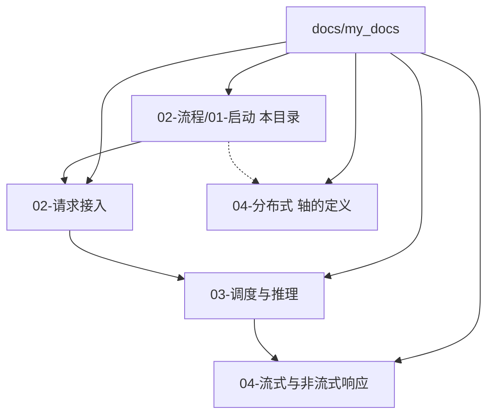
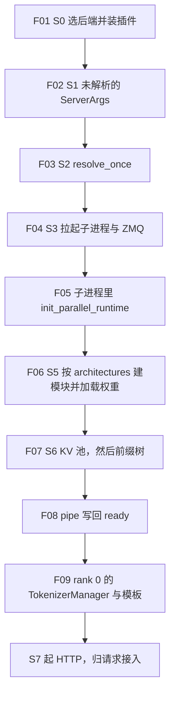
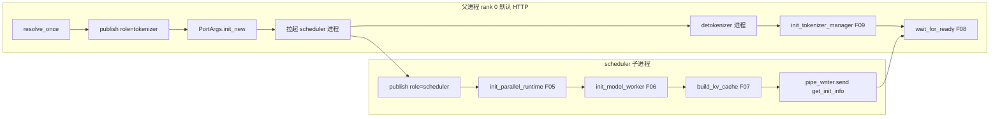
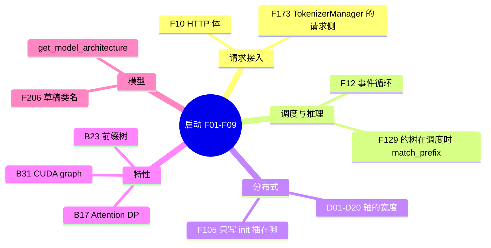

# 阶段总览

本页只铺 S0 到 ready 的时间顺序（F01–F09）。每一步的函数级过程在后面各页。证据来自本树；多卡和设备上的耗时没有实跑，标 **源码路径推断，未实测**。

## 这一段在框架里的位置

启动把一份 CLI 收成封口后的配置，再在子进程里建进程组、加载权重、划出 KV，最后用 pipe 告诉父进程可以接请求。请求从 HTTP 进来之后的路径不在本页。

S4 的符号在清单里单列，调用发生在父进程 `wait_for_ready` 之前：detokenizer 和 tokenizer 先建好，再等子进程的 pipe。子进程内部则是分布式 init、模型、KV 都做完才 `send`。两张时间表不要叠成一条直线。

## 场景

| 场景 | 硬件或平台前提 | 这条链路怎么分叉 | 清单 |
| --- | --- | --- | --- |
| 单机单卡，默认 HTTP | 能跑默认设备后端的机器。CUDA 是常见路径；CPU / NPU / XPU / MPS / HPU 在 S2 换后端 | 主进程 tokenizer，1 个 scheduler，1 个 detokenizer | F01–F09、F20 |
| 单机多卡 TP | `tp_size>1`，`dp_size=1`，`attn_dp_size=1` | 本节点按 PP×TP 切片起多个 scheduler 进程，没有 DataParallelController | F04、F97 |
| 模型副本 DP | `dp_size>1`，且不能再开 attention DP | 额外一个 `DataParallelController` 进程，由它拉起各副本的 scheduler | F97、F99、F192 |
| Attention DP | `attn_dp_size>1`，`dp_size` 必须是 1。GPU 数仍由 TP 决定 | 父进程先按 TP 预拉起 scheduler，再起控制器，按 `attn_dp_rank` 分组路由 | F97、F192、F202 |
| 多机，`node_rank>=1` | 需要 `dist_init_addr` 一类的集合通信地址。未实测 | 不建 tokenizer，不提供业务 HTTP；可起 follower gRPC 和 dummy health | F101、F199 |
| `model_path` 为 `none` / `dummy` | 不读真实权重 | S2 在硬件校验后只做 boundary reduction 就返回 | F31 之后的早退，见解析流水线 |
| 扩散 | `--model-type diffusion`，或 auto 判定为扩散 | 不进 LLM 的 `run_resolution_pipeline` | F24 |
| Encoder-only / SMG gRPC / Ray / Rust server | 见 CLI 页的旗标 | 不走或截断默认 HTTP 三进程 | F21–F23、F102、F204 |

平台分叉（F44、F61、F73、F87）发生在 S2，落在 [03-解析流水线](03-解析流水线.md)。场景行已回填总表。

## F01–F09

### F01 S0 选定后端，装插件

位置：进程入口，早于任何 `ServerArgs` 解析。符号：`python/sglang/cli/serve.py` 的 `serve`，`sglang.srt.plugins.load_plugins`。

角色：决定这趟启动是 LLM 还是扩散，并在分发前装上插件，使后面的 `run_hook` 能替换单个解析步骤。

原理：`--model-type` 默认 `auto`。显式指定则跳过探测。插件必须在 `ServeBackend.run` 之前装上，否则 S2 的 hook 替换赶不上第一次 `resolve_once`。`python -m sglang.launch_server` 则在 `prepare_server_args` 之前调用 `load_plugins`。

实现上 `load_plugins` 可重复调用，后面 Engine 和 scheduler 子进程还会再调一次。细节见 [01-CLI与分叉](01-CLI与分叉.md)。

### F02 S1 CLI 变成未解析的 ServerArgs

位置：LLM 后端 `_run_llm`。符号：`prepare_server_args`。

角色：把 argv 收成 `ServerArgs` 结构体。这一步结束时，`attention_backend=auto` 之类仍是输入，不是运行时值。

原理：字段默认值来自 `arg_groups/fields/`。`prepare_server_args` 不调用 `run_resolution_pipeline`。见 [02-声明与封口](02-声明与封口.md) 的 F27、F191。

### F03 S2 改写默认值并封口

位置：`run_server` 开头，以及稍后 `Engine._launch_subprocesses` 再调一次。符号：`ServerArgs.resolve_once` → `run_resolution_pipeline`。

角色：按依赖顺序改写配置，然后把记录封成只读。第二次调用若已经成功，直接返回。

原理：hook 对自己的输出不幂等，失败的记录不能在同一对象上重跑。合法改写走 `declare_resolution`，不直接给字段赋值。全序见 [03-解析流水线](03-解析流水线.md)。

### F04 S3 拉起 scheduler / detokenizer，分配 ZMQ

位置：默认 HTTP 的 `http_server.launch_server` 进入 `Engine._launch_subprocesses`。

角色：在父进程发布 `role="tokenizer"` 的运行时上下文，分配 IPC 名和 NCCL 端口，再 `spawn` 子进程。

原理：HTTP 文档字符串把引擎拆成主进程里的 TokenizerManager、子进程里的 Scheduler、另一个子进程里的 DetokenizerManager，进程之间用 ZMQ。`node_rank>=1` 和 Rust server 会砍掉其中几段。见 [04-进程拓扑](04-进程拓扑.md)。

### F05 分布式 init 在 scheduler 子进程

位置：`Scheduler.__init__`，在 `init_model_worker` 之前。符号：`distributed/bootstrap.py` 的 `init_parallel_runtime`。

角色：每个 scheduler 进程建一次 WORLD，以及 TP / PP / EP / CP 组，并标 attention DP 的 rank。HTTP 进程不建这些组。

原理：同进程第二次调用直接 `RuntimeError`。草稿 worker 复用目标的组，不得再调。宽度从发布后的 `get_parallel()` 读。见 [05-分布式初始化](05-分布式初始化.md)。

### F06 S5 读 config，按 architectures 建模块，加载权重

位置：`init_model_worker` → `TpModelWorker` → `ModelRunner.initialize` → `load_model`。权重在 worker 构造期间就加载，早于后面的 KV 池。

角色：用 checkpoint 的 `architectures` 选模块类，再按 S2 定下的 `load_format` 选 loader。

草稿模型会在 `ModelConfig._config_draft_model` 里把 `architectures[0]` 改成 NextN / MTP / DSpark 类名（F206）。见 [06-模型加载](06-模型加载.md)。

### F07 S6 按剩余显存建 KV 池，再挂前缀树

位置：池在 `Scheduler.init_memory_pools`，仍在 `init_model_worker` 里面。树在 `init_model_worker` 返回之后，`kv_cache_builder.build_kv_cache` 写入 `self.tree_cache`。

角色：池决定能放多少 token 的 KV；树决定前缀如何复用这些页。两步不是同一次分配。

预算来自 `KVCacheConfigurator.configure`，用的是加载前测到的 `pre_model_load_memory` 和 S2 写好的 `mem_fraction_static`。见 [07-KV与前缀树](07-KV与前缀树.md)。

### F08 ready：子进程把 init 信息写回 pipe

位置：`run_scheduler_process` 在 `Scheduler(...)` 返回后 `pipe_writer.send(scheduler.get_init_info())`。此时 F111–F135 已结束，事件循环还没进。

角色：父进程 `wait_for_ready` 要看到 `status == "ready"`，并带回 `max_total_num_tokens`、`max_req_input_len`。见 [08-ready](08-ready.md)。

### F09 S4 rank 0 建 tokenizer 和模板

位置：父进程，rank 0，且不是 Rust server。符号：`engine.py` 的 `init_tokenizer_manager`，`TemplateManager.initialize_templates`。

角色：在主进程构造 `TokenizerManager`，并初始化 chat / completion 模板。`tokenizer_worker_num != 1` 时改为 `MultiTokenizerRouter`，`template_manager` 为 `None`。

函数注释写 “Launch tokenizer process”，调用点在 `_launch_subprocesses` 的主进程路径上，默认并不再 `spawn` 一个 tokenizer 进程。模板函数和分词细节归 [请求接入](../02-请求接入/README.md) 的 F173–F178。

## 和别的层怎么连

返回 [本目录](README.md)。
