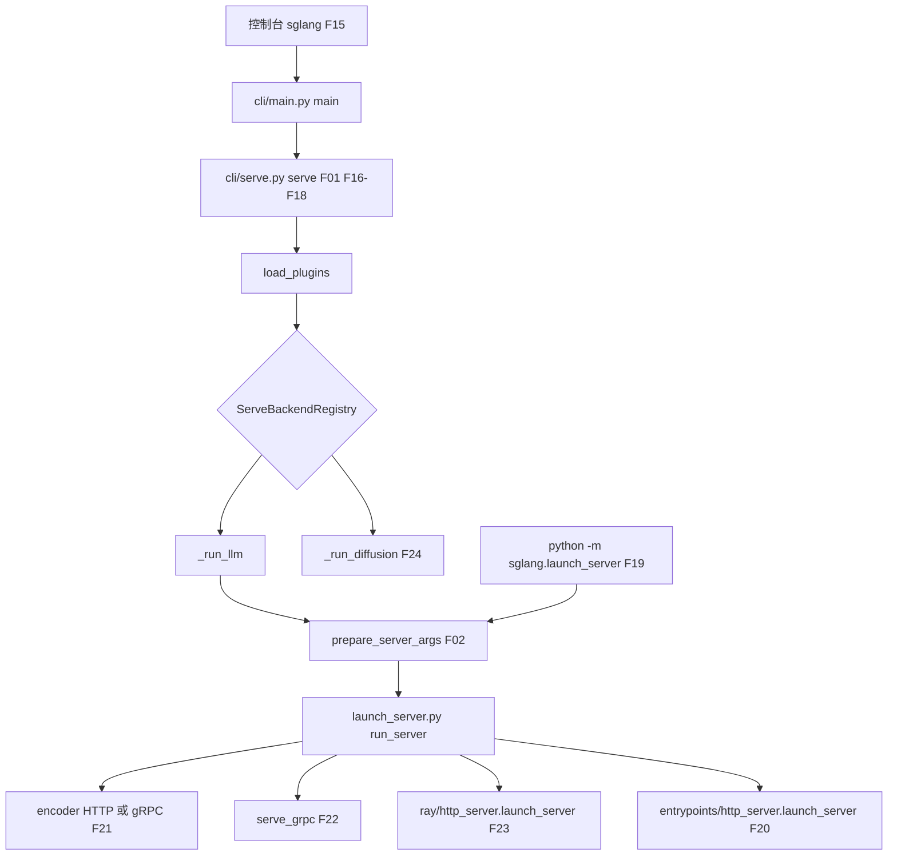
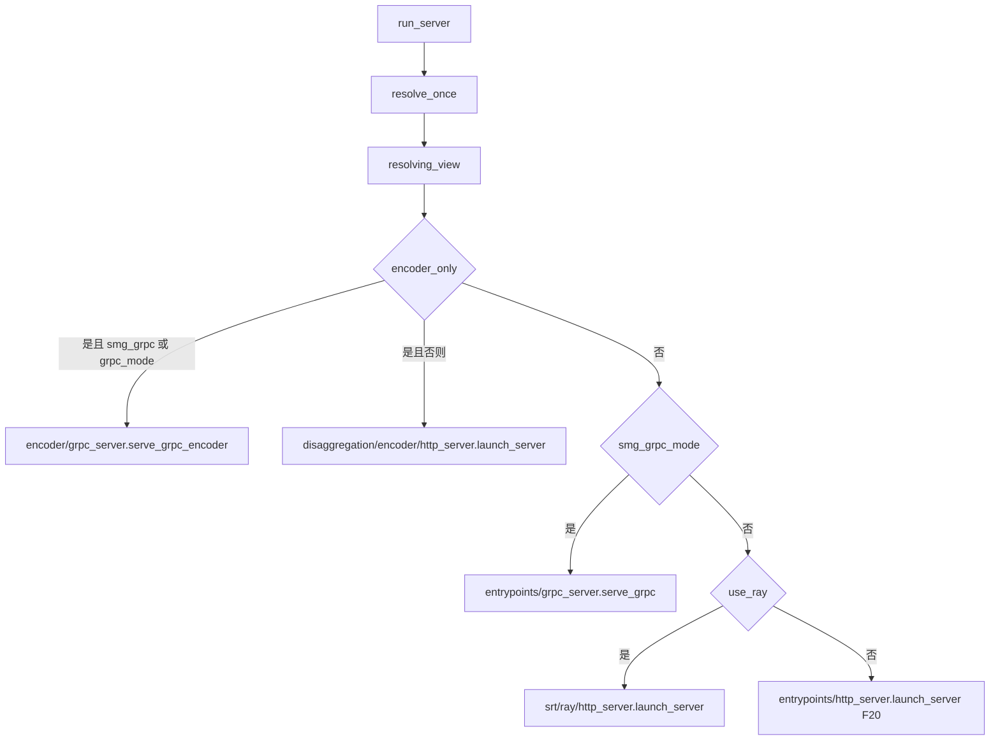
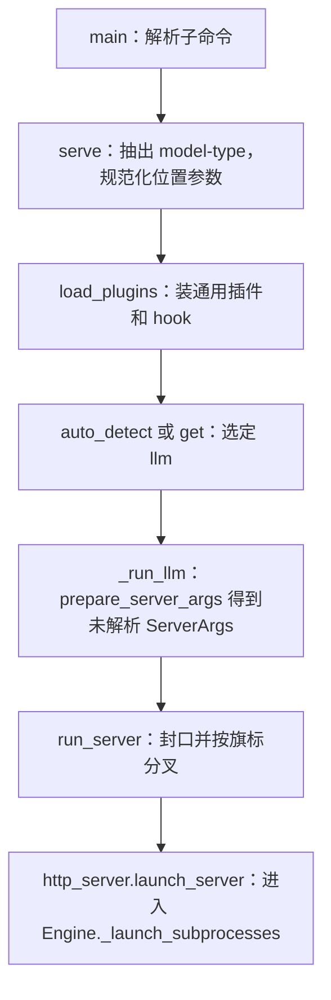

# CLI 与进程分叉

对应 F15–F24，以及粗阶段 F01。本页停在「选中哪条启动函数」。进入 LLM 默认 HTTP 之后的解析和子进程在后续页。**源码路径推断，未实测**。

## 在框架中的位置

扩散和 LLM 在 registry 处分手。LLM 内部再按封口后的旗标分到 encoder、SMG gRPC、Ray 或默认 HTTP。

## 场景

| 怎么启动 | 前提 | 落到哪 |
| --- | --- | --- |
| `sglang serve <模型路径>` | 第一个参数不以 `-` 开头 | F17 把它改成 `--model-path` |
| `sglang serve --model-path ...` | 默认 `--model-type auto` | 非 llm 的 detector 有 MATCH 才离开 LLM，否则 LLM |
| `--model-type diffusion` | 装了扩散额外依赖，否则 help 路径会提示安装 | `_run_diffusion` |
| `--model-type llm` | 跳过 auto | `_run_llm` |
| `python -m sglang.launch_server` | 兼容入口，会打 UserWarning，推荐 `sglang serve` | 自己的 `load_plugins` + `prepare_server_args` + `run_server`，不经 registry |
| 封口后 `encoder_only` | 编码器分离，不是 PD 的 prefill | F21 |
| `smg_grpc_mode` 或已折进去的 `grpc_mode` | 旧 SMG gRPC。`--grpc-port` 的原生 gRPC 不走这条 | F22 |
| `use_ray` | 需要安装 `sglang[ray]`，否则 ImportError | F23 |
| 以上都不中 | 默认 | F20 HTTP |

## F15 控制台入口

`python/pyproject.toml` 的 script 把命令 `sglang` 指到 `sglang.cli.main:main`。CPU / NPU / XPU 的 pyproject 同样指向这个函数。

`main` 用 `parse_known_args`。子命令 `serve` 的 parser 设了 `add_help=False`，好让后面的 `--help` 留给具体后端。`serve` 时调用 `cli/serve.py` 的 `serve(args, extra_argv)`。同文件还有 `generate` 和 `version`，它们不是本目录的服务器启动。

角色：把控制台切到子命令，自己不解析模型旗标。

## F16 `--model-type`，默认 auto

`serve` 先 `_extract_model_type_override`。没有该旗标时名字是 `auto`。`--model-type` 与 `--model-type=` 两种写法都会从 argv 里拿掉，剩下的才是后端参数。空字符串会 `ValueError`。

合法名字不在这里写死。`ServeBackendRegistry.get` 才校验，因为进程外的 entry point 可以加后端。内置表在 `_create_backend_registry`：`llm` 没有 detector；`diffusion` 的 detector 是 `_detect_diffusion`。

`auto` 时 `registry.auto_detect`：非 llm 的 detector 返回 `MATCH` 就用那个后端，否则回到 llm。显式 `--model-type` 打日志 “skip auto detection”，不再探测。

`_detect_diffusion`：没有 model path 则 `UNKNOWN`；`get_is_diffusion_model` 为真，或 argv 里的 pipeline 类名已在原生扩散注册表里，则 `MATCH`。

## F17 位置参数改成模型路径

`_normalize_positional_model_path`：`extra_argv[0]` 存在且不以 `-` 开头时，改成 `["--model-path", 该参数, *其余]`，并记下 `model_path_is_positional=True`。扩散路径会把这个标记放进 `_sglang_explicit_arg_names`。已经是旗标形式则原样返回。

角色：让 `sglang serve <模型>` 和 `sglang serve --model-path <模型>` 进同一个解析器。

## F18 插件在分发前加载

帮助信息（argv 里有 `-h` / `--help`）在 `load_plugins` 之前打印并返回，不装插件。

真正启动时，`serve` 在 `registered.backend.run` 之前调用 `load_plugins()`。`finally` 里 `kill_process_tree`，父进程退出时清掉子进程。

`load_plugins` 还会出现在：`launch_server.py` 的 `__main__`、`Engine.__init__`、`_launch_subprocesses`、scheduler 子进程、DP controller 子进程。实现是幂等的：加载 `sglang.general_plugins` 的 entry point，再 `HookRegistry.apply_hooks()`。解析流水线里单个 hook 可被插件包一层，顺序本身不能换，见 F31 之后的 `run_hook` 说明。

## F19 兼容入口

`python/sglang/launch_server.py` 的 `__main__`：

1. 打 UserWarning，说明仍支持，推荐 `sglang serve`。
2. `load_plugins()`。
3. `prepare_server_args(sys.argv[1:])`。
4. `run_server(server_args)`。
5. `finally` 里杀掉子进程。

这条路径没有 `--model-type`，也没有扩散 registry。它假定调用者要的是 LLM 的 `run_server`。

## F20–F23 `run_server` 的四条 LLM 分叉

`run_server` 在看旗标之前做两件事。

若 `smg_grpc_mode` 或 `grpc_mode` 且 `tokenizer_path is None`，先把 `tokenizer_path` 设成 `model_path`。注释写明：SMG servicer 读的是原始字段，解析只把默认值放进 stash，不会写回字段，所以必须在 `resolve_once` 封口前种上。

然后 `server_args.resolve_once()`，用 `resolving_view` 读封口后的值。`prepare_server_args` 返回的是原始输入，分叉不能看封口前的默认值（F191）。

| ID | 条件 | 函数 | 角色 |
| --- | --- | --- | --- |
| F21 | `encoder_only` | 再看 `smg_grpc_mode` 或 `grpc_mode`：`serve_grpc_encoder`，否则 encoder 的 `launch_server` | 编码器分离的第三条进程，不是 PD prefill。内部进程未按 LLM Engine 展开 |
| F22 | 非 encoder，且 `smg_grpc_mode` | `asyncio.run(serve_grpc(server_args))` | 旧 SMG gRPC。注释：废弃的 `--grpc-mode` 折进 `smg_grpc_mode`。`--grpc-port` 的原生 Rust gRPC 不在这条分支，它跟默认 HTTP 一起在 FastAPI lifespan 里起 |
| F23 | 再否则 `use_ray` | `sglang.srt.ray.http_server.launch_server` | Ray 后端。缺 Ray 包则 ImportError，提示 `pip install 'sglang[ray]'`。`RayEngine` 覆盖 `_launch_scheduler_processes`，`scheduler_procs` 为 None。actor 与 rank 的逐行对应待核 |
| F20 | else | `sglang.srt.entrypoints.http_server.launch_server` | 默认。主进程 HTTP + TokenizerManager，子进程 Scheduler 与 DetokenizerManager |

F20 之后的进程表在 [04-进程拓扑](04-进程拓扑.md)。

## F24 扩散是另一条启动

`_run_diffusion` 不调用 LLM 的 `prepare_server_args`，也不进入 `run_resolution_pipeline`。

顺序：可选帮助；`multimodal_gen.runtime.platforms.plugins.apply_plugin_hooks`；用 `add_multimodal_gen_serve_args` 解析；`execute_serve_cmd`。扩散自己的 `prepare_server_args` 在 `multimodal_gen/runtime/server_args/server_args.py`。

角色：把图像/视频生成服务从 LLM 服务器的配置封口里拆出去。本目录不写扩散 runtime 的加载顺序。

## 调用栈（默认 LLM HTTP）

| 函数 | 做什么 | 角色 |
| --- | --- | --- |
| `main` | 子命令分发 | 控制台根 |
| `serve` | 后端选择与插件 | S0 |
| `_normalize_positional_model_path` | 位置参数改成 `--model-path` | 兼容两种 CLI |
| `load_plugins` | 幂等加载 entry point | 让 S2 的替换 hook 就位 |
| `prepare_server_args` | argparse → `ServerArgs` | S1，尚未改写 |
| `run_server` | `resolve_once` 后四选一 | 启动拓扑的第一处分叉 |
| `launch_server` | 调 `_launch_subprocesses` | 默认 HTTP 引擎的父进程 |

返回 [本目录](README.md) · 下一页 [声明与封口](02-声明与封口.md)。
