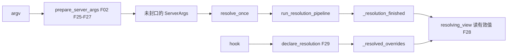
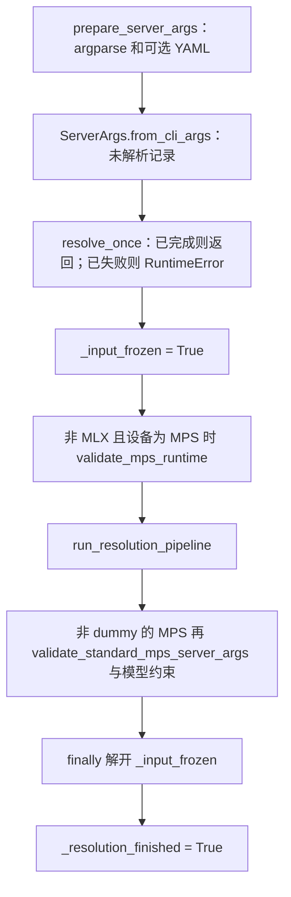

# 声明与封口

对应 F25–F30，以及「为何」F190、F191。本页解释 `ServerArgs` 在 S1 结束时是什么，S2 怎样改它，封口后为什么不能再赋值。hook 的全序在 [03-解析流水线](03-解析流水线.md)。**源码路径推断，未实测**。

## 在框架中的位置

`run_server` 和 `Engine._launch_subprocesses` 都会调 `resolve_once`。第一次跑完流水线，第二次看到 `_resolution_finished` 就返回。

## 场景

| 场景 | 这一层的行为 |
| --- | --- |
| 普通 `sglang serve --model-path ...` | S1 得到原始字段；S2 把 `auto` 和缺省启发式写成带来源的声明 |
| `--config yaml` | `prepare_server_args` 在 argparse 之前把 YAML 并进 argv。仍是 S1，不是 S2 |
| 帮助 `-h` | `_run_llm` 只调 `prepare_server_args(["--help"])`，不 `resolve_once` |
| 已经成功 resolve 的同一对象 | `resolve_once` 直接返回 |
| 上次 resolve 抛错的同一对象 | 再调 `resolve_once` 抛 `RuntimeError`，要求用改过的参数新建记录 |
| 封口后给字段赋值 | `AttributeError`，提示改用 `get_context().override` |
| 解析进行中直接赋值 | `AttributeError`，提示改用 `declare_resolution` |
| `model_path` 为 `none` / `dummy` | 流水线提前 return，但 `resolve_once` 仍会把 `_resolution_finished` 设为真 |

## F25 字段从 dataclass 来

`ServerArgs` 是 msgspec Struct。类文档写明：字段加在 `arg_groups/fields/` 的对应命名空间，用 `A[T, help]` 或 `A[T, Arg(...)]`。`add_cli_args` 先 `add_cli_args_from_dataclass(parser, ServerArgs)`，把这些字段注册成 CLI。`POSITIONAL_FIELD_ORDER` 保持构造函数的位置参数顺序。

角色：一份结构体同时是 CLI 和进程间被 pickle 的配置记录。

## F26 少量旗标手写

`add_cli_args` 在 dataclass 之后手写这些参数（以函数正文为准，不抄附录 05 的全表）：

| 旗标 | 为何手写 |
| --- | --- |
| `--sampling-backend` | choices 在注册时算，环境变量打开时可以多一个 `token_oracle` |
| `--reasoning-parser` | choices 来自 `_reasoning_parser_choices()`，并加上 `auto` |
| `--tool-call-parser` | 同上，`_tool_call_parser_choices()` |
| `--kv-canary-real-data` | choices 来自 `_real_kv_hash_modes()` |
| `--config` | YAML 合并发生在 `prepare_server_args`，不是普通字段 |
| `--disable-cuda-graph` | 字段 `no_cli`，这条废弃旗标是命令行入口，指向 `--cuda-graph-backend-{decode,prefill}=disabled` |
| `--enable-dp-attention` | 字段 `no_cli`。解析把它收成 `attn_dp_size`。注释写 2026-12-31 之后移除 |
| `--monokernel-backend` | 废弃，只接受 `amd`，写到 `enable_amd_monokernel` |
| `--enable-flashinfer-allreduce-fusion` | 废弃，帮助文本指向 `--flashinfer-allreduce-fusion-backend=auto` |

## F27 这一步结束还没改写

`prepare_server_args` 建 parser、可选地合并 `--config`、`parse_args`、`ServerArgs.from_cli_args`。它不调用 `run_resolution_pipeline`。

因此 S1 结束时，`attention_backend` 之类仍可以是 `auto`，`mem_fraction_static` 仍可以是 `None`，平台后端也还没按设备改写。这些发生在 S2。

`__post_init__` 的文档同样写明：构造保持未解析，由 launcher 和 publisher 去调 `resolve_once`。

## F28 当前有效值：`resolving_view`

`arg_groups/overrides.py` 的 `resolving_view` 返回只读的 `ResolvingConfig`。读字段时，`_resolved_overrides` 里后写的覆盖先写的，没有声明则读记录上的原始字段。

角色：hook 和 `run_server` 的分叉都读这份视图，避免把「用户输入」和「后写的决定」混在一个属性里。

已发布的运行时上下文是另一层。封口后的进程内改动走 `get_context().override`，不走 `ServerArgs` 赋值。

## F29 合法改写：`declare_resolution`

`declare_resolution` 把 `(source, fields)` 追加到 `_resolved_overrides`。未知字段名会 `AttributeError`。记录已经 publish 之后再 declare，会 `ValueError`。

`run_post_process_pass` 是常用外壳：函数拿到视图，返回 dict；非空则以其 `__qualname__` 为来源调用 `declare_resolution`，并做声明校验。流水线里的 `_sampling_backend_default`、`_page_size_default`、`_pipeline_parallel_overlap_disable`、`resolve_boundary_reduction` 都走它。各 hook 内部还有更多 pass。

流水线开头还会做两件和声明有关的事（F31）：

- 把当时每个字段抄进 `_raw_input`，作为「调用者要的输入」。
- 把已经存在的 `_resolved_overrides` 复制一份，保留 Engine 启动前 launcher 写下的声明。

## F30 封口后赋值会失败

两道闸都在 `ServerArgs.__setattr__`，异常类型是 `AttributeError`（清单 F30 的待核项，以正文为准）。

1. `_input_frozen` 为真（`resolve_once` 在跑流水线期间）：拒绝写配置字段。提示用 `declare_resolution`，这样决定带有来源，原始输入保持不动。
2. `_resolution_finished` 为真：拒绝再写。提示 `server_args` 只读，改动用 `get_context().override`，某个 runner 私有的值用构造参数传递。

下划线开头、且不在配置字段名单里的记账属性可以写。`_resolution_finished`、`_input_frozen`、`_raw_input` 属于这类。

封口时刻有两处：

- 完整流水线的最后一行把 `_resolution_finished = True`（F90）。
- `resolve_once` 在 `try/finally` 之后再次设为真。dummy / `none` 从流水线中途 `return`，碰不到流水线末行，但仍会被 `resolve_once` 标成已完成。注释写明这一点。

`finally` 里会把 `_input_frozen` 放回假。失败路径先设 `_resolution_failed = True` 再抛出。

pickle 走 `__reduce__`：先恢复字段，再恢复记账，使写封条在重建时最后武装。

## F190 为何 `resolve_once` 只能成功一次

`resolve_once` 的文档字符串写了原因：handler 对自己的输出不幂等。失败的解析不能在同一条记录上重试，因为已经跑过的 handler 把声明留在记录上，第二遍会把半成品当成新输入。

成功路径用 `_resolution_finished` 短路。失败路径用 `_resolution_failed` 抛 `RuntimeError`，并要求用修正后的参数新建记录。

改写必须走 `declare_resolution`，是因为解析期间 `_input_frozen` 把结构体当成操作者的输入。直接赋值会抹掉「用户给了什么」和「哪一步改的」。`_raw_input` 加按来源堆叠的 `_resolved_overrides` 才是投影要读的结果。

这不是「函数被调两次会重复 spawn」。spawn 在更后面。这里封的是配置记录。

## F191 为何 S1 的默认值不能拿来解释运行时

S1 的值是字段默认和 CLI 的并集，流水线还没跑。下面这些都还没发生：

- 平台 hook 把 attention / sampling 后端换成 HPU、CPU、NPU、MPS、XPU 或 HIP 的默认（F61、F73）。
- `handle_gpu_memory_settings` 在 `mem_fraction_static is None` 时按显存估算（F62）。
- `handle_model_specific_adjustments` 进入 `model_overrides/`（F63）。
- `handle_data_parallelism` 在 attention DP 下把 `chunked_prefill_size` 整除 `attn_dp_size`（F202）。
- `_pipeline_parallel_overlap_disable` 在 `pp_size>1` 时强制 `disable_overlap_schedule`（F196）。

`run_server` 的分叉因此显式 `resolve_once` 再用 `resolving_view`。注释写：`prepare_server_args` 返回原始输入，`--grpc-mode` 折进 `smg_grpc_mode` 是解析的决定。

读运行时行为时，先看 `resolving_view` 或发布后的 `get_*()` 袋子，再回头看 CLI 默认。附录 05 的旗标说明是输入面，不是封口后的值。

## 调用栈

| 函数 | 做什么 | 角色 |
| --- | --- | --- |
| `prepare_server_args` | argv → 结构体 | S1 |
| `add_cli_args` | dataclass 旗标 + 手写旗标 | 输入面 |
| `resolve_once` | 只成功一次的解析入口 | 封口 |
| `run_resolution_pipeline` | 按序 hook | S2 本体 |
| `resolving_view` | 原始值加声明的只读投影 | hook 和分叉的读口 |
| `declare_resolution` | 追加带来源的改写 | 唯一合法写口 |
| `__setattr__` | 冻结期间和封口后拒绝字段赋值 | 守门 |

返回 [本目录](README.md) · 下一页 [解析流水线](03-解析流水线.md)。
