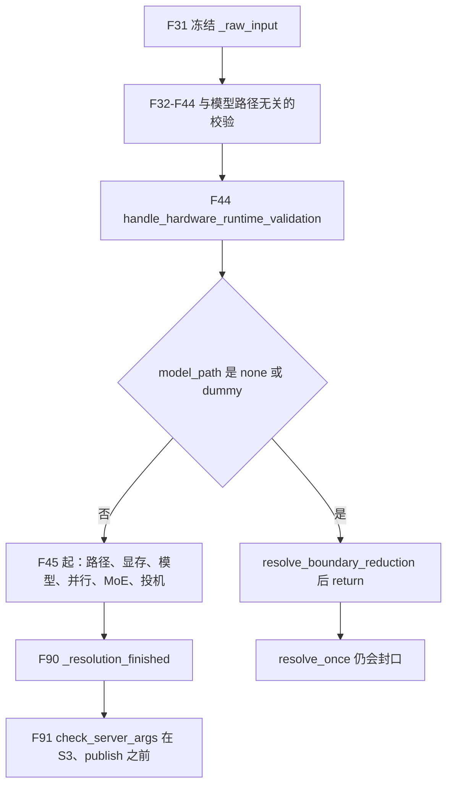
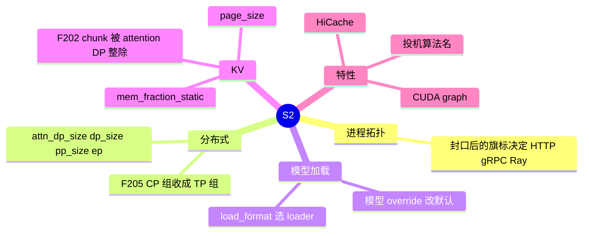
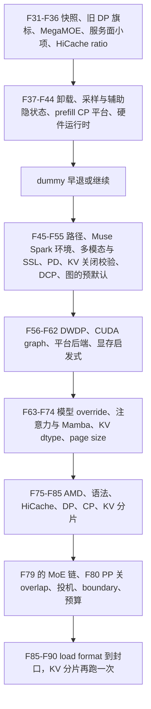

# 解析流水线

对应 F31–F91，以及 F196、F202、F205。文件是 `python/sglang/srt/arg_groups/pipeline.py` 的 `run_resolution_pipeline`。次序以该函数和清单 A.4 为准。归档里的压缩表缺了后来加进流水线的步骤，不要用它核对。

**源码路径推断，未实测**。平台分支写出了代码里的条件；本环境没有在 HPU、NPU、ROCm、多卡上跑过这些 hook。

## 在框架中的位置

S1 交出未改写的 `ServerArgs`。本页把它收成封口记录。封口之后 `run_server` 才选择 HTTP / gRPC / Ray，`Engine` 才 `publish`。模型权重还不在这一页加载。

## 原理

1. 依赖顺序是硬的。注释把必须早于某读者的步骤钉在调用点上，例如 `handle_aux_hidden_state_capture` 必须在任何代码读 `speculative_algorithm` 之前，`handle_pd_disaggregation` 必须在 CUDA graph 之前，`handle_dwdp` 必须在 CUDA graph 和 data parallel 之前，Muse Spark 的环境默认必须在显存启发式之前。
2. 插件经 `resolution_hooks.run_hook` 替换**单个**步骤，不能换顺序。`register_resolution_hook` 的名字必须在白名单里。同一名字的 wrapper 按注册顺序嵌套，最后注册的在最外层。第一个 wrapper 若不调用 `previous`，等于换掉内置实现。`handle_kv_cache_sharding` 在流水线里出现两次，同一组 wrapper 两次都会包上。
3. 两个步骤不经 `run_hook`：`apply_muse_spark_env_defaults`、`finalize_cuda_graph_prefill_max_context`。
4. 改写进 `_resolved_overrides`，不改 `_raw_input`。读者用 `resolving_view`。
5. dummy 早退放在硬件运行时校验之后，避免先下载模型或跑显存启发式。早退只再跑 `resolve_boundary_reduction`。

## 调用栈（阶段，不是 90 个格子挤在一张图里）

下面每个 ID 写：场景、角色、这一步实际做的事。未展开的模型 override 字段标在 F63。

## F31 快照

场景：每次进入流水线，包括 dummy。

角色：把「用户输入」和「已有声明」固定下来，供后面的投影读取。

实现：遍历 `record_fields` 抄进 `_raw_input`；把已有 `_resolved_overrides` 复制成新 list；`cfg = resolving_view(server_args)`。dummy 判断用的是这一份 `cfg`，不是中途改过的视图。

## F32 `handle_deprecated_dp_attention`

场景：命令行仍带废弃的 `--enable-dp-attention`。没有该旗标则空操作。

角色：在任何读者看 DP 布局之前，把旧写法收成新字段。

实现：`enable_dp_attention` 且 `attn_dp_size == 1` 时，声明 `attn_dp_size = 原 dp_size`、`dp_size = 1`。然后总是把 `enable_dp_attention` 声明为假。旧语义是「在 `--dp-size N` 上打开 attention DP」；新语义把这份宽度放在 `attn_dp_size`，副本数回到 1。

## F33 `handle_mega_moe`

场景：`moe_a2a_backend == "megamoe"`。其他后端在兼容检查里返回。

角色：别名整理，并拒绝 MegaMOE 不能跑的组合。

实现：调用 `handle_moe_runner_backend_alias` 和 `check_mega_moe_compat`。MegaMOE 加上 TBO/SBO，或平台不是 CUDA SM90/SM100、也不是 HIP，会 `ValueError`。ROCm 路径的报错指向环境变量 `SGLANG_AMD_USE_FLYDSL_MEGA_MOE=1`。

## F34 `handle_return_hidden_states_mode`

场景：要回传隐状态的服务。

角色：把旧旗标收成 `return_hidden_states_mode`。

实现：模式不是 `None` / `last` / `full` 则报错。旧旗标可以写成 `"full"`，或打开 `enable_return_hidden_states`。

## F35 `handle_media_url_security`

场景：服务会拉取媒体 URL。

角色：把允许的域名收成 `allowed_media_domains`。

实现：结果来自 `configure_media_url_security`。

## F36 `handle_watermark_config`

场景：`watermark_config is None` 则返回。

角色：把嵌套水印配置摊成 `watermark_*` 字段。

## F37 `handle_hicache_ratio_default`

场景：分层缓存的 host 比例还没填。decode 模式不在这里设 ratio，留给后面的 KV builder。

角色：给非 decode 一个比例默认，并避免比例和 fraction 同时生效。

实现：非 decode 且 `hicache_ratio is None` 时，`buffer_only` 用 `1.2`，否则 `2.0`。用户已经给了 ratio 或 size，则把 `hicache_host_memory_fraction` 清成 `None`。fraction 不在 `(0, 1]` 则报错。

## F38 `handle_offload_compatibility`（第一次）

场景：PLE embedding 与 CPU/group offload 的组合。流水线后部、模型 override 之后还会再跑一次（见 F65 后面）。

角色：在默认值被模型改写之前先挡住明显不合法的卸载组合。

实现：PLE embedding 加上 CPU 或 group offload 会报错；`ple_offload_backend=file` 且没有 embedding offload 也会报错。

## F39 `validate_prefill_decode_interval`

负的 interval 或 min batch size → `ValueError`。

## F40 `validate_response_store`

response store 与 PD 分离同时打开 → `ValueError`。

## F41 `validate_sampling_mask_max_tokens`

废弃的环境变量，或 `sampling_mask_max_tokens <= 0` → `ValueError`。

## F42 `handle_aux_hidden_state_capture`

场景：要用辅助隐状态捕获。注释要求本步早于任何 `speculative_algorithm` 的读者。

角色：打开捕获时清掉投机算法名，避免两套隐状态路径叠在一起。

实现：旗标关闭但给了 layer id → `ValueError`。打开时声明 `speculative_algorithm=None`，并把方法名转成小写。算法必须是 EAGLE3、DFLASH 或 DSPARK；要有 draft path；`pp_size` 必须是 1。其余组合在函数体内继续拒绝。

## F43 `validate_prefill_cp_platform`

场景：`enable_prefill_cp` 且平台是 MUSA。

角色：在下载模型之前拒绝已经废弃的 MUSA prefill CP。

## F44 `handle_hardware_runtime_validation`

场景：所有路径，包括 dummy。这是平台分叉的第一道门。

角色：拒绝显式打开、但当前机器跑不了的硬件运行时。函数本身不读 `server_args` 的模型字段。

实现：`use_mlx()` 时要求 MLX 环境可用，与 `--device` 是否写成 mlx 无关。`resolve_once` 在调用流水线之前还有一道：非 MLX 且设备是 MPS（显式或平台探测）时 `validate_mps_runtime()`。

## dummy / `none` 早退

条件：`cfg.model_path.lower()` 属于 `none` 或 `dummy`。大小写在 `lower()` 之后比较。

动作：`run_post_process_pass(server_args, resolve_boundary_reduction)` 然后 `return`。后面的路径解析、显存启发式、模型 override、MoE、加载格式全部不跑。

`resolve_boundary_reduction` 在正常路径的投机步骤之后还会再跑一次（F82）。dummy 上若模式是 auto，目标与草稿的 boundary reduction 写成 `"rs+rsv"`。非 auto 则目标与草稿取同一个已选值。

`resolve_once` 仍会把记录标成解析完成。

## F45 `handle_model_source_paths`

场景：真实模型路径。dummy 到不了这里。

角色：把 Hub、GGUF、对象存储 URI 收成本地路径。

实现：GGUF Hub 解析；Run:AI URI 走 `ObjectStorageModel.download_and_get_path`。

## F46 `apply_muse_spark_env_defaults`

场景：架构是 Muse Spark，且不是 INSTANCE connector。直接调用，不经 `run_hook`。注释要求它早于 `handle_gpu_memory_settings`，因为显存启发式会读 post-capture KV 开关。

角色：给 Muse Spark 写入 CUDA graph 去重、pool、post-capture KV 等环境默认。`modelopt_fp4` 时把 `SGLANG_FLASHINFER_NVFP4_PER_TOKEN_ACTIVATION` 设为真。

## F47 `handle_multimodal`

场景：带多模态配置的服务。

角色：校验 mm 配置的类型，避免后面的处理器拿到错的对象。

## F48 `handle_ssl_validation`

场景：要开 TLS 或 HTTP/2。

角色：证书必须成对且文件存在；HTTP/2、granian、reuseport 的组合在这里约束。

## F49 `handle_asr_validation`

场景：语音服务。buffer 和 session 数必须为正。

## F50 `handle_deprecated_args`

场景：仍使用旧旗标名的命令行。

角色：把别名收成现行字段。原生 gRPC 与 sidecar / Ray 的互斥也在这里。

## F51 `handle_prefill_delayer_env_compat`

场景：旧环境变量还在设置 prefill delayer。

角色：把环境变量映到对应字段，避免只认 CLI 的读者漏掉。

## F52 `handle_missing_default_values`

场景：若干服务字段仍是 `None`。

角色：补 tokenizer 路径、served name、device、seed、mm 配置；处理 ModelScope；给 draft 量化一个默认；`quantization=unquant` 收成 `None`。

这一步之后，缺省才像「有一个具体字符串」。再之前的 `None` 是「还没人声明」。

## F53 `handle_expert_pack`

场景：`load_format == "expert_pack"`。其他格式返回。

角色：专家包加载要求单卡、关掉 CUDA graph 和 shared-expert fusion。

实现：并行度必须全是 1；CUDA graph 不是 DISABLED 会失败。声明 `disable_cuda_graph=True`、`disable_shared_experts_fusion=True`。DeepSeek V4 还会关 `SGLANG_OPT_FP8_WO_A_GEMM`。错误可以聚合成一条 `ValueError`。

## F54 `handle_pd_disaggregation`

场景：`disaggregation_mode` 不是普通合部，或开了角色切换、host receive 等 PD 旗标。注释要求早于 CUDA graph。

角色：把 PD 的传输和缓存默认定下来，并拒绝与角色切换冲突的特性。

实现要点：`mooncake_tcp` 收成 mooncake 并设 `MC_FORCE_TCP`；decode 默认关 radix，或走实验开关；`prefill_complete` 做校验；host receive 打开 retraction backup；角色切换有特性黑名单。传输后端的可选值在清单 F181：`mooncake`、`nixl`、`ascend`、`fake`、`mori`、`mooncake_tcp`。事件循环本身归调度篇。

## F55 `validate_prefill_only_disable_kv_cache_args`

场景：只在 prefill 关掉 KV 的旗标。关闭则返回。

角色：这种模式只服务 embedding，并且不能再开一组会用 KV 的特性。

实现：必须 `--is-embedding`；检查 KV dtype；`chunked_prefill_size` 必须是 `-1`；radix 要关；不能开 prefill CP，`attn_cp` 不能大于 1。

## F56 `handle_decode_context_parallelism`

场景：`dcp_size` 或 DCP 通信后端被设置。

角色：给 DCP 选通信后端，并拒绝与 prefill CP、非 CUDA 的 FlashInfer A2A 冲突的组合。

实现：先 `run_post_process_pass(_dcp_comm_backend_default)`。`dcp_size < 1`，或 `dcp_size > 1` 再加 prefill CP，会报错。要 `a2a` / `fi_a2a` 但 `dcp_size <= 1` 也会报错。`fi_a2a` 不是 CUDA 则拒绝。`replicate_q_proj` 另有约束。字段帮助写明：未设置时，支持的地方用 `fi_a2a`，CUDA/ROCm/XPU 否则 `a2a`，再否则 `ag_rs`。

## F57 `apply_inkling_prefill_cuda_graph_default`

场景：Inkling，且 prefill 图后端还没被锁住。

角色：把 prefill CUDA graph 后端默认成 `FULL`。

## F58 `apply_muse_glimmer_prefill_cuda_graph_max_bs_default`

场景：Muse Glimmer，且 prefill `max_bs` 还没设。

角色：把该默认设为 `512`。

## F59 `handle_dwdp`

场景：`dwdp_size <= 1` 则返回。注释要求本步早于 CUDA graph 和 data parallel。

角色：DWDP 用权重预取代替 token all-to-all，因此要改掉一组会冲突的并行和图设置。

实现：声明 attention DP 宽度等于 `dwdp_size`、`dp_size = 1`、`ep_size = dwdp_size`、`moe_a2a_backend = none`、关掉 CUDA graph，并设 `SGLANG_SCHEDULER_SKIP_ALL_GATHER=True`。对 PD、EPLB、投机、PP、TBO 有断言。字段帮助还要求 `dwdp_size` 等于 `tp_size`，且分离模式只能是 null 或 prefill。

## F60 `handle_cuda_graph_config`

场景：任何还要捕获 CUDA graph 的服务。expert pack、DWDP、某些模型会在更早或更晚把它关掉。

角色：把图配置解析成 decode / prefill 两相，并对齐 DeepEP bucket 和 PD 角色。

实现：`parse_cuda_graph_config`，兼容性检查，DeepEP bucket 对齐，PD 角色，再校验允许的后端。废弃的 `--disable-cuda-graph` 已在 F26 收成两相的 `disabled`。

## F61 平台后端

场景：按当前平台改 attention、sampling 和默认旗标。这是清单点名的平台分叉。

| 次序 | 函数 | 做什么 |
| --- | --- | --- |
| 30 | `handle_hpu_backends` | attention 用 `torch_native`，sampling 用 `pytorch` |
| 31 | `handle_cpu_backends` | 默认 AMX 或 `torch_native`，sampling 用 `pytorch` |
| 32 | `handle_npu_backends` | `set_default_server_args` |
| 33 | `handle_mps_backends` | 非 MLX 的 MPS 声明 `disable_overlap_schedule=True` |
| 34 | `handle_xpu_backends` | sampling 用 `intel_xpu`；除非图已被锁成 full 或 disabled，默认关 decode graph |
| 35 | `handle_symm_mem_device_support` | 不是 CUDA 也不是 HIP 则 `enable_symm_mem=False` |
| 36 | `handle_platform_defaults` | `record_foreign_defaults(platform.apply_server_args_defaults)`，把平台对象自己的默认记进来 |

角色：同一套 CLI 在不同设备上落到不同内核。后面的模型 override 仍可能再改。

## F62 `handle_gpu_memory_settings`

场景：`chunked_prefill_size`、decode 图的 `max_bs`、`mem_fraction_static` 有任一仍空。`gpu_mem is None` 时用后备：chunk 4096，decode `max_bs` 160，静态比例 0.95。

角色：用显存容量当算力的代理，先定 chunk 和 decode batch，再反推静态比例，给后面的 KV 预算留激活和 graph 的空档。

显存档（函数注释里的例子，单位是 `get_device_memory_capacity` 的返回，与 `20 * 1024` 比较）：

| 容量 | 注释中的卡 | chunked_prefill_size | decode max_bs |
| --- | --- | --- | --- |
| `< 20 * 1024` | T4、4080 | 2048 | 8 |
| `< 35 * 1024` | A10、4090、5090 | 4096 | `tp_size < 4` 则 48，否则 160 |
| `< 60 * 1024` | A100 40GB、L40 | 4096 | `tp_size < 4` 则 32，否则 160 |
| `< 90 * 1024` | H100、A100 | 8192 | `tp_size < 4` 则 256，否则 512 |
| `< 160 * 1024` | H20、H200 | 8192 | 同上 |
| 其余 | B200、MI300 | 16384 | 512 |

只在对应字段仍是 `None` 时声明。用户已经给过的值保留。

`mem_fraction_static` 的定义写在函数文档里：`(权重 + KV 池) / 显存`，也就是 `(显存 - 激活 - CUDA graph 缓冲) / 显存`。函数体在 `mem_fraction_static is None` 时计算，单位与 `gpu_mem` 一致：

- 计划做 post-capture KV 时，不再预留 graph 和激活，只留地板 `1536` 加上 `tp_size * pp_size / 8 * 1024`。
- 否则 `reserved_mem` 从 512 起，加上 `activation_tokens * 1.5`、同一项 TP/PP 余量、`reserve_for_graph_mb`、DeepEP A2A 余量。decode 分离的 `activation_tokens` 用 `max_running_requests`（或 decode max_bs）乘草稿 token 数，再与 2048 取大。`gpu_mem > 60 * 1024` 时 `reserved_mem` 至少 `10 * 1024`。XPU 再加 `2 * 1024`。
- `mem_fraction_static = round((gpu_mem - reserved_mem) / gpu_mem, 3)`。多模态且不是 language-only、不是 decode 分离时，再 `adjust_mem_fraction_for_vlm`。

文档字符串里的 `chunked_prefill_size * 1.5 + max_bs * 2` 是设计说明。函数体是上面的分支。prefill 图的 `max_bs`：非 MLA 用 chunk 大小，MLA 用 `min(8192, chunk)`。路径里含 `llama-2` 时再把 prefill `max_bs` 压到 4096。

F202 会在更后面把 chunk 整除 `attn_dp_size`，并可能把这里写好的 prefill `max_bs` 再夹一遍。

## F63 `handle_model_specific_adjustments`

场景：真实 checkpoint。`ConnectorType.INSTANCE` 跳过 Hugging Face override。

角色：按架构把通用默认改成该模型能跑的组合。这是 S1 默认值不能当运行时解释的主要原因之一（F191）。

实现：`collect_model_override_declarations` 收集 `MODEL_OVERRIDES`、`model_overrides/` 包里的模块，以及 `overrides.py` 里注册的谓词（例如 Muse Spark、Step3p）。包内模块包括 bailing、deepseek v2/v4、gemma、glm、gpt-oss、kimi、qwen、inkling、muse glimmer 等。本页不逐模块抄字段，那些默认值归模型目录。

函数里还有命令式调用：Kimi K3、Glm5Next、DeepSeek V4。DSA 架构会改环境和 CP、CUDA graph。InternS2 Mobius、NPU DCP 有额外校验。

DeepSeek V4.1 的拒绝不在流水线顶层的函数名里。`validate_deepseek_v41_features`（`deepseek_v4_hook.py`）在 `model_type == "deepseek_v41"` 时拒绝：非 DSPARK 的投机、HiSparse、unified KV 的 triton 路径、two-batch overlap、`pp_size > 1`。非 v41 却开了 encoder replay 也会 `ValueError`。v41 上还有 HIP prefill graph、CP、ROCm DP attention、PD decode 等组合限制。DSpark 的 PD 需要 static verify、mooncake 或 nixl，且 DCP 为 1。这条拒绝的「为何」是 F197，归模型篇，这里只记下它发生在 F63。

## F64 `default_unset_prefill_decode_interval`

已经设过 interval 则返回。否则声明 `prefill_decode_interval = 0`。注释提到 Qwen3-VL 在 Hopper 上的例外写在别的 override 里；本步的默认就是 0。那个 22 的具体赋值未在本页打开对应模块核对，标待核。

## F65 再次 `handle_offload_compatibility`

模型 override 可能改了 PLE 默认，所以卸载兼容再查一次。规则与 F38 相同。

## F66 `_sampling_backend_default`

`sampling_backend is None` 时：平台 `has_flashinfer` 则 `flashinfer`，否则 `pytorch`。走 `run_post_process_pass`，不是 `run_hook`。内置采样后端名单在清单 F165，归回包篇。

## F67 `handle_deterministic_inference`

场景：RL 或 on-policy 需要确定推理。

角色：打开确定性路径，并收紧会破坏它的集合通信。

实现：可把 deterministic 打开。ROCm 上 `tp_size > 2` 且关掉 custom all-reduce → `ValueError`。CUDA 上 `tp_size > 1` 会走 NCCL tree 及相关环境。随后的 post-pass 选择 attention 后端。

## F68 `handle_nvfp4_prefill_kv_dequant_dtype`

只在 `kv_cache_dtype=nvfp4` 时做事。`auto` 在 SM100 上走 native，否则 prefill 反量化用 fp8，并写下 prefill / decode 后端。

## F69 `handle_attention_backend_compatibility`

场景：attention 后端仍是 auto，或与图、长上下文、XPU DCP 冲突。

角色：把后端从 auto 收成具体实现，并在 torch native / flex 时关图。

实现：一串 post-pass。aiter 长上下文会缩小内存占用。XPU 的 DCP 另有检查。哪些架构强制 DSA，清单 B12 标了待核，本页不补架构全表。

## F70 `disable_prefill_cuda_graph_for_deepseek_trtllm_mla`

场景：DeepseekV3，prefill 后端是 `trtllm_mla`，且 prefill 图没被锁住。

角色：关掉 prefill CUDA graph。清单写明 DeepEP normal、DWDP 和若干模型 override 也会关 prefill 图，那些条件在各自的 hook 里。

## F71 Mamba 与线性注意力

| 函数 | 角色 |
| --- | --- |
| `handle_mamba_backend` | 选定 Mamba 后端 |
| `handle_int8_mamba_checkpoint` | int8 Mamba checkpoint 与 HiCache、自定义 radix、LMCache 不兼容时拒绝 |
| `handle_linear_attn_backend` | 例如 SM100 bf16 默认 FlashInfer GDN。文件后半还有其他 dtype 和平台分支 |

## F72 KV 小数与 page size

| 函数 | 角色 |
| --- | --- |
| `handle_kv4_compatibility` | KV4 与平台、后端、投机、PD 的组合断言 |
| `handle_mxfp8_kv_cache_compatibility` | MXFP8 KV 的同类约束 |
| `_page_size_default` | 已经设了 `page_size` 则空 dict。HIP 且 `SGLANG_AITER_KV_CACHE_LAYOUT=vectorized_5d` → 64。MUSA → 64。其余 → 1 |

page size 会进入 KV 池和 F85 的分片对齐。

## F73 AMD、NCCL 预热、语法后端

| 函数 | 场景 | 行为 |
| --- | --- | --- |
| `handle_amd_specifics` | HIP | `triton_attention_num_kv_splits = 16`，并给传输设一个钉住的下限环境 |
| `handle_nccl_pre_warm` | 不是 CUDA、HIP、NPU | `pre_warm_nccl = False`。真正的预热发生在分布式 init，且还要看 TP/PP/EP 宽度 |
| `handle_grammar_backend` | `grammar_backend is None` | 声明 `xgrammar` |

## F74 评分与「prefill 不要 KV」

`handle_multi_item_scoring`：MIS 关掉 decode/prefill 图和 radix，`chunked_prefill_size = -1`，并断言两端都是 flashinfer。

`handle_prefill_only_disable_kv_cache`：在 F55 的参数校验之后，对 embedding 且 prefill 后端是 fa3/fa4 的路径做实际关闭。

## F75 `handle_hicache`

场景：`enable_hierarchical_cache`（帮助里的别名是 `--enable-hicache`）。

角色：把 host/L3 缓存和存储后端的组合收成可启动的配置。HiCache 是树的 host 层，不是第三种前缀树。与 unified external linker 的互斥在这个 hook 里。存储后端名单在清单 B27，本页不抄旗标。

## F76 数据并行、负载、上下文并行

### `handle_data_parallelism`（F202 在这里）

场景：任何带 `dp_size` 或 `attn_dp_size` 的启动。`attn_dp_size < 1` 直接 `ValueError`。`attn_dp_size > 1` 且 `dp_size > 1` 也 `ValueError`，副本和 attention DP 不能叠。

角色：区分两种 DP。`dp_size` 是整模副本数。`attn_dp_size` 是 TP 组内部的 attention 组数，FFN 仍张量并行。调度器个数的派生字段是 `num_dp_ranks = dp_size * attn_dp_size`，见分布式 init 页的 F192。

实现：

- `run_post_process_pass(_data_parallelism_defaults)`：单个副本且不是 elastic scale 时 `enable_dp_lm_head=False`。
- `attn_dp_enabled_of` 为真时：`schedule_conservativeness` 乘 0.3；Rust server 则打开 `enable_dp_attention_local_control_broadcast`。
- **F202**：`chunked_prefill_size = chunked_prefill_size // attn_dp_size`，并打警告日志，写明调整前后的数。要求 `tp_size % attn_dp_size == 0`。注释说明：F62 里的 prefill 图 `max_bs` 来自整除前的 chunk；这里再夹到整除后的 per-DP-rank chunk，使可分段 CUDA graph 不超过 MoE all-to-all 的 `max_num_tokens`，那份预算也按整除后的 chunk 计算。
- 若 prefill 图未禁用、`max_bs` 大于新的 chunk、且 `max_bs` 没被锁住，则把 `max_bs` 夹到新 chunk；`bs` 列表未锁住时用 `generate_prefill_cuda_graph_batch_sizes` 重算。
- 随后 `_tp_lm_head_all_to_all_default`、`_dp_lm_head_validation`。多 rank 的图可能捕获集合通信，于是 `setdefault` `NCCL_GRAPH_REGISTER=0`。

`mm_enable_dp_encoder` 在 `tp_size == 1` 时只警告没有可分的编码器工作；`tp_size > 1` 时打日志说明视觉编码器被复制、图像工作按 rank 分。

### `handle_load_balance_method`

`auto`：PD prefill 用 `follow_bootstrap_room`，否则 `round_robin`。其余可选值是 `total_requests`、`total_tokens`，在请求路由时用，不在本页展开。

### `handle_context_parallelism` 与 F205

场景：prefill CP 或 `attn_cp_size > 1`。函数里会再嵌套一次 `run_hook(validate_prefill_cp_platform)`。

角色：检查 CP 策略、HIP、以及 TP 能否被 `attn_dp * attn_cp` 整除，然后调用 `init_cp_strategy`。

**F205** `resolve_cp_tp_group_sharing`（`cp_tp_group_sharing_hook.py`）：

- 直接返回的条件：没开 prefill CP，或 `attn_cp_size <= 1`，或 `architectures[0]` 不在白名单。
- 白名单只有 `Glm5NextForConditionalGeneration`（策略必须是 `interleave`）和 `Qwen4ExpForConditionalGeneration`（策略必须是 `zigzag`）。
- 要求 `attn_cp_size == tp_size`，否则 `ValueError`。注释说明：CP 组就是 TP 组；残差、attention、indexer 按 CP 切；MoE 和线性注意力保持 TP 划分。
- 通过后声明 `enable_cp_tp_group_sharing=True`。该字段在 `fields/parallel.py`，`no_cli`。
- Qwen4Exp 额外把 prefill CUDA graph 设为 `DISABLED`，因为序列集合通信的尺寸仍依赖 batch。
- 投机：只有 GLM-5 Next 允许，且仅 DFLASH，或原生 MTP（EAGLE/NEXTN、草稿路径是空或与目标相同、topk 是空或 1）。这个 hook 跑在投机默认和 NEXTN 别名解析之前。
- 两组架构各自还有黑名单（DCP、mixed chunk、moe dp、以及 Qwen 的 EP / waterfill / PP / decode 分离，GLM 的 PD 组合）。线性注意力的头数必须能被 `tp_size` 整除。

## F77 `apply_prefill_cp_cuda_graph_default`

仅当 `enable_prefill_cp` 时流水线才调用。支持的话把 prefill 图设成 `BREAKABLE`。F205 对 Qwen4Exp 的 DISABLED 声明若已经锁住，以锁为准。

## F78 `handle_kv_cache_sharding`（第一次）

场景：PD prefill 的 KV 分片。大量特性与它互斥。

角色：把 chunk 对齐到 page。`rounded = (chunk_size + page_size - 1) // page_size * page_size`。也可能改 `mem_fraction_static`。

流水线末尾还会再跑一次（F89），因为更晚的能力调整可能改 attention 后端或关掉 chunked prefill。注释写明第二次是幂等的门。

## F79 MoE 与专家并行

| 函数 | 角色 |
| --- | --- |
| `handle_moe_kernel_config` | 按量化选择 runner 的 post-pass，并断言 runner、量化、EP |
| `handle_a2a_moe` | waterfill、deepep、flashinfer、megamoe、pplx 等。MegaMOE 要求 `attn_dp_size == tp_size` 且 SM100。相关 post-pass 会在命中 `_A2A_EP_SPANNING_BACKENDS` 时把 `ep_size` 改成 `tp_size`。这是 F201，归专家并行篇，不在这里展开成员集合 |
| `handle_shared_experts_tp` | 仅 Kimi K3 加特定 a2a；注意力 TP 必须整除 |
| `handle_eplb_and_dispatch` | EPLB 打开记录器。`moe_a2a_backend == none` 时 dispatch 必须是 dynamic |
| `handle_expert_distribution_metrics` | 默认 buffer 1000，或跟 EPLB 迭代次数走 |
| `handle_elastic_ep` | mooncake IB；scale 模式断言 attention DP、以及 nixl 时 `ep_size == tp_size` 等 |
| `validate_experimental_sgl_marlin` | LoRA 的 marlin 策略 |

## F80 `_pipeline_parallel_overlap_disable`（F196）

场景：`pp_size > 1`。`pp_size == 1` 时返回空 dict。

角色：在进入调度循环之前关掉 overlap schedule。

实现：`run_post_process_pass`。日志原文是 “Pipeline parallelism is incompatible with overlap schedule.” 声明 `disable_overlap_schedule=True`。

`Scheduler.__init__` 稍后用 `enable_overlap = not disable_overlap_schedule and not use_mlx()`。PP 的事件循环是 `event_loop_pp`：各 stage 按序被上一 stage 通知，async send、sync recv，并用 async batch depth 缓冲最后一级的输出，以便重叠 GPU 计算和 CPU 处理。这是 PP 自己的微批重叠，和被关掉的 overlap schedule 不是同一个开关。函数没有写更细的互斥证明；「不兼容」以这条日志和声明为准。调度循环的正文归调度篇。

## F81 `handle_speculative_decoding`

场景：`--speculative-algorithm` 非空。算法名来自 `SpeculativeAlgorithm.from_string`，启动时会转成大写。

角色：把算法收成具体 worker 能接受的参数。worker 本身在 S5 才建。

实现：Gemma4 的草稿收成 `FROZEN_KV_MTP`。先 `_speculative_moe_runner_default`，让草稿的 MoE runner 对齐目标；flashinfer megamoe 的草稿默认改走 flashinfer trtllm，因为草稿层通常未量化。然后 `SpeculativeAlgorithm.handle_server_args` 分到 `_handle_dspark`、`_handle_dflash`、`_handle_eagle_family`、`_handle_ngram`、`_handle_frozen_kv_mtp`、`_handle_uno` 或自定义注册。

`_handle_dspark` 摘要：CUDA、NPU 或 XPU；attention DP 时要 `dp_lm_head`；默认草稿路径可以是捆绑目录或子目录；`speculative_num_steps = 1`，`topk = 1`；若给了 gamma，则 `speculative_num_draft_tokens = gamma + 1`；默认 `max_running_requests = 48`。V4.1 只放行 DSPARK，那条拒绝在 F63。

NEXTN 这个**算法名**会折成 EAGLE，不是独立 worker。它和模型文件里的 `*NextN` 类不是一回事；类名改写是 F206。

## F82 `resolve_boundary_reduction`

投机参数定稿之后再跑。非 auto 时目标与草稿用同一个值。auto 且 dummy 的行为见早退一节；正常模型上的具体非 auto 值以函数返回的 dict 为准。

## F83 `handle_layernorm_sp`

场景：Muse Spark 的 MegaMOE 路径。校验 token 预算，以及 breakable prefill。

## F84 两份 token 预算

都在投机定稿之后，这样草稿 token 数已经可见。

- `validate_flashinfer_a2a_token_budget`
- `validate_mega_moe_token_budget_for_model`：decode 侧每个 rank 的 token 用 `mega_moe_decode_tokens_per_rank`，其中包含 `decode_max_bs * (speculative_num_draft_tokens or 1)` 这一类乘积。

## F85 加载、编码器分离、环境与缓存布局

| 函数 | 角色 |
| --- | --- |
| `handle_load_format` | 把 `load_format` 收成 loader 能识别的值。类的选择在 `model_loader/loader.py` 的 `get_model_loader`，映射表写在模型加载页 |
| `handle_encoder_disaggregation` | 编码器分离的旗标。进程分叉在 F21 |
| `handle_tokenizer_batching` | tokenizer 批大小 |
| `handle_environment_variables` | 把剩余开关写进环境 |
| `handle_cache_compatibility` | 前缀缓存与其他特性的互斥 |
| `handle_page_major_kv_layout` | 页主序 KV。unified pool 会暗示打开它 |
| `handle_unified_memory_pool` | 统一内存池。PD 传输后端函数 `_unified_memory_pd_transfer_backends` 目前返回的集合是 `mooncake` |

## F86 扩散语言模型、崩溃、调试、能力

| 函数 | 角色 |
| --- | --- |
| `handle_dllm_inference` | dLLM。HIP 上关图。post-pass 含 `_dllm_page_size` 等 |
| `handle_crash_dump_env` | 崩溃转储环境。注释要求在 CUDA init 之前 |
| `handle_debug_utils` | 调试开关 |
| `handle_other_validations` | 其余散校验 |
| `handle_model_capability_adjustments` | 后端选定之后的能力约束。例如 HRM-Text、EmbeddingGemma 会强制 triton、关 radix、关 chunk、关图 |

## F87 NVIDIA megakernel 与 AMD monokernel

场景：`--enable-nvidia-megakernel` 或 `--enable-amd-monokernel`。注释要求放在 CUDA graph、attention 后端和投机都定稿之后。先跑 NVIDIA，这样两个旗标同时打开时一条错误里带上全部原因。

| 函数 | 行为 |
| --- | --- |
| `handle_nvidia_megakernel` | 打开时收集不满足的原因并 `ValueError`。与 AMD monokernel 互斥 |
| `handle_amd_monokernel` | 校验后可能把 decode 图的 `bs` 扩到盖住 monokernel 的宽度 |

## F88 `finalize_cuda_graph_prefill_max_context`

直接调用。把 prefill 图的 `max_context_size` 按页对齐。

## F89 收尾校验

1. 再跑 `handle_kv_cache_sharding`。
2. `validate_deepep_v2_speculative_draft`。
3. `validate_deepep_v2_dispatch_token_budget`：prefill 的 per-rank token 对上环境；decode 图的 token 对上容量。

`handle_flashinfer_a2a_dispatch_type` 和 `validate_deepep_v2_model_architecture` 定义在 `moe_hook.py`，不在 `pipeline.py` 的 `run_hook` 列表里。它们若在别处被调用，本页未逐个调用点核对，标待核。

## F90 封口

完整路径的最后一行：`server_args._resolution_finished = True`。dummy 早退跳过这行，由 `resolve_once` 补上。语义见声明与封口页的 F30、F190。

## F91 `check_server_args` 不在这张表里

`validation_hook.check_server_args` 不由流水线调用。`ServerArgs.check_server_args` 在 `Engine._launch_subprocesses` 里、`publish` 之前调用。注释说明它不是只读：LoRA 检查会通过晚期解析规范化适配器路径，已发布的配置会拒绝这种写，所以必须在 publish 前，也必须在会消耗 `auto` 的 parser 探测前。被拒绝的记录要还能重试。

`resolve_once` 在流水线之后对非 dummy 的 MPS 另调 `validate_standard_mps_server_args` 和 `validate_mps_model_config`，那也不是 `check_server_args`。

本页不逐条展开 `check_server_args` 的断言。多节点禁止 `dp_size > 1` 这一条，清单 B18 记在该函数里；展开分布式副本时再对正文。

返回 [本目录](README.md) · 下一页 [进程拓扑](04-进程拓扑.md)。
