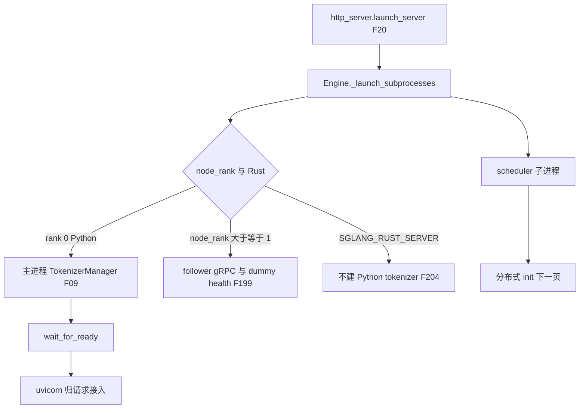
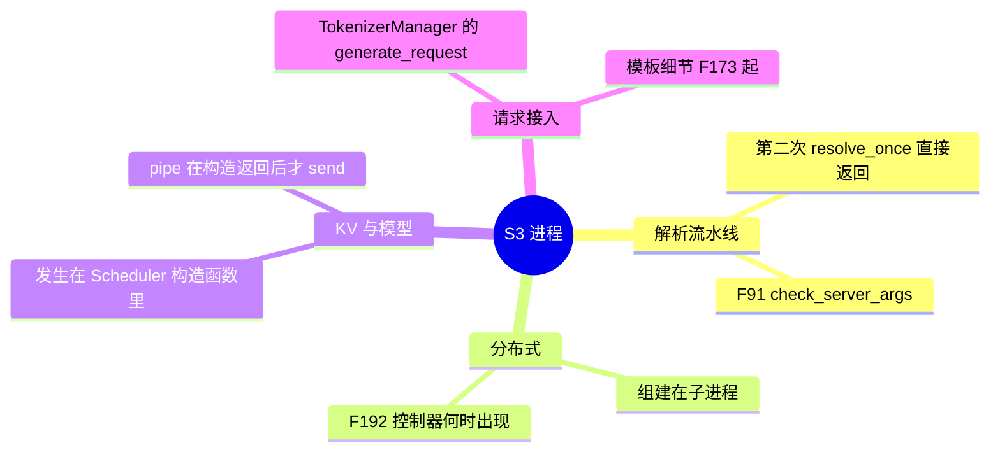
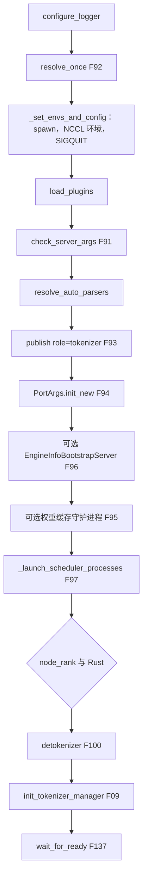

# 进程拓扑

对应 F04、F09、F92–F104，以及 F189、F199、F204。默认路径是 `http_server.launch_server` → `Engine._launch_subprocesses`。Ray、SMG gRPC、encoder-only 在 [CLI 与分叉](01-CLI与分叉.md) 就已经离开这条函数。**源码路径推断，未实测**。

## 在框架中的位置

## 场景与进程表

计数按源码的循环，不按某次实跑的 `ps`。`num_dp_ranks = dp_size * attn_dp_size`（`runtime_context.num_dp_ranks_of`）。`use_dp_controller` 为真当 `num_dp_ranks > 1`，或 `ep_join_mode == "scale"`。

| 场景 | 主进程 | 子进程 |
| --- | --- | --- |
| rank 0，单卡，`tp=pp=1`，`num_dp_ranks=1`，非 Rust | HTTP 尚未起来；先建 `TokenizerManager` 和模板 | 1 个 `run_scheduler_process`，1 个 detokenizer。`weight_cache_mode == "daemon"` 时再加本节点 PP×TP 个权重缓存守护进程，这里是 1 个 |
| rank 0，TP，`num_dp_ranks=1` | 同上，仍一个 tokenizer | 本节点 `pp_rank_range × tp_rank_range` 个 scheduler，没有 DataParallelController |
| `num_dp_ranks > 1` 且不是 attention DP 的预启动 | tokenizer 仍只在 rank 0 | 先起 `DataParallelController`，由它 `launch_dp_schedulers` 再拉各副本的 TP×PP scheduler |
| attention DP，且不是 elastic EP、也不是 EP joiner | 同上 | 父进程按 PP×TP **预启动** scheduler（`prelaunch_dp_schedulers`），再起控制器。控制器把参数从 duplex pipe 送进已经活着的进程，而不是再按 TP 乘一批 GPU |
| `node_rank >= 1` | 不建 tokenizer / detokenizer。`wait_for_ready` 之后可起 follower gRPC，可选 dummy health，然后阻塞到 scheduler 退出 | 本节点的 scheduler 切片；若 `use_dp_controller`，控制器没有 `node_rank == 0` 的门，本节点也会起。待核：每种多机 DP 布局下控制器是否每节点一个 |
| `SGLANG_RUST_SERVER` | 不建 Python detokenizer 和 `TokenizerManager`。`Engine.__init__` 若发现该环境变量会直接拒绝离线 Engine | scheduler 内部再起嵌入的 Rust 前端。主进程调用 `start_disagg_service_for_rust_server` |
| `detokenizer_worker_num > 1` | tokenizer 仍在主进程 | 每个 detokenizer 一条私有 IPC，另有 `MultiDetokenizerRouter` 占住原来的 `detokenizer_ipc_name` |
| `tokenizer_worker_num != 1` | `MultiTokenizerRouter`，`template_manager` 为 `None` | router 内部是否再起进程，本页未逐行展开，标待核 |
| elastic expert backup 且 elastic EP 后端非空 | 同上 | 额外 `run_expert_backup_manager` 的 `mp.Process` |

`_set_envs_and_config` 把 multiprocessing 的 start method 设为 `spawn`。子进程不继承父进程里已经建好的 CUDA 上下文。

GPU 编号在父进程的循环里算：`base_gpu_id + (pp_rank % pp_size_per_node) * tp_size_per_node + (tp_rank % tp_size_per_node) * gpu_id_step`。多机时每个节点只循环 `_calculate_rank_ranges(node_rank)` 给出的 PP、TP 切片。

## F189 为何拆成进程

`Engine._launch_subprocesses` 的文档字符串只陈述布局：

> Launch the TokenizerManager in the main process, the Scheduler in a subprocess, and the DetokenizerManager in another subprocess.

`http_server.launch_server` 的文档字符串补了职责和 IPC：

- HTTP 是 FastAPI，把请求送到引擎。HTTP、Engine、TokenizerManager 都在主进程。
- Scheduler 子进程：从 TokenizerManager 收请求，组 batch，前向，把 token 送给 DetokenizerManager。
- DetokenizerManager 子进程：把 token id 变回文本，送回 TokenizerManager。
- 进程之间用 ZMQ，每个进程不同的端口。

源码没有写「不能用一个进程里的三条线程」的对照实验，也没有把原因归结为 GIL。能直接从启动代码看到的约束是：

- 集合通信和模型只在 scheduler 子进程里初始化（F05）。
- 主进程要留在 HTTP 和分词上，`wait_for_ready` 之前并不进入模型的事件循环。
- detokenizer 有自己的进程入口 `run_detokenizer_process_func`，和 scheduler 的 pipe、ZMQ 都分开。
- start method 是 `spawn`。

把「为何不是线程」写成 GIL 或 CUDA context 的普遍结论，源码这段没有这句话，标 **待核**。

## 父进程调用栈

publish 用 `snapshot_context` 包住。端口分配或 bootstrap 失败时 `restore_context`，调用方仍拿得到 publish 之前的上下文。注释写明：校验阶段的晚期解析会拒绝已经 publish 的记录，所以失败必须把发布一起撤掉。

| 函数 | 做什么 | 角色 |
| --- | --- | --- |
| `resolve_once` | 已成功则返回 | F92，避免把封口后的记录再跑一遍不幂等的 hook |
| `check_server_args` | publish 前的断言，含 LoRA 路径规范化 | F91 |
| `resolve_auto_parsers` | 在 publish 前消化 `auto`。插件可以注册 parser | 调用点在启动；模板匹配的正文是 F177，归请求接入 |
| `publish(..., role="tokenizer")` | 主进程的运行时袋子 | F93。子进程会用自己的 role 再 publish |
| `PortArgs.init_new` | ZMQ 名和 `nccl_port` | F94 |
| `_launch_scheduler_processes` | `mp.Process` 或交给控制器 | F97、F99 |
| `_launch_detokenizer_subprocesses` | detokenizer 或 router | F100 |
| `init_tokenizer_manager` | 主进程里的分词器和模板 | F09 |
| `wait_for_ready` | `pipe.recv`，要求 `status == "ready"` | F137，见 ready 页 |

## F94 `PortArgs.init_new`

`nccl_port` 用参数，或 `get_free_port_below_ephemeral()`。注释：scheduler 子进程稍后才 bind，端口要避开临时端口段。`instance_id` 是 UUID 十六进制的前 12 位，用来派生 `/dev/shm` 上的负载快照路径。

非 attention DP：tokenizer、scheduler input、detokenizer、rpc、metrics 各一个 `ipc://` 临时文件。`tokenizer_worker_num != 1` 时再加 `tokenizer_worker_ipc_name`。

attention DP：改用 TCP 端口，以便单机和多机同一套地址。单机且没有 `dist_init_addr` 时，从服务 `port` 加或减 `ZMQ_TCP_PORT_DELTA`，避免超过 65535。各 DP rank 在控制器里再 `PortArgs.init_new(server_args, dp_rank, worker_ports)`，但共用同一个 `nccl_port` 和 `instance_id`。注释：数据并行复用张量并行组，所以 NCCL 端口相同。

解耦投机（`decoupled_spec_role != "null"`）要求 bind、connect 和 rank 三个旗标，否则 `ValueError`，并填 `DecoupledSpecIpcConfig`。

## F103 IPC 名

`SchedulerIpcChannels.create` 把 `PortArgs` 接成套接字。rank 0 的 scheduler：

| 字段 | 来自 | 模式 |
| --- | --- | --- |
| `recv_from_tokenizer` | `scheduler_input_ipc_name` | PULL |
| `recv_from_rpc` | `rpc_ipc_name` | DEALER |
| `send_to_tokenizer` | `tokenizer_ipc_name` | PUSH |
| `send_to_detokenizer` | `detokenizer_ipc_name`；`skip_tokenizer_init` 时改用 `tokenizer_ipc_name` | PUSH |
| `send_metrics_from_scheduler` | `metrics_ipc_name` | PUSH，仅打开 metrics 时 |

非零 rank 在 tokenizer / detokenizer 方向得到 `None` 或空的 `SenderWrapper`。请求面的收发循环归调度篇。

## F95、F96 可选进程

`remote_instance_weight_loader_start_seed_via_transfer_engine` 且 `node_rank == 0`：检查 `engine_info_bootstrap_port` 空闲，否则 `RuntimeError`，然后起 `EngineInfoBootstrapServer`。同机多实例必须使用不同的 `--engine-info-bootstrap-port`。

`weight_cache_mode == "daemon"`：`_launch_weight_cache_daemons`。句柄回到 Engine，`shutdown` 时回收。

## F97–F99 scheduler 与 DP 控制器

`_launch_scheduler_processes`：

- 不需要控制器，或需要 attention DP 预启动：按本节点 PP×TP 起进程。预启动时 pipe 是 duplex，目标函数是 `run_scheduler_process_with_init_pipe`，真正的 rank 参数等控制器送来。
- `use_dp_controller`：再起 `run_data_parallel_controller_process`，插在 `scheduler_procs` 最前。只要有控制器，父进程的 `scheduler_pipe_readers` 就被换成控制器这一根 pipe。控制器等自己的 scheduler 都 `send` 完，再向父进程发送 `status == "ready"`，并带上 `scheduler_pids`。预启动时这些 pid 已经在父进程的 `scheduler_procs` 里，`wait_for_ready` 不再从 info 里追加一次。

控制器内部（`DataParallelController.__init__`）：

- `attn_dp_enabled`：`launch_dp_attention_schedulers`。对每个 TP rank 用 `compute_dp_attention_world_info` 算出 `attn_dp_rank`，再配 TCP `PortArgs`。预启动字典里已有 `(pp_rank, tp_rank)` 就把参数 `send` 进去。
- 否则：`launch_dp_schedulers`，按 `num_dp_ranks` 拉副本。

attention DP 不按 `attn_dp_size` 再乘 GPU。进程数仍是本节点的 TP×PP 切片。多个 TP rank 可以共享同一个 `attn_dp_rank`，它们是该 DP 组里的 attention TP。路由用的 worker 套接字个数是 `num_dp_ranks`（elastic 时按 `max_dp_size` 预留）。这和 F192 的「一个 scheduler 服务一个 DP rank」指的是路由面，不是「每增加 1 个 attn_dp 就多插一张 GPU」。细节在分布式 init 页。

## F98 子进程入口

`run_scheduler_process`：

1. `load_plugins`。
2. `publish(server_args, role="scheduler", ranks=SpawnRanks(...))`。注释：publish 前就要有落点，TP/PP 用来选 WORLD rank；普通 DP 副本的 WORLD 彼此分开，所以要显式 DP rank。
3. `configure_scheduler_process`。
4. 构造 `Scheduler`。构造函数里做完分布式 init、模型、KV 和树。事件循环不在构造里。
5. `pipe_writer.send(scheduler.get_init_info())`。
6. `scheduler.run_event_loop()`。这一步已经是服务，不在本目录展开。

## F104 进程标题

`configure_scheduler_process` 在 publish 之后。标题是 `sglang::scheduler` 加上有内容的段：`DP`、`PP`（仅 `pp_size > 1`）、`ATTN_CP`、`MOE_DP`、`TP`（仅 `tp_size > 1`）、`EP`（仅 `ep_size > 1`）。空格换成下划线。`display_*` 只用于日志和标题，运行时 rank 仍是本地的。同时 `kill_itself_when_parent_died`，打开 faulthandler，并按环境变量绑 CPU 和 NUMA。

## F100 detokenizer

rank 0 且非 Rust：`_launch_detokenizer_subprocesses`。`detokenizer_worker_num <= 1` 时一个进程，入口是调用方传入的 `run_detokenizer_process_func`，监听 `port_args.detokenizer_ipc_name`。大于 1 时 router 占这个名字，worker 用私有 IPC。

这些进程的 pid 追加进 `all_child_pids`，就绪后和 scheduler 一起交给 `SubprocessWatchdog`。

## F09 tokenizer 放在等 ready 之前

`tokenizer_worker_num == 1`：`init_tokenizer_manager` 在主进程构造 `TokenizerManager`，再 `TemplateManager.initialize_templates`。若 reasoning / tool parser 仍是 `auto`，用模板管理器的建议值 `record_config_updates`，来源字符串是 `template-detection`。建议值为空则把该 parser 记成 `None` 并警告。

然后才 `wait_for_ready`。成功后把 `scheduler_infos[0]["max_req_input_len"]` 抄到 tokenizer。失败且对象是 `TokenizerManager` 时关掉 `cuda_vmm_feature_transport`。

函数注释写 “Launch tokenizer process”。默认调用点没有 `mp.Process`。多 worker 走 `MultiTokenizerRouter`。

## F199 为何 `node_rank >= 1` 不提供业务 HTTP

`_launch_subprocesses` 在 `node_rank >= 1` 时的注释是：非零 rank 的节点不跑 tokenizer 进程。顺序是 `wait_for_ready`，然后 `start_follower_grpc_server`。gRPC 绑定失败会杀掉 scheduler 进程树和权重缓存守护进程，因为此时 `Engine.__init__` 还没拿到这些句柄。

环境变量 `SGLANG_BLOCK_NONZERO_RANK_CHILDREN=0` 时直接返回，给把 `Engine` 当 Python API 的调用方，不在这里阻塞。否则给主线程装 SIGTERM 处理器：记录日志并等待 rank 0 的 `ShutdownReq` 广播。注释写明非零 rank 不能自己把集群排空。

dummy health：`SGLANG_RUST_SERVER` 且 `node_hosts_rust_server()` 时，本节点的 Rust 监听已经占着健康检查，就不再 `launch_dummy_health_check_server`。否则在 `host:port` 起一个假的健康服务。然后 `block_until_scheduler_exits`。返回的 tokenizer 和 template 都是 `None`。

`http_server.launch_server` 看到 `node_rank >= 1` 就返回，因为 `_launch_subprocesses` 已经阻塞到 scheduler 退出。业务 HTTP 只留在 rank 0。多机时请求是否只打到 rank 0，代码是这样分的；实际集群流量没有在本环境测过。

## F102 与 F204 Rust server

环境变量是 `SGLANG_RUST_SERVER`（`srt/environ.py`）。为真时：

- 离线 `Engine.__init__` 拒绝，提示关掉该变量才能用 `sgl.Engine`。
- `_launch_subprocesses` 不启动 Python detokenizer，也不构造 `TokenizerManager`。注释：嵌入的 Rust server 在 rank 0 的 scheduler 里启动，自己拥有 API、分词和反分词。不要和 `RayEngine` 一起用。
- 原本由 TokenizerManager 启动的 KV bootstrap，改由 `start_disagg_service_for_rust_server`。该函数的文档写：Rust 模式没有 TokenizerManager 去调 `start_disagg_service`。内部仍是 `start_disagg_service()`，且只在 prefill 分离加对应 bootstrap 后端时才有实质动作。
- 然后 `wait_for_ready`，并用 watchdog 看着 scheduler 进程。返回的 tokenizer、template、权重缓存句柄按代码是 `None`。
- `launch_server` 不再跑 Python HTTP。

这就是 F204：Rust 路径把分词从 Python 主进程拿掉，因为那一段职责已经在 Rust 前端里。Python tokenizer 的模板和 `GenerateReqInput` 路径因此不会建立。

## 和后面阶段的边界

父进程停在 `wait_for_ready` 时，子进程必须已经做完分布式 init、模型加载和 KV。那些步骤在 `Scheduler.__init__` 里，下一页从 `init_parallel_runtime` 写起。

返回 [本目录](README.md) · 下一页 [分布式初始化](05-分布式初始化.md)。
