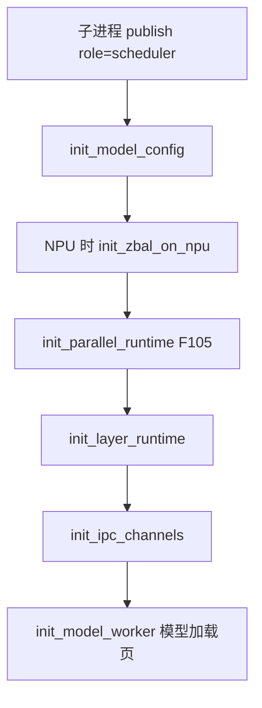
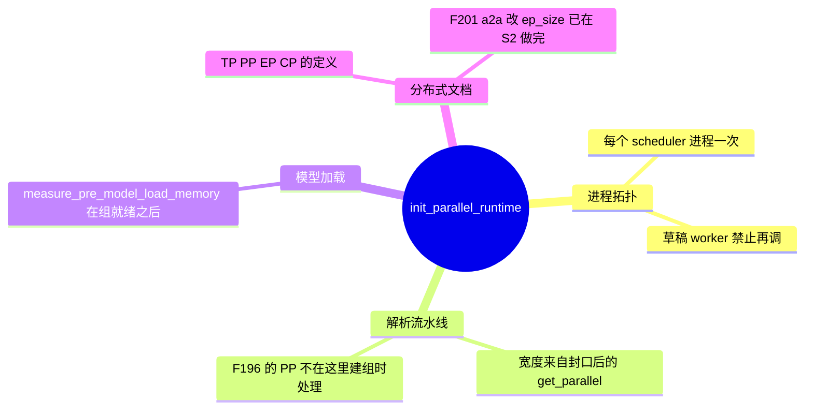
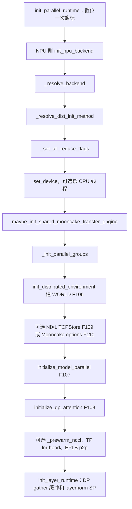

# 分布式初始化

对应 F05、F105–F110、F192。轴的宽度和通信语义在 [04-分布式](../../04-分布式/README.md)（D01–D20）。本页只写：组在启动的哪一步建、建一次意味着什么、attention DP 为何不增加 GPU 却增加调度面。**源码路径推断，未实测**。多卡集合通信没有在本环境跑过。

## 在框架中的位置

HTTP 进程的 `publish` 用的是 `role="tokenizer"`。它分配 `nccl_port`，不调用 `init_parallel_runtime`。组的生存期在 scheduler 进程里。

## 场景

| 场景 | 这一步的分支 |
| --- | --- |
| 单进程，`tp_size = pp_size = 1` | 仍调用 `init_distributed_environment`。WORLD 的大小按 `tp_size * pp_size` 算，这里是 1。NCCL 预热要求 TP、PP 或 MoE EP 大于 1，单卡不会进 `_prewarm_nccl` |
| 单机多卡 TP 或 PP | `dist_init_method` 默认是本机 host 加 `nccl_port` 的 TCP。backend 来自设备默认 |
| 多机 | 有 `dist_init_addr` 时用它的 host 和 port。未实测 |
| `elastic_ep_backend == "mooncake"` 且设备是 cuda | `_resolve_backend` 把 backend 改成 `"mooncake"`，F110 |
| `moe_a2a_backend == "nixl"` | WORLD 建完后 `_create_global_tcp_store`，F109 |
| NPU | 进入函数先 `init_npu_backend`，把 `torch.cuda.*` 转到 `torch.npu.*`。组建完后 `register_sgl_tp_rank` |
| CPU | `_init_cpu_threads_env`。注释写共享内存 all-reduce 只支持 Intel AMX 和 arm64 |
| 草稿 worker | 文档禁止调用本函数，复用目标进程里已经建好的组 |
| 同进程第二次调用 | `RuntimeError`，F105 |
| attention DP | 不把 `attn_dp_size` 乘进 WORLD。WORLD 仍是 `tp_size * pp_size`（scale joiner 另加 rank offset）。`initialize_dp_attention` 只标 rank，F108、F192 |

## F105 一次初始化

`init_parallel_runtime` 用模块级 `_PARALLEL_INITIALISED`。已为真则：

> init_parallel_runtime() ran twice in this process. The groups are built once, before anything that reads one exists ... An elastic scale-up joins an existing WORLD through initialize_model_parallel directly and does not come through here.

角色：保证读组的代码只看见一套组。弹性扩容不走这个入口，它直接 `initialize_model_parallel`。失败不是静默忽略。

调用点在 `Scheduler.__init__`，紧挨 `init_model_config` 和 NPU 的 `init_zbal_on_npu` 之后，早于 IPC、tokenizer 的 scheduler 侧副本、MoE GEMM 配置，更早于 `init_model_worker`。`maybe_revert_pr_fix` 的注释要求它在 `init_model_worker` 之前，因为 worker 里的池初始化会跑那些被补丁的函数。

## 调用栈

| 函数 | 做什么 | 角色 |
| --- | --- | --- |
| `init_parallel_runtime` | 设备、线程、组、预热 | 子进程分布式入口 |
| `_resolve_backend` | 设备默认；cuda 且 elastic EP 是 mooncake 时改成 mooncake | F110 的开关 |
| `_resolve_dist_init_method` | 环境覆盖、`dist_init_addr`，或 `host:nccl_port` | 进程组 rendezvous |
| `_init_parallel_groups` | 从 `get_parallel()` 取宽度和 rank，不从函数参数取 | F107 的输入 |
| `init_distributed_environment` | `torch.distributed.init_process_group` | WORLD |
| `initialize_model_parallel` | TP、PP、EP、以及 PD mux 时的 duplicate TP 组 | 模型并行组 |
| `initialize_dp_attention` | 计算并写上 `attn_dp_rank` | attention DP 的进程内标记 |
| `init_layer_runtime` | `init_dp_gathered_buffer` 与 `initialize_layernorm_sp` | 组已在，模型尚未加载 |
| `measure_pre_model_load_memory` | `ModelRunner.init_torch_distributed` 里调用 | 给 KV 预算的基线，发生在加载权重之前 |

`init_layer_runtime` 不建进程组。它用已经发布的 `model_config` 去定 DP gather 缓冲和 layernorm 序列并行。

## F106 建 WORLD

`_init_parallel_groups` 读取 `tp_size`、`pp_size`、`tp_rank`、`pp_rank`、`ep_join_rank_offset`、是否 joiner。

- 普通：`world_size = tp_size * pp_size`，`rank = tp_size * pp_rank + tp_rank`。
- scale joiner：`world_size = rank_offset + tp_size * pp_size`，rank 同样加 offset。

然后 `init_distributed_environment(..., moe_a2a_backend=...)`。timeout 来自 `get_parallel().dist_timeout`。

环境变量 `SGLANG_DISTRIBUTED_INIT_METHOD_OVERRIDE` 若设成 `env://`，torch 使用 `MASTER_ADDR` / `MASTER_PORT` 和外部 TCPStore。注释写这是给外部编排避开同机端口冲突。

## F107 建 TP / PP / EP / CP 组

`initialize_model_parallel` 的宽度不在这次调用的参数里传。函数从 `get_parallel()` 读。调用点传的是：

- `duplicate_tp_group = enable_pdmux`
- `enable_symm_mem`
- joiner 与 scale joiner 的 `recovered_rank`、`rank_offset`、`max_world_size`

注释：扩容时只有 WORLD 被拉长。joiner 的模型并行组是它这一拨进程自己的固定组。scale joiner 的 `max_world_size` 在这次调用里传 `None`。

CP 组是否与 TP 组合并，由 S2 的 F205 写下 `enable_cp_tp_group_sharing`。建组时读的是已经发布的并行袋子。CP 的切分定义归分布式文档，不在这里重写。

建组前 `_set_all_reduce_flags` 根据封口后的通信旗标设置 custom all-reduce、mscclpp、symm mem、FlashInfer all-reduce。

## F108 attention DP 的 rank

`initialize_dp_attention`：

1. `initialize_dp_attention_flags`：`dp.enabled = attn_dp_enabled`。elastic EP 且是 scale joiner 时还可以 `joiner_skip_all_gather`。
2. `compute_dp_attention_world_info(tp_rank, tp_size, attn_dp_size, attn_cp_size)` 得到 `attn_tp_rank`、`attn_tp_size`、`attn_dp_rank`、`attn_dp_size`。
3. `override_permanently(attn_dp_size=..., attn_dp_rank=...)`。

`attn_tp_size` 来自 `derive_attn_tp_size`：`tp_size` 除掉 attention DP 和 attention CP。两个 rank 是进程私有的，不在 `override_permanently` 的宽度表里，所以要在这里算。

`get_dp_tp_group`：attention DP 打开时返回 `attn_tp_group`，否则返回整个 `tp_group`。文档字符串：这是跑某一个 DP rank 那份 batch 的 TP rank。

## F109 NIXL 的 TCPStore

`init_distributed_environment` 在 `init_process_group` 之后：若 `moe_a2a_backend == "nixl"`，调用 `_create_global_tcp_store`。注释写这是给 NIXL 做协调。动态成员在 `recovered_rank` 或 `max_world_size > world_size` 时允许。NIXL 传输本身归专家并行和 PD 文档。

## F110 Mooncake 作为 process group 后端

两处 Mooncake，不要合成一件事。

1. **进程组后端**：`device == "cuda"` 且 `elastic_ep_backend == "mooncake"` 时，backend 字符串是 `"mooncake"`。`init_distributed_environment` 看到这个 backend 就构造 `MooncakeBackendOptions`（活跃 rank 张量，扩容时带 `max_world_size`），传给 `init_process_group`。
2. **传输引擎**：`maybe_init_shared_mooncake_transfer_engine` 在建组之前。触发条件是 PD 的 mooncake 传输、HiCache 的 mooncake 存储、encoder 分离的 mooncake，或 elastic EP 后端是 mooncake。这是 KV / 权重传输，不是 process group。

## 预热为何在 KV 预算之前

`pre_warm_nccl` 且（`tp_size > 1` 或 `pp_size > 1` 或 `moe_ep_size > 1`）时 `_prewarm_nccl`。S2 的 `handle_nccl_pre_warm` 已经在非 CUDA/HIP/NPU 上把旗标关掉。注释：去掉第一次请求的冷启动。AMD 上这个旗标默认开。

另两段预热只在 cuda：

- `enable_tp_lm_head_all_to_all` 且 `tp_size > 1`：`_prewarm_tp_lm_head_all_to_all`。注释写明，CUDA graph 会启用这条 all-to-all 的 PyNCCL，要在测量 `pre_model_load_memory` 之前走一遍，让持久的传输分配算进后来的 KV 大小，而不是捕获图时才冒出来。
- EPLB、backend 是 nccl、没有 elastic EP、单机、`pp_size == 1`、`moe_ep_size == tp_size > 1`：`_prewarm_eplb_p2p`。注释：EPLB 用默认进程组，不是 TP/EP 协调器；预热目前限制在静态、单机、满 EP。

`measure_pre_model_load_memory` 的文档：并行初始化之后、分配权重之前调用。`world_size > 1` 且不是草稿时，可用显存做一次分布式最小值。草稿不参与这次 WORLD 规约，注释说草稿可能只存在于一个 PP stage，加进去会死锁。TP 大于 1 且不是草稿时还会 `_check_tp_memory_balance`。

## F192 为何 attention DP 不增加 GPU，却增加 scheduler

字段文档（`fields/parallel.py`）：

- `dp_size`：模型的数据并行副本数。
- `attn_dp_size`：TP 组内部的 attention 数据并行组数，每组一个 scheduler，FFN 仍张量并行。
- 派生 `num_dp_ranks`：`dp_size * attn_dp_size`，服务这么多个数据并行 rank，每个一个 scheduler。elastic EP 扩容时会变宽。
- `num_dp_ranks_of` 的文档再补一句：attention DP 不在副本里面跑，所以两个数里有一个是 1。这和 S2 的互斥一致：`attn_dp_size > 1` 且 `dp_size > 1` 直接 `ValueError`。

GPU / 进程数：

- 线程绑定的 `world_size` 用 `dp_size * tp_size * pp_size`。`bootstrap` 里这段的注释是：attention DP 划分的是已有的 TP 组，而不是再起一批进程，所以只有副本去乘进程数。
- `_init_parallel_groups` 的 WORLD 是 `tp_size * pp_size`（加 joiner offset），不乘 `attn_dp_size`。
- 父进程和控制器按 PP×TP 起 scheduler 进程。attention DP 给每个 TP rank 算一个 `attn_dp_rank`，若干 TP rank 共用一个 DP rank，那一组的 attention TP 一起跑同一份 batch。

增加的是调度面：

- `num_dp_ranks > 1` 时父进程拉起 `DataParallelController`。
- 控制器按 `num_dp_ranks` 绑定 worker 套接字，请求路由到 DP rank，而不是只看一张全局 TP 组。
- `attn_dp_enabled` 在 `attn_dp_size > 1` 时为真；elastic scale joiner 即使自己的组宽度是 1，也会走 attention DP 路径，因为它加入的是一个 attention DP 部署。

所以「不增加 GPU」指的是同一 `tp_size` 下不把 `attn_dp_size` 乘进设备数和 WORLD。「增加 scheduler」指的是派生字段写明的 DP rank 数，以及控制器按这个数做的路由。它不是在每张 GPU 旁边再 fork 一个额外的 GPU 进程。

副本 DP（`dp_size > 1`）才会再复制整模，进程数按副本乘。那条路径和 attention DP 互斥。

空的 attention DP 组为何仍要 `ForwardMode.IDLE`，是 F193，归调度篇。

返回 [本目录](README.md) · 下一页 [模型加载](06-模型加载.md)。
