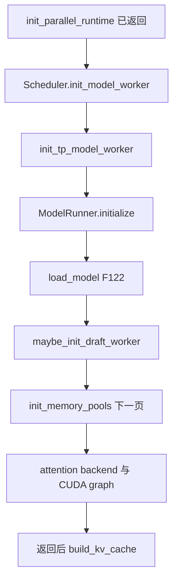
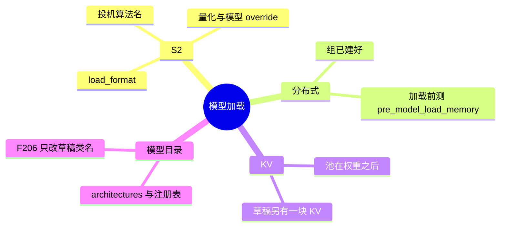
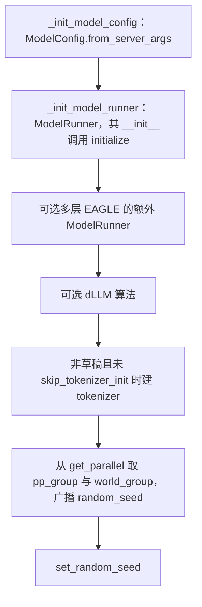

# 模型加载

对应 F06、F111–F125、F206。权重在 `TpModelWorker` 构造 `ModelRunner` 时加载，早于 `init_memory_pools` 里的 KV。KV 池和前缀树在下一页。**源码路径推断，未实测**。

## 在框架中的位置

## 场景

| 场景 | 加载路径 |
| --- | --- |
| 单卡，无投机 | 一个 `TpModelWorker`，一个 `ModelRunner`，`model_worker` 指回 `tp_worker` |
| `use_mlx()` | `init_tp_model_worker` 改用 `MlxTpModelWorker`。MLX 与 CUDA 的池、图是否逐步对齐，标待核 |
| 投机打开，且本 rank 是最后一级 PP 或没有 PP | `maybe_init_draft_worker` 用 `SpeculativeAlgorithm.create_worker`。非最后一级 PP 不建草稿 |
| 草稿 | `ModelConfig` 以 `is_draft_model=True` 构造，F206 改 `architectures[0]`。草稿不调用 `init_parallel_runtime` |
| NPU | `init_model_config` 可能再建 `DllmConfig`。MindSpore 实现会把架构收成 `MindSporeForCausalLM` |
| `load_format` | 由 S2 的 `handle_load_format` 定，`get_model_loader` 选类 |
| 启动期权重重叠 | `get_model().is_startup_weight_load_overlap` 时，目标 worker 建完就 `start_startup_weight_load`，图和 post-capture 之后 `finalize_startup_weight_load` |
| DeepSeek V4 | 池类在下一页。架构仍由 `architectures` 进入注册表 |

## F111–F119 `init_model_worker` 的顺序

`Scheduler.init_model_worker`：

| ID | 次序 | 函数 | 做什么 | 角色 |
| --- | --- | --- | --- | --- |
| F111 | 1 | `init_tp_model_worker` | MLX 则 `MlxTpModelWorker`，否则 `TpModelWorker` | 目标模型。构造过程中已经 `load_model` |
| F112 | 2 | `start_startup_weight_load` | 仅当 `is_startup_weight_load_overlap` | 把权重预取和后面的建池重叠。草稿的预取字节会在划池前加进 `account_preloaded_weights` |
| F113 | 3 | `maybe_init_draft_worker` | 算法来自 `SpeculativeAlgorithm.from_string`。算法为空则 `draft_worker = None`。PP 且不是最后一级则不建。ngram 还可以带 `ExternalCorpusManager` | 第二套模块，不是第二套进程组 |
| F114 | 4 | `init_memory_pools` | 先目标池，再草稿 `alloc_memory_pool`，然后 `init_hicache_draft_plan` | 下一页展开。划池耗时记在 `kv_cache_allocation_time` |
| F115 | 5 | `init_all_attention_backends` | 目标，然后草稿 | 必须在捕获图之前。`ModelRunner` 注释：这样捕获时辅助隐状态捕获已经打开 |
| F116 | 6 | `init_all_cuda_graphs` | `@torch.no_grad()`。目标，然后草稿 | 图里要看到已经补丁过的池方法，所以池在前 |
| F117 | 7 | post-capture | `token_to_kv_pool.post_capture_active` 时先 `prepare_hicache_staging`，预热采样后再 `post_capture_resize_kv_pool` | 与树的先后见 F195 |
| F118 | 8 | 赋值 `model_worker` | 无投机或无草稿 → `tp_worker`；否则 `draft_worker` | 服务时的前向入口走验证形态。非最后一级 PP 没有草稿，仍用 `tp_worker` 跑验证形状的目标前向 |
| F119 | 9 | `tp_worker.get_worker_info` | 始终问目标 worker，不问 `model_worker` | 取出 `max_total_num_tokens`、`max_prefill_tokens`、`max_running_requests`、`max_req_len`、`max_req_input_len`、种子、设备、stream，以及池的 size |

F116 与 F117 之间还有：统一内存时 `prewarm_compaction`；选择 schedule stream 或 forward stream；`prewarm_graph_pool_borrow` 和 `prewarm_sampling`。F117 的 resize 会计入 `kv_cache_allocation_time`。然后若开了重叠加载，`finalize_startup_weight_load`（提交并 `dist_barrier_after_load`）。再 `refresh_deep_gemm_layout_memory_budget`。elastic EP 且 `ep_join_mode == "recover"` 时 `post_capture_elastic_ep_recover`。

`get_worker_info` 之后，scheduler 还从 `get_parallel()` 取出 tp、attn tp、attn cp、pp、world 组。这些组在 F105 已经建好，这里只是保存句柄。

## `TpModelWorker` 构造

草稿的 `ModelConfig` 使用 `speculative_draft_model_path`、revision、`is_draft_model=True`，以及可选的 context length。种子广播对 elastic joiner、以及 PP 加投机时只在草稿 TP 内广播，有专门分支。

`alloc_memory_pool` 把共享的 req pool 和 allocator 交给每个 runner（含多层 EAGLE），并断言 `max_running_requests > 0`。`init_cuda_graphs` 同样转发给全部 runner。

## F120–F125 `ModelRunner.initialize`

`ModelRunner.__init__` 在 `initialize` 之前：设定设备，`init_torch_distributed` 里调用 `measure_pre_model_load_memory` 并存成 `pre_model_load_memory`，建 forward stream。NPU 且 `model_impl == MINDSPORE` 时还有 MindSpore 分布式。然后才 `initialize`。

| ID | 函数 | 角色 | 跳过条件 |
| --- | --- | --- | --- |
| F120 | `init_memory_saver_adapter` | Torch memory saver 包装 | 不跳过 |
| F120 | `maybe_init_remote_instance_transfer_engine` | 远端实例权重传输 | `remote_instance_transfer_engine_enabled` 为假。草稿看自己的 `draft_load_format` |
| F120 | `maybe_init_expert_location_metadata` | EP 布局和分布记录 | 草稿 |
| F120 | `maybe_init_lplb_solvers` | LP 派发 | 不是 `ep_dispatch_algorithm == "lp"`，或是草稿 |
| F120 | `maybe_init_eplb_manager` | EPLB 管理器 | 没开 EPLB，或是草稿 |
| F120 | `ExpertLocationUpdater` | 专家位置更新器 | 总是构造 |
| F120 | `maybe_init_elastic_ep` | 弹性 EP 状态 | 没有 elastic EP 后端 |
| F120 | `init_token_oracle` | 进程级 token oracle | 草稿。注释：避免覆盖目标的词表 |
| F121 | `create_sampler` | 赋给 `self.sampler` | 不跳过 |
| F122 | `load_model` | 见下节 | 不跳过 |
| F123 | `prepare_moe_topk` | 权重到位后的 MoE top-k | 不跳过 |
| F124 | `maybe_init_dwdp` | DWDP 管理器 | 草稿，或 `dwdp_size <= 1` |
|  | `disable_routed_experts_capture_for_draft` | 草稿不采集 routed experts | 非草稿 |
|  | `maybe_init_expert_backup_client` | 专家备份客户端 | 没同时开 elastic expert backup 和 elastic EP |
| F125 | `maybe_init_lora_manager` | LoRA。UNO 投机走另一支 | 非 UNO 时要 `enable_lora` 且不是草稿 |
| F125 | `maybe_enable_batch_invariant_mode` | 确定性算子 | 没开确定性推理 |
| F125 | `configure_kv_cache_dtype` | 本 runner 的 KV dtype 字符串 | 走到这里就会做 |
| F125 | `install_megakernel` | megakernel 钩子 | 调用点总是到达。注释：放在加载后变换之后、KV 划大小之前。插件内部的跳过条件本页未逐行展开，标待核 |

`resolve_layer_indices` 得到 `layer_info`。`maybe_apply_post_load_model_transforms` 仅在 `tp_size > 1` 且模型声明支持 torch TP 时做张量并行变换。

远端权重发布在传输器内部。本页不写传输协议。

## F122 `load_model` 在做什么

`load_model`：

1. `build_load_config`：服务参数、草稿的 `draft_load_format`、TP rank、远端引擎 id。
2. `load_model_with_memory_saver`：`get_model_loader`。若开了启动重叠，先 `StartupWeightLoadManager.prepare()`，否则 `loader.load_model`。权重大块放在 memory saver 区域。
3. `current_platform.post_load_model`，目标模型的 offloader `post_init`，内核预编译，monokernel，可选 NVTX，`load_kv_cache_scales`，滑窗和 dtype。未重叠时 `dist_barrier_after_load`。

`DefaultModelLoader.load_model` 的高层，没有逐张量：

1. 可选的 modelopt 基座分支。
2. `_initialize_model`：`get_model_architecture`，在默认 dtype 和设备上构造模块。
3. `load_weights_and_postprocess`：迭代权重，`model.load_weights`，`postprocess_weights`。

### 架构

`get_model_architecture`（`model_loader/utils.py`）读 `hf_config.architectures`。EmbeddingGemma、量化 Mixtral 有覆盖。`ModelImpl.MINDSPORE` 收成 `MindSporeForCausalLM`。不是原生实现或 `ModelImpl.TRANSFORMERS` 时走 `resolve_transformers_arch`。然后 `ModelRegistry.resolve_model_cls`。注册表的类名单在模型目录，不在本页抄 225 个类。

### loader

`get_model_loader` 按顺序匹配，先命中先生效：

| 条件 | 类 |
| --- | --- |
| `load_format == DUMMY` | `DummyModelLoader` |
| `load_format` 本身是 type | 该自定义类 |
| `quantization == "auto-round-int8"` | `IncModelLoader` |
| ModelOpt 量化或 workflow | `ModelOptModelLoader`。在线 modelopt fp4 且没有 workflow 会被挡住；与 RUNAI_STREAMER、REMOTE_INSTANCE 的组合另有限制 |
| `SHARDED_STATE` | `ShardedStateLoader` |
| `PRESHARDED` | `PreshardedModelLoader` |
| `BITSANDBYTES` | `BitsAndBytesModelLoader` |
| `GGUF` | `GGUFModelLoader` |
| `EXPERT_PACK` | `ExpertPackModelLoader` |
| `LAYERED` | `LayeredModelLoader` |
| `FLASH_RL` | `QuantizedRLModelLoader` |
| `REMOTE` | `RemoteModelLoader` |
| `REMOTE_INSTANCE` | `RemoteInstanceModelLoader` |
| `PRIVATE` | `PrivateModelLoader` |
| `RUNAI_STREAMER` | `RunaiModelStreamerLoader` |
| `IPC_CACHE` | `IpcModelLoader` |
| 其余，含 auto | `DefaultModelLoader` |

S2 的 `handle_load_format` 负责把 CLI 收成这些名字。dummy 模型在流水线里已经早退，不会走到这里的真实加载；`load_format == dummy` 是另一条，仍会构造 `DummyModelLoader`。

## F206 草稿架构改名

`ModelConfig.from_server_args` 是工厂。`ModelConfig.__init__` 用 `get_config` 读 Hugging Face 配置，处理多模态开关之后，在 `is_draft_model` 时调用 `_config_draft_model`。这不是 DeepSeek V4.1 的 config 归一化（清单里的 M09）。

只改草稿。`architectures[0]`（或旁边的 config 对象）在源码里的改名：

| 来源 | 写成 |
| --- | --- |
| `DeepseekV3ForCausalLM`、`DeepseekV32ForCausalLM` | `DeepseekV3ForCausalLMNextN` |
| `GlmMoeDsaForCausalLM` | `GlmMoeDsaForCausalLMNextN` |
| `DeepseekV4ForCausalLM` | 捆绑 dspark 且算法是空或 DSPARK 时 `DeepseekV4ForCausalLMDSpark`，否则 `DeepseekV4ForCausalLMNextN`，并把 `num_nextn_predict_layers` 设为 1 |
| `Glm4MoeForCausalLM` | `Glm4MoeForCausalLMNextN` |
| `Glm4MoeLiteForCausalLM` | `Glm4MoeLiteForCausalLMNextN` |
| `Glm5NextForConditionalGeneration` | `Glm5NextForConditionalGenerationNextN` |
| `GlmOcrForConditionalGeneration` | `GlmOcrForConditionalGenerationNextN` |
| `LongcatFlashForCausalLM` | `LongcatFlashForCausalLMNextN` |
| `MiMoForCausalLM` | `MiMoMTP` |
| MiMo V2 的架构集合 | `MiMoV2MTP` |
| `Step3p5ForCausalLM` | `Step3p5MTP` |
| `InklingForConditionalGeneration` | `InklingForConditionalGenerationMTP` |
| `GigaChat35ForCausalLM` | `GigaChat35ForCausalLMNextN` |
| `Step3p7ForConditionalGeneration` | config 换成 `Step3p5MTP` |
| `BailingMoeV2ForCausalLM`、`BailingMoeForCausalLM`、`BailingMoeV2_5ForCausalLM`、`BailingMoeV3ForCausalLM` | `BailingMoeForCausalLMNextN` |
| `Ernie4_5_MoeForCausalLM` | `Ernie4_5_MoeForCausalLMMTP` |
| `Qwen3NextForCausalLM` | `Qwen3NextForCausalLMMTP` |
| `Qwen4ExpForConditionalGeneration` | 深拷贝 config 后 `Qwen4ExpForCausalLMMTP` |
| `Qwen3MoeForCausalLM` | `Qwen3MoeForCausalLMMTP` |
| `Qwen3_5ForConditionalGeneration`、`Qwen3_5MoeForConditionalGeneration`、`Qwen3_5ForCausalLM`、`Qwen3_5MoeForCausalLM`、`InternS2PreviewForConditionalGeneration`、`InternS2MobiusForConditionalGeneration` | `Qwen3_5ForCausalLMMTP`。Mobius 还会改文本专家字段 |
| `ExaoneMoEForCausalLM`、`ExaoneMoeForCausalLM` | `ExaoneMoEForCausalLMMTP` |
| `NemotronH_Omni_Reasoning_V3`、`NemotronHForCausalLM`、`NemotronHPuzzleForCausalLM` | `NemotronHForCausalLMMTP` |
| `HYV3ForCausalLM` | `HYV3ForCausalLMNextN` |
| `HYV4ForCausalLM` | `HYV4ForCausalLMNextN` |

`Dots3Config` 走 `configure_draft_model()`，目标类名由那个函数决定，本页不把它收成固定字符串。`DSparkMiniMaxDraftModel` 且算法是 DSPARK 时走 `configure_minimax_m3_dspark`，改的是 config，不是上面那种固定类名替换。

角色：草稿 worker 再用 `get_model_architecture` 时，拿到的是 MTP / NextN / DSpark 模块，而不是目标模型的类。算法名 `NEXTN` 折成 EAGLE worker，和这些 `*NextN` 类不是同一个机制。

返回 [本目录](README.md) · 下一页 [KV 与前缀树](07-KV与前缀树.md)。
