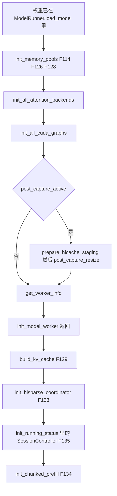
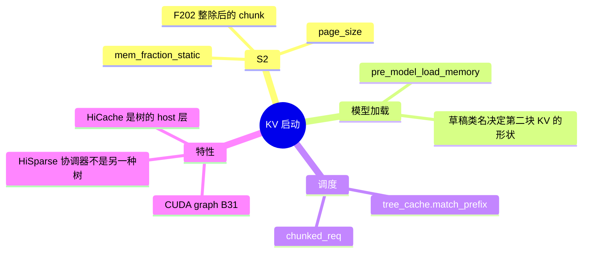
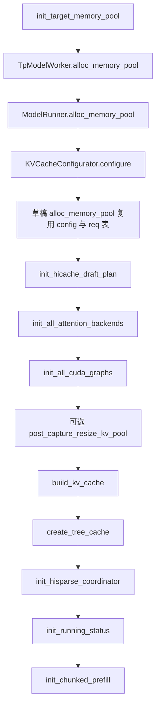

# KV 与前缀树

对应 F07、F126–F135，以及 F194、F195。池和树不是同一步。池在 `init_model_worker` 里分配；树在该函数返回之后挂到 `Scheduler.tree_cache`。**源码路径推断，未实测**。显存数字没有在本环境量过。

## 在框架中的位置

请求到来之后的 `match_prefix` / `insert` 是 F161，归调度篇。本页只写树被挂上的时刻和选哪一个类。

## 场景

| 场景 | 池 | 树 |
| --- | --- | --- |
| 普通 CUDA，未关 radix，未开 LMCache / FlexKV | `DefaultPoolConfigurator` 或混合 SWA 变体 | `default_radix_cache_factory` 落到 `UnifiedRadixCache` |
| 纯 SWA，且不是 host-pool retraction | 混合池按层区分 full 与 SWA | `PureSWARadixCache` |
| `enable_lmcache` | 同上，树自己接 LMCache | `LMCacheUnifiedRadixCache` |
| `enable_flexkv` | 同上 | `_flexkv_factory` → `FlexKVRadixCache` |
| `disable_radix_cache` | 池仍在 | 纯 SWA 且 retraction 不是 `host_pool` 时仍用 `PureSWARadixCache`，否则仍是 `create_unified_radix_cache`。关闭的是发布前缀，不是取消分配 |
| DeepSeek V4 且 hybrid SWA | `DSV4PoolConfigurator`，GPU 上 `DeepSeekV4TokenToKVPool`，NPU 上 `DSV4NPUTokenToKVPool` | `build_kv_cache` 对 DSV4 的 hybrid SWA 另有前缀门 |
| 投机 | 目标先划池；草稿复用目标的 `memory_pool_config`、`ReqToTokenPool` 和 allocator，KV 存储分开 | 草稿还有 `init_hicache_draft_plan`：FUSED 或 SIDECAR。SIDECAR 要求 `UnifiedRadixCache` |
| `post_capture_kv_sizing` 且 CUDA | 先按较小预算建池，图捕获后再 `post_capture_resize_kv_pool` | 树在 resize 之后才建，所以树看见的是最终池 |
| NPU | `prepare_hicache_staging` 在 NPU 上是空操作。DeepSeek V4 且 NPU 时 scheduler 还可 `maybe_init_hccl_dp_prewarm` | C128 sidecar 会在统一树里加一个组件 |
| CPU | `KVCacheConfigurator.configure` 对 FP8 KV 有约束 | 未单独改默认工厂 |
| HiSparse | 池后 `maybe_init_hisparse_coordinator`，仅目标 | 没有单独的 HiSparse 树类 |

清单 F130 写 registry 会选 `RadixCache` 或 `UnifiedRadixCache`。本树的 `default_radix_cache_factory` 不直接构造 `RadixCache`。`RadixCache` 仍是 `PureSWARadixCache` 和 `FlexKVRadixCache` 的父类，类定义在 `radix_cache.py`。默认落点是 `UnifiedRadixCache`。命名后端通过 `register_radix_cache_backend` 注册；没注册就 `ValueError` 并列出已注册名字。插件在 import 时注册了哪些名字，本页没有把全部副作用 import 跑一遍，标待核。

## 三层对象

| 对象 | 角色 |
| --- | --- |
| `ReqToTokenPool`（F131） | 请求槽到 token 位置。形状是请求槽 × 上下文位置，值为 int32 的 KV 下标。定义在 `mem_cache/memory_pool.py`。请求侧的视图是 `schedule_batch.py` 的 `ReqKvInfo`，那个对象在调度时用，不在启动时填充 |
| `token_to_kv_pool` 与 allocator | 物理 KV 页，或 MLA、DSV4 的结构。allocator 管页，并区分 SWA 与 full |
| `tree_cache` | 前缀怎么复用这些页。`build_kv_cache` 的返回值放进 `self.tree_cache`，同时带回 req pool 和 allocator |

`get_worker_info` 里常被叫做 token pool 大小的，是 `token_to_kv_pool.size`，加上 `req_to_token_pool.size` 和 `max_context_len`。

## F126–F128 池的预算和两块池

### F126 `KVCacheConfigurator.configure`

`ModelRunner.alloc_memory_pool`：

1. `init_kv_cache_configurator(draft_parallel_layout)`。
2. `configure(pre_model_load_memory=...)`。
3. `_init_post_memory_pool_components`：KV index 翻译、canary（注释要求在 decode CUDA graph 之前，让捕获到的前向看见补丁过的池）、ngram embedding、水印、`maybe_init_hisparse_coordinator`、routed / indexer 捕获器、图旗标。

`create_memory_pool_configurator`：DeepSeek V4 且 hybrid SWA 用 `DSV4PoolConfigurator`，否则混合 SWA 的变体，否则 `DefaultPoolConfigurator`。

`_profile_available_bytes`：`gc.collect()`，读剩余显存，多卡时可以取分布式最小值。`rest_memory` 从可用字节里扣掉 `pre_model_load_memory * (1 - mem_fraction_static)` 和多模态运行时预留。Mamba 和 post-capture 还有自己的 slack。`_handle_max_mamba_cache` 处理混合 SSM。草稿不重新 profile：`configure` 在已有目标的 `memory_pool_config` 时直接复用。

`mem_fraction_static` 是 S2 的 F62 声明的。这里用它，不再重新发明比例。

F132：`is_dsv4_model` 且在 GPU 上时，`_build_dsv4_kv_pool` 的类是 `DeepSeekV4TokenToKVPool`（`mem_cache/deepseek_v4_memory_pool.py`）。NPU 用 `DSV4NPUTokenToKVPool`。非 NPU 的分页 SWA 页大小在这条路径上是 256。

### F127 目标池

`Scheduler.init_target_memory_pool`：若目标 runner 已经同时有 `memory_pool_config`、`req_to_token_pool`、`token_to_kv_pool_allocator`，直接返回。否则把目标和草稿已经预取的权重大小交给 `account_preloaded_weights`，再 `tp_worker.alloc_memory_pool`。草稿的并行布局在有草稿时传进去。

### F128 与 F194 为何草稿和目标各有一块池

`init_memory_pools` 的顺序：

1. `init_target_memory_pool`。
2. `kv_cache_builder.resolve_decode_retraction_backup`。注释：先把 retraction 后端落到 disagg 袋子上，草稿的 HiCache 计划才会读到它。
3. 有草稿时，取出目标的 req pool 和 allocator，调用 `draft_worker.alloc_memory_pool(memory_pool_config=目标的, req_to_token_pool=同一个, token_to_kv_pool_allocator=同一个)`。
4. `draft_worker.init_hicache_draft_plan()`。

共享的是请求到 token 的表和分片 allocator 的布局。分开的是 KV 存储。`KVCacheConfigurator._init_pools` 的注释：

> MTP drafts sharing the target's sharded allocator need the same shard layout with separate KV storage.

草稿模块的形状由 F206 的类名决定，和目标不是同一套权重。目标的预算配置被复用，避免草稿再做一次会和目标 WORLD 死锁的显存规约（见分布式 init 页）。HiCache 的草稿计划在 `base_spec_worker.init_hicache_draft_plan`，FUSED 与 SIDECAR 两种；sidecar 注册进统一树。

## F195 为何图在池之后、树之前，或中间再 resize

`init_model_worker` 的实际顺序是：池 →（统一内存则 compaction 预热）→ attention 后端 → CUDA graph → 若 `post_capture_active` 则 HiCache staging、流上的预热、`post_capture_resize_kv_pool` → `get_worker_info`。`Scheduler.__init__` 在这整个函数返回后才 `build_kv_cache`。

源码里写明的原因，按出现位置：

- 池上的 canary 要在 `init_decode_cuda_graph` 之前装好，捕获到的前向才会走补丁过的池方法（`_init_post_memory_pool_components`）。
- attention 后端要在捕获之前初始化，辅助隐状态捕获才会在图里（`init_attention_backends` 的注释）。
- 分布式 init 里的 TP lm-head 预热，是为了让持久传输分配进 KV 预算，而不是捕获时才出现。
- `post_capture_active` 来自 `is_post_capture_kv_active`：CUDA 且 `post_capture_kv_sizing_planned`。dflash 草稿跟随目标池的这个旗标。S2 在计划走这条路径时，静态比例不再预留 graph 和激活，因为捕获之后会按剩余显存再量一次。
- `prepare_hicache_staging` 在 NPU 上是空操作。它在 resize 之前，让 host 侧在最终 KV 尺寸落地前就位。
- 树使用最终的 req pool 和 allocator。所以树不能建在 resize 之前，否则前缀结构会绑在一块即将被换掉的池上。

「树之前或穿插 resize」因此是一条链上的两个事实：resize 穿插在图捕获和 `build_kv_cache` 之间；树永远在 `init_model_worker` 之外的下一步。

## F129–F130 前缀树

`Scheduler.__init__` 在 `init_model_worker` 之后：

1. `init_kv_event_lora_names`。
2. `kv_cache_builder.build_kv_cache(...)`，结果分解进 `req_to_token_pool`、`token_to_kv_pool_allocator`、`tree_cache`。
3. 若分层缓存，把 fence 接到 `tree_cache.cache_controller`。
4. `emit_metrics_constants`，NPU 且 DeepSeek V4 时 `maybe_init_hccl_dp_prewarm`。
5. 有 canary 则 `attach_radix_cache`。

`create_tree_cache`：`radix_cache_backend` 有名字就查注册表，否则 `default_radix_cache_factory`。

默认链（`registry.py`）：

1. `disable_radix_cache`：纯 SWA 且 retraction 不是 `host_pool` → `PureSWARadixCache`，否则 `create_unified_radix_cache`。
2. `enable_lmcache` → `LMCacheUnifiedRadixCache`。组件按是否纯 SWA、hybrid SWA、hybrid SSM 选择 FULL / SWA / MAMBA。
3. `enable_unified_cache_external_linker` → 统一树，并 `init_cache_linker`。
4. 纯 SWA → `PureSWARadixCache`。
5. `enable_flexkv` → `_flexkv_factory`。CLI 的 flexkv 配置文件在环境变量 `FLEXKV_CONFIG_PATH` 空着时写进去。
6. 其余 → `create_unified_radix_cache`。

`create_unified_radix_cache` 的组件默认有 FULL；hybrid SWA 加 SWA；hybrid SSM 加 MAMBA。NPU 的 DSV4 若池上有 `req_to_c128_sidecar`，再加 C128。MLX 且 hybrid SSM 时把 MAMBA 组件换成 `MlxAuxiliaryStateComponent`。`enable_hierarchical_cache` 或 retraction 是 `host_pool` 时 `cache.init_hicache`。host-pool retraction 拒绝 Mamba，也拒绝纯 SWA。

`create_tree_cache` 返回后还有门：`buffer_only` 的 HiCache host 模式要求对象是 `UnifiedRadixCache`；session radix 和 `tlru` 驱逐同样要求统一树。流式 session 和 mamba 状态的注释也要求统一树。不满足会 `ValueError`，提示去开 issue。

HiCache 的 L3 实现（文件、shm、mooncake、nixl 等）是控制器后面的存储，不是另一棵树。存储类名单在清单 B27。

## F133 HiSparse

`ModelRunner.maybe_init_hisparse_coordinator`：`enable_hisparse` 且不是草稿。注释：草稿不得再建第二个 sparse 协调器。

scheduler 的 `init_hisparse_coordinator` 从 runner 取出这个实例，并设置 decode producer stream。它不分配第二块 KV。V4.1 在 S2 的 `validate_deepseek_v41_features` 里拒绝 HiSparse，那种组合到不了这里。

## F134 `init_chunked_prefill`

在 `init_running_status` 之后。设置 `chunked_prefill_size`、`prefill_decode_interval` 和计数器。多模态加上 Transformers 后端时关掉分块。`chunked_req = None`。分块仍开且 `enable_mixed_chunk` 时 `is_mixed_chunk` 为真。

attention DP 下这个大小已经在 S2 被 `// attn_dp_size`（F202）。这里用的是封口后的值。`-1` 表示关，字段帮助如此。动态分块的 sizer 是紧接着的 `maybe_init_dynamic_chunk_sizer`，给 PP 用。

## F135 session

`init_running_status` 建立队列，并 `SessionController(self.tree_cache)`（`session/session_controller.py`）。session 因此依赖树已经存在。树的匹配策略在调度时才用。

可选的 `DecodeKVCacheOffloadManager` 在这一段附近，条件是 decode 分离加上 KV offload。它不是前缀树的一种实现。

## 调用栈

| 函数 | 做什么 | 角色 |
| --- | --- | --- |
| `KVCacheConfigurator.configure` | 用加载前的显存基线和静态比例决定池大小 | 预算 |
| `alloc_memory_pool` | 建 req 表、KV 池、allocator | 目标或草稿的存储 |
| `init_all_cuda_graphs` | 在池就绪后捕获 | 把池的形状吃进图 |
| `post_capture_resize_kv_pool` | 按捕获后的剩余显存改池 | 只在 post-capture 旗标下 |
| `build_kv_cache` | 选树并接上 HiCache | 前缀索引，不重新决定总 token 数 |
| `init_chunked_prefill` | 把封口后的 chunk 放进 scheduler 字段 | 长 prefill 拆批的开关 |

返回 [本目录](README.md) · 下一页 [ready](08-ready.md)。
