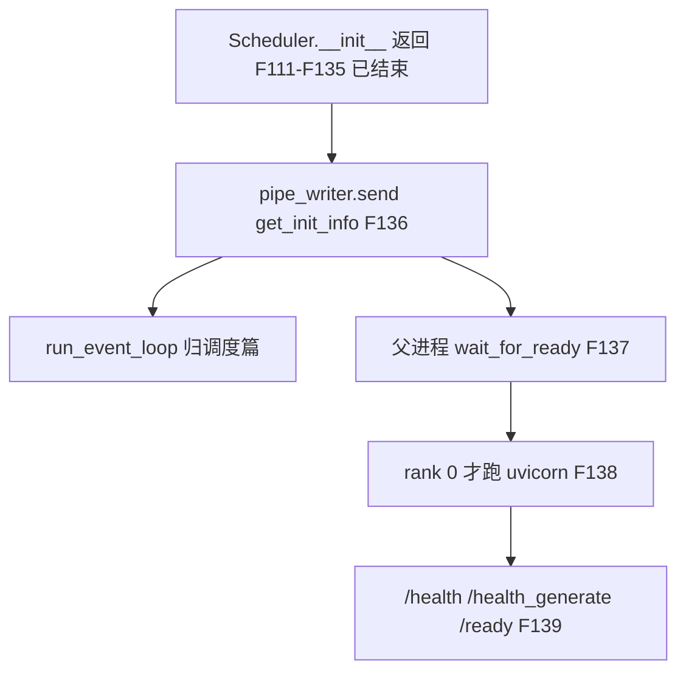
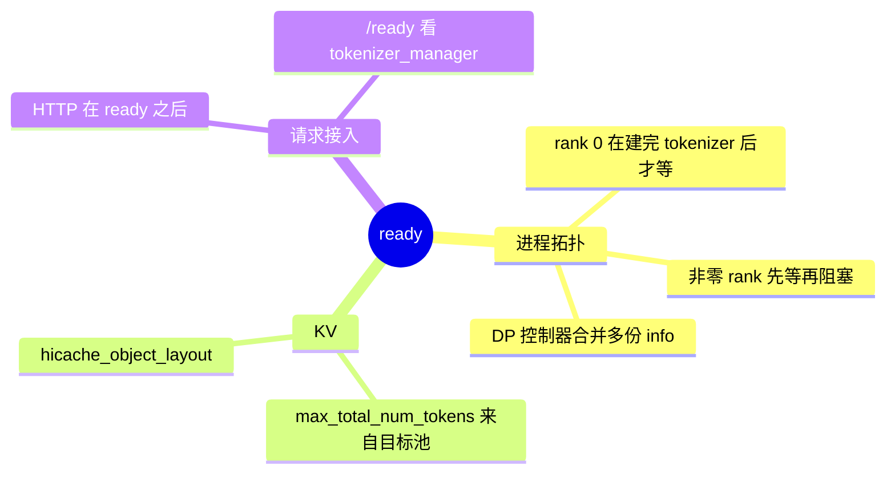
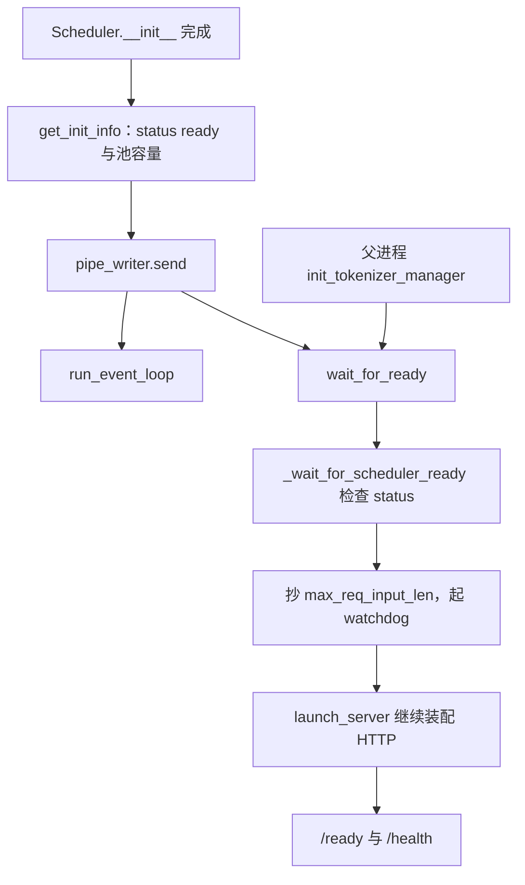

# ready

对应 F08、F136–F139。子进程把握手写进 pipe 的时刻，就是启动段的结束。事件循环的下一次迭代归 [调度与推理](../03-调度与推理/README.md)。**源码路径推断，未实测**。

## 在框架中的位置

## 场景

| 场景 | 父进程怎样算「齐了」 |
| --- | --- |
| 单 scheduler | `_wait_for_scheduler_ready` 读这一根 pipe，`status` 必须是 `ready` |
| 本节点多个 TP/PP scheduler，没有控制器 | 每根 pipe 一份 info，全部到齐 |
| 有 DataParallelController | 父进程只读控制器这一根 pipe。控制器先收齐各 scheduler 的握手，再发送 `status == "ready"` 和 `scheduler_pids` |
| attention DP 预启动 | 父进程已经把 scheduler 拉起来，duplex pipe 先把 rank 参数送进去。ready 仍由控制器汇总后写给父进程，父进程不直接读那些预启动 pipe |
| `node_rank >= 1` | 同样 `wait_for_ready`，但随后不进入业务 HTTP |
| Rust server | 主进程没有 tokenizer，仍 `wait_for_ready`，然后停在 scheduler 上，不跑 Python HTTP |
| 原生 `--grpc-port`，且不是 SMG / 旧 grpc 模式 | 每份 scheduler info 可带 `kv_event_sources`。父进程把各 rank 的源按 `dp_rank` 排序后放进 `infos[0]` |

## F136 子进程何时 send

`run_scheduler_process` 的顺序是：插件、`publish`、进程标题、`Scheduler(...)`、**然后** `pipe_writer.send(scheduler.get_init_info())`，然后才 `run_event_loop()`。

`Scheduler.__init__` 末尾把 `is_initializing` 设为假，并 `init_startup_timing_summary`。构造函数返回时，模型、池、树、chunk、session、HiSparse 句柄、分离初始化、grammar、request receiver 都已经走过。本目录不展开这些接收器在服务期的行为，只确认它们发生在 send 之前，所以父进程看到 ready 时子进程不是停在 `load_model` 半截。

`get_init_info` 的文档：给 tokenizer manager 和其他组件做握手。字段：

| 键 | 含义 |
| --- | --- |
| `status` | 固定 `"ready"` |
| `max_total_num_tokens` | 来自目标 `tp_worker.get_worker_info`，F119 |
| `max_req_input_len` | 同上 |
| `startup_time` | scheduler 自己的启动计时 |
| `hicache_object_layout` | `_hicache_l3_layout()`。没有 L3 时具体值以该函数为准，键本身总会写上 |
| `kv_event_sources` | 仅当 `grpc_port` 非空，且不是 `smg_grpc_mode` 或 `grpc_mode` |

控制器的 `get_init_info` 不带 `status` 字符串的另一套合并：它保留 `max_total_num_tokens`、`max_req_input_len`、聚合后的 `startup_time`，并用 `merge_l3_layouts` 合并各 scheduler 的布局。父进程 `_wait_for_scheduler_ready` 要求 `data["status"] == "ready"`。控制器进程发给父进程的那份 payload 在 `run_data_parallel_controller_process` 里还要包一层，并带 `scheduler_pids`。本页没有把控制器 send 的每一键再抄一遍；父进程只认 `status == "ready"` 这一条作为放行条件。

各 PP stage 只报告自己的 L3 池。`wait_for_ready` 内部 `merge_scheduler_info_layouts`，让每一份 info 都带上合并后的布局。

## F137 父进程等齐

`Engine._launch_scheduler_processes` 返回的 `SchedulerInitResult.wait_for_ready` 就是闭包 `wait_for_ready`。它调用 `_wait_for_scheduler_ready(scheduler_pipe_readers, scheduler_procs)`。

rank 0 的 Python HTTP 路径里，这个等待发生在 detokenizer 进程和 `init_tokenizer_manager` **之后**（进程拓扑页）。子进程的 send 不依赖 tokenizer 已经构造完成；父进程选择在自己把分词器建好后再阻塞。两边用 pipe，不用 ZMQ。ZMQ 的 IPC 名在这之前已经写进 `PortArgs`，但业务请求还没发送。

等待成功后 `_set_startup_time`，并把第一份 info 的 `max_req_input_len` 抄给 tokenizer。然后 `SubprocessWatchdog` 看着 scheduler 和 detokenizer。Ray 的 `scheduler_procs` 是 `None`，watchdog 的进程列表因此为空的 scheduler 段；Ray actor 的就绪协议待核。

预启动且 `node_rank > 0` 时，`block_until_scheduler_exits` 会先起 watchdog 再 `join`。那是非零 rank 的驻留，不是 ready 握手本身。

## F138 然后才是 HTTP

`http_server.launch_server`：

- `node_rank >= 1`：`_launch_subprocesses` 已经阻塞到 scheduler 退出，这里直接 return，不起业务 HTTP。
- `SGLANG_RUST_SERVER`：注释写 Rust 自己提供 API、分词和反分词，主进程没有 Python HTTP / tokenizer 要跑。
- 其余：`_launch_subprocesses` 返回之后才进入 HTTP 服务器的装配和 uvicorn。原生 gRPC 若设置了 `grpc_port` 且不是 SMG 模式，在 FastAPI lifespan 里跟着 HTTP 起，不改变 F22 的 SMG 分支。

warmup 函数 `_execute_server_warmup` 是 `launch_server` 的参数，发生在子进程已经 ready、HTTP 开始对外服务的这段装配里。warmup 的请求内容属于服务期，不在本页展开。

因此「ready」有两层：pipe 里的 `status == "ready"` 表示 scheduler 初始化结束；HTTP 的 `/ready` 表示 tokenizer 认为可以接新请求。第二层在 F139。

## F139 健康检查

默认 HTTP 进程上：

| 路由 | 条件 | 结果 |
| --- | --- | --- |
| `GET /ready` | `tokenizer_manager.is_ready()` | 200 或 503。`is_ready` 要求没暂停且 `is_healthy()`。`is_healthy` 要求没在退出，且 `server_status == Up` |
| `GET /health` 与 `GET /health_generate` | `gracefully_exit` 或 `server_status == Starting` | 503 |
| 同上 | `SGLANG_DIAG_BYPASS_HEALTH_GENERATE` | 200，不发真实生成 |
| `GET /health` | 没开 `SGLANG_ENABLE_HEALTH_ENDPOINT_GENERATION` | 200，不发真实生成 |
| 其余 | 生成模型 | 发一条 `max_new_tokens = 1`、`temperature = 0` 的 `GenerateReqInput`，`input_ids = [0]`，`log_metrics=False`。rid 带 UUID。PD 分离时再填假的 bootstrap host 和 room 0 |
| 其余 | 非生成（embedding） | 同样的单 token，走 `EmbeddingReqInput` |
| 判定 | 在 `HEALTH_CHECK_TIMEOUT` 内从 `generate_request` 收到任意一块 | 文档字符串：只要 detokenizer 或 scheduler 有响应，就认为健康。正在跑别的请求时这条特殊请求会被忽略，因此没有额外开销；空闲时才会真的跑 |

`GET /ping` 是 SageMaker 的检查：`is_healthy()` 则 200。注释写明和 `/ready` 的差别：暂停的服务对 `/ping` 仍可以是 200，避免权重同步这类主动暂停把实例换掉。它看的是旗标，因为 SageMaker 的超时是 2 秒。`/ping` 不在清单 F139 的三个路径里，这里只作为相邻路由记下。

`node_rank >= 1` 的 dummy health 是另一个端口上的占位服务，不跑这条生成探针。Rust 占着本节点基端口时连 dummy 也不起。

## 调用栈

| 函数 | 做什么 | 角色 |
| --- | --- | --- |
| `get_init_info` | 组装握手字典 | 子进程声明自己可以进事件循环 |
| `pipe_writer.send` | 把字典交给父进程 | ready 的传输，不是 ZMQ 业务通道 |
| `wait_for_ready` | 收齐本节点的 pipe | 父进程的屏障 |
| `launch_server` 的后半 | 在屏障之后跑 HTTP | 业务端口 |
| `ready` / `health_generate` | 读 tokenizer 状态，或发 1 token | 对外的存活信号 |

启动段到此结束。下一批是请求如何变成 `GenerateReqInput` 并送进已经就绪的 scheduler。

返回 [本目录](README.md)。
