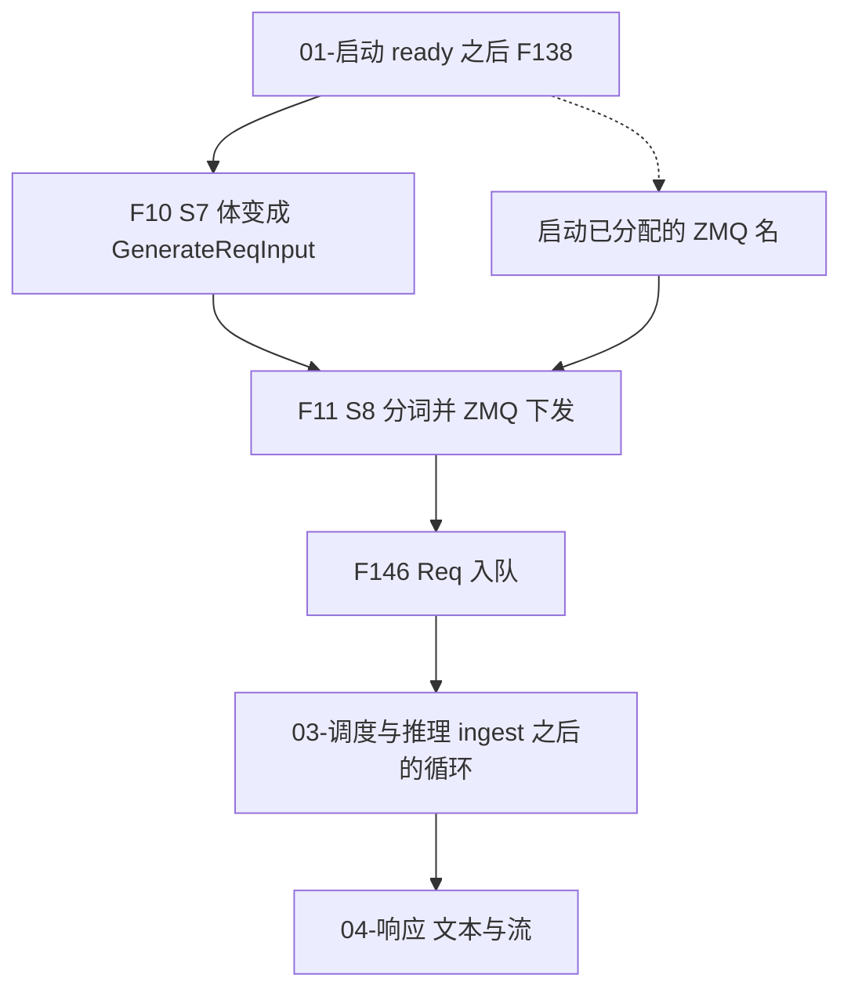
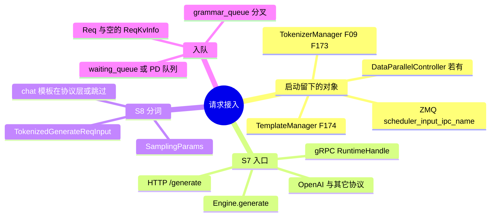
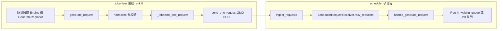
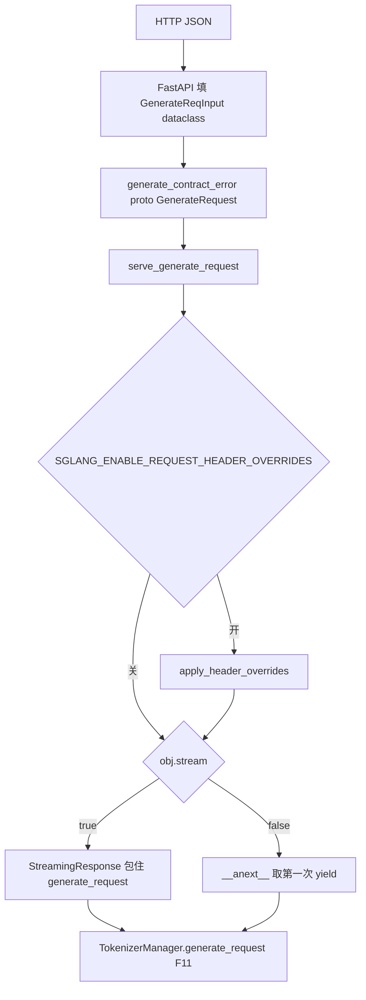
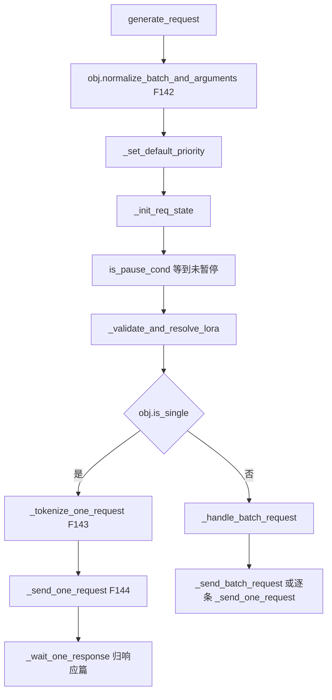

# 阶段总览

本页只铺 S7、S8（F10、F11）。函数级过程在后面各页。树是 `297e54fd105e974cdf401e5b4d20253a22c16f90`（标签 `v0.5.23`）。多卡、设备和网络上的时序没有实跑，标 **源码路径推断，未实测**。

调度循环、组 batch、前向归 [调度与推理](../03-调度与推理/README.md)。token 变文本、SSE 块怎么 yield 归 [流式与非流式响应](../04-流式与非流式响应/README.md)。本目录写到请求进 scheduler 队列为止。

## 这一段在框架里的位置

启动在 pipe `status == "ready"` 之后才跑 uvicorn（F138）。请求接入从这之后的第一份业务体开始，到 `Req` 进入 `waiting_queue` 或 PD 的对应队列结束。

父进程里的时间序和子进程里的时间序不要叠成一条直线。HTTP 或 Engine 在 tokenizer 进程里把体收成 `TokenizedGenerateReqInput` 并 `PUSH`。scheduler 进程在自己的事件循环里 `ingest_requests`，那时才 `Req(...)`。两边用 ZMQ，不用启动时那根 pipe。

谁在循环里调用 `ingest_requests` 是 F12，归调度篇。本页只确认：收包函数已经挂在 `Scheduler` 上，ready 之前 `init_request_dispatcher` 已把 `TokenizedGenerateReqInput` 指到 `handle_generate_request`。

## 场景

| 场景 | 前提 | 这条链路怎么分叉 | 清单 |
| --- | --- | --- | --- |
| 默认 HTTP，单请求文本 | rank 0 的 FastAPI。`stream` 默认 false | `POST/PUT /generate` → 契约检查 → `serve_generate_request` → 一次 `__anext__` | F10、F140 |
| HTTP 流式 | 同一路由，体里 `stream: true` | 入口就包 `StreamingResponse`。块内 yield 规则归响应篇 | F10、F170 的入口侧 |
| OpenAI chat | `Content-Type: application/json` | 先在 `OpenAIServingChat` 里渲染模板，再变成 `GenerateReqInput`。不走 `/generate` 的 proto 契约 | F141、F178 |
| 进程内 Engine | `sgl.Engine` / `Engine.generate`。拒绝 `SGLANG_RUST_SERVER` | 直接造 `GenerateReqInput`，`request=None`，没有 SSE | F11 |
| 原生 gRPC | 设置了 `grpc_port`，且不是 SMG 模式。Rust 扩展 `sglang.srt.rust_extensions._grpc` | `RuntimeHandle` 仍调用同一个 `generate_request` | F10 的非 HTTP 侧 |
| 多模态 | 模型 `is_multimodal`，且没有 `--language-model-only` | 文本分词之后走 `mm_processor.process_mm_data_async` | F176 |
| 已给 `input_ids` | 调用方自己分好词，或 chat 层已经编码 | `_tokenize_one_request` 不再 `encode` | F143 |
| `skip_tokenizer_init` | 启动时关掉 tokenizer | 只接受 `input_ids` / embedding 的既有 id。文本直接 `ValueError` | F143 |
| 有 DataParallelController | `dp_size>1` 或 attention DP。启动篇 F97 | ZMQ 先到控制器，再按负载或 `routed_dp_rank` 送到某个 scheduler | F144 |
| 多 tokenizer worker | `tokenizer_worker_num>1` | worker 先到 `MultiTokenizerRouter`，路由器再 PUSH 到 scheduler 或控制器 | F144 |
| PD 分离 | `disaggregation_mode` 为 prefill 或 decode | `Req` 不进 `waiting_queue`，分别进 bootstrap 队列或 decode prealloc 队列 | F146 |
| embedding | `/encode`、`/classify`，或 `Engine.encode` | 体是 `EmbeddingReqInput`，scheduler 走 `handle_embedding_request` | F141 |
| Rust server | 环境变量 `SGLANG_RUST_SERVER` | 主进程没有 Python tokenizer。scheduler 从环缓冲 `drain`。启动篇 F102、F204 | 本目录不重写 |
| 扩散 HTTP | `--model-type diffusion` | 不进 LLM 的 `TokenizerManager`。启动篇 F24 | 本目录不写 |

场景行回填 [场景与硬件前提总表](../../01-体系总览/03-场景与硬件前提总表.md)。接入代码跑在 tokenizer 进程，不建 TP 组。CUDA 只在多模态特征传输 `mm_feature_transport=cuda_vmm`，以及 encoder SWA replay 的图像请求上成为硬前提。

## F10 S7 HTTP 体变成 GenerateReqInput

位置：rank 0 的 FastAPI，`python/sglang/srt/entrypoints/http_server.py` 的 `generate_request` / `serve_generate_request`。OpenAI 兼容层在进这两个函数之前就把协议体收成同一个 dataclass。符号：`managers/io_struct.py` 的 `@dataclass GenerateReqInput`。

角色：把外部 JSON 收成 tokenizer 唯一认的请求体。这一步结束时还没有 token id，也还没有 `Req`。

原理：FastAPI 按 dataclass 字段做第一次解析。`/generate` 再拿 Starlette 缓存的 JSON 跑 `generate_contract_error`，用 `sglang.api.v1` 的 `GenerateRequest.from_json_value` 做第二次拒绝。注释写明这是 schema 检查，不是第二次解码。其它协议用自己的 Pydantic 模型，不进这道 proto 门，它们在自己的 `_convert_to_internal_request` 里造 `GenerateReqInput`。

`stream` 在这一步就决定 HTTP 怎么包响应：真则 `StreamingResponse`，媒体类型 `text/event-stream`，每块 `data: ` 加 JSON，生成器结束再写 `data: [DONE]`；假则对 `generate_request(...).__anext__()` 只取第一次 yield。生成器内部是否中途 yield，归 F169，本目录不展开。

实现上的入口分叉见 [01-协议入口](01-协议入口.md)。字段表不在这里抄，在 [附录 06](../../附录-选项索引/06-Client请求选项大全.md)。

## F11 S8 分词，ZMQ 发给 scheduler

位置：`managers/tokenizer_manager.py` `TokenizerManager.generate_request`。Engine、gRPC、`/generate`、OpenAI serving 的流式与非流式最后都进这个异步生成器。

角色：规范化、分词、造成 `TokenizedGenerateReqInput`，经 ZMQ 送到 scheduler 或 DP 控制器，然后在本进程等回包。等回包的循环归响应篇；本阶段的完成点是 `_send_one_request` 把对象发出去。

原理：tokenizer 与 scheduler 不共享地址空间。启动已经把 `PUSH`/`PULL` 的 IPC 名写进 `PortArgs`。请求侧只发送已经 pickle 过的 token 化对象，不发送原始 HTTP 体。`request is None` 时没有 HTTP 断连可查，Engine 走这条。

单请求失败若发生在发出去之前，`_release_req_states_on_failure` 丢掉尚未 `dispatched` 的 `rid_to_state`。已经 `PUSH` 过的请求改走 abort，避免 scheduler 侧泄漏。

返回 [本目录 README](README.md)。
