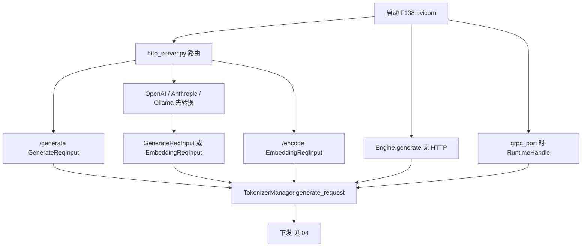
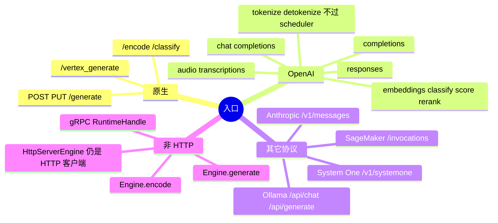
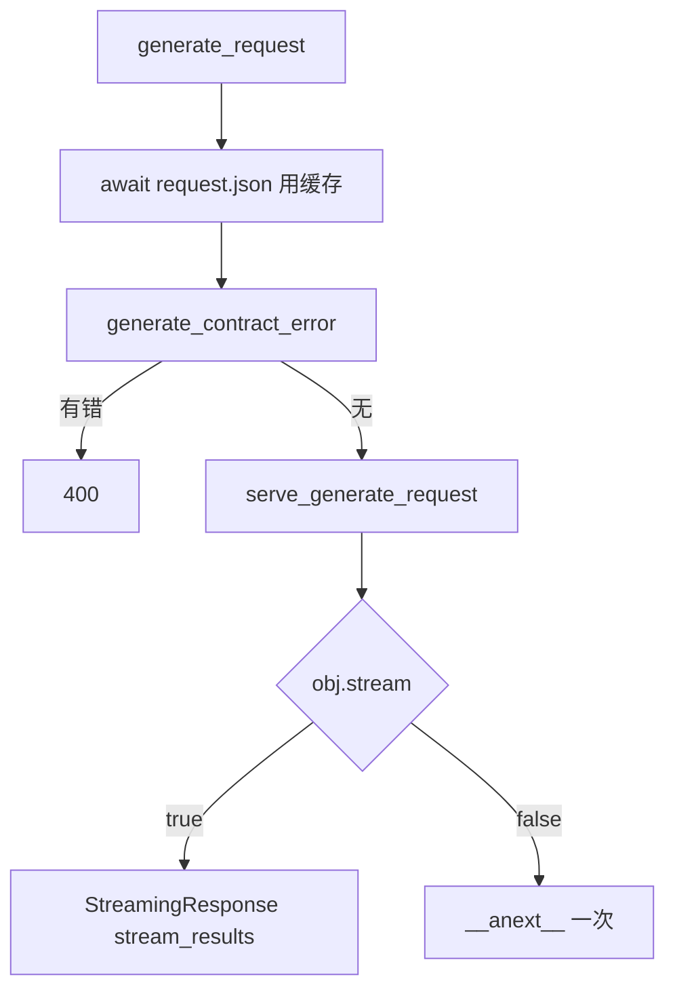
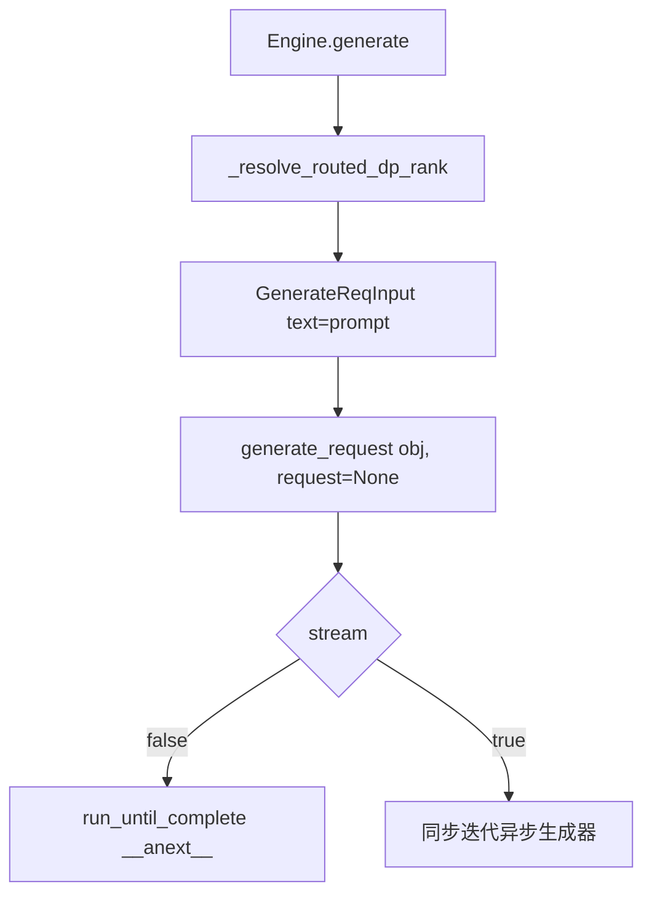

# 协议入口

对应 F140，以及清单 A.10 末尾列出的其它 HTTP 入口。它们是协议，不是第二条调度器。树是 `297e54fd105e974cdf401e5b4d20253a22c16f90`。**源码路径推断，未实测**。

字段逐项对照在 [附录 06](../../附录-选项索引/06-Client请求选项大全.md)。本页写每条入口把外部体收成哪种内部对象，以及 `stream` 在入口处怎么分支。

## 在框架中的位置





## 场景

| 场景 | 谁造内部对象 | 过不过 `/generate` 的 proto 契约 | `stream` 在入口的含义 |
| --- | --- | --- | --- |
| `POST/PUT /generate` | FastAPI 填 `GenerateReqInput` | 过。`generate_contract_error` | 真：SSE。假：一次 JSON |
| OpenAI chat / completions | `OpenAIServingBase.handle_request` → `_convert_to_internal_request` | 不过。另有 JSON Content-Type 检查 | 真：子类 `_handle_streaming_request`。假：`_handle_non_streaming_request` |
| Anthropic `/v1/messages` | 先变成 `ChatCompletionRequest`，再进 chat serving | 不过 | 跟 chat 的 `stream` |
| Ollama chat / generate | `OllamaServing` 自己造 `GenerateReqInput` | 不过 | 路由内再分支流式包装 |
| Vertex | 路由里手写 `GenerateReqInput`，再调 `generate_request` | 过，因为进了 `generate_request` | 跟 `/generate` |
| SageMaker `/invocations` | 直接 `openai_serving_chat.handle_request` | 不过 | 跟 chat |
| `/encode`、`/classify` | FastAPI 填 `EmbeddingReqInput` | 不过 | 这两个路由只 `__anext__()` 一次。类上没有 `stream` |
| `Engine.generate` | 方法内 `GenerateReqInput(...)` | 不过 | 真：同步包装异步生成器。假：`run_until_complete` 取一次 |
| gRPC `submit_request` | `GenerateReqInput(**req_dict)` | Python 侧看不到 proto 门。Rust 扩展是否先校验，**待核** | `req_dict["stream"]` 决定是否逐块回调 |
| `SGLANG_RUST_SERVER` | 不建 Python `TokenizerManager` | 不走本页路由 | 启动篇 F204 |

## F140 原生 `/generate`

位置：`http_server.py`。

```text
@app.api_route("/generate", methods=["POST", "PUT"])
async def generate_request
async def serve_generate_request
```

角色：LLM 的原生生成入口。OpenAI 层不调用它，Vertex 调用它。

原理：dataclass 解析与 proto 契约是两道门。第一道失败由 FastAPI 的 `RequestValidationError` 处理。第二道失败返回 400，`{"error": contract_error}`，不再调用 `serve_generate_request`。注释写明 Starlette 缓存了已解析的 body，所以第二道不是重新解码。

`serve_generate_request` 的角色是「已经准入的生成」。函数文档写自带解析器的路由可以直接调它、从而不再做第二次契约检查。本树里唯一的调用点是 `generate_request` 自己。Vertex 调的也是 `generate_request`，因此仍过契约。

入口处的 `stream`：

| `obj.stream` | 入口做的事 | 角色 |
| --- | --- | --- |
| true | 定义 `stream_results`，对 `generate_request` 异步迭代，每块 `b"data: "` + JSON + `b"\n\n"`，最后 `b"data: [DONE]\n\n"`。返回 `StreamingResponse`，`background=create_abort_task(obj)` | 把 tokenizer 的多次 yield 包成 SSE。客户端断开时 `ValueError` 且 `request.is_disconnected()` 则只打日志、不再发 400 |
| false | `await generate_request(...).__anext__()`，`orjson_response` 一次返回 | 非流式也进同一个异步生成器，只消费第一次 yield。为何如此是 F198，归响应篇 |

`SGLANG_ENABLE_REQUEST_HEADER_OVERRIDES` 为真时，`apply_header_overrides` 在看 `stream` 之前改对象。



`api_contract.py` 的模块文档：`proto/sglang/api/v1` 是 Rust 与 Python 共用的 schema。dataclass 放行但 schema 拒绝的 `/generate` 体，用 schema 自己的错误文本拒绝。

## OpenAI 兼容层

位置：`http_server.py` 后半，实现在 `entrypoints/openai/`。

公共骨架是 `OpenAIServingBase.handle_request`：

1. `_validate_request`。失败则 `create_error_response`，不进 tokenizer。
2. 可选把原始 OpenAI 体记日志（`log_requests_level >= 2`）。
3. `loop.run_in_executor(None, _convert_to_internal_request, ...)`。注释写明 Jinja 渲染和整段分词会挡住事件循环，Rust tokenizer 会放 GIL，所以转换丢到线程池。
4. 给 `GenerateReqInput` / `EmbeddingReqInput` 打上 `received_time`。
5. `request.stream` 为真走 `_handle_streaming_request`，否则 `_handle_non_streaming_request`。基类的流式默认是 501，chat 与 completions 覆盖它。

`validate_json_request` 只查 `Content-Type` 的 media type 是不是 `application/json`。它挂在 chat、completions、embeddings、score、responses、rerank、Anthropic messages 上。`/generate` 不挂这个依赖。`/v1/audio/transcriptions` 是 multipart，也不挂。

| 路由 | 处理函数 | 内部对象 | 角色 |
| --- | --- | --- | --- |
| `POST /v1/completions` | `OpenAIServingCompletion.handle_request` | `GenerateReqInput`。字符串 prompt 放 `text`，token 数组放 `input_ids`。若配置了 completion template，先 `generate_completion_prompt_from_request` | 补全，不跑 chat 模板 |
| `POST /v1/chat/completions` | `OpenAIServingChat.handle_request` | `GenerateReqInput`。模板在转换期展开，能复用 token 时放 `input_ids` | 对话。模板细节在分词页 |
| `POST /invocations` | 同一个 chat `handle_request` | 同上 | SageMaker 复用 chat |
| `POST /v1/embeddings` | `OpenAIServingEmbedding.handle_request` | `EmbeddingReqInput`，部分模板路径会先 `apply_chat_template` | 向量，非生成 |
| `POST /v1/classify` | `OpenAIServingClassify.handle_request` | embedding 侧对象 | 分类 |
| `POST /v1/score` | `OpenAIServingScore.handle_request` | 注释写 CausalLM 用 logprob、分类模型用类 logit，不一律造 `GenerateReqInput` | 打分 |
| `POST /v1/decisions` | `OpenAIServingDecisions.handle_request` | 经 chat 模板渲染后走打分，不生成 | 选项题 |
| `POST /v1/rerank` | `OpenAIServingRerank.handle_request` | 文本重排可造 embedding 请求；VL 重排路径里出现 `GenerateReqInput` | 重排 |
| `POST /v1/responses` | `OpenAIServingResponses.create_responses` | 内部仍造 `GenerateReqInput`。返回值若是异步生成器，路由包 `StreamingResponse` | Responses API。背景任务的取回与取消是另外两个路由，不新造生成请求 |
| `POST /v1/audio/transcriptions` | `OpenAIServingTranscription.create_transcription` | 读上传字节后造 `GenerateReqInput` | 转写。表单里的 `stream` 传进 create |
| `WS /v1/realtime` | `handle_websocket` | 注释写只实现转写子集 | 不走 `/generate` |
| `POST /v1/tokenize`、`/tokenize` | `OpenAIServingTokenize` | 在本进程分词后返回 | 不进 scheduler |
| `POST /v1/detokenize`、`/detokenize` | `OpenAIServingDetokenize` | 本进程反分词 | 不进 scheduler |
| `GET /v1/models` | `available_models` | 无 | 读 `served_model_name` 与已加载 LoRA |

chat 转换期若 `stream` 为真，下列字段直接 `ValueError`，请求到不了 tokenizer：`return_prompt_token_ids`、`return_token_ids`、`return_meta_info`。这是入口校验，不是 scheduler 拒绝。

## 其它协议

| 路由 | 函数 | 做完什么 |
| --- | --- | --- |
| `POST /v1/messages` | `anthropic/serving.py` `AnthropicServing.handle_messages` | `_convert_to_chat_completion_request`，再交给 chat serving 的流式或非流式。Anthropic 的 `stream` 决定走哪边 |
| `POST /v1/messages/count_tokens` | `handle_count_tokens` | 计数，不按生成请求下发 |
| `POST` `SGLANG_OLLAMA_CHAT_ROUTE`，默认 `/api/chat` | `OllamaServing.handle_chat` | `tokenizer.apply_chat_template(..., tokenize=True)` 得到 `prompt_ids`，`GenerateReqInput(input_ids=..., stream=request.stream)`。默认 `max_new_tokens` 缺省时写成 2048 |
| `POST` `SGLANG_OLLAMA_GENERATE_ROUTE`，默认 `/api/generate` | `handle_generate` | 同样造 `GenerateReqInput`。这是补全口，不套 chat 消息列表 |
| `POST /v1/systemone` | `systemone_serving.handle_request` | 注释：用候选打分回答，不生成。`/encode` 若看见 `decision_layout` 会拒绝，只允许这条路由填写 |
| `POST` `AIP_PREDICT_ROUTE`，默认 `/vertex_generate` | `vertex_generate` | 从 `instances` 取 `text` / `input_ids` / `input_embeds` 之一，加上 `image_data` 与 `parameters`，造 `GenerateReqInput`，再 `generate_request` |
| `GET /ping` | `sagemaker_health` | 只看 `tokenizer_manager.is_healthy()`。暂停仍 200。不发推理 |

原生且会进 `generate_request` 的还有：

| 路由 | 体 | 与生成的差别 |
| --- | --- | --- |
| `POST/PUT /encode` | `EmbeddingReqInput` | 先 `_refuse_decision_layout`。只取一次 yield |
| `POST/PUT /classify` | 同上 | 注释写奖励模型与 embedding 的参数和返回目前相同 |

管理面路由（权重、LoRA、profile、flush、session、abort、pause）也挂在同一个 `app` 上，它们发的是控制消息，不是 `GenerateReqInput`。本页不把它们算进 F140。

## 非 HTTP：Engine

位置：`entrypoints/engine.py` `Engine.generate` / `async_generate` / `encode` / `async_encode`。`ray/engine.py` 的 `RayEngine` 继承 `Engine`，生成方法没有另写一套。Ray actor 怎么替换进程，启动篇已标待核，本页不重开。

角色：离线调用与 HTTP 共用 tokenizer 之后的路径，不共用 HTTP 包装。

原理：

- `Engine.__init__` 若发现 `SGLANG_RUST_SERVER`，直接 `ValueError`。注释写这个变量只替换 `sglang serve` 的 HTTP 路径。
- `generate` 把参数收成 `GenerateReqInput`。`prompt` 放进 `text`。`data_parallel_rank` 在进 dataclass 之前由 `_resolve_routed_dp_rank` 折进 `routed_dp_rank`；`num_dp_ranks<=1` 且 rank 为 0 时丢掉。
- `tokenizer_manager.generate_request(obj, None)`。第二个参数是 HTTP `Request`，这里没有客户端连接。
- `stream` 为假：`loop.run_until_complete(generator.__anext__())` 返回一个 dict。为真：同步生成器里反复 `run_until_complete(__anext__())`，直到 `StopAsyncIteration`。
- `async_generate` 在 `stream is True` 时把异步生成器原样返回，否则 `await __anext__()`。
- `encode` 造 `EmbeddingReqInput`，只取一次结果。没有 `stream` 参数。

`http_server_engine.py` 的 `HttpServerEngine.generate` 是另一回事：它把字段收成 JSON，`_make_request("generate", payload)` 打到已经在跑的 HTTP 服务器。那是客户端，仍走 F140，不在进程内调用 `TokenizerManager`。



多 tokenizer 时，`Engine.__init__` 若拿到的是 `MultiTokenizerRouter`，会再 `_init_tokenizer_worker`，让本进程的 `generate` 仍有自己的 `TokenizerManager`。路由器没有 `generate_request`。

## 非 HTTP：原生 gRPC

位置：`http_server.py` `_start_native_grpc_server_for_runtime`，在 FastAPI lifespan 里、且 `grpc_port` 有值、又不是 SMG / 旧 grpc 模式时调用。Python 侧是 `entrypoints/grpc_bridge.py` `RuntimeHandle`。真正 listen 的是 Rust 扩展 `sglang.srt.rust_extensions._grpc` 的 `start_server`。

角色：给非 HTTP 客户端一条进同一 `TokenizerManager` 的路。分词仍在 Python。

`submit_request`：

| `req_type` | 对象 | 下一步 |
| --- | --- | --- |
| `generate` | `GenerateReqInput(**req_dict)` | `_run_generate` → `generate_request`。`stream` 来自 dict，缺省 false |
| `embed` | `EmbeddingReqInput(**req_dict)` | `_run_embed` |
| 其它 | `ValueError` | 不发送 |

另有 `submit_openai_chat`、`submit_openai_complete`、`submit_openai_embed` 等，走对应的 OpenAI serving，而不是跳过模板。断连用 `_GrpcRequest.is_disconnected`，不是 FastAPI `Request`。

Rust 扩展在把 dict 交给 `submit_request` 之前做了哪些字段检查，本树的 Python 文件看不出，标 **待核**。

`SGLANG_RUST_SERVER` 与这条 gRPC 不是同一条。前者替换掉 Python tokenizer，scheduler 从环缓冲收包（`SchedulerRequestReceiver._pull_raw_reqs`）。后者保留 Python tokenizer，只是把 HTTP 换成 gRPC 前端。

返回 [本目录 README](README.md)。
