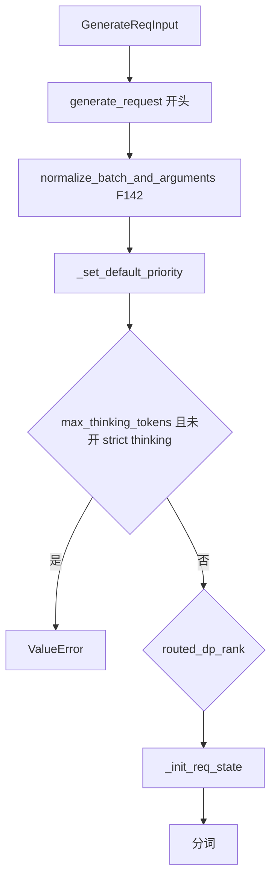
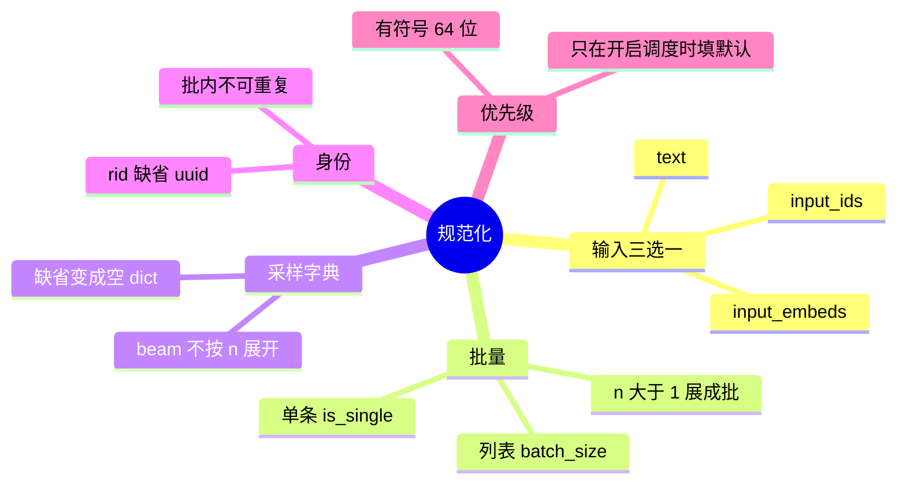
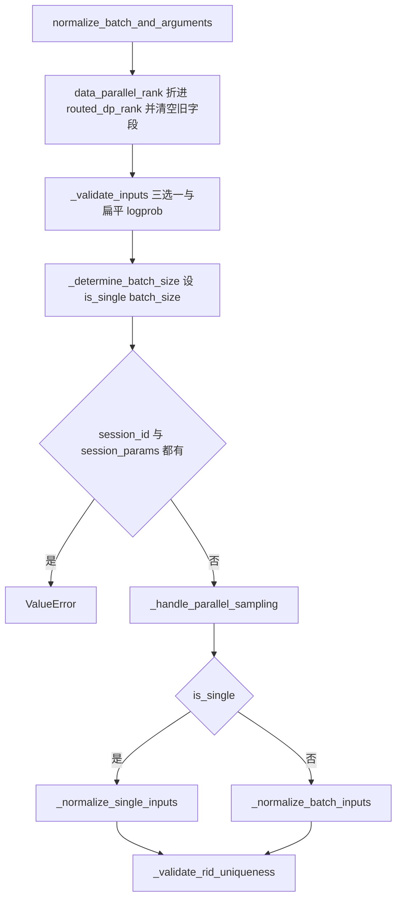

# 校验与规范化

对应 F141、F142。树是 `297e54fd105e974cdf401e5b4d20253a22c16f90`。**源码路径推断，未实测**。

本页从「已经是 `GenerateReqInput` 或 `EmbeddingReqInput`」写起。协议怎么变成它，在 [01-协议入口](01-协议入口.md)。分词在 [03-分词与模板](03-分词与模板.md)。

## 在框架中的位置

## 场景

| 场景 | 规范化怎么走 | 会在这一步失败的情况 |
| --- | --- | --- |
| 单条 `text` 字符串 | `is_single=True`，`batch_size=1`。`input_embeds` 被清掉 | `text`、`input_ids`、`input_embeds` 全空，或三个同时有 |
| 单条 `input_ids` | 一维 int 列表算单条。空列表只在带 session id 时放行，否则 `ValueError` | 空 `input_ids` 且没有 session |
| `input_embeds` | 看第一维是不是 float，区分单条与批 | 与 text、ids 的互斥规则同上 |
| `sampling_params.n>1` 且原来是单条 | 变成批：text/ids/embeds 套一层列表。`parallel_sample_num=n` | 批里每条的 `n` 不一致 |
| `beam_width>1` | `_handle_beam_search_parallel_sampling` 把展开倍数收成 1。`n` 表示返回序列数，不复制请求 | 无单独错误码；展开被取消 |
| OpenAI chat 已经填好 `input_ids` | 仍走同一套 `normalize_*`。模板不再跑 | `stream` 与若干返回字段的冲突在 chat 转换期已经拒绝 |
| Engine 传入 `data_parallel_rank` | `Engine._resolve_routed_dp_rank` 先折成 `routed_dp_rank`。dataclass 的 `normalize` 里还有一道同样的弃用警告，给没走 Engine 的调用方 | rank 越界在 `generate_request` 里 `ValueError`，`num_dp_ranks<=1` 且 rank 为 0 则忽略 |
| 优先级调度开着且请求没带 `priority` | `_set_default_priority` 填 `default_priority_value` | 值不在有符号 64 位范围 |
| 优先级调度关着但请求带了 `priority` | 这一步只查范围，不拒绝。scheduler 入队时才可能 abort | 见下发页 `_set_or_validate_priority` |
| `session_id` 与 `session_params` 同时有 | `normalize_batch_and_arguments` 直接 `ValueError` | 两个会话身份不能并存 |
| 扁平 logprob 与流式 | `_validate_inputs` | `return_flat_raw_output_top_logprobs` 且 `stream`；b64 旗标缺少对应扁平旗标；扁平 top logprob 与 `multi_item_delimiter_indices` 同时出现 |
| embedding 批 | `EmbeddingReqInput.normalize_batch_and_arguments` 另有实现，本页以生成为主 | `/encode` 上的 `decision_layout` 在路由里就拒绝 |

## F141 请求体

位置：`python/sglang/srt/managers/io_struct.py`。`GenerateReqInput` 与 `EmbeddingReqInput` 都是 `@dataclass`。发出去之后的形态是 msgspec 的 `TokenizedGenerateReqInput(BaseReq)`。

角色：HTTP、OpenAI、Engine、gRPC 之间的交汇结构。调度器不读这个 dataclass，只读 token 化之后的 `BaseReq`。

原理：外部字段很多，但分词只消费其中一组。三套 prompt 互斥，多媒体是附加，不是第四种 prompt。`rid` 可以是字符串或列表；省略则在规范化时生成。批请求若给了一个字符串 `rid`，后面 `_normalize_rid` 用它做前缀拆成每条一个 id。

和 token 化对象的分工：

| 阶段 | 类型 | 谁持有 | 采样参数形态 |
| --- | --- | --- | --- |
| 接入 | `GenerateReqInput` | tokenizer 进程 | `dict` 或 `dict` 的列表 |
| 下发 | `TokenizedGenerateReqInput` | ZMQ 上的 msgspec | `SamplingParams` 结构体 |
| 运行 | `Req` | scheduler 进程 | 同一份 `SamplingParams` |

`EmbeddingReqInput` 对应 `TokenizedEmbeddingReqInput`。`/v1/systemone` 把 `decision_layout` 放在 embedding 体上。生成体没有这条布局；联合头模型若收到 `GenerateReqInput`，分词校验会要求改走 `/v1/systemone`（`_validate_joint_schema_request`）。

OpenAI 层先变成它的证据：`serving_chat.py` `OpenAIServingChat._convert_to_internal_request` 末尾 `GenerateReqInput(...)`；`serving_completions.py` `OpenAIServingCompletion._convert_to_internal_request` 同样。chat 在此之前已经决定 `input_ids` 还是文本键。completions 在字符串时用 `text`，在 token 数组时用 `input_ids`。

header 与体的优先级，chat 在造对象时处理：`extract_routed_dp_rank_from_header` 高于体里的 `routed_dp_rank`。`/generate` 则依赖环境变量打开的 `apply_header_overrides`。两条入口的 header 语义不要当成同一个函数。

## F142 规范化

位置：`GenerateReqInput.normalize_batch_and_arguments`，由 `TokenizerManager.generate_request` 在记日志之前调用。优先级是下一步 `_set_default_priority`，不在 dataclass 方法里。

角色：把单条、批、并行采样收成 tokenizer 能按下标切开的形状，并给缺省字段填值。这一步不调用 tokenizer，不访问 GPU。

原理：后面的 `_tokenize_one_request` 只处理「一条」。批请求靠 `__getitem__` 切成单条再分词。所以批的长度、图像列表、LoRA、bootstrap、logprob 旗标都必须在这里拉齐。并行采样用复制输入实现，而不是在 scheduler 里把一条请求跑 n 次。

调用序：

`_determine_batch_size` 的规则：

| 有的字段 | 单条条件 | 副作用 |
| --- | --- | --- |
| `text` | `str` | 清掉 `input_embeds` |
| `input_ids` | 空且有 session，或第一项是 int | 清掉 `input_embeds`。空且无 session 则拒绝 |
| 只剩 `input_embeds` | `input_embeds[0][0]` 是 float | 不改另两个字段 |

`_handle_parallel_sampling`：`sampling_params is None` 则 `parallel_sample_num=1` 并返回。dict 取 `n`，缺省 1。list 要求每条 `n` 相同。beam 宽度大于 1 时展开倍数改回 1。单条且 `n>1` 时把 `is_single` 改成 false，并把 text/ids/embeds 包成长度为 1 的列表，交给批路径去乘 `n`。

单条 `_normalize_single_inputs` 填上的缺省：

| 字段 | 缺省 |
| --- | --- |
| `sampling_params` | `{}` |
| `rid` | `uuid.uuid4().hex` |
| `return_logprob` | false |
| `logprob_start_len` | -1 |
| `top_logprobs_num` | 0 |
| `token_ids_logprob` | 空或 None 都收成 None |
| `return_sampling_mask` | false |
| `extra_key`、`cache_salt` | 必须是 str；空串收成 None |
| `kv_hints` | 单条不能是 list；非空则 `decode_kv_hints_envelope` |

批路径 `_normalize_batch_inputs` 先算展开后的条数 `num = batch_size * parallel_sample_num`，再按这个长度拉齐：主输入、`rid`、LoRA、image/video/audio、`mm_hashes`、采样、watermark、logprob、hidden states、custom logit processor、`extra_key`、`cache_salt`、`kv_hints`、bootstrap。图像列表长度必须等于展开前的 `batch_size`，否则 `ValueError`。单张图会被收成 `[[image]] * num`，并把 `modalities` 设成 `"image"`。

`_set_default_priority` 在规范化之后：

- `enable_priority_scheduling` 且 `priority is None` 且服务器有 `default_priority_value`：写上该默认。
- `priority` 非空时必须落在 `[-2^63, 2^63)`。
- 调度没开时，这里不把 priority 清掉。入队函数才会决定是留下还是 abort。

`max_thinking_tokens` 也在 `generate_request` 里、分词之前检查：服务器没有 `--enable-strict-thinking` 就 `ValueError`。通过之后，造 `SamplingParams` 时把它写入 `custom_params["thinking_budget"]`。

`routed_dp_rank` 的范围也在分词前：`elastic_worker_count` 来自 `num_dp_ranks`。小于等于 1 且请求写了 0，只打 debug，不改后续发送。越界 `ValueError`。指定了合法 rank 时，控制器侧 `maybe_external_dp_rank_routing` 会直接把包送到该 rank，不再走负载函数。

返回 [本目录 README](README.md)。
