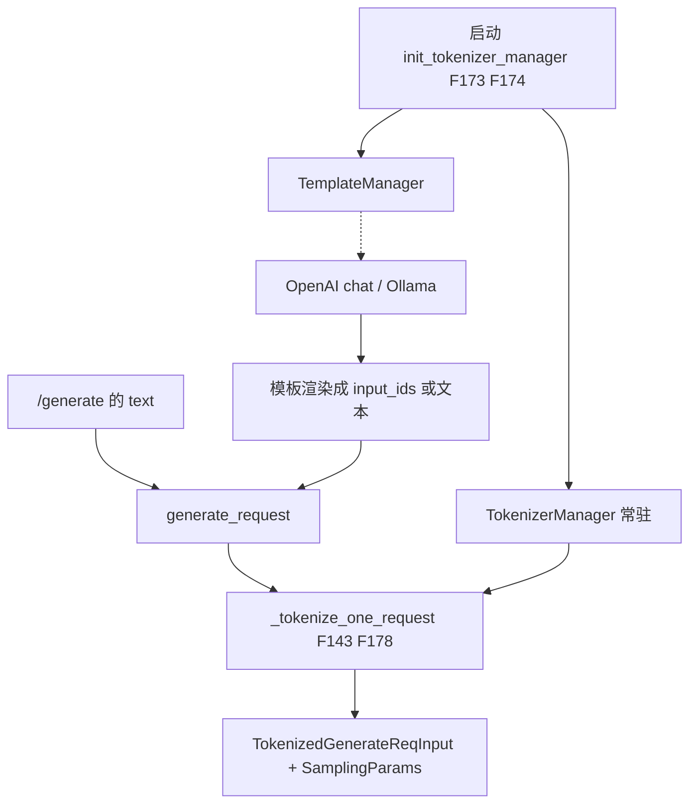
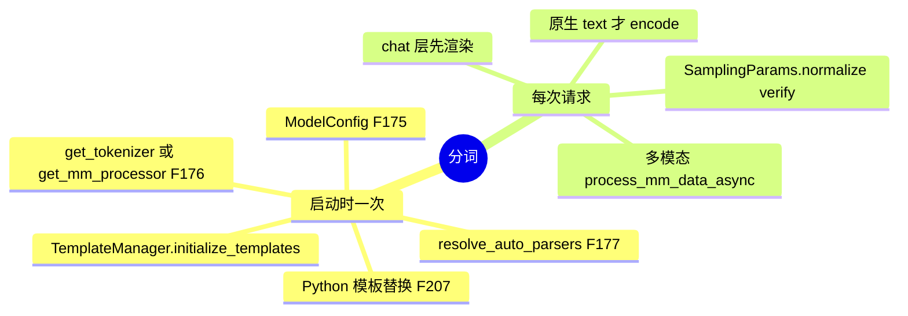
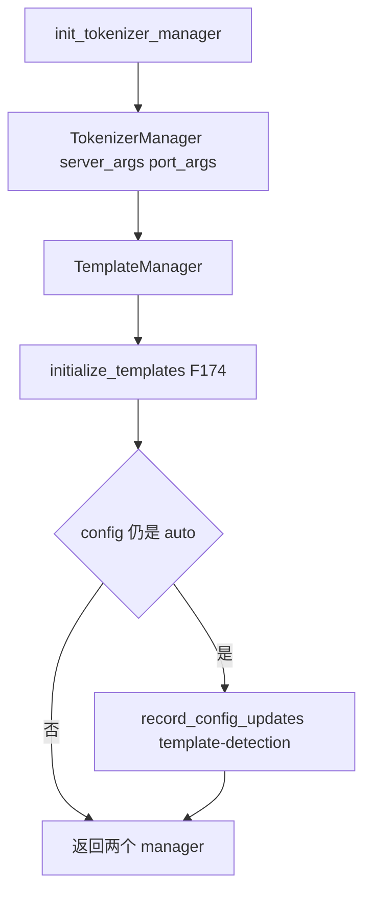
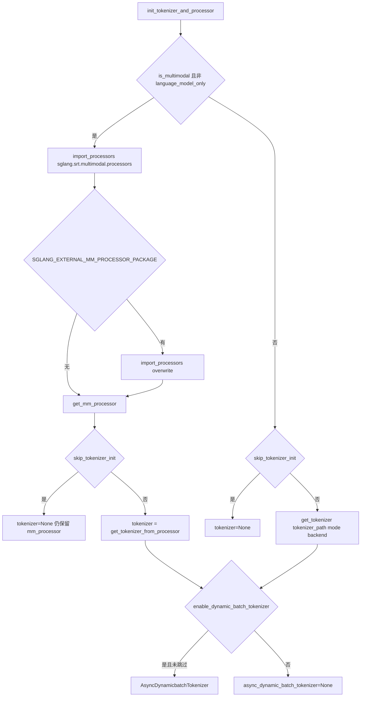
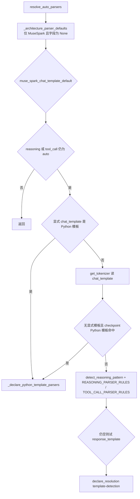
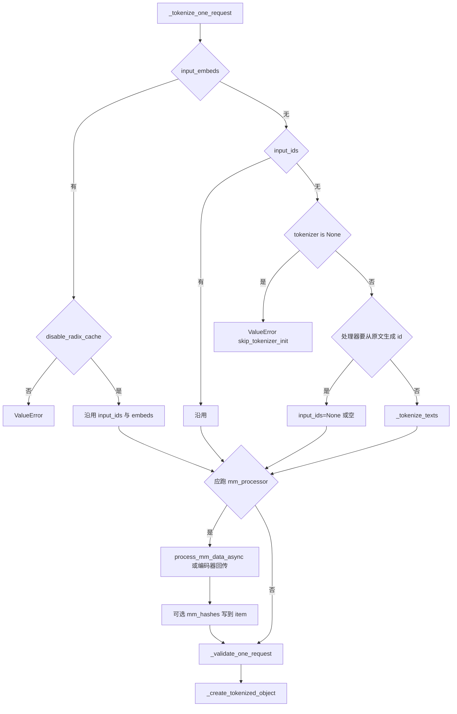

# 分词与模板

对应 F143、F173–F178、F207。树是 `297e54fd105e974cdf401e5b4d20253a22c16f90`。**源码路径推断，未实测**。

`TokenizerManager` 的进程在启动篇 F09 已经建好。本页写它里面和请求有关的对象，以及一次请求如何变成 `TokenizedGenerateReqInput`。

## 在框架中的位置

## 场景

| 场景 | 模板跑在哪 | 分词跑在哪 |
| --- | --- | --- |
| `POST /generate` 且 `text` 是字符串 | 不跑 chat 模板。字符串原样编码 | `_tokenize_texts` |
| `/generate` 或 Engine 已给 `input_ids` | 不跑 | `_tokenize_one_request` 直接沿用 |
| `/generate` 给 `input_embeds` | 不跑 | 要求 `--disable-radix-cache`，否则 `ValueError` |
| `/v1/chat/completions` | `OpenAIServingChat._process_messages` → `_render_and_encode_chat_template` 或会话模板 / 专用 encoder | 转换线程里已经得到 `prompt_ids` 时，`GenerateReqInput` 带 `input_ids`，tokenizer 不再 encode 这段文本 |
| Ollama `/api/chat` | `tokenizer.apply_chat_template(..., tokenize=True)` | 结果放进 `input_ids` |
| `/v1/completions` | 只有配置了 completion template 才改 prompt。不跑 chat 模板 | 字符串仍是 `text`，到 `_tokenize_texts` 才编码 |
| 多模态且处理器声明 `generates_input_ids_from_raw_prompt` | 模板若已产出 id，仍可能把原文交给处理器 | 先不 encode 带占位符的原文，等 `mm_inputs.input_ids` |
| 纯音频、文本为空 | 不套 chat | `input_ids` 用空列表，处理器再填 |
| `skip_tokenizer_init` | 无 tokenizer | 文本 `ValueError`。多模态仍会建 `mm_processor`，注释写即使跳过 tokenizer 也要能编码图像 |
| `--language-model-only` 又带图/音/视频 | 分词函数里拒绝 | 不跑本地编码器 |
| GLM-5.3 / GLM-5.3-Flash 且 checkpoint 模板匹配 | Jinja 被 Python 模板换掉 | `apply_chat_template` 走替换后的实现。见 F207 |
| `reasoning_parser=auto` 或 `tool_call_parser=auto` | 不在单次请求里检测 | 启动时 `resolve_auto_parsers`，见 F177 |

## F173 构造

位置：`entrypoints/engine.py` `init_tokenizer_manager`。`Engine._launch_subprocesses` 在 rank 0 调用它。函数本身在启动过程中执行，请求期只使用产物。

角色：造出唯一对外的 `TokenizerManager`，以及配套的 `TemplateManager`。

实现过程：

`TokenizerManager.__init__` 要求 `assert_published(server_args, role="tokenizer")`。顺序是 `init_model_config` → CUDA VMM 传输校验 → `init_tokenizer_and_processor` → ZMQ → 运行态 → 日志 → 权重更新句柄 → LoRA → PD bootstrap → 指标 → `init_request_dispatcher` → 位置嵌入传输 → `CudaVmmFeatureTransport`。传输放在最后，避免前面失败留下回收线程。

ZMQ：`tokenizer_worker_num==1` 时 `send_to_scheduler` 是连到 `scheduler_input_ipc_name` 的 `PUSH`。大于 1 时改连 `tokenizer_worker_ipc_name`，并由 `stamp_http_worker_ipc` 在发出前写上本 worker 的回程名。

## F175 模型 config

位置：`TokenizerManager.init_model_config`。`ModelConfig.from_server_args`。

角色：给分词长度检查一份与 scheduler 一致的上下文长度、词表、是否生成模型、是否多模态。tokenizer 进程不加载权重；`from_server_args` 读的是启动时已经解析过的 config。

随后记下的量：`is_generation`、`context_len`、`image_token_id`、`enable_priority_scheduling`、`default_priority_value`、`num_reserved_tokens`。`max_req_input_len` 先置 None，等父进程 `wait_for_ready` 之后从 scheduler info 抄过来（启动篇 F137）。请求期的长度检查用 `context_len` 加预留 token；scheduler 入队前还会用 `max_req_input_len` 再查一次。两道检查都在，注释写了 FIXME，希望将来合成一处。

## F176 多模态处理器与 tokenizer

位置：`init_tokenizer_and_processor`。处理器目录 `python/sglang/srt/multimodal/processors/`。入口函数 `get_mm_processor`（`managers/multimodal_processor.py`）。

角色：决定这条进程用 HF tokenizer，还是用会改写 `input_ids` 的多模态处理器。

原理：多模态模型要在占位符上展开视觉/音频 token，单靠 `tokenizer.encode` 不够。非多模态，或 `--language-model-only`，则 `mm_processor` 为 None。

动态批 tokenizer 只服务「单条字符串」这一路 `_tokenize_texts`。批文本和 cross-encoder 仍走普通 `tokenizer(...)` 或逐条 `encode`。

## F174 模板装载

位置：`parser/template_manager.py` `TemplateManager.initialize_templates` → `load_chat_template`。可选再 `load_completion_template`。

角色：在第一份请求之前决定 chat 渲染用哪一套。请求期不再读 checkpoint 文件。

`load_chat_template` 的来源，按优先级：

| 条件 | 结果 | 角色 |
| --- | --- | --- |
| `--chat-template` 有值，且是内置会话模板名 | `chat_template_name` 设上，直接返回 | chat 走 `generate_chat_conv`，不走 Jinja |
| 有值，且 `get_python_chat_template` 命中 | `_load_python_chat_template` | 用 Python 模板换掉 `apply_chat_template` |
| 有值，且是存在的 `.jinja` 或 JSON 文件 | 读文件装上 | 显式模板 |
| 有值但不是名字也不是文件 | `RuntimeError` | 启动失败，请求到不了 |
| 无显式参数 | `guess_chat_template_from_model_path` | 从模型路径猜内置会话模板 |
| 仍没有名字 | `_resolve_hf_chat_template`，写回 `tokenizer.chat_template` | HF 模板 |
| HF 模板之后 | `resolve_python_chat_template` | F207。命中则 Python 模板覆盖刚写上的 Jinja |
| 都没有 | content format 记成 `string` | 没有模板可渲染 |

装完之后若 tokenizer 还在：Python 模板用模板对象自带的 parser 建议；否则对 Jinja 源跑 `_run_template_detection`，得到 `suggested_reasoning_parser` 与 `suggested_tool_call_parser`。

## F207 Python 模板替换 Jinja

位置：`parser/python_chat_template.py` `resolve_python_chat_template`。调用点在 `load_chat_template` 里、HF 模板解析之后，且没有显式 `--chat-template` 名字的那条分支。显式名字若本身就是 Python 模板，走 `_load_explicit_chat_template`，不经过这个函数。

角色：少数模型不用 Jinja 渲染对话。替换发生在 tokenizer 对象上，所以 Ollama 直接调 `apply_chat_template` 也会进新实现。

原理：架构类名不够。`GlmMoeDsaForCausalLM` 同时覆盖 GLM-5、5.1、5.2、5.3。函数只在 `architectures[0]` 落在 `_GLM53_TEMPLATES_BY_ARCH` 里、且 `may_replace_jinja_template` 认为 checkpoint 模板是 GLM-5.3 正文时返回模板对象。多模态标记看模板字符串里有没有 `<|begin_of_image|>`，必须和所选模板是否 Flash 一致：GLM-5.3 文本模板对上无标记，GLM-5.3-Flash 对上有标记。不一致就返回 None，继续用 Jinja。

`install_python_chat_template` 换成新的 `apply_chat_template`。调用方若自己传入 `chat_template`，或使用 `continue_final_message` / `return_assistant_tokens_mask`，仍走原来的 Jinja。

chat 路径在 `_render_and_encode_chat_template` 里还有一次显式分支：`template_manager.python_chat_template is not None` 且不是 lossy round-trip 时，用 `render_chat_segments` 再 `encode_prompt_segments`，而不是 `tokenize=False` 的 Jinja 字符串。lossy 模型则直接 `apply_chat_template(..., tokenize=True)`，避免把控制 token 在文本往返里弄丢。

## F177 auto parser

位置有两处，都在第一份用户请求之前。

1. `Engine._launch_subprocesses` 在 `publish` 之前调用 `parser/template_detection.py` `resolve_auto_parsers`。启动篇进程拓扑只点了这个调用点。
2. `init_tokenizer_manager` 在 `initialize_templates` 之后：若 `config_value("reasoning_parser")` 或 `tool_call_parser` 仍是字符串 `"auto"`，用 `TemplateManager` 的 suggested 名做 `record_config_updates("template-detection")`。没有建议就把该项记成 None，并打警告。

角色：把 CLI 上的 `auto` 收成具体 parser 名或空，再发布给 scheduler 子进程。请求接入不在每条请求上重跑检测。

`resolve_auto_parsers` 的顺序：

清单里的开放问题是：V4.1 的 reasoning 名 `deepseek-v41` 是否只出现在 `reasoning_parser_names.py`。本树不是。该字符串同时在：

| 文件 | 角色 |
| --- | --- |
| `parser/reasoning_parser_names.py` | `REASONING_PARSER_NAMES` 成员。模块文档写单元测试要求这份列表与 `DetectorMap` 一致 |
| `parser/reasoning_parser.py` | `"deepseek-v41": DeepSeekV4Detector` |
| `parser/template_detection.py` | `REASONING_PARSER_RULES` 里 `value="deepseek-v41"`，谓词 `_is_deepseek_v41` |
| `entrypoints/openai/chat_encoding_adapters.py` | 编码规格别名 `("deepseek-v41", "deepseekv41")` |

名字能对上。检测规则是否在每份 checkpoint 上都选中它，没有实跑，仍是 **源码路径推断，未实测**。parser 表的其余名字本页不逐个展开。

`init_tokenizer_manager` 的后手只在发布后的值仍是 `"auto"` 时进入。`resolve_auto_parsers` 一旦 `declare_resolution`，值会变成检测到的名字或 None，后手的条件不再成立。后手覆盖的是「发布前没有把 auto 写掉」的情况，不是另一套请求期逻辑。

## F178 chat 展开在分词前

清单要求把模板函数名钉死。按入口：

| 入口 | 展开函数 | 相对 `_tokenize_one_request` |
| --- | --- | --- |
| chat，内置会话模板名非空 | `_apply_conversation_template` → `generate_chat_conv` | 之前。产出文本或 id |
| chat，默认 Jinja / 已安装的 Python `apply_chat_template` | `_render_and_encode_chat_template` | 之前。`apply_chat_template` 或 `render_chat_segments` |
| chat，DeepSeek V3.2 一类专用编码 | `encoding_dsv32.encode_messages` 再 `tokenizer.encode` | 之前。本页不展开每种 spec 的消息格式 |
| chat，能复用纯文本 prompt id | `_convert_to_internal_request` 把 `processed_messages.prompt_ids` 放进 `input_ids` | 分词函数看见 `input_ids is not None`，不再 encode |
| chat，不能复用 | `_engine_prompt` 把文本或原始多模态 prompt 放进 `GenerateReqInput` | 分词函数走 `text` 分支，多模态再交给处理器 |
| Ollama chat | `tokenizer.apply_chat_template` | 之前，且 `tokenize=True` |
| 原生 `/generate` 的 `text` | 无 chat 函数 | `_tokenize_texts` 才是第一次编码 |
| completions | `generate_completion_prompt_from_request` 仅当 completion template 名非空 | 改的是 prompt 字符串，编码仍可能在 `_tokenize_texts` |

`_tokenize_one_request` 内部不再调用 `apply_chat_template`。清单写「chat 展开发生在分词前、在 `_tokenize_one_request` 内部」需要收窄：展开在该函数之前的协议层；该函数内部做的是 encode、多模态改写和 `SamplingParams` 构造。原生 text 没有 chat 展开。

## F143 分词

位置：`TokenizerManager._tokenize_one_request`，返回 `TokenizedGenerateReqInput` 或 `TokenizedEmbeddingReqInput`。批请求由 `_handle_batch_request` 逐条调用它，或在 `_should_use_batch_tokenization` 为真时改走 `_batch_tokenize_and_process`。

角色：把一条已经规范化的请求收成可 ZMQ 发送的 token 化对象。采样参数在这里从 dict 变成 `SamplingParams`。

`_tokenize_texts`：

| 步骤 | 函数 | 做什么 |
| --- | --- | --- |
| 认格式 | `_detect_input_format` | 字符串、cross-encoder 成对、普通批 |
| 准备 | `_prepare_tokenizer_input` | 单字符串包成批 |
| 编码 | `AsyncDynamicbatchTokenizer.encode` 或 `tokenizer.encode` / `tokenizer(...)` | 慢 tokenizer 且非 cross-encoder 时逐条 `encode` |
| EmbeddingGemma | 就地补 EOS | 注释写 checkpoint 默认不加 EOS，这里只对这个模型补 |
| 拆回 | `_extract_tokenizer_results` | 单条取出第 0 个 |

多模态：`contains_mm_input` 且 `--language-model-only` 则拒绝。`should_run_mm_processor` 在有媒体，或架构名里有 `MossVLForConditionalGeneration` 时为真。本地处理调用 `mm_processor.process_mm_data_async`。`language_only` 且传输后端是 `zmq_to_tokenizer` 时，先 `mm_receiver.recv_mm_data`，没有再回退本地。`zmq_to_scheduler` / `mooncake` 且不需要等待时，单图一类请求也本地处理。处理器若返回 `input_ids`，覆盖前面的编码。

调用方的 `mm_hashes` 长度必须等于 `mm_items`。对得上则 `item.set_hash(int(hex, 16))`，让前缀缓存键与外部路由的哈希一致。解析失败只打警告，该 item 回退内部 `hash_feature`。`mm_content_hashes` 是另一套内容身份，`_normalize_mm_content_hashes` 校验它与 `ImageData.content_hash` 不冲突，且不替换特征哈希。

`_validate_one_request` 在造对象之前：

| 检查 | 失败时 |
| --- | --- |
| encoder SWA replay | 非 CUDA 的图像、或视频/音频/embeds/位置覆盖，`ValueError` |
| 联合头 / pointer head | 生成请求或没有 `decision_layout` 的 embedding，要求改走 `/v1/systemone`。健康检查 rid 前缀放行 |
| 输入长度 ≥ `context_len` | `allow_auto_truncate` 则截断并警告，否则 `ValueError` |
| 输入 + `max_new_tokens` 超长 | 同样截断 `max_new_tokens` 或拒绝 |
| 生成模型收到 embedding 请求 | 提示加 `--is-embedding` |
| Matryoshka `dimensions` | 模型不支持、不在列表、或大于 `hidden_size` |
| `token_ids_logprob` | 必须是一维 int，且落在词表内 |
| `return_hidden_states` 高于服务器档 | 要求对应的 `--return-hidden-states-mode` |
| `custom_logit_processor` | 服务器没开 `--enable-custom-logit-processor` 则拒绝 |
| `return_sampling_mask` 配了不支持的 processor | 拒绝，避免调度后才炸 |
| `sampling_logprobs_mode` 但没有 mask | 拒绝 |

`_create_tokenized_object`：若有 `preferred_sampling_params`，先铺底再被请求 dict 覆盖。顶层 `watermark` 与 `sampling_params` 里的 watermark 不能同时有。然后 `SamplingParams(**sampling_kwargs)`，`normalize(self.tokenizer)`，`verify(vocab_size)`。生成对象带上 `stream`、bootstrap、LoRA、`session_params`、`routed_dp_rank`、`kv_hints`。`disaggregation_transfer_backend=="fake"` 且没有 `bootstrap_room` 时，用进程内计数器补一个。`time_stats.set_tokenize_finish_time()` 打在 `rid_to_state` 上。

批：`parallel_sample_num==1` 且 `_should_use_batch_tokenization` 时走 `_batch_tokenize_and_process`，再 `_send_batch_request`。该判断为真有两种情况：开了 `enable_tokenizer_batch_encode`，或没有 attention DP 且整批都没有 text。没有 text 时函数只是对每条再调 `_tokenize_one_request`，并不调用 `_tokenize_texts`。有 text 时才一次 `_tokenize_texts`，然后逐条 `_validate_one_request` 与 `_create_tokenized_object`。这条批编码拒绝多模态、已有 `input_ids`、已有 `input_embeds`。注释写批编码还不支持 attention DP，否则会全部落到第一个 rank，所以无 text 的那条捷径在 `attn_dp_enabled` 时关掉。

不满足上面条件时逐条 `_tokenize_one_request` 再逐条 `_send_one_request`。`n>1` 的批会先发一条 `max_new_tokens=0` 的前缀请求，再发真正的样本。注释写这条组合没有做好性能，批大于 128 会警告。

返回 [本目录 README](README.md)。
