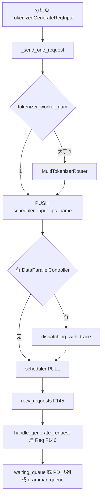
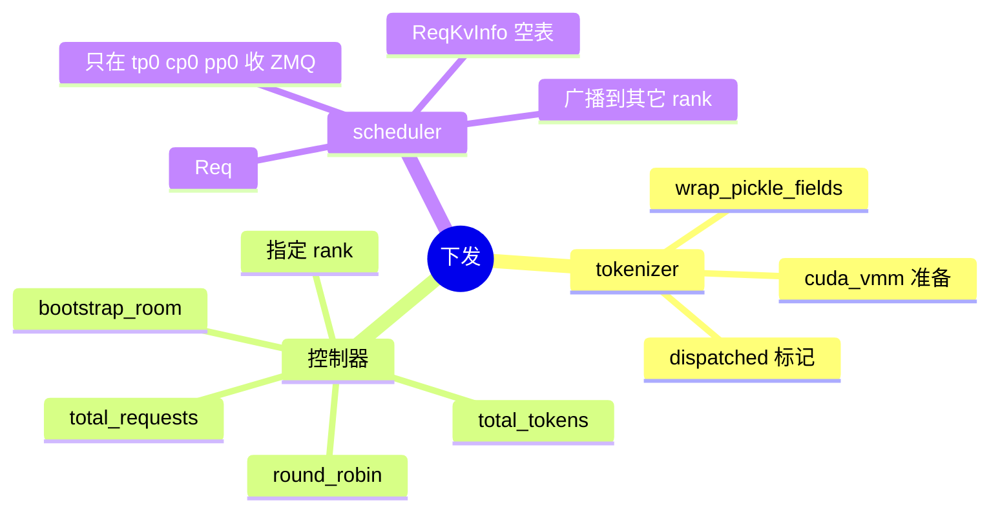
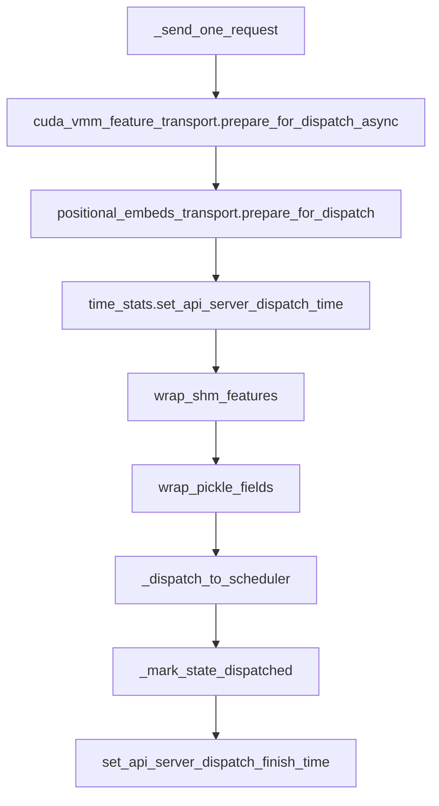
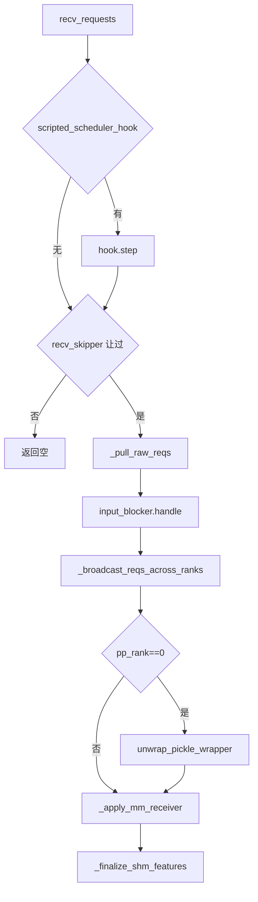
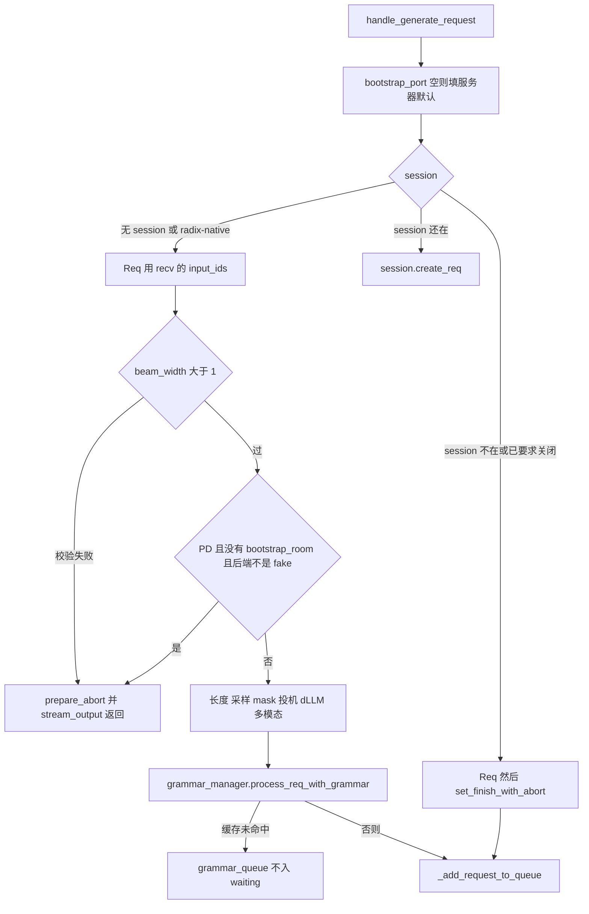

# 下发与入队

对应 F144、F145、F146。树是 `297e54fd105e974cdf401e5b4d20253a22c16f90`。**源码路径推断，未实测**。

本页从 `TokenizedGenerateReqInput` 离开 tokenizer 写到 `Req` 进入队列。`get_next_batch_to_run` 之后归 [调度与推理](../03-调度与推理/README.md)。

## 在框架中的位置

## 场景

| 场景 | 包先到谁 | `Req` 进哪个队列 |
| --- | --- | --- |
| 单 scheduler，`dp_size=1` 且无 attention DP | tokenizer 直接 PUSH 到该进程的 `scheduler_input_ipc_name` | `disaggregation_mode==NULL` 时 `waiting_queue` |
| 模型副本 DP 或 attention DP | 先到 `DataParallelController` 的 PULL，再 PUSH 到某个 worker | 每个 worker 自己的队列。控制器不造 `Req` |
| 请求带合法 `routed_dp_rank` | `maybe_external_dp_rank_routing` 直送该 rank | 同上 |
| PD prefill | 与上相同的 ZMQ | `disagg_prefill_bootstrap_queue` |
| PD decode | 同上 | `disagg_decode_prealloc_queue` |
| 带 json/regex/ebnf/structural_tag，且 grammar 缓存未命中 | 同上 | `grammar_queue`，此时不进 `waiting_queue` |
| 多 tokenizer worker | worker PUSH 到路由器，路由器再 PUSH 到 `scheduler_input_ipc_name` | 与单 worker 相同。回包靠 `http_worker_ipc` |
| `pp_rank>0` | 不从 ZMQ 收。上一 PP 级 `point_to_point_pyobj` | 非 0 级不把请求放进本页的等待队列；接力归调度篇 |
| `SGLANG_RUST_SERVER` | `recv_from_tokenizer.drain`，无 Python PUSH | 仍进 `handle_generate_request`。tokenizer 侧不在本页 |
| session 找不到或正在关闭 | 仍造 `Req`，`set_finish_with_abort` | 照样 `_add_request_to_queue`，让输出路径把错误送回 |

## F144 下发

位置：`TokenizerManager._send_one_request` / `_send_batch_request`，底层 `_dispatch_to_scheduler`。控制器在 `managers/data_parallel_controller.py`。

角色：把 token 化对象送出本进程。发送前把不好 msgpack 的字段包进 pickle，并把多模态特征交给传输层。

单条顺序：

`_dispatch_to_scheduler`：多 worker 时先 `stamp_http_worker_ipc`，再 `sock_send`。失败则 `finally` 里取消 VMM 与位置嵌入的准备，且 `dispatched` 仍为 false，外层 `_release_req_states_on_failure` 会丢掉本地状态而不是 abort scheduler。

批：每条 `wrap_pickle_fields` 之后合成 `BatchTokenizedGenerateReqInput` 或 `BatchTokenizedEmbeddingReqInput`，一次 `PUSH`。

### 有控制器时

tokenizer 的 `scheduler_input_ipc_name` 绑在控制器上。控制器 `init_dispatcher`：

| 类型 | 函数 | 角色 |
| --- | --- | --- |
| `TokenizedGenerateReqInput` / `TokenizedEmbeddingReqInput` | `dispatching_with_trace` | 打 DP 时间戳后 `dispatching` |
| `BatchTokenizedGenerateReqInput` | `dispatch_batch_generate` | 有用户请求时先 `refresh_load_budget` 一次，再对每条 `dispatching_with_trace(..., refresh_load_budget=False)` |
| `BatchTokenizedEmbeddingReqInput` | `dispatch_batch_embedding` | 同上 |
| `BlockReqInput`、`ProfileReq` | `send_to_all_workers` | 控制面，不是生成 |
| 其它 | `send_control_message` | 回退 |

`dispatching` 在 `__init__` 里按 `load_balance_method` 选一个：

| 方法 | 函数 | 未指定 rank 时 |
| --- | --- | --- |
| round robin | `round_robin_scheduler` | 在 `_active_workers` 里轮转，跳过 `status` 为假的槽 |
| follow bootstrap room | `follow_bootstrap_room_scheduler` | 要求 `bootstrap_room` 非空，`room % len(workers)` |
| total requests | `total_requests_scheduler` | `dp_budget.dispatch(TOTAL_REQUESTS)` |
| total tokens | `total_tokens_scheduler` | 用 `len(req.input_ids)` 估计，再 `dp_budget.dispatch(TOTAL_TOKENS)` |

四个函数的第一行都是 `maybe_external_dp_rank_routing`。命中则直接返回。`refresh_load_budget` 只挂在 total requests 与 total tokens 上。

`maybe_external_dp_rank_routing`：`routed_dp_rank is None` 返回 false。有值则 rank 必须落在 `workers` 长度内、在 `_active_workers` 里、且 socket 非空，否则 `ValueError`。命中则 `sock_send(self.workers[rank], req)`。

`refresh_load_budget` 最多 20ms 一次。注释写若不节流，突发请求会把预算反复打回过期快照，整批落到同一个 rank。

健康检查走 `dispatch_health_check`，不占用用户 round-robin 计数。follow-room 模式的健康检查仍按 room；否则也可被 external rank 截走。

控制器不构造 `Req`。它转发的仍是 token 化对象。

### 多 tokenizer

`MultiTokenizerRouter` 的文档：正向是 tokenizer workers → router → scheduler，反向是 detokenizer → router → workers。`router_worker_obj` 从 `tokenizer_worker_ipc_name` 收，注册消息只记账，暂停/继续先广播给所有 worker 再视模式转给 scheduler，其余对象 `async_sock_send(self.send_to_scheduler, recv_obj)`。这条 `send_to_scheduler` 使用启动时的 `scheduler_input_ipc_name`，因此有控制器时先到控制器。

## F145 scheduler 收包

位置：`scheduler.py` `Scheduler.ingest_requests` 调用 `scheduler_components/request_receiver.py` `SchedulerRequestReceiver.recv_requests`。`ingest_requests` 由事件循环调用，循环本身是 F12。本页写收包函数做完什么。

角色：在持有等待队列的那个 rank 上把 ZMQ 读空，再让同组其它 rank 看见同一份请求。

`recv_requests` 的顺序：

`_pull_raw_reqs` 只在 `pp_rank==0` 且 `attn_tp_rank==0` 且 `attn_cp_rank==0` 时读 socket。Rust server 用 `drain(max_recv_per_poll)`。否则 `sock_recv(..., NOBLOCK)` 直到 `zmq.ZMQError` 或达到 `max_recv_per_poll`（小于 0 表示不限）。同一轮还会非阻塞读 `recv_from_rpc`。其它 TP/CP rank 得到 None，等广播。`pp_rank>0` 且是本组的 tp0/cp0 时，用 `point_to_point_pyobj` 接上一 PP 级，不读 tokenizer socket。

广播：attention DP 把请求拆成 work 与 control。work 用 `attn_cp_tp_broadcast_pyobj`，只在共享一个等待队列的 rank 里传。control 默认走整个 TP 组；`enable_dp_attention_local_control_broadcast` 或 EP scale joiner 时改为组内广播，避免全体 gloo。没有 attention DP 且 `tp_size!=1` 时，整份列表 `broadcast_pyobj`，源是 tp rank 0。

`unwrap_pickle_wrapper` 只在 `pp_rank==0`。单条和批里的每条都 `unwrap_pickle_fields`。

`_apply_mm_receiver` 只在 pp0、`language_only`、且编码器后端是 `zmq_to_scheduler` 或 `mooncake` 时，把还在等特征的请求从本轮拿开或变成 abort。

`ingest_requests` 把收到的对象放进 `_deferred_input_requests`，再 `process_input_requests`。那里对每条：重建位置嵌入的 CUDA IPC、可选物化 cuda_vmm、跳过不空闲时的健康检查，然后 `_request_dispatcher`。生成类型的登记在 `init_request_dispatcher`：

| 类型 | 处理 |
| --- | --- |
| `TokenizedGenerateReqInput` | `handle_generate_request` |
| `BatchTokenizedGenerateReqInput` | `handle_batch_generate_request`，逐条再进上一个 |
| `TokenizedEmbeddingReqInput` | `handle_embedding_request` |
| `BatchTokenizedEmbeddingReqInput` | `handle_batch_embedding_request` |

## F146 运行中的请求

位置：`managers/schedule_batch.py` `Req`。KV 视图 `ReqKvInfo`。构造点是 `Scheduler._handle_generate_request` → `_create_generation_req` → `Req(...)`。embedding 在 `handle_embedding_request` 里同样 `Req(...)`。

角色：scheduler 进程里一份请求的输入、输出和结束原因。tokenizer 侧的 `ReqState` 只等回包，不是这个类。

`Req.__init__` 把 `origin_input_ids`、`sampling_params`、`stream`、bootstrap、`priority`、`http_worker_ipc` 抄进来，`output_ids` 从空数组开始。`self.kv = ReqKvInfo()` 在构造时就有，但 `req_pool_idx` 仍是 None，`kv_allocated_len` 为 0。注释写这块是前缀缓存之外、请求自己持有的设备 KV；匹配和插入发生在调度，不在构造函数里。`holds_kv` 要等登记了 req_to_token 行才为真。

`_handle_generate_request` 的分叉：

`input_embeds` 没有 ids 时，用长度个 `1` 填 `input_ids`，只为让序列长度成立。

多模态在 scheduler 上还会展开占位 token（`duplicate_pad_mm_input_ids` 或 `_try_apply_padded_mm_input_ids`）。展开后长度达到 `max_req_input_len` 则 `set_finish_with_abort`，请求仍入队，这样客户端能收到错误而不是挂住。

`_add_request_to_queue`：

| `disaggregation_mode` | 队列 | 时间戳 |
| --- | --- | --- |
| `NULL` | 先 `_abort_on_queued_limit`，再 `_prefetch_kvcache`，然后 `waiting_queue.append` | `set_wait_queue_entry_time` |
| `PREFILL` | `disagg_prefill_bootstrap_queue.add` | `set_prefill_bootstrap_queue_entry_time` |
| `DECODE` | `disagg_decode_prealloc_queue.add` | 新请求用 decode prealloc 戳；被撤回再入队的用 wait 戳 |
| 其它 | `ValueError` | |

优先级：调度开着且请求没带 priority 时，按 `schedule_low_priority_values_first` 填 `sys.maxsize` 或最小 int。调度关着、请求却带了 priority、且 `abort_on_priority_when_disabled`：不入队，`send_abort_output`，状态 503。这是 tokenizer 侧 `_set_default_priority` 之后的第二道。

grammar：`process_req_with_grammar` 在 json/regex/ebnf/structural_tag 任一非空时查缓存。未命中则 `grammar_queue.append` 并返回 true，`_handle_generate_request` 就不再调用 `_add_request_to_queue`。`get_ready_grammar_requests` 以后把编译好的请求挪进等待队列，那个循环在调度篇。`--grammar-backend none` 时请求被标成 abort，随后仍会入队。

`waiting_queue.append` 是本目录的结束点。下一次谁把它取出来组成 `ScheduleBatch`，见 [批对象与采样参数](05-批对象与采样参数.md) 的对象边界，以及调度篇的策略。

返回 [本目录 README](README.md)。
