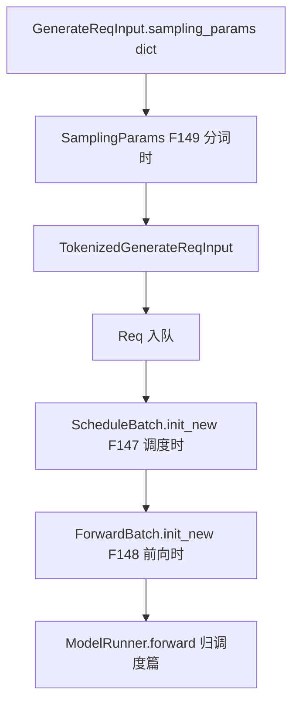
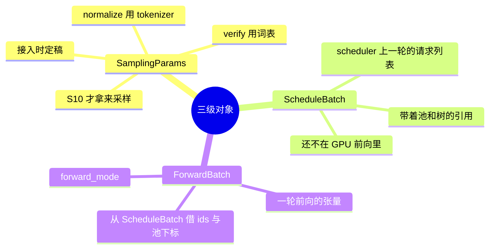
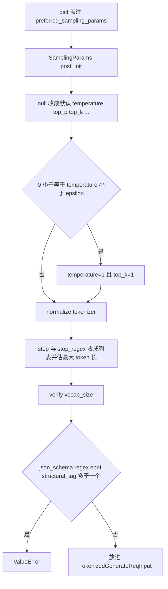

# 批对象与采样参数

对应 F147、F148、F149。树是 `297e54fd105e974cdf401e5b4d20253a22c16f90`。**源码路径推断，未实测**。

`SamplingParams` 在分词时就定稿。`ScheduleBatch` 与 `ForwardBatch` 不在接入时构造。清单把它们放在 A.10，因为它们是 `Req` 之后的两级对象。本页写这三级各是什么、在哪一个函数里长出来。组 batch 的策略、`ForwardMode` 怎么选、前向怎么跑，归 [调度与推理](../03-调度与推理/README.md)。

## 在框架中的位置

## 场景

| 场景 | 这一级发生什么 | 不发生什么 |
| --- | --- | --- |
| 普通生成 | 每条请求一份 `SamplingParams`，随 `Req` 进等待队列 | 不在 HTTP 进程里建 `ScheduleBatch` |
| `n>1` 且非 beam | 规范化把一条展成多条，每条自己的 `SamplingParams` | scheduler 不把一条 `Req` 复制 n 份 |
| beam | 展开倍数被收成 1。`beam_width` 留在 `SamplingParams` 上。`BeamCoordinator.validate_and_init` 在造 `Req` 之后 | 本页不写 beam 的搜索步 |
| embedding | 同样造 `SamplingParams` 并 `normalize`/`verify`，随 embedding 的 `Req` | 没有 `max_new_tokens` 的生成语义。`logprob_start_len` 在 embedding 入队路径上被写成 -1 |
| 语法约束 | 约束字符串在 `SamplingParams` 上。grammar 对象在入队前挂到 `Req.grammar`，未编译完则先去 `grammar_queue` | FSM 推进不在本页 |
| chunked prefill 的 MIXED | `ForwardMode.MIXED` 是前向对象的模式，不是请求体字段 | 接入时的 `stream` 与这个模式无关 |
| attention DP 空组 | `ForwardMode.IDLE` 表示该 worker 这一轮没有序列 | 空组仍要前向，原因是 F193，归调度篇 |
| PD decode，KV 已在对端算好 | `ForwardMode.PREBUILT` | 为何不用 `EXTEND` 是 F203，归调度篇 |

## F149 采样参数

位置：`python/sglang/srt/sampling/sampling_params.py` `SamplingParams`，msgspec 结构体。构造点在 `TokenizerManager._create_tokenized_object`：`SamplingParams(**sampling_kwargs)`，接着 `normalize(self.tokenizer)`，再 `verify(self.model_config.vocab_size)`。

角色：把 HTTP/Engine 的采样 dict 收成 scheduler 和采样器共用的一份参数。S8 定稿，S10 使用。接入不调用采样核。

原理：dict 里可以缺字段，也可以把本该是数字的字段写成 JSON null。`__post_init__` 把 null 收成默认，避免 `verify` 在 null 上崩溃。`normalize` 依赖 tokenizer 把 stop 字符串估成 token 长度；`skip_tokenizer_init` 时 tokenizer 是 None，长度改用字符串长度。`is_normalized` 为真时 `__post_init__` 直接返回，避免反序列化把已经算好的 stop 长度清掉。

调用序：

`verify` 拒绝的范围：`temperature` 非有限或为负；`top_p` 不在 (0, 1]；`min_p` 不在 [0, 1]；`top_k` 小于 1 且不是已经折成的全词表；frequency/presence 不在 [-2, 2]；repetition 不在 (0, 2]；`min_new_tokens` 为负或大于 `max_new_tokens`；`logit_bias` 的 key 不在词表；`sampling_seed` 不是 int 或不在有符号 64 位；四种语法同时设了多于一种。`max_new_tokens` 的默认在结构体上是 128。Ollama 在造 dict 时若缺这个键会先写成 2048，于是默认 128 不会再生效。

`__post_init__` 里 `top_k == -1` 收成 `TOP_K_ALL`。温度落在采样 epsilon 内则改成贪心：温度 1 且 `top_k=1`。这是接入时的改写，不是采样器临时决定的。

四种语法字符串留在结构体上。真正编译是 scheduler 的 `GrammarManager.process_req_with_grammar`，见下发页。采样器读的是已经 normalize 过的 `stop_strs`，API 字段 `stop` 在 `__post_init__` 里拷到 `stop_strs`。

## F147 一轮调度

位置：`managers/schedule_batch.py` `ScheduleBatch`。构造函数是类方法 `init_new`。

角色：scheduler 进程里一轮要跑的 `Req` 列表，加上这轮要用的池、前缀树、模型 config。类文档写：保存 scheduler 上一个 batch 的全部信息；`ForwardBatch` 从它派生 lora、rid、grammar、位置。

它不在 `_add_request_to_queue` 里出现。`waiting_queue` 里仍是单条 `Req`。`init_new` 的参数就是已经选出来的 `reqs: List[Req]`，以及启动时建好的 `req_to_token_pool`、`token_to_kv_pool_allocator`、`tree_cache`。谁选择这批 `reqs` 是 `SchedulePolicy`（F158），归调度篇。

`init_new` 当时记下的批级旗标：任一请求 `return_logprob` 则整批要 logprob；hidden states 模式取这批请求的并；`has_grammar` 看任一 `req.grammar`；`is_prefill_only` 要全部请求都是。`chunked_req` 可选，给 PP 的 chunked prefill。这些旗标是批的属性，不是单条 HTTP 字段。

`ReqKvInfo` 仍挂在每条 `Req.kv` 上。`ScheduleBatch` 另持 `req_to_token_pool` 与分配器，也就是启动篇 F131 的那张表。匹配前缀、给请求登记池中的行，发生在组 batch 的过程中，不在 `Req(...)` 里。

## F148 一轮前向

位置：`model_executor/forward_batch_info.py` `ForwardBatch` 与 `ForwardMode`。构造是 `ForwardBatch.init_new(batch: ScheduleBatch, model_runner, ...)`。

角色：一轮模型前向的输入。类文档写：保存一次 forward 的全部输入。`input_ids`、`req_pool_indices`、`seq_lens`、`out_cache_loc` 从 `ScheduleBatch` 借来。

`forward_mode: ForwardMode` 是这一级才有的字段。成员与清单 A.10 一致：

| 成员 | 类上的注释 |
| --- | --- |
| `EXTEND` | 延长序列。开头一段 KV 可以已经算过。也叫 prefill |
| `DECODE` | 解码一个 token |
| `MIXED` | chunked prefill 时 EXTEND 与 DECODE 同批 |
| `IDLE` | 没有序列。attention DP 下有的 worker 分不到请求 |
| `TARGET_VERIFY` | 投机：在目标模型上验证 |
| `DRAFT_EXTEND_V2` | 投机：在草稿模型上 extend |
| `PREBUILT` | 分离式 decode。这批请求的 KV 已经可以开始解码 |
| `SPLIT_PREFILL` | PD 复用时的拆开 prefill |
| `DLLM_EXTEND` | dLLM |

接入路径不设置 `ForwardMode`。一条请求在等待队列里还没有模式。模式是组完 `ScheduleBatch`、要调用模型时才写进 `ForwardBatch`。`is_extend` 把 `EXTEND`、`MIXED`、`TARGET_VERIFY`、`SPLIT_PREFILL`、`DLLM_EXTEND` 都当成 extend；`DRAFT_EXTEND_V2` 要调用方显式算进去。

`init_new` 的参数里还有 hidden 捕获模式、extend 的位置信息、投机 mrope、本轮的 `kv_loc_plan`。这些是前向装配，本目录停在「函数存在、输入是上一轮的 `ScheduleBatch`」。`TpModelWorker.forward_batch_generation` 调用 `ModelRunner.forward` 是 F162，归调度篇。

返回 [本目录 README](README.md)。
