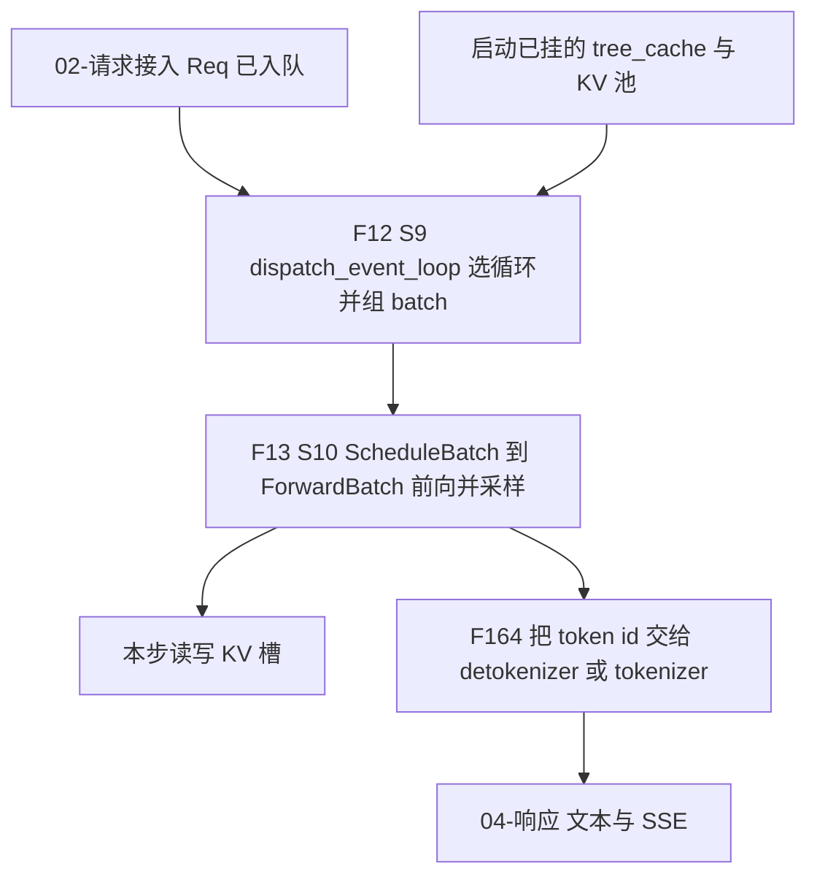
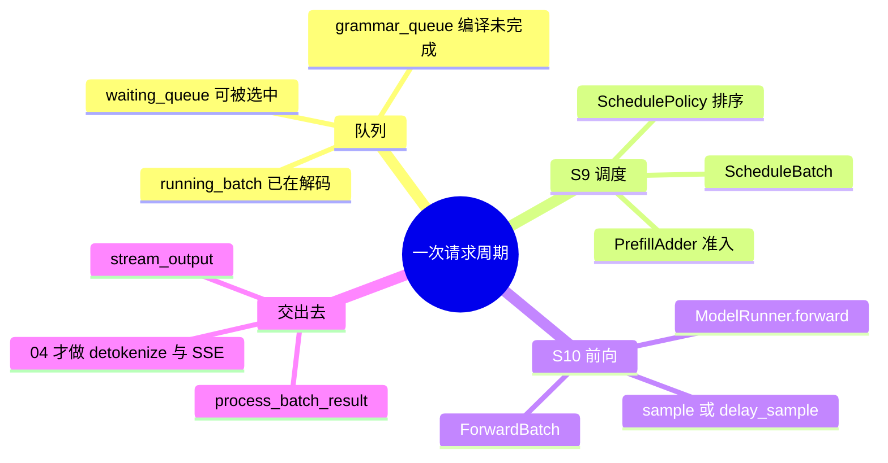
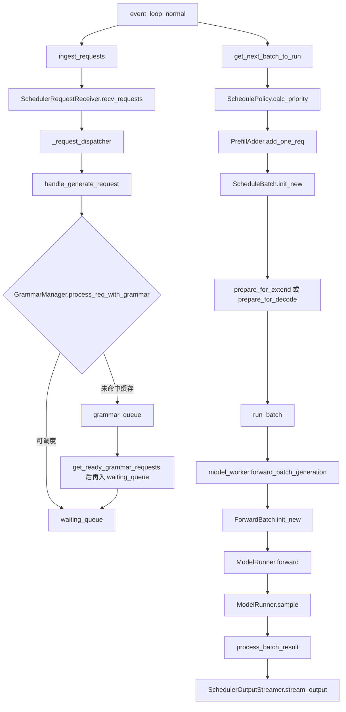

# 阶段总览

本页铺 S9、S10（F12、F13）。函数级过程在后面各页。树是 `297e54fd105e974cdf401e5b4d20253a22c16f90`（标签 `v0.5.23`）。多卡、设备和网络上的时序没有实跑，标 **源码路径推断，未实测**。

请求如何进 `waiting_queue` 或 PD 队列，在 [02-请求接入](../02-请求接入/README.md)。token 变文本、SSE 怎么 yield，在 [04-流式与非流式响应](../04-流式与非流式响应/README.md)。本目录写 scheduler 收包之后的一轮：选循环、组 batch、前向、采样、把 token id 交出去。

## 这一段在框架里的位置

启动在 `run_scheduler_process` 里建完 `Scheduler`，`pipe_writer.send(get_init_info())` 之后调用 `Scheduler.run_event_loop`。`run_event_loop` 在 CUDA/HIP 上把调度放进 `schedule_stream`，然后 `dispatch_event_loop`（F12）。请求接入已经把 `Req` 放进队列；本段从事件循环的下一次 `ingest_requests` 开始，到 `SchedulerOutputStreamer.stream_output` 把本步 token 送出结束。

父进程的 HTTP 时间和 scheduler 的循环时间仍然分开。tokenizer 侧在等 ZMQ 回包；本段只发生在 scheduler 进程。`pp_rank`、`attn_tp_rank`、`attn_cp_rank` 不全为 0 的进程不持有 `recv_from_tokenizer`，它们跟着 0 号的同一轮集体通信往下走。

## 一条请求在本段里走过的函数

下面是 `disaggregation_mode == null`、不开 overlap、没有投机、单条文本请求的主路径。分叉在各页展开。

| 函数 | 这一步做什么 | 角色 |
| --- | --- | --- |
| `dispatch_event_loop` | 按 PD、PP、overlap、MLX 选一个死循环 | S9 的入口。选错循环，后面的队列和前向都不是同一套 |
| `event_loop_normal` | 一轮里顺序做收包、组 batch、前向、处理结果 | 默认的连续批调度器 |
| `get_next_batch_to_run` | 先尝试新的 prefill，没有才更新正在跑的 decode | 连续批：prefill 优先于 decode |
| `ScheduleBatch.init_new` | 把选中的 `Req` 收成一轮调度对象 | S9 的产出，还不是 GPU 前向张量 |
| `TpModelWorker.forward_batch_generation` | `ForwardBatch.init_new`，再 `ModelRunner.forward`，最后采样 | S10。投机时 `model_worker` 换成 `draft_worker` |
| `process_batch_result` | 按 `ForwardMode` 把 token 写回 `Req`，并发布或释放前缀 | 把 GPU 结果收成请求状态 |
| `stream_output` | 组 `BatchTokenIDOutput` 一类 payload，PUSH 出去 | 本段的终点。文本和 SSE 归响应篇 |

## 场景

| 场景 | 前提 | 本段怎么分叉 | 清单 |
| --- | --- | --- | --- |
| 单机，默认文本生成 | `disaggregation_mode=null`。`disable_overlap_schedule` 默认 false，所以走 overlap，除非平台关掉它 | `event_loop_overlap`：上一批结果和当前批前向错开 | F12、F154 |
| 显式关掉 overlap，或 CPU 以外被流水线关掉 | `disable_overlap_schedule`，或 `pp_size>1` 时 S2 已把它打开（F196） | `event_loop_normal`：`run_batch` 之后立刻 `process_batch_result` | F155、F152 |
| Prefill 与 decode 同时在场 | 连续批。`running_batch` 里已有解码请求，`waiting_queue` 里还有新请求 | 能组出 prefill 就先跑 extend；否则 `update_running_batch` 跑 decode | F12、F158 |
| Chunked prefill | `chunked_prefill_size` 为正。`-1` 或 `<=0` 在 `init_chunked_prefill` 里收成 None，等于关 | 一条长请求拆成多轮 extend，中间块先不流出 token | F160 |
| Mixed chunk | 上面成立，且 `enable_mixed_chunk` | extend 与 decode 合成 `ForwardMode.MIXED` | F160 |
| 语法约束 | 请求带 json_schema / regex / ebnf / structural_tag，且 grammar 后端不是 `none` | 编译未完成时进 `grammar_queue`，完成后再进 `waiting_queue` | F158 的队列侧 |
| 投机 / MTP | `speculative_algorithm` 非空，且本 PP 级建了 draft worker | `model_worker` 是 `draft_worker`。验证轮把模式收成 `TARGET_VERIFY`。算法内部归特性篇 | F13 的调度触点 |
| 多卡 TP | `tp_size>1` | 非最后一级 PP 才有区别；纯 TP 时各 rank 都跑 `ModelRunner.forward`，采样在每个 worker 的最后 rank 语义上由 `pp_group.is_last_rank` 决定。`pp_size=1` 时每个 rank 都是 last rank | F13、F162 |
| Attention DP | `attn_dp_size>1` | 空组仍造 `ForwardMode.IDLE` 的 batch，参加同一轮 MLP / MoE 集体通信 | F193 |
| 流水并行 | `pp_size>1`，且 PD 模式是 null | `event_loop_pp`。overlap 已被关掉 | F152 |
| PD 分离 | `disaggregation_mode` 为 prefill 或 decode | 另一套事件循环。decode 用 `PREBUILT` 表示 KV 已从对端到达 | F179–F188、F203 |
| MLX | `use_mlx()` | overlap 改走 `event_loop_overlap_mlx`，用 `mx.async_eval`，不用 PyTorch stream | F153 |
| embedding | 模型不是 generation | `run_batch` 走 `forward_batch_embedding`，结果走 embedding 分支 | F13 |
| `skip_tokenizer_init` | 启动时关掉 tokenizer | `send_to_detokenizer` 与 `send_to_tokenizer` 绑同一根 `tokenizer_ipc_name` | F164 |

场景行回填 [场景与硬件前提总表](../../01-体系总览/03-场景与硬件前提总表.md)。本段代码跑在 scheduler 子进程，设备前提跟启动时选定的后端走。CUDA graph、MoE all-to-all、PD 传输没有在本环境跑过。

## F12 S9 收请求、组 batch、跑 extend 或 decode

位置：`python/sglang/srt/managers/scheduler.py` 的 `dispatch_event_loop` / `_dispatch_event_loop_once`，以及被它选中的 `event_loop_*`。组 batch 的函数是 `get_next_batch_to_run`。

角色：在已经入队的 `Req` 里决定这一轮跑谁、以 extend 还是 decode 跑。这一步结束时手里是 `ScheduleBatch` 或空。空则 `on_idle`。

原理：服务不是一条请求一次前向。`running_batch` 跨轮保留正在解码的请求；`waiting_queue` 里的新请求在显存和 chunk 预算允许时插进 prefill。这就是连续批。prefill 能组出来就先跑，decode 在没有新 prefill 时才更新。Attention DP 下空组也要交出一个 batch，否则对端的集体通信对不上。

循环选择和一轮的内部顺序见 [01-事件循环](01-事件循环.md)。队列和策略见 [02-队列与策略](02-队列与策略.md)。`ScheduleBatch` 怎么从队列里长出来见 [03-组batch](03-组batch.md)。

## F13 S10 ScheduleBatch 变成 ForwardBatch，前向并采样

位置：`managers/tp_worker.py` `TpModelWorker.forward_batch_generation`。scheduler 侧的调用点是 `Scheduler.run_batch` 里的 `self.model_worker.forward_batch_generation`。`model_worker` 在投机关闭或本级没有 draft worker 时就是 `tp_worker`，否则是 `draft_worker`。

角色：把一轮调度对象变成一次模型前向的张量，跑 `ModelRunner.forward`，在最后一级流水上采样出 next token。KV 的读写下标在 `prepare_for_extend` / `prepare_for_decode` 里已经写进 `ScheduleBatch`，`ForwardBatch.init_new` 只是把它们借走。

原理：调度器决定「哪些 token 进这一步、写到池的哪一槽」。模型前向按 `out_cache_loc` 写 KV，按已有前缀槽读 KV。采样读的是最后一级的 logits，加上请求在接入时定稿的 `SamplingParams`。overlap 时，带语法或打开 `SGLANG_ENABLE_DELAY_SAMPLE` 的普通解码可以把 `sample` 推迟到上一批结果处理之后，因为语法掩码依赖上一批已经接受的 token。

前向、KV 和 `IDLE` 见 [05-前向与采样](05-前向与采样.md)。前缀树为何在 scheduler 上见 [04-前缀与KV](04-前缀与KV.md)。结果如何交出去见 [06-结果回传](06-结果回传.md)。PD 的 `PREBUILT` 见 [07-PD分离](07-PD分离.md)。

返回 [本目录 README](README.md)。
