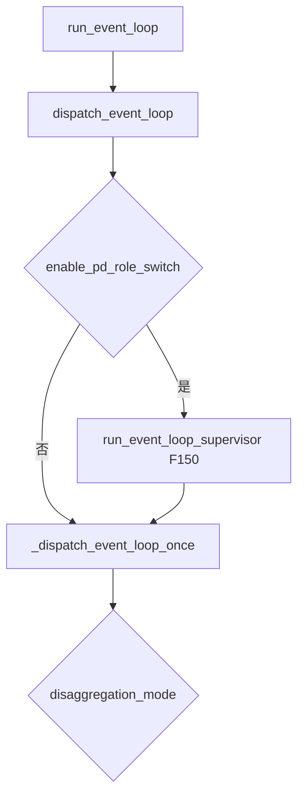
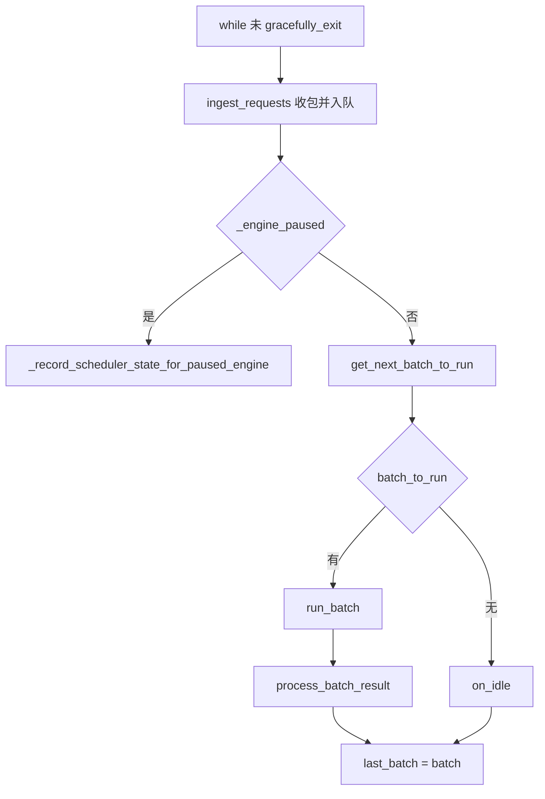
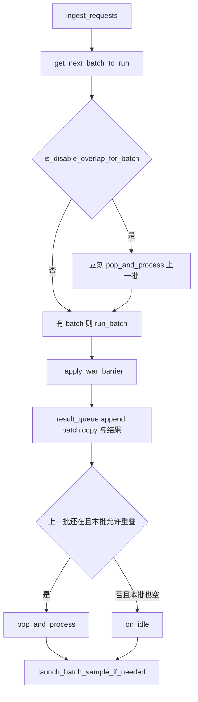

# 事件循环

对应 F150–F157。树是 `297e54fd105e974cdf401e5b4d20253a22c16f90`。**源码路径推断，未实测**。PD 循环的队列和 `PREBUILT` 在 [07-PD分离](07-PD分离.md)，本页只写选择条件和一轮骨架。

## 在框架中的位置

`Scheduler.run_event_loop` 在 ready 回写之后调用 `dispatch_event_loop`。进程在这里阻塞，直到 `ShutdownReq` 把 `gracefully_exit` 设上。选中的循环每轮都从 `ingest_requests` 开始，所以请求接入写下的收包函数是在这里被反复调用的。

角色切换成功时，`process_input_requests` 抛 `PdRoleSwitchRestart`。supervisor 接住它，再调一次 `_dispatch_event_loop_once`，于是同一进程换循环。KV 池不重建，这是 F185，细节在 PD 页。

## 场景

| 条件 | 选中的循环 | 清单 |
| --- | --- | --- |
| `enable_pd_role_switch` | 外面包 `run_event_loop_supervisor`，内部仍是下面这一次分发 | F150 |
| NULL 且 `enable_pdmux` | `event_loop_pdmux` | F151 |
| NULL 且 `pp_size>1` | `event_loop_pp` | F152 |
| NULL 且 overlap 且 MLX | `event_loop_overlap_mlx` | F153 |
| NULL 且 overlap | `event_loop_overlap` | F154 |
| NULL 且不 overlap | `event_loop_normal` | F155 |
| PREFILL | `pp_size>1` 用 `event_loop_pp_disagg_prefill`，否则 overlap 用 `event_loop_overlap_disagg_prefill`，否则 `event_loop_normal_disagg_prefill` | F156 |
| DECODE | 三个对应的 `event_loop_*_disagg_decode` | F157 |

`enable_overlap` 的定义在 `Scheduler.__init__`：`disable_overlap_schedule` 为假，且当前不是 MLX。MLX 把同一旗标收成 `enable_overlap_mlx`。`pp_size>1` 时 S2 的 `_pipeline_parallel_overlap_disable` 会把 `disable_overlap_schedule` 打开，所以流水并行不会进 `event_loop_overlap`。这是启动篇 F196 已经写下的改写，本页只消费它。

`enable_pdmux` 的判断写在 PP 判断之前。`validation_hook` 要求打开 mux 时 `pp_size == 1`、`disaggregation_mode == "null"`、`disable_overlap_schedule` 为真，且 `chunked_prefill_size == -1`。通过校验的配置不会同时进入 PP 循环或 overlap 循环。分发顺序和这组断言一致。

## F155 普通循环的一轮

`event_loop_normal` 是把四步排成直线的那一版。暂停时只记状态并 `continue`，不组 batch。

| 函数 | 这一步做什么 | 角色 |
| --- | --- | --- |
| `ingest_requests` | 三个 0 号 rank 在没有积压输入时先 `_poll_timeout_aborts`，再 `recv_requests`，然后 `process_input_requests` | 把 tokenizer 进程的对象变成队列里的 `Req`。暂停时事件循环在 ingest 之后 `continue`，本轮不组 batch |
| `get_next_batch_to_run` | 合并上一轮 extend，再决定本轮是新 prefill 还是 decode | 连续批的决策点 |
| `run_batch` | 调 worker 前向。`PREBUILT` 在这里短路 | S10 的入口 |
| `process_batch_result` | 按模式把 token 写回请求并流出 | 本轮 CPU 收尾，和 GPU 前向在这条循环里是前后关系 |
| `on_idle` | 服务空转时自检并重置一些状态 | 没有 batch 且上一轮也空（overlap 的条件更严）才走到 |

`ingest_requests` 的返回值给流水并行转发用。普通循环忽略返回值，因为请求已经在 `process_input_requests` 里分发完。

## F154 overlap：上一批的 CPU 和当前批的 GPU 错开

`event_loop_overlap` 一开始就把 `enable_skip_finishing_decode` 设为真，并准备 `result_queue`。注释写的是让 CPU 处理与 GPU 计算重叠。

| 函数 | 这一步做什么 | 角色 |
| --- | --- | --- |
| `is_disable_overlap_for_batch` | 连续两个 extend，且环境变量 `SGLANG_DISABLE_CONSECUTIVE_PREFILL_OVERLAP` 为真时，本批不与上一批重叠。投机 decode 且 `grammar_needs_sync` 且队列非空时也不重叠 | 保护首包延迟，以及让 FSM 先于下一批 bitmask |
| `run_batch` | 前向在 `forward_stream` 上，先 `wait_stream(schedule_stream)` | GPU 计算。采样可能被收成 `delay_sample_func`，函数先返回 |
| `_apply_war_barrier` | 让下一轮调度流的写落在这一轮对统一内存池的读之后 | overlap 下两套流的读写顺序 |
| `pop_and_process` | `process_batch_result` 处理队列头 | 上一批的 CPU。和当前批的 GPU 并行的就是这段 |
| `launch_batch_sample_if_needed` | 若结果带 `delay_sample_func`，在上一批处理之后再采样 | 语法掩码要看见上一批已经提交的 token |

`batch.copy()` 放进队列，是因为下一轮会改正在跑的 batch，而结果处理还要用这一轮的请求视图。`forward_mode.is_extend()` 在 attention DP 且 `require_mlp_sync` 时改看全局同步过的 `is_extend_in_batch`，避免各 rank 对「要不要重叠」做出不同决定，进而在集体通信上卡住。这是源码注释里的死锁理由，没有在多卡上实测。

不支持语法重叠的投机算法走 `need_grammar_sync` 这条同步。`supports_grammar_overlap` 为真的算法（`is_eagle()`、standalone、dflash 家族）把 `_advance_pending_grammar` 当作 `grammar_barrier` 交给 worker，在 verify 里推进 FSM，于是不必为语法关掉重叠。`is_eagle()` 目前把 `FROZEN_KV_MTP` 算进去，旁边有 FIXME，写明 scheduler 侧对它的支持尚未立住。MTP 是否真能走这条重叠，标 **待核**。

## F152 流水并行

`SchedulerPPMixin.event_loop_pp` 的文档字符串写了统一调度：每一级按 microbatch 下标循环，从上一级收请求和 proxy，跑本级 batch，再处理上一个 microbatch 的结果，然后把请求和 proxy 发给下一级。发送是异步的，接收是同步的，用来减少对不齐，同时把通信开销压住。最后一级可以用异步 batch 深度把输出先缓冲起来，让 GPU 计算和 CPU 处理重叠。这和 `event_loop_overlap` 不是同一个开关；overlap schedule 在 PP 上已经被关掉。

每一级仍调用同一个 `get_next_batch_to_run` 和 `run_batch`。非最后一级的 `forward_batch_generation` 返回 `pp_hidden_states_proxy_tensors`，不采样。采样、接受和草稿留在最后一级。投机加 PP 的 verify 重建在 [05-前向与采样](05-前向与采样.md)。

## F151 同进程 mux

`event_loop_pdmux` 在同一个进程里用两条 CUDA stream：`prefill_stream` 上 `update_split_prefill_batch` 把 prefill 收成 `ForwardMode.SPLIT_PREFILL`，`decode_stream` 上 `update_running_batch` 后 `run_batch`。SM 配额由 `adjust_stream_groups` 按负载改。这是 `disaggregation_mode == null` 时的同进程复用，不是跨进程的 prefill/decode 角色。跨进程角色是 F156、F157。

`run_batch` 见到 `enable_pdmux` 且模式是 `SPLIT_PREFILL` 时，走 `tp_worker.forward_batch_split_prefill`，按 `split_forward_count` 把一次 extend 拆成多次 `ModelRunner.forward`。层切分留在 `ModelRunner.forward_split_prefill`。

## F153 MLX

`run_event_loop` 在 `use_mlx()` 时直接 `dispatch_event_loop`，注释写明 MLX 的重叠用 `mx.async_eval`，不用 PyTorch MPS stream。循环本体在 `hardware_backend/mlx/scheduler_mixin.py` 的 `event_loop_overlap_mlx`。它和 CUDA overlap 逐步对齐到哪一步，启动篇已经标待核，本页不另下结论。

## F156、F157 的骨架

Prefill 普通循环在 `ingest_requests` 之后，把 `disagg_prefill_bootstrap_queue.pop_bootstrapped()` 里已经完成 bootstrap 的请求并进 `waiting_queue`，再用 `get_next_disagg_prefill_batch_to_run` 组 batch。一轮结束还要 `process_disagg_prefill_inflight_queue`。

Decode 普通循环在收包之后 `process_decode_queue`，再用 `get_next_disagg_decode_batch_to_run`。KV 已经到齐的请求先以 `PREBUILT` 进入：这一步不跑提示词前向，请求上已有 prefill 送来的最后一个输出 token。处理完才并进 `running_batch`，下一轮才是 decode 进程上的模型前向。

两条 overlap 变体都有自己的 `result_queue`。Prefill overlap 还可以在环境变量和 attention DP=CP=1、非投机、自回归生成都满足时打开连续收包。不满足就打日志并退回普通的 overlap 等待。传输和校验和在 PD 页。

返回 [本目录 README](README.md)。
