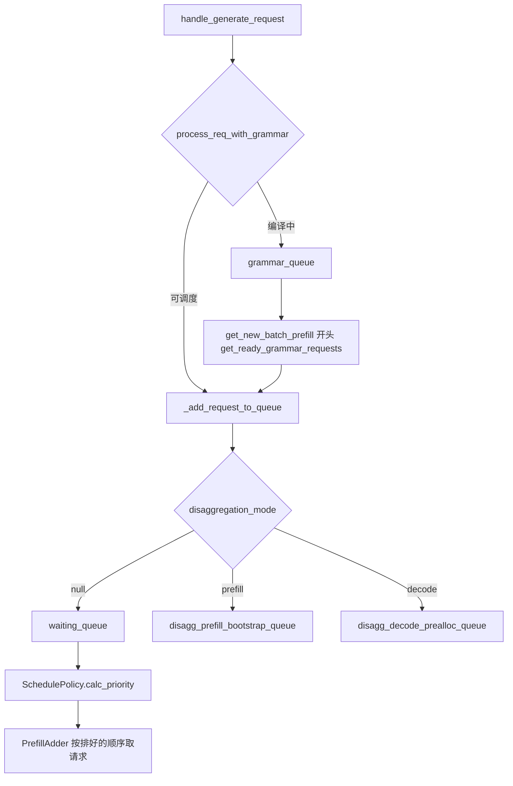
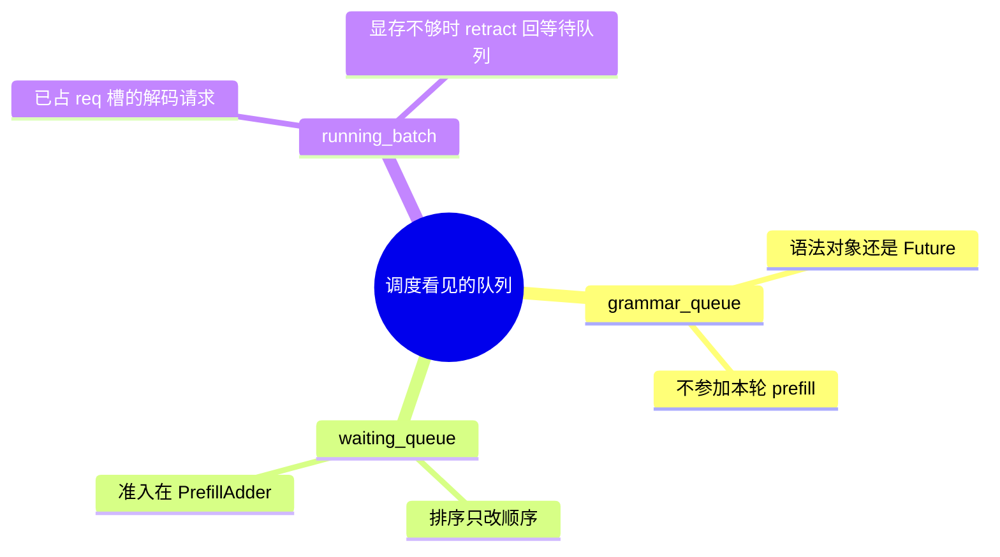

# 队列与策略

对应 F158、F159，以及 `grammar_queue` 在调度循环里的位置。树是 `297e54fd105e974cdf401e5b4d20253a22c16f90`。**源码路径推断，未实测**。

接入页已经写过：`handle_generate_request` 里 `GrammarManager.process_req_with_grammar` 返回真时，请求先不进 `waiting_queue`。本页从那之后写起：语法队列何时挪走，等待队列如何排序，优先级如何插队或挤掉队尾。

## 在框架中的位置

角色：`grammar_queue` 把「约束还不能用」和「可以占 KV」分开。`waiting_queue` 是连续批的候选集。`SchedulePolicy` 只排序，不分配显存。真正决定本轮谁上车的是 `PrefillAdder`。

## 场景

| 场景 | 队列行为 |
| --- | --- |
| 无语法 | `process_req_with_grammar` 返回假，直接 `_add_request_to_queue` |
| 语法命中缓存 | `req.grammar` 已是编译好的对象。非法缓存则 `set_finish_with_abort`，仍进等待队列，让结果路径把 abort 送出去 |
| 语法未命中 | `grammar` 是 `Future`，请求进 `grammar_queue`。下一轮及以后的 `get_new_batch_prefill` 才把它挪进等待队列 |
| `--grammar-backend none` 但请求带约束 | 请求被标成 abort，不进语法队列，直接入等待队列 |
| 严格思考模式、没有四种约束字符串 | 可能直接装上 `init_strict_reasoning_grammar` 的对象，不进语法队列 |
| `enable_priority_scheduling` | 入队时补默认优先级。队列满时可以挤掉优先级更差的在队请求 |
| 没开优先级却带了 `priority`，且 `abort_on_priority_when_disabled` | `_set_or_validate_priority` 直接 abort，不入队 |
| PD | `_add_request_to_queue` 不写 `waiting_queue`。prefill 进 bootstrap 队列，decode 进 prealloc 队列。语法队列的挪入仍调用这一个函数，所以 PD 下「语法就绪」进的是角色队列 |
| decode 侧 `disaggregation_mode` | `calc_priority` 里为了负载快照做的前缀匹配被跳过。decode 不再做 prefill 匹配 |

## grammar_queue

位置：`constrained/grammar_manager.py` `GrammarManager`。入队函数 `process_req_with_grammar`。出队函数 `get_ready_grammar_requests`，调用点在 `Scheduler._get_new_batch_prefill_raw` 的开头，条件是 `has_waiting_grammars()`。

原理：编译可能跨过好几轮调度。若编译未完成就进 `waiting_queue`，`PrefillAdder` 会给一个还没有 bitmask 的请求分配 KV。缓存命中则对象已经可用，可以立刻参与排序。

`get_ready_grammar_requests` 的文档写明多卡同步：

1. 只在 `pp_rank == 0` 上轮询。每条 `Future.done()` 的下标进 ready 集。`SGLANG_GRAMMAR_POLL_INTERVAL` 限制这一轮最多等多久。
2. 没完成的增加 `grammar_wait_ct`。达到 `SGLANG_GRAMMAR_MAX_POLL_ITERATIONS` 的记入失败集。
3. PP0 上，`grammar_sync_size > 1` 时用 `torch.distributed.all_gather_object`，组是 `scheduler.dp_tp_cpu_group`。ready 取交集，failed 取并集。这样同一 DP/TP 组放行同一批请求。`grammar_sync_size == 1` 时不做这次集合通信。
4. PP0 再把这对集合沿流水线 `send_object` / `recv_object`，tag 是 `P2PTag.GRAMMAR_PP_SYNC`。后面的 PP 级不自己轮询。

就绪且编译成功的请求 `_apply_request_reasoning_config` 后，由调度器 `_add_request_to_queue`。失败的 `set_finish_with_abort` 后同样入队，让输出路径报告错误。Abort 请求若还在语法队列里，`abort_requests` 会取消 Future。

语法后端的名字（xgrammar、outlines、llguidance、none）是 F166，采样掩码怎么作用在 logits 上归响应篇和特性 B48。本页只钉队列。FSM 在结果处理里推进：普通 decode 于 `process_batch_result_decode` 调用 `_accept_grammar_tokens`；支持语法重叠的投机在 verify 里通过 `grammar_barrier` 提前推进。见 [01-事件循环](01-事件循环.md) 和 [06-结果回传](06-结果回传.md)。

## F158 排队策略

位置：`managers/schedule_policy.py` `SchedulePolicy`。构造时 `_validate_and_adjust_policy`。每轮 prefill 前 `calc_priority(waiting_queue, running_batch, processed_tokens)`。

CLI `schedule_policy` 的 choices 是 `lpm`、`random`、`fcfs`、`dfs-weight`、`lof`、`priority`、`routing-key`、`hrrn`、`shortest-prefill-first`，默认 `fcfs`。类里真正的枚举分两族：

| 族 | 成员 | 排序在看什么 |
| --- | --- | --- |
| cache-aware | `lpm`，`dfs-weight`，`hrrn`，`shortest-prefill-first` | 先 `match_kv_cache`，再按前缀或未缓存长度排 |
| cache-agnostic | `fcfs`，`lof`，`random`，`routing-key` | 不靠树来决定名次。`fcfs` 保持到达序；开了优先级则先按优先级再按到达 |

`getattr(tree_cache, "disable", True)` 为真时，cache-aware 里除了 `shortest-prefill-first` 都会被改成 `fcfs`。属性缺失也走这条，因为默认值是真。`shortest-prefill-first` 在树关闭时直接 `ValueError`，因为实验策略要求前缀缓存。

`lpm` 和 `hrrn` 在等待队列长于 `WAITING_QUEUE_PREFIX_MATCH_MAX`（128）时，本轮退回 `fcfs`，避免每轮对长队列做前缀匹配。`_compute_prefix_matches` 还会用一棵模拟的 `waiting_queue_radix_tree`：已有缓存命中不超过 32 个 token 时，若队列内部共享的前缀达到 32，后来的请求被临时降权，好让先跑的那条把前缀写进真树。阈值来自 `IN_BATCH_PREFIX_CACHING_CHECK_THRESHOLD` 和 `IN_BATCH_PREFIX_CACHING_DEPRIORITIZE_THRESHOLD`。

各策略的比较键：

| 策略 | 顺序 |
| --- | --- |
| `lpm` | `_sort_by_longest_prefix`：临时降权的键是正无穷，排到最后；其余按 `-num_matched_prefix_tokens`。等长时 Python 的稳定排序保留原顺序 |
| `dfs-weight` | `tree_cache.dfs_weight_order` 按各请求的 `last_node` 重排 |
| `hrrn` | 老化轴是 `processed_tokens - arrival_processed_tokens`，再除以未缓存长度。比值大的在前。未缓存长度为 0 的先排。临时降权的在最后。平手用 `rid`。`Req` 入队时记下当时的 `processed_tokens_counter`。这个计数器在 `run_batch` 里只累加 `extend_num_tokens`，decode 不加。调用方没把计数器传进来时，注释写明顺序退化成按 `rid` |
| `shortest-prefill-first` | 临时降权的在后。工作量是 `len(origin_input_ids) + len(output_ids) - num_matched_prefix_tokens`，再按入队时间 |
| `lof` | 按 `sampling_params.max_new_tokens` 从大到小。开了优先级时优先级在前、`max_new_tokens` 在后 |
| `random` | `random.shuffle` |
| `routing-key` | running batch 里该 key 出现越多越靠前。没有 key 或 running 里没出现过的排在后面。running 里一个 key 都没有则保持原顺序 |
| `fcfs` | 不开优先级时不排序。开了则 `_sort_by_priority_and_fcfs`：优先级，再 `wait_queue_entry_time` |

cache-agnostic 且树支持 `supports_fast_match_prefix`、又不是 decode 角色时，仍会对每条请求 `match_kv_cache`。注释写明：排序不用这个结果，负载快照要读 `num_matched_prefix_tokens`。

CLI choices 里的 `"priority"` 不在两个枚举里。`_validate_and_adjust_policy` 对未知字符串抛 `ValueError`。本树的 `arg_groups` 里没有把 `"priority"` 改写成 `fcfs` 的 hook。优先级的正式开关是 `enable_priority_scheduling`，并且 `validation_hook` 要求此时 `schedule_policy` 只能是 `fcfs` 或 `lof`。`"priority"` 这个 choice 是否在更早的入口被拒绝，标 **待核**。

`num_continuous_decode_steps` 的字段 help 写「连续多步 decode 以降低调度开销」，默认 1。在 `python/sglang/srt` 里除了字段声明和 `field_order.py`，没有读到它的使用点。它是否还生效，标 **待核**。

## F159 优先级

位置：`fields/schedule.py` 的 `enable_priority_scheduling`（默认 false）、`priority_scheduling_preemption_threshold`（默认 10）、`schedule_low_priority_values_first`、`abort_on_priority_when_disabled`。scheduler 上是同名属性。

入队：`_set_or_validate_priority`。开了优先级而请求没带值时，低值优先则默认 `sys.maxsize`，否则默认 `-sys.maxsize - 1`，也就是最不优先。没开优先级、请求却带了值、且 abort 旗标为真，则 503，消息是服务器禁用了 priority。

队列满：`max_queued_requests` 有值且 `len(waiting_queue)+1` 超过它。默认拒绝新请求，消息「The request queue is full.」。开了优先级时，用方向化的优先级和入队时间挑出最不优先的在队请求；新请求严格更好才挤掉它，消息变成被更高优先级请求中止。同优先级时更新的在队请求先被挤（时间键更大）。

运行中抢占：`enable_priority_preemption` 为真时，`_get_new_batch_prefill_raw` 把 `running_batch.batch_is_full` 清掉，让 `PrefillAdder.preempt_to_schedule` 有机会为更高优先级的等待请求腾位置。阈值就是 `priority_scheduling_preemption_threshold`，传入 adder。被挤出的请求经 `_add_request_to_queue` 回到队列。`disable_priority_preemption` 在没开优先级时只打警告。

decode 显存不够时的 retract 是另一条政策：`retraction_policy` 为 `length` 或 `priority`。`priority` 要求已经打开优先级调度，校验在 `validation_hook`。retract 发生在 `update_running_batch`，见 [03-组batch](03-组batch.md)。

## 连续批在队列上的含义

`waiting_queue` 里的请求不占用模型步。`running_batch` 里的请求跨轮保留，每轮 decode 一个（或投机多个）token。新 prefill 被接纳后，下一轮 `get_next_batch_to_run` 把上一轮 extend 里已经产出首 token 的请求并进 `running_batch`。一条请求的生命周期是：语法队列（可选）→ 等待队列 → 一轮或若干轮 extend → running batch 的 decode → 结束时离开 batch。

`batch_is_full` 在没有空 req 槽、或 adder 报 `NO_TOKEN` 且已经有人能跑时被置上。下一轮若没有请求离开，prefill 不再准入，循环只 decode。有请求结束或 retract，`filter_batch` 把旗标清掉，等待队列里的下一条才有机会进来。这就是连续批，而不是等整个 batch 一起结束再收新请求。

返回 [本目录 README](README.md)。
