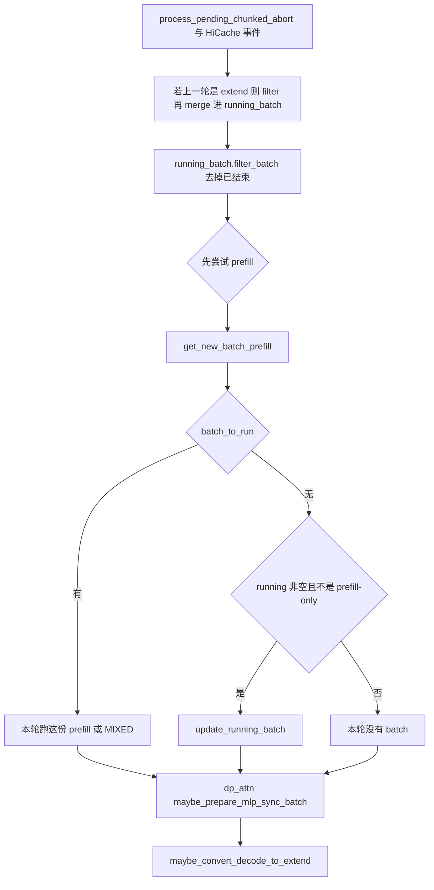
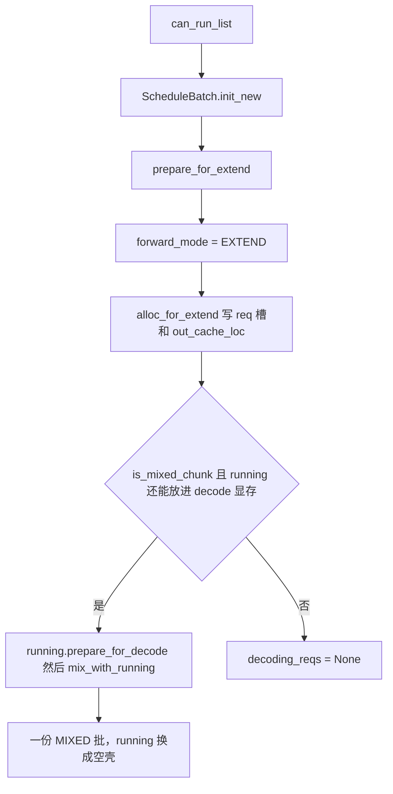

# 组 batch

对应 F160，以及 F147 的 `ScheduleBatch` 在调度时如何被造出来。对象边界在请求接入的批对象页。树是 `297e54fd105e974cdf401e5b4d20253a22c16f90`。**源码路径推断，未实测**。

## 在框架中的位置

`get_next_batch_to_run` 是 `event_loop_normal`、`event_loop_overlap` 和 `event_loop_pp` 共用的决策。它返回 `NextBatchPlan`：`batch_to_run` 是这一轮要前向的 `ScheduleBatch`，`running_batch` 是跨轮保留的解码集合。

角色：把队列和正在跑的请求收成一份带 `ForwardMode` 的 `ScheduleBatch`。这一步分配 KV 槽、匹配前缀、决定 chunk 长度。模型前向不再重新选择请求。

## 场景

| 场景 | `batch_to_run` 是什么 | `ForwardMode` |
| --- | --- | --- |
| 等待队列有人，显存和 chunk 预算够 | 新的 prefill 批 | `prepare_for_extend` 写成 `EXTEND`。dLLM 写成 `DLLM_EXTEND` |
| 没有可跑的 prefill，running 里有解码请求 | 原 running batch 原地更新 | `prepare_for_decode` 写成 `DECODE`。投机则把准备交给 `spec_prepare_for_decode` |
| `enable_mixed_chunk`，本轮既有新 extend 又有 running decode，且两边都不要求 logprob、没有 input embeds、decode 侧没有 beam | `mix_with_running` 把 decode 行拼进 extend 批，running 被换成空批 | `MIXED` |
| chunk 还没写完 | 该请求留在 `self.chunked_req`，本轮只跑到 `chunked_prefill_size` | 仍是 extend。中间块 `inflight_middle_chunks` 加一，结果处理时不把 token 当最终输出流出去 |
| running 的 decode 放不下新 token | `retract_decode`，请求带着 `is_retracted=True` 回到队列 | 本轮可能变成更小的 decode，或空 |
| attention DP 本 rank 没有序列，对端有 | `get_idle_batch` | `IDLE`。原因是 F193 |
| HiSparse | 不把上一轮 extend merge 进 running。就绪请求经 `_build_hisparse_decode_batch` 进入 | 特性侧再展开。本页只标这条分叉 |
| dLLM | `get_new_batch_dllm` 替换普通 prefill | `DLLM_EXTEND`。扩散式解码的步语义不在本页 |

## 上一轮 extend 如何进入连续批

`get_next_batch_to_run` 在组新 prefill 之前处理 `last_batch`。条件是没开 HiSparse，且上一轮 `forward_mode.is_extend()`（`EXTEND`、`MIXED`、`TARGET_VERIFY`、`SPLIT_PREFILL`、`DLLM_EXTEND` 都算）。

`filter_batch` 去掉已经 `finished()` 的请求，以及调用者点名排除的 chunked 请求和 dLLM staging。剩下的并进 `running_batch`：running 为空就直接换上，否则 `merge_batch`。注释写明：attention DP 若把 running 就地转成了 extend，`last_batch is running_batch`，只过滤、不再和自己合并。

overlap 下，prefill 的请求可能在结果还没处理完时就被 merge。所以每一步都对 running 再 `filter_batch` 一次，不能只在 merge 之后过滤。`enable_skip_finishing_decode` 为真时，`_reqs_finishing_inflight` 把「队列里那份结果会让它按长度结束」的请求先排除，避免对一个即将结束的请求再分配 decode 槽。

## F160 chunk

位置：`Scheduler.init_chunked_prefill`。字段 `chunked_prefill_size` 的 help 写：一个 chunk 里的最大 token 数，`-1` 表示关掉 chunked prefill。`<=0` 在 init 里收成 `None`。多模态且实现是 Transformers 时，正数也会被警告后收成 `None`，避免半截多模态 chunk 对不齐。

`enable_mixed_chunk` 默认 false。只有 chunk 开着且该旗标为真，`is_mixed_chunk` 才为真。mixed 时传给 `PrefillAdder` 的 `num_mixed_decode_tokens` 是当前 `running_batch` 的请求数，构造函数把它从 `rem_input_tokens` 里扣掉。不开 mixed 时这个参数是 0。扣掉的是请求数，不是每条 decode 的序列长度。

`enable_dynamic_chunking` 默认 false。`maybe_init_dynamic_chunk_sizer` 只在该旗标且 `pp_size>1` 时建 `DynamicChunkSizer`。注释写：按拟合函数把各 stage 的 chunk 调到接近的执行时间。正在 chunk 的请求若 sizer 给出 `predict(history_len)`，本轮的 `chunked_prefill_size` 改用这个动态值。

本轮长度还受 `max_prefill_tokens`（默认 16384，实际下界还会抬到模型上下文长）、`prefill_max_requests`、`max_running_requests`、req 槽和页预算约束。`get_num_allocatable_reqs` 取 `pp_max_micro_batch_size - running_bs` 与可用 req 行的较小值。beam 再按 `beam_width` 整除。

`PrefillAdder.add_one_req` 对一条候选做的事：

1. 用 `max_new_tokens` 裁到 `CLIP_MAX_NEW_TOKENS`（环境变量 `SGLANG_CLIP_MAX_NEW_TOKENS_ESTIMATION`，默认 4096）估计后续 decode 占用。这个裁剪只影响准入估计，不改请求自己的停止条件。
2. `cand_extend_input_len = len(full_untruncated_fill_ids) - prefix_len`。前缀匹配必须已经发生，否则预算把整段 prompt 都当成新 token。
3. 锁住 `last_node`，调用 `_select_prefill_admission`。返回 `AddReqResult` 表示本条不收：`NO_TOKEN` 会把 batch 标满，`OTHER` 表示请求数或 delayer 预算用尽。
4. 接纳则记下 `extend_len`。超过 chunk 的那条变成 `new_chunked_req`，scheduler 把它放进 `self.chunked_req`，下轮 `add_chunked_req` 续跑。`shortest_prefill_chunk_limit` 可以在该策略下限制续跑长度。

`prefill_decode_interval` 由 `_arm_prefill_decode_interval` 使用。help 写：一轮 prefill 之后先跑若干轮 decode 再允许下一次 prefill；默认除了 Hopper 上已 profile 的 Qwen3-VL 配置外是关的；attention DP 下这个间隔跨 rank 同步；0 表示关。`prefill_decode_interval_min_bs` 以下仍每轮都允许 prefill，好让 batch 先填满。`_should_defer_prefill` 为真时本轮直接不做 `get_new_batch_prefill`。间隔的具体递减在 `_arm_prefill_decode_interval`，本页不展开每个计数器字段。

LoRA、HiCache prefetch 未完成、setwise pooling 与 last-token pooling 不能同批，这些都是 `for req in waiting_queue` 里的 `continue`，请求留在队列里等下一轮。它们是准入分叉，不是另一套调度器。

## ScheduleBatch 怎么长出来

选中的 `can_run_list` 从 `waiting_queue` 摘掉之后：

`init_new` 记下的批级旗标和接入页一致：任一请求要 logprob 则整批要；`has_grammar` 看任一 `req.grammar`；`is_prefill_only` 要全部都是。`chunked_req` 单独传入。`contains_last_prefill_chunk` 在没有 chunked 请求、或本轮能跑的不只是那一条时为真。最后一块才把请求并进 decode 集合。

`prepare_for_extend` 取每条请求 `get_fill_ids()[prefix_len:]` 当本轮要算的 token，`seq_lens` 用 `extend_end`。输入 id 先放在 pinned CPU，H2D 推迟到 `resolve_forward_inputs`，发生在 `run_batch` 里、进 worker 之前。KV 分配见 [04-前缀与KV](04-前缀与KV.md)。

mixed 的额外条件写在源码里：两边都不 `return_logprob`（注释留了 TODO）、`input_embeds is None`（`mix_with_running` 拼接 `input_ids`，不拼接 embeds）、running 里没有 beam。decode 行若 `check_decode_mem()` 失败，它们留在 running 里，下一轮再 decode。注释写明 mixed 这一步不 retract 它们。

## decode 更新与 retract

`update_running_batch` 原地改解码批。先排除即将结束的请求。`check_decode_mem()` 失败表示再写一个 token 的 KV 放不下。若这些名额会在本步结果处理里被即将结束的请求释放，函数返回 `None`，本轮不 decode，也不 retract。否则 `retract_decode`：

- 按 `retraction_policy` 挑请求。`length` 先收回短输出、长输入的。`priority` 按优先级方向收回更差的。
- 收回的请求 `_add_request_to_queue(..., is_retracted=True)`。等待超时和入队时间被重新盖上。PD decode 走 prealloc 队列的 retracted 分支。
- 放不下又无法备份的请求走 abort，经 `send_abort_output` 出去。
- `new_token_ratio` 被调得更保守。平时没有 retract 时 `new_token_ratio_tracker.decay_step` 把估计放松一点。`schedule_conservativeness` 越大，准入越保守，字段 help 建议在频繁 retract 时加大。

然后 `prepare_for_decode`：`forward_mode = DECODE`，清掉 prefill 才有的 embeds 和 CP 元数据。非投机时 `alloc_for_decode(..., token_per_req=1)`，`seq_lens` 加一。投机时函数在分配之前返回，改调 `spec_prepare_for_decode`。草稿要写多长、验证要占哪些槽，归特性篇的投机算法。调度侧保证 decode 批带着 `spec_algorithm`，并且 `run_batch` 会把 worker 的 `next_draft_input` 放回 `batch.spec_info`，下一轮再读。

`input_ids` 在 decode 准备时沿用上一轮 `run_batch` 的约定：overlap 用 future map 中继，非 overlap 用采样出的 token。`prepare_for_decode` 的注释写「上一轮 run_batch 结束时已经放好」。

返回 [本目录 README](README.md)。
