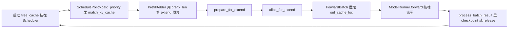
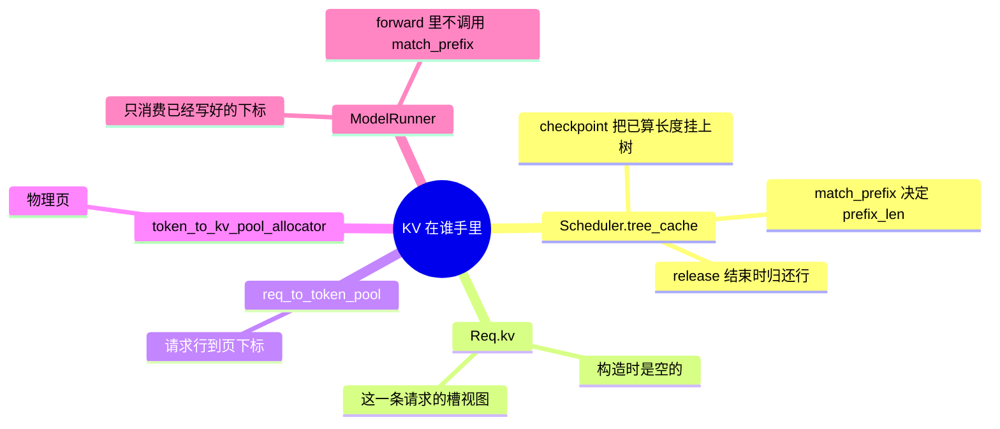

# 前缀与 KV

对应 F161、F200。树是 `297e54fd105e974cdf401e5b4d20253a22c16f90`。**源码路径推断，未实测**。池和树在启动时已经建好，见 [07-KV与前缀树](../../02-流程/01-启动/07-KV与前缀树.md)。本页写一次请求在调度步里如何匹配、分配、写回。

## 在框架中的位置

角色：前缀树回答「这段 token 已经有 KV 了没有」。分配器回答「新 token 写到哪一页」。两者都在 scheduler 进程、在 `ModelRunner.forward` 之前完成。前向按给定下标读旧页、写新页。

## 场景

| 场景 | 匹配 | 分配 | 写回树 |
| --- | --- | --- | --- |
| 普通 prefill，树开着 | `match_kv_cache` 把 `device_prefix_len` 写入 `req.prefix_len` | `alloc_for_extend` 只为 `extend_len` 要新页，前缀页从 `prefix_device_indices` 接上 | 最后一块结束且请求还要 decode：`checkpoint_kv_cache`。请求结束：`release_kv_cache(..., checkpoint=True)` |
| 树关掉，或 `skip_radix_cache_insert` | 匹配长度为 0，或 checkpoint 被跳过 | 仍要分配新页 | `checkpoint` 直接返回，不 `tree_cache.checkpoint`。`prefix_len` 仍被推到 `extend_end`，下一块从这里续 |
| chunk 的中间块 | 下轮 `init_next_round_input` 再匹配 | 该请求保住自己的 req 行 | 中间块不把首 token 当完成。`inflight_middle_chunks` 归零的那一轮才 checkpoint |
| decode | 不再为整段 prompt 匹配。投机的 decode 准备在 `spec_prepare_for_decode` | `alloc_for_decode` 每条请求再要 `token_per_req` 个槽。非投机是 1 | 结束时 `release_kv_cache`。未结束的 decode 不每步 checkpoint 整段 |
| 显存不够 retract | 回到队列时 `is_retracted=True`，存储预取计数被清掉 | `retract_decode` 先腾页。能备份的走 `backup_kv_cache`，下一轮再 `restore` | 备份失败且不能重算的请求被 abort |
| PD decode，KV 从对端来 | 本机不再把提示词当 extend 去匹配 | 页由传输写入。`process_prebuilt` 对每条请求 `checkpoint_kv_cache`，并取 `output_ids[-1]` 当作下一轮 decode 的输入 | 结束的请求在 `process_batch_result_prebuilt` 里 `release`。见 F203 |
| `SGLANG_RADIX_FORCE_MISS` | `match_kv_cache` 把结果收成零匹配 | 整段当新 token | 用来强制 miss，不是服务默认 |

HiCache 的 host / storage 命中记在 `host_hit_length` 和 `storage_hit_length`。`num_matched_prefix_tokens` 是 `min(prefix_len + host_hit_length, max_prefix_len)`。设备页、host 页、存储页的搬运在 `PrefillAdder` 的 load-back 和 `tree_cache.prefetch_from_storage`。那些路径属于特性里的缓存篇。本页只钉调度步必须先知道命中长度，才能决定 `extend_len`。

## F161 匹配与插入发生在哪

接口在 `mem_cache/base_prefix_cache.py` 一类对象上。调度步的包装在 `mem_cache/common.py`：

| 函数 | 做什么 | 谁调用 |
| --- | --- | --- |
| `match_kv_cache` | `tree_cache.match_prefix(MatchPrefixParams)`，把 `device_prefix_len`、`last_device_node`、`last_host_node`、host 命中长度写回 `Req` | `SchedulePolicy._compute_prefix_matches`；cache-agnostic 且支持快速匹配时，`calc_priority` 里也会调，给负载快照用 |
| `checkpoint_kv_cache` | 请求还没结束时，`tree_cache.checkpoint(req, up_to=extend_end)`，然后 `req.prefix_len = extend_end` | prefill 结果处理里，请求未结束且不在本轮 mixed 的 decoding 行上 |
| `release_kv_cache` | 先按 `checkpoint` 旗标决定要不要 `tree_cache.checkpoint` 到 `owned_kv_len`，再 `free_kv_row`、解锁、`req_to_token_pool.free` | 请求结束、abort、retract 之后的释放 |

`match_prefix` 的 key 来自 `_req_radix_key`：token、`extra_key`、`cache_salt`。强制 miss 的环境变量在包装函数里把 `MatchResult` 收成零，树本身不必改。

`Req.init_next_round_input` 在准入循环里、`add_one_req` 之前再调一次 `init_next_round_input(self.tree_cache)`。队列里等了若干轮之后，设备上的前缀可能已经被驱逐，所以准入当时的 `prefix_len` 以这一次为准。HiCache 若发现设备命中比入队时的存储查询更短，会重新发存储查询并 `continue`，本轮不收这条。

插入不是在 `ModelRunner.forward` 返回的瞬间做的。前向只把 KV 写进 `out_cache_loc` 指着的页。页变成「可被别的请求匹配的前缀」要等 `checkpoint` 或 `release` 里的 `tree_cache.checkpoint`。中间 chunk 已经写进池的页属于这条请求的行，别的请求要等到 checkpoint 之后才能匹配到。

`prepare_for_extend` 在分配前把 `prefix_lens`、`extend_lens`、`seq_lens` 放上 batch。`alloc_for_extend`（`mem_cache/allocation.py`）先 `maybe_evict_swa`，再取每条请求的前缀页下标，然后 `alloc_req_slots`。槽不够时 `alloc_req_slots` 抛 `RuntimeError`，注释写明这是故意大声失败，因为准入阶段应该已经保证有行。返回的三元组是 `out_cache_loc`、设备上的 `req_pool_indices`、CPU 镜像。新 token 的写位置在 `out_cache_loc`，旧 token 的读位置是前缀下标拼上这条请求的行。

`prepare_for_decode` 里 `alloc_for_decode(batch, token_per_req=1)` 再要一格，`seq_lens` 加一。这一格就是本步 decode 要写入的 KV。投机的多 token 分配不走这个 `token_per_req=1`，而走 `spec_prepare_for_decode`。

Mamba 混合模型的 COW 和清槽可以推迟到前向流上。`ModelRunner._maybe_execute_deferred_mamba_cow_and_clear` 只在 extend、且不是 target verify、也不是 draft extend 时，于各层读池之前做。这是前向里唯一和「缓存状态准备」有关的写，它消费的是调度期已经放进 `ForwardBatch` 的 `mamba_cow_*` / `mamba_clear_indices`，仍然不是现查前缀树。

## F200 为何树挂在 scheduler

启动篇 F129：`build_kv_cache` 返回的树放进 `Scheduler.tree_cache`，时机在池和图之后。调度期每次用的都是这一个对象。`ModelRunner.forward` 的签名只收 `ForwardBatch`。`ForwardBatch.init_new` 从 `ScheduleBatch` 借 `out_cache_loc`、`req_pool_indices`、`seq_lens`，不接收一棵要现查的树。

树放在 scheduler 上，是因为下面几件事必须发生在前向之前，而且要用同一份结果：

1. **谁能上车取决于命中长度。** `PrefillAdder` 的 `cand_extend_input_len` 减去 `prefix_len`。若等 `forward` 里才查树，batch 里的 token 数、chunk 边界、attention DP 的 `global_num_tokens` 都已经按错误的长度做完集体通信。
2. **写槽必须在 kernel 之前定下来。** `alloc_for_extend` 把前缀页和新建页填进 `req_to_token_pool`。kernel 只拿 `out_cache_loc`。现查树无法回头改已经 all-gather 过的 token 数。
3. **多 rank 要同意同一批请求。** 语法就绪集要 all-gather，MLP sync 要同意本轮是 extend 还是 decode。前缀匹配跑在组 batch 的 CPU 路径上，各 attention TP rank 看到的是同一份已广播的请求。把匹配放进 `forward` 会落在集体通信的中间。
4. **发布前缀是结果处理的事。** `checkpoint_kv_cache` 要知道这条请求是中间 chunk、还是已经可以给别的请求复用。这个信息和 `inflight_middle_chunks`、`finished()` 在一起，都在 `process_batch_result_*`。`forward` 返回的是 logits，不是「该不该把这些页挂上树」。
5. **retract 和优先级抢占也要动树。** 把请求赶回 `waiting_queue` 时要备份或放弃 KV。这是调度决策，发生在 `update_running_batch`，此时这一轮的 `forward` 还没被调用。

`SessionController` 在 `init_running_status` 里拿的就是 `self.tree_cache`。session 的行复用和调度准入是同一棵树。若 `forward` 再查一次，两处命中长度会分叉。

因此 F161 的调用点是：排序和准入时 `match_kv_cache`，extend/decode 准备时 `alloc_for_*`，结果处理时 `checkpoint_kv_cache` / `release_kv_cache`。`ModelRunner.forward` 只按已经绑定的下标读写池。

返回 [本目录 README](README.md)。
