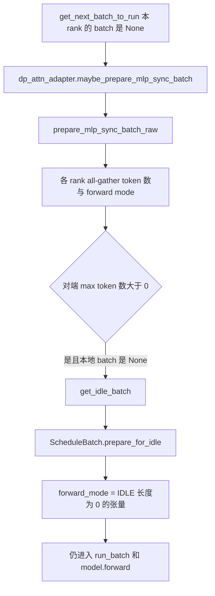

# 前向与采样

对应 F13、F162、F193。树是 `297e54fd105e974cdf401e5b4d20253a22c16f90`。**源码路径推断，未实测**。采样后端的名字是 F165，本页只写采样函数在调度步的哪一次被调用。SSE 不在这里。

## 在框架中的位置

```mermaid
flowchart TD
  run["Scheduler.run_batch"] --> pre{"forward_mode.is_prebuilt"}
  pre -->|是| pb["_run_batch_prebuilt 不跑提示词"]
  pre -->|否| res["resolve_forward_inputs"]
  res --> iso["_forward_isolation"]
  iso --> gen["model_worker.forward_batch_generation"]
  gen --> fb["ForwardBatch.init_new"]
  fb --> mr["ModelRunner.forward"]
  mr --> graph{"decode CUDA graph 能跑"}
  graph -->|是| cg["decode_cuda_graph_runner.execute"]
  graph -->|否| eager["eager_runner 或 prefill CUDA graph"]
  eager --> logits["最后一级得到 logits"]
  logits --> samp{"要不要立刻 sample"}
  samp -->|普通| now["ModelRunner.sample"]
  samp -->|overlap 且语法或延迟采样| later["delay_sample_func 交给下一轮"]
```

角色：`run_batch` 是调度器进入 GPU 的门。`forward_batch_generation` 把 `ScheduleBatch` 收成 `ForwardBatch`。`ModelRunner.forward` 跑层。`sample` 把最后一级 logits 收成 token id。KV 的读写使用组 batch 时已经填好的下标。

`model_worker` 的选择在 `init` 末尾：投机算法为空，或本 PP 级没有 `draft_worker` 时，`model_worker = tp_worker`。否则 `model_worker = draft_worker`。PP 的非最后一级没有 draft worker，它们用 `tp_worker` 跑验证形状的目标前向。

## 场景

| 场景 | 前向 | 采样 |
| --- | --- | --- |
| 单卡生成，`EXTEND` 或 `DECODE` | `TpModelWorker.forward_batch_generation` → `ModelRunner.forward` | `pp_group.is_last_rank` 上 `model_runner.sample`。prefill-only 不采样，放一批 0，需要 logprob 时只 `compute_logprobs_only` |
| `MIXED` | eager runner 在非 NPU、且没有 CP 策略时把模式改成 `EXTEND` 再跑。NPU 保留 `MIXED` 走专用 kernel。CP 保留 `MIXED` 以跳过 zigzag 切分 | 与 extend 相同，最后一级采样 |
| `IDLE` | `EagerRunner._execute_idle` 仍调用 `model.forward` | 空组没有真实序列。结果走 `process_batch_result_idle` |
| 投机 | `draft_worker.forward_batch_generation`。验证步把模式变成 `TARGET_VERIFY`，草稿 extend 是 `DRAFT_EXTEND_V2` | 目标验证的接受长度由 worker 写入 `GenerationBatchResult`。调度器在 `run_batch` 末尾把 `next_draft_input` 放回 `batch.spec_info` |
| PP 非最后一级 | `model_runner.forward` 的返回值被当成 `pp_hidden_states_proxy_tensors` | 不采样 |
| PP 最后一级加投机、非 overlap | `resolve_forward_inputs` 之后在 `_forward_isolation(overlap=False)` 里跑 worker | 最后一级持有采样和草稿。非最后一级若是 verify 轮，只跑 `eagle_prepare_for_verify` 造出的 `ForwardBatch`，`is_verify=True` 时 worker 跳过采样 |
| overlap | 前向在 `forward_stream`，先等 `schedule_stream` | 无投机、且（batch 有 grammar，或 `SGLANG_ENABLE_DELAY_SAMPLE` 且不是 prefill-only）时，`sample` 收成闭包，等 `launch_batch_sample_if_needed` |
| embedding | `tp_worker.forward_batch_embedding` | 没有 next token。`EmbeddingBatchResult` |
| PD `PREBUILT` | `run_batch` 开头就返回 `_run_batch_prebuilt` | 这一步不采样。见 [07-PD分离](07-PD分离.md) |
| attention DP 且对端是 extend | `maybe_convert_decode_to_extend` 可以把本 rank 的 decode 批改成 extend 视图，让各 rank 回放同一种图 | 模式变了，采样仍在 `forward_batch_generation` 的最后一级分支 |

## F162 从 ScheduleBatch 到模型

`TpModelWorker.forward_batch_generation` 在 `batch is not None` 时：

1. `set_hicache_consumer` 把这一轮的 host cache 消费者下标交给 worker。
2. 若打开 encoder SWA replay，先按后端决定是折叠进同一次 extend，还是先重放再正常 extend。折叠后的 batch 才交给 `ForwardBatch.init_new`。
3. `ForwardBatch.init_new(batch, model_runner, ...)`。类文档写：保存一次 forward 的全部输入。`input_ids`、`req_pool_indices`、`seq_lens`、`out_cache_loc` 从 `ScheduleBatch` 借来。`init_new` 声明自己不改传入的 `ScheduleBatch`。
4. decode 或 idle 时，extend 专用的 `extend_seq_lens` 等留空。有语法则把 `req.grammar` 抄进 `sampling_info.grammars`。
5. dLLM 算法直接 `dllm_algorithm.run`，不走下面的 `model_runner.forward`。
6. `pp_group.is_last_rank` 时 `model_runner.forward`，取出 `logits_output`。否则同一调用的返回值是给下一级的 proxy。

`ModelRunner.forward` 增加 `forward_pass_id`，套上 expert-distribution 记录，然后 `_forward_raw`：

| 步骤 | 函数 | 做什么 |
| --- | --- | --- |
| 模型自己的准备 | `model.prepare_for_forward`，若存在 | 层间元数据 |
| 上下文 | `forward_context` | 把 `attn_backend` 和这份 `ForwardBatch` 放进前向上下文 |
| decode 图 | `decode_cuda_graph_runner.can_run_graph` 且模式的 `is_cuda_graph()` 为真 | `DECODE`、`TARGET_VERIFY`、`IDLE`、`DLLM_EXTEND` 在枚举上允许图。命中则 `execute` 后直接返回 |
| 图没命中 | `_prepare_eager_forward_batch` | 给 eager、prefill 图、split prefill 补上 DP / MLP sync 的填充长度。decode 图那条提前返回，不走这里 |
| Mamba | `_maybe_execute_deferred_mamba_cow_and_clear` | extend 上、读池之前，把调度期推迟的清槽和 COW 做完 |
| split prefill | `forward_split_prefill` | PD mux 的层切分 |
| prefill 图 | `prefill_cuda_graph_runner.can_run_graph` | piecewise prefill 图。`token_indices_to_pool` 非空时不走 |
| 其余 | `eager_runner.execute` | 按模式分到 `_execute_decode`、`_execute_idle`、`_execute_extend` |

eager 的三条都在准备好 attention metadata 之后调用 `model.forward(input_ids, positions, forward_batch, **pp_kwargs)`。extend 在 CP 激活时可能改走 `_execute_extend_cp`。decode 在 pdmux 下改用 `decode_attn_backend`。

KV 的读和写就在这次 `model.forward` 里，由 attention 后端使用 `ForwardBatch` 上的计划：

- 读：前缀页的下标已经在 `req_to_token_pool` 的对应行里，`extend_prefix_lens` / `seq_lens` 告诉 kernel 哪些位置是已有 KV。
- 写：`out_cache_loc` 是本步新 token 的槽。`KVLocPlan.bind` 可以把它收成物理下标；投机的一次迭代里多次前向共享同一份 plan，用 `write_cols` 标明这一次写窗口的哪些列。
- idle：长度为 0 的输入。`_execute_idle` 在 `batch_size == 0` 时把 `attn_backend.forward_metadata` 清掉，避免 SWA 用到已经释放的 req 行；填充过的 idle（`batch_size > 0`）仍 `init_forward_metadata`。

前向返回 `ModelRunnerOutput`。非草稿 worker 上，routed-experts 和 indexer topk 的捕获器在 `forward` 的后半段挂到 output 上。这是附加输出，不改变 token 采样的位置。

## 采样发生在前向的哪一侧

`ModelRunner.sample`：

1. `_preprocess_logits` 里 `sampling_info.update_regex_vocab_mask()`，再 `apply_logits_bias`。掩码用完就把 `grammar_mask` 置空，避免 overlap 把这份词表掩码留到下一轮。
2. 有水印候选时 `watermark_state.force` 改 logits。
3. `self.sampler(...)` 产出 `next_token_ids`。decode 用 `forward_batch.positions`，其它模式用 `seq_lens - 1`，也就是每条序列最后一个位置。
4. 采样观察者和 ngram embedding 在 token id 出来之后更新。

调用点在 `forward_batch_generation` 的最后一级，且 `is_verify` 为假。verify 把采样留给投机 worker 自己的接受逻辑，函数在 `capture_pre_sample_logits` 之后返回。

overlap 的推迟条件写在 worker 里：`enable_overlap`、没有投机、并且（`grammars is not None`，或者环境变量 `SGLANG_ENABLE_DELAY_SAMPLE` 且不是 prefill-only）。闭包 `sample_batch_func` 放进 `GenerationBatchResult.delay_sample_func`。`Scheduler.launch_batch_sample_if_needed` 在上一批 `process_batch_result` 之后才调用它，然后 `_copy_result_to_cpu`，并丢掉闭包和 `next_token_logits`，避免语法掩码的显存留到下轮。

非 overlap、非投机的普通路径在 `run_batch` 里同步调用 worker，采样已经完成，再 `_relay_forward_payload` 把 token 放进 `future_map`，供下一轮 decode 的 `resolve_forward_inputs` 取回。投机则中继 `next_draft_input`。

`copy_to_cpu` 在 overlap 的 CUDA 路径上走 `copy_stream`，让 D2H 和下一次前向重叠。HIP 的注释写跨流同步比这次小拷贝更贵，所以在前向流上直接拷。hidden states 和 DSpark 的接受长度是 CUDA graph 缓冲的视图，下一轮回放会改掉，所以即使开了异步 D2H，也要立刻在前向后面排队拷贝。

## 多卡：各 rank 做同一轮的不同部分

| 轴 | 前向时的分工 |
| --- | --- |
| TP | 每个 scheduler 进程一份 `ModelRunner`。`pp_size=1` 时每个 TP rank 的 `pp_group.is_last_rank` 为真，都会跑采样，这样各 rank 拿得到同一个 next token。集体通信在层里面。ZMQ 只建在 `pp_rank`、`attn_tp_rank`、`attn_cp_rank` 都为 0 的进程上，避免把同一批 token PUSH 多次 |
| PP | 非最后一级把 hidden proxy 交给下一级，不产生 token。最后一级采样。`run_batch` 的 `pp_proxy_tensors` 参数就是上一级传来的张量 |
| Attention DP | `get_next_batch_to_run` 末尾 `maybe_prepare_mlp_sync_batch`。各 rank all-gather token 数和模式。本 rank 没有序列而对端有时，换成 idle batch，见 F193。投机且没开 `SGLANG_ENABLE_DP_SPEC_PREFILL_COORDINATION` 时，代码先保证 prefill 与 decode 不混在同一步里再做这次同步 |
| Attention CP | extend 的 CP 元数据在 eager extend 里准备。`prepare_for_decode` 把 `attn_cp_metadata` 清掉，注释写 CP 只用于 prefill |
| MoE / EP | expert 分布记录在 `ModelRunner.forward` 的上下文里。空的 attention DP 组仍要进 `model.forward`，这样 all-to-all 的对端存在。弹性 EP 的 join 在采样之后 `_maybe_finalize_elastic_cuda_graph_scale`，或在非图路径的 `forward` 末尾 |

这些集体通信没有在本环境跑过。死锁条件来自源码里的同步点：模式不一致、或某一 rank 跳过 `forward`。

## F193 为何空的 attention DP 组仍要 IDLE

`ForwardMode.IDLE` 的注释：没有序列要前向；data parallel attention 下，有的 worker 分不到序列。

调用链：



`prepare_mlp_sync_batch_raw` 在 `need_idle_batch` 时，本地 batch 为空就换成 `get_idle_batch()`。`need_idle_batch` 在跳过 all-gather 时等于「不是 DWDP 且 `num_dp_ranks>1`」；否则等于「全局 token 数的最大值大于 0」。也就是：只要这一步有任何一个 attention DP rank 真的要算，空 rank 也要交出一份 idle batch。

`prepare_for_idle` 把 `input_ids`、`seq_lens`、`out_cache_loc`、`req_pool_indices` 都收成空张量，并仍建一份 `SamplingBatchInfo`。`process_batch_result` 见到 `is_idle()` 走 `process_batch_result_idle`：等 D2H，再以 `is_idle_batch=True` 调用流输出。它不往请求的 `output_ids` 里追加 token。

`PREBUILT` 走同一套同步时不把自己当成计算批：函数给它安一个 `inner_idle_batch`，真正参加 MLP sync 的是那份 idle。`_run_batch_prebuilt` 若看见 inner idle，就转去 `run_batch(idle_batch)`。

原因从这条路径读出来：attention DP 把序列分到不同 rank，MLP 和 MoE 的 all-to-all 仍然要每个 rank 都进入同一次前向。空 rank 若直接 `on_idle` 返回，对端的集合通信没有同伴。`IDLE` 是「本 rank 没有序列，但这一步的通信图里仍有我」的模式。注释和 `prepare_mlp_sync_batch_raw` 的替换写的是这件事。没有空组却跳过前向时会不会死锁，标 **源码路径推断，未实测**。

`is_cuda_graph()` 把 `IDLE` 和 `DECODE` 放在一起，空组也可以回放 decode 图。eager 路径则走 `_execute_idle`，计时类别是 `"idle"`。

返回 [本目录 README](README.md)。
