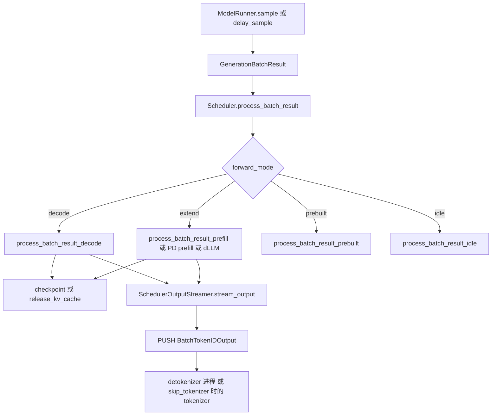

# 结果回传

对应 F163、F164。树是 `297e54fd105e974cdf401e5b4d20253a22c16f90`。**源码路径推断，未实测**。

本页停在 scheduler 把 token id 交出去。detokenizer 如何把 id 变成文本、tokenizer 如何 `_stream_one_response`、HTTP 如何包 SSE，归 [04-流式与非流式响应](../04-流式与非流式响应/README.md)。

## 在框架中的位置

角色：把 GPU 上的 token id 写回 `Req.output_ids`，推进语法和结束条件，发布或释放 KV，再把这一步要给客户端的增量送出 scheduler 进程。文本还不在这里产生。

## 场景

| 场景 | 结果函数 | 送给谁 |
| --- | --- | --- |
| 普通 decode | `process_batch_result_decode` | 达到 `stream_interval` 或结束的请求进入 payload |
| 普通 prefill，含 chunk 的最后一块 | `process_batch_result_prefill` | 首 token 在这里 append。中间 chunk 设 `skip_stream_req`，不把未完成的块流出去 |
| mixed 批里的 decode 行 | 仍进 prefill 结果函数。已结束或 retracted 的行被 `continue` 跳过 | decode 行的 token 由它们自己的那次 decode 结果处理提交 |
| overlap | 结果先留在 `result_queue`，下一轮才 `process_batch_result` | 同一条已结束的请求可能再被看见一次。`finished_output` 为真时流输出直接跳过，避免多送一块空增量 |
| 投机 | decode 结果里 `next_token_id` 是一列已接受的 token，不是固定 1 个 | 指标用 `num_correct_drafts` 和接受长度。语法已在 `_resolve_spec_v2_tokens` 里推进的，这里不再推进 |
| idle | `process_batch_result_idle` | `is_idle_batch=True` 的流输出，不追加 token |
| embedding | prefill 结果函数的 else 分支 | `stream_output` 走 `_stream_output_embedding` |
| `skip_tokenizer_init` | 流输出函数不变 | `send_to_detokenizer` 这根套接字在建连时就绑到 `tokenizer_ipc_name`，和 `send_to_tokenizer` 同一目的地 |
| Rust server | 不走 ZMQ detokenizer | `rust_server.push_generation` |

## F163 process_batch_result

位置：`Scheduler.process_batch_result`。decode 的逐请求逻辑在 `scheduler_components/batch_result_processor.py` 的 `process_batch_result_decode`。prefill 在同文件的 `process_batch_result_prefill`。

分发：

| 模式 | 函数 |
| --- | --- |
| `is_decode()` | `process_batch_result_decode` |
| `is_extend()` 且 dLLM | `process_batch_result_dllm` |
| `is_extend()` 且 PD prefill | `process_batch_result_disagg_prefill` |
| 其它 extend | `process_batch_result_prefill` |
| `is_prebuilt()` | `process_batch_result_prebuilt` |
| `is_idle()` | `process_batch_result_idle` |

进入分发之前，函数先 `flush_trace_batch`，再按需发布负载快照。注释写：overlap 时这段 CPU 发生在下一批 GPU 前向已经发射之后。分发之后 `tree_cache.flush_pending_backups()`，把这一步排队的 host 备份提交掉，再记步数计数器。

decode 一条请求上的顺序：

1. `copy_done` 先同步，保证 token id 已经在 CPU 上。
2. `_normalize_decode_outputs` 把张量收成每条请求一个列表。非投机长度是 1。投机是接受下来的那一串。
3. beam 由 `beam_coordinator.commit_decode` 先写好结束状态。没有 beam 时，overlap 下已经 `finished()` 或 `is_retracted` 的请求直接跳过，多分配的 KV 在 `release_kv_cache` 里收回。
4. `req.output_ids.extend(next_token_id)`，再 `update_finish_state`。采样掩码不合法则改为 abort，接受长度记 0。
5. 语法：非投机调用 `_accept_grammar_tokens`。投机若已经在 `_resolve_spec_v2_tokens` 里推进过，这里只把 `grammar.finished` 设成请求的结束状态。
6. logprob、hidden states、routed experts 按请求旗标抄到 `Req` 上。
7. 结束时 `_handle_finish_state_updated_req` 才释放 KV。默认 `release_kv_cache(..., checkpoint=True)`。Mamba lazy 时 `checkpoint` 改用 `req.mamba_lazy_checkpoint`。开了 decode KV offload 时先异步下沉，释放推迟到 Device→Host 完成。采样掩码不合法走 `_handle_sampling_mask_abort`，`checkpoint=False`。未结束的 decode 不在每步把整段再 checkpoint 一次。prefill 路径不同，见下。
8. `output_streamer.stream_output(batch.reqs, batch.return_logprob)`。

prefill 一条请求上的顺序：

1. 同样先等 `copy_done`。
2. `inflight_middle_chunks > 0` 的是还在 chunk 的请求：计数减一，记成 `skip_stream_req`，只增量更新 input logprob。不 append 输出 token，也不 checkpoint。
3. 计数已经归零：append `next_token_id`，`update_finish_state`。结束则 `release_kv_cache`。还要继续 decode、且不在本轮 mixed 的 decoding 行里，则 `checkpoint_kv_cache`，前缀从此可以被别的请求匹配。
4. 丢弃原因（KV 加载失败、采样掩码不可用）时 `checkpoint=False` 的释放，不把这块 KV 留在树上。
5. 语法在 `_apply_prefill_grammar`。overlap 的投机若 `result.grammar_advanced` 已经为真，这里不再次推进。
6. `stream_output(..., skip_req=skip_stream_req)`。

`ScheduleBatch` 在 `run_batch` 里被 overlap 改过的字段，不能拿来解释这份结果。所以 `run_batch` 在返回前把 `extend_input_len_per_req` 和 `extend_logprob_start_len_per_req` 抄进 `GenerationBatchResult`。结果处理读的是这份拷贝。

## F164 输出回 tokenizer 的路

位置：`scheduler_components/output_streamer.py` `SchedulerOutputStreamer.stream_output`。生成走 `_stream_output_generation`，embedding 走 `_stream_output_embedding`。

`_stream_output_generation` 用 `_GenerationStreamAccumulator` 决定这一步哪些请求该出现在 payload 里。`stream_interval` 和强制间隔在累加器里。已经 `finished_output` 的请求跳过，这是 overlap 多看一次同一条请求时的去重。`skip_req` 是还在 chunk 的那条。

payload 非空时：

| 进程形态 | 发送 |
| --- | --- |
| 嵌入的 Rust server | `rust_server.push_generation`。ZMQ tokenizer 套接字在这种模式下不被消费 |
| 否则 | `send_to_detokenizer.send_output(payload)` |

套接字在 `scheduler_components/ipc_channels.py` `SchedulerIpcChannels.create` 里建。`init_ipc_channels` 把「0 号」定义成 `pp_rank`、`attn_tp_rank`、`attn_cp_rank` 都为 0：

- `send_to_tokenizer` 总是 PUSH 到 `port_args.tokenizer_ipc_name`。控制响应、abort、健康检查走这根。
- `skip_tokenizer_init` 为假：`send_to_detokenizer` PUSH 到 `port_args.detokenizer_ipc_name`。detokenizer 进程再把文本送回 tokenizer。这是 F14 的入口，本页不写 detokenizer 循环。
- `skip_tokenizer_init` 为真：两根都 PUSH 到 `tokenizer_ipc_name`。注释写没有 decode 工作，输出直接到 tokenizer 侧；`tokenizer_worker_num>1` 时由 `MultiTokenizerRouter` 再分发。tokenizer 收到的是 `BatchTokenIDOutput`，不再经过 detokenizer。

三个 rank 不全为 0 的进程上，两个 sender 包着 `None`，`send_output` 不会把同一批 token 再送一遍。

abort 不走 `stream_output`。队列满、优先级拒绝、retract 失败用 `send_abort_output`，直接 `send_to_tokenizer`。Rust 模式改 `rust_server.push_abort`。

## overlap 时结果和采样的先后

普通循环里，`run_batch` 返回时采样已经完成，紧接着 `process_batch_result`。overlap 循环把这两件事拆开，顺序固定成：

1. 当前批 `run_batch`。需要推迟的采样先不跑，logits 留在 `delay_sample_func` 里。
2. `_apply_war_barrier`，再把 `(batch.copy(), batch_result)` 放进 `result_queue`。
3. 若上一批存在且本批允许重叠，`pop_and_process` 处理上一批。语法的接受发生在这里。
4. `launch_batch_sample_if_needed` 才采样当前批。掩码因此能看见上一批已经接受的 token。
5. 采样之后的 D2H 仍由 `copy_done` 守着。下一轮处理当前批时，`process_batch_result_*` 开头会同步这个 event。

连续两个 prefill 被环境变量要求不重叠时，步骤 3 提前到 `run_batch` 之前，当前批的采样也不再和上一批的结果处理并行。见 [01-事件循环](01-事件循环.md)。

返回 [本目录 README](README.md)。
