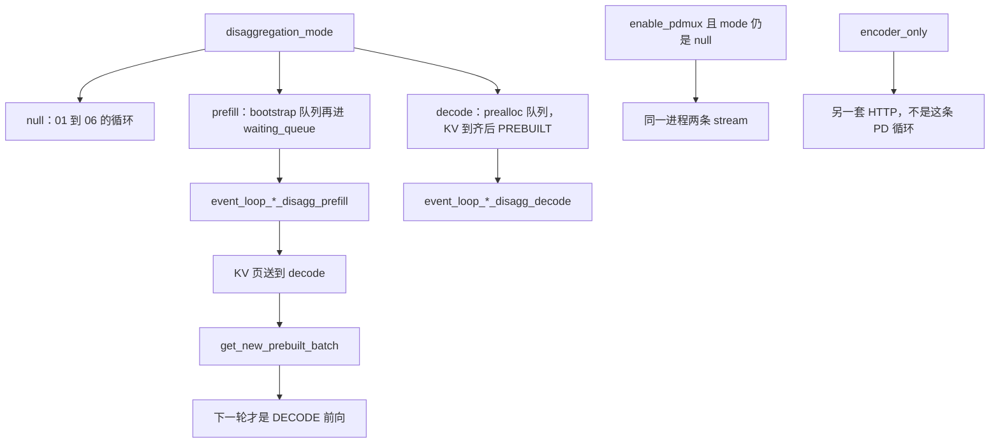
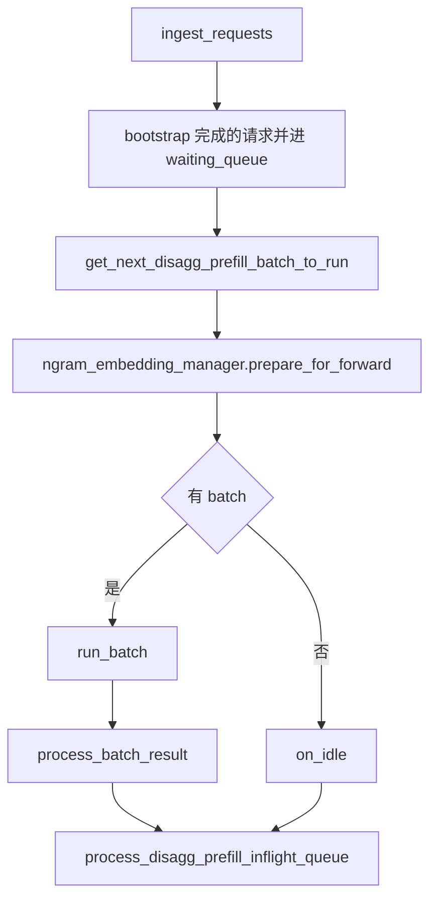
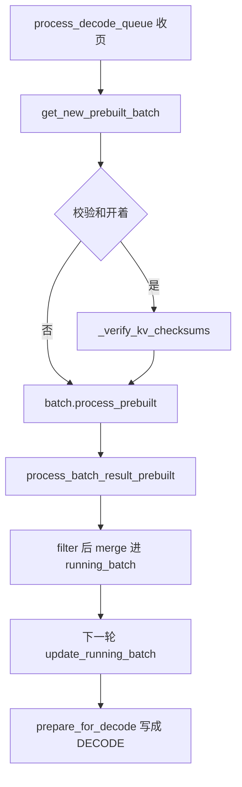

# PD 分离

对应 F179–F188、F203。树是 `297e54fd105e974cdf401e5b4d20253a22c16f90`。传输和多机时序 **源码路径推断，未实测**。

并行角色（谁和谁建组）在 [04-分布式/05-分离多机与通信](../../04-分布式/05-分离多机与通信.md)。特性侧的调度策略在 [03-特性/06-调度与PD](../../03-特性/06-调度与PD/README.md)。本页只写 scheduler 上的模式、循环和 `PREBUILT`。

## 在框架中的位置

角色：prefill 进程把提示词的 KV 算完并送走，自己不把请求留在本地做长 decode。decode 进程不重算提示词，等页到齐后并进 `running_batch`，之后的步和普通 decode 一样走 `update_running_batch`。

## 场景

| 场景 | 循环 | 请求进哪 |
| --- | --- | --- |
| `null` | F151–F155 | `waiting_queue` |
| `prefill`，`pp_size=1`，overlap | `event_loop_overlap_disagg_prefill` | 先 `disagg_prefill_bootstrap_queue`，bootstrap 完成后并进 `waiting_queue` |
| `prefill`，不 overlap | `event_loop_normal_disagg_prefill` | 同上 |
| `prefill`，`pp_size>1` | `event_loop_pp_disagg_prefill` | 同上，再按 PP microbatch 传递 |
| `decode` 的三个对称循环 | `event_loop_pp_disagg_decode` / `event_loop_overlap_disagg_decode` / `event_loop_normal_disagg_decode` | `disagg_decode_prealloc_queue`。retract 的请求也回到这里 |
| `enable_pdmux`，模式仍是 null | `event_loop_pdmux` | 仍是本地 `waiting_queue`。prefill 被收成 `SPLIT_PREFILL`，和 decode 用不同 stream |
| `enable_pd_role_switch` | 外层 supervisor | 空闲时拆掉角色结构再重建，然后换上面的循环 |
| `encoder_only` | 不进本页的 PD 循环 | 启动时就走编码器的 `launch_server`。F21 |

## F179 模式

位置：`arg_groups/fields/disagg.py` `disaggregation_mode`，取值 `null` / `prefill` / `decode`，默认 `null`。help 写明没指定就不是 PD。运行时对象是 `DisaggregationMode`。`Scheduler.disaggregation_mode` 和 `_dispatch_event_loop_once` 读的是它。

`null` 走 [01-事件循环](01-事件循环.md) 的本地循环。`prefill` 和 `decode` 互斥，一台进程一个模式。要在运行中翻转，必须打开 F185。

## F180 解析期

S2 的 `handle_pd_disaggregation` 在启动篇的解析流水线里。它改写的是模式、传输和与之冲突的旗标，发生在任何请求之前。本页的循环只消费解析结果。更后面的 `handle_encoder_disaggregation` 管的是编码器那条进程，和 PD 的 prefill 角色不是同一个 hook。

## F181 传输后端

`disaggregation_transfer_backend` 默认 `mooncake`。`DISAGG_TRANSFER_BACKEND_CHOICES`：`mooncake`，`nixl`，`ascend`，`fake`，`mori`，`mooncake_tcp`。

scheduler 循环不实现 RDMA 或 TCP 的页拷贝。prefill 侧在 `run_batch` 里对每条请求 `maybe_send_cached_prefix_chunk`：已在本机命中的前缀可以在后缀前向还在跑时先送。若这一轮还有 HiCache load-back 没写完（`hicache_consumer_index >= 0`），这次早送被关掉，避免把还在写的页送出去。decode 侧由 `disagg_decode_prealloc_queue` 收页，收齐才进入 `get_new_prebuilt_batch`。各后端的连接和队列类型在 `srt/disaggregation/`，本页不展开每个后端的握手。

## F182 prefill 循环

`SchedulerDisaggregationPrefillMixin`（`disaggregation/prefill.py`）。普通一轮：

`get_next_disagg_prefill_batch_to_run` 仍调用本地的 `get_new_batch_prefill`，所以 chunk、策略、前缀匹配和 null 模式共用 adder。区别是候选来自 bootstrap 队列弹出的请求，以及前向期间可以把已缓存前缀先送走。结果处理走 `process_batch_result_disagg_prefill`，不把请求留在本地 `running_batch` 里做后续 decode。

overlap 变体维持最多两个在飞前向，并在等结果时继续收包。连续轮询要 attention DP 和 CP 都是 1、非投机、自回归生成，否则退回普通 overlap。

## F183 decode 循环与 F203 PREBUILT

`ForwardMode.PREBUILT` 的注释：分离式 decode worker 上，这一批请求的 KV 已经可以开始解码。

它不是 `EXTEND`。`EXTEND` 表示本进程还要算一段新 token 的 KV，前缀可以已经在本地树上。PD decode 的提示词 KV 是 prefill 进程算的，再经 F181 的后端写进 decode 进程的池。若这里走 `EXTEND`，decode 会按 `prefix_len` 再算一遍提示词，和「页已经到了」矛盾，也会把 attention DP 的 token 数算成整段 prompt。

`PREBUILT` 在调度里是一次状态迁移，不是一次提示词前向：

`process_batch_result_prebuilt` 断言当前模式是 decode。它对每条请求盖上 prebuilt 完成时间并 `update_finish_state`。已经结束的（例如长度为 0 的特殊完成）走 `release_kv_cache`。注释写 logprob 由 prefill 引擎处理。然后 `stream_output`。若打开 decode 侧 radix，释放包在 `free_group` 里。

`Scheduler.run_batch` 一看见 `is_prebuilt()` 就 `return self._run_batch_prebuilt(batch)`，不调用 `model_worker.forward_batch_generation`。`_run_batch_prebuilt` 只有在 batch 上挂了 `inner_idle_batch` 时才真正前向，而且前向的是那份 `IDLE`，用来参加 attention DP 的 MLP sync。没有 inner idle 时返回空的 `GenerationBatchResult`。

`process_prebuilt` 读的是请求上已经存在的 `output_ids[-1]`。这个 token 是 prefill 进程算好、随 KV 一起带到 decode 的，不是 decode 进程在 `PREBUILT` 这一步采样出来的。函数把它 `checkpoint_kv_cache` 进本地树；语法对象若还没接受过当前 token，就 `accept_token`。非投机时把这个 token stash 进 `future_map`，作为下一轮 `DECODE` 的输入。下一轮 `update_running_batch` → `prepare_for_decode` 才在 decode 进程上跑模型，采样的是再往后的 token。

`get_next_disagg_decode_batch_to_run` 先处理 prebuilt，再对非空的 running 调用 `update_running_batch`。从这一轮起，decode 的 KV 读写和 null 模式的 decode 相同：`alloc_for_decode` 再要新槽，`ModelRunner.forward` 按 `out_cache_loc` 写。

## F184 bootstrap 端口

`disaggregation_bootstrap_port` 默认 8998。help 写这是 prefill 服务器上的 bootstrap 端口。请求在接入时带着房间号，prefill 的 bootstrap 队列用它和对端的 decode 对上同一条传输。端口监听和房间状态机在 disaggregation 连接层。调度循环只在 `pop_bootstrapped()` 看到「这个房间可以开始算」之后才把请求放进 `waiting_queue`。

## F185 角色热切换

`enable_pd_role_switch` 默认 false。help 写允许经 `/pd_role_switch` 在运行时翻转 prefill 与 decode。

`dispatch_event_loop` 在旗标为真时不直接进循环，而是 `role_switch.run_event_loop_supervisor`。supervisor 调用 `_dispatch_event_loop_once`。切换请求由 `process_input_requests` 分发到 `handle_pd_role_switch`：

- 实例必须 `is_fully_idle()`，否则拒绝，并标明可以等排空后再试。
- 目标角色和当前角色相同则直接成功返回。
- 成功时拆掉当前角色的 disaggregation 结构再按新角色建。文件头注释写：token KV 池与角色无关，不重新分配。
- 重建失败对这个实例是致命的，没有就地回滚。
- 响应送出之后把 `_event_loop_should_restart` 设上，`process_input_requests` 抛 `PdRoleSwitchRestart`。supervisor 接住后再分发，于是 F156 和 F157 对调。

## F186 同进程 mux

`enable_pdmux` 默认 false。help 写 PD 跑在 green context 的 stream 上。它要求 `disaggregation_mode == null`，所以和 F182、F183 不是同一台进程的两种角色，而是一台进程里同时跑切分 prefill 和 decode。

`event_loop_pdmux` 用 `prefill_stream` 和 `decode_stream`。prefill 侧 `update_split_prefill_batch` 把模式写成 `SPLIT_PREFILL`。decode 侧仍是 `update_running_batch`。SM 组数默认 `sm_group_num=8`，`adjust_stream_groups` 按两边是否有批来改配额。`run_batch` 对 `SPLIT_PREFILL` 调用 `forward_batch_split_prefill`，多次进入 `ModelRunner.forward_split_prefill`。

`ForwardMode.SPLIT_PREFILL` 在 `is_extend()` 里算 extend，所以上一轮 merge、overlap 的 extend 判断会把它当成 prefill。它和 `PREBUILT` 解决的不是同一件事：`SPLIT_PREFILL` 是同进程把一次 prefill 拆开和 decode 交错；`PREBUILT` 是跨进程 KV 已经在 decode 侧就绪。

## F187 编码器分离

`encoder_only` 默认 false。help 写：带编码器的多模态模型可以拉起一台只做编码的服务器。这是第三条进程。启动篇 F21：`resolving_view.encoder_only` 为真时走 `disaggregation/encoder/http_server.py` 的 `launch_server`，或编码器 gRPC。它不进入 `event_loop_*_disagg_prefill`。PD 的 prefill 角色算的是语言模型的 KV；编码器角色产出的是视觉或其它塔的特征，再交给 language-only 进程。两边的 bootstrap 端口也不同：编码器默认 8997（`encoder_bootstrap_port`），PD 默认 8998。

## F188 校验和

`disaggregation_enable_kv_checksum` 默认 false。help 写：prefill 上对每条请求的 KV 页算 Adler-32，decode 上核对。两边都要打开。不一致则 abort 这条请求，CI 里改为抛错。decode 侧开了 radix 时，摘要只覆盖 prefill 真正送出的页。prefill 的布局和 decode 不一致（TP 宽度、PP 级、page size、dtype）时放行，并告警一次，不核对。

调度侧的核对点在 `get_new_prebuilt_batch`：`process_prebuilt` 把页算进缓存之前调用 `_verify_kv_checksums`。计算机对象是 `self.kv_checksum_computer`，没开时函数直接返回。环境变量 `SGLANG_TEST_DISAGG_KV_CHECKSUM_MISMATCH_PROB` 可以在测试里注入不一致。本环境没有跑过这对进程，Adler-32 是否真的拦住坏页，标 **源码路径推断，未实测**。

返回 [本目录 README](README.md)。
