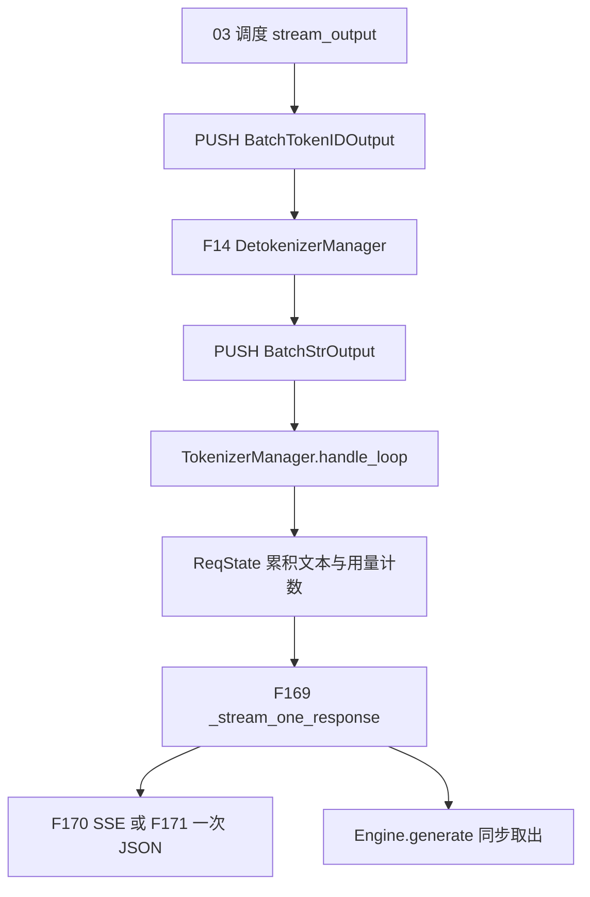
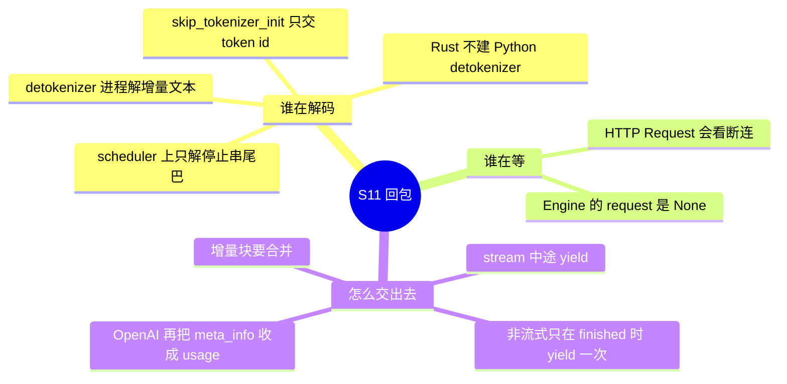
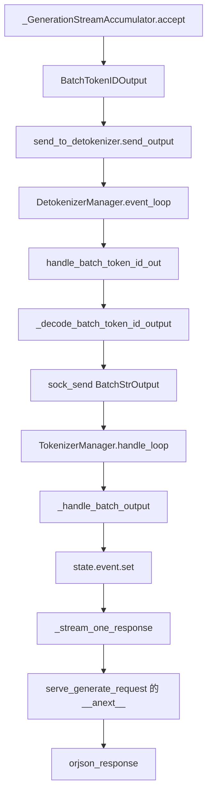

# 阶段总览

本页铺 S11（F14）。函数级过程在后面各页。树是 `297e54fd105e974cdf401e5b4d20253a22c16f90`（标签 `v0.5.23`）。多卡、SSE 字节和断连时序没有实跑，标 **源码路径推断，未实测**。

调度篇写到 `SchedulerOutputStreamer.stream_output` 把 token id 送出为止，见 [06-结果回传](../03-调度与推理/06-结果回传.md)。HTTP 入口在 `obj.stream` 上选择 `StreamingResponse` 或一次 `__anext__`，见 [02-请求接入/00-阶段总览](../02-请求接入/00-阶段总览.md)。本目录从那次 PUSH 之后写到客户端拿到的 JSON。

## 这一段在框架里的位置

`stream_output` 组的是 `BatchTokenIDOutput`（生成）或 `BatchEmbeddingOutput`（embedding）。默认路径上，rank 0 的 scheduler 把它 PUSH 到 `detokenizer_ipc_name`。`DetokenizerManager` 把本步新增的 token 解成增量字符串，再 PUSH `BatchStrOutput` 到 `tokenizer_ipc_name`。`TokenizerManager.handle_loop` 把文本和 `meta_info` 放进 `ReqState`，用 `asyncio.Event` 叫醒 `_stream_one_response`。HTTP 或 `Engine` 消费这个异步生成器。

父进程的 HTTP 时间和 scheduler 的循环时间仍然分开。文本在 detokenizer 进程里产生，yield 在 tokenizer 所在的 asyncio 循环里发生。`pp_rank`、`attn_tp_rank`、`attn_cp_rank` 不全为 0 的 scheduler 不持有发送套接字，同一批 token 不会被 PUSH 第二次。这件事的套接字条件在调度篇 F164。

## 三条必须分开的轴

| 轴 | 两端 | 分叉点 | 清单 |
| --- | --- | --- | --- |
| 流式 SSE / 一次 JSON | `stream` 为真时，未完成也 yield；为假时只在 `finished` 时 yield 一次 | 同一函数 `_stream_one_response`。HTTP 再决定包成 SSE 还是只取第一次 yield | F169、F170、F171、F198 |
| HTTP / Engine | HTTP 传入 `fastapi.Request`，会轮询断连并在流式路由上挂 abort 背景任务。Engine 把 `request` 传成 `None`，返回 dict 或同步生成器，没有 `data: ` 帧 | `generate_request` 的第二个参数 | F170、F171 |
| detokenizer 进程 / 旁路 | 默认独立进程把 id 解成 `output_strs`。`skip_tokenizer_init` 时生成 payload 直达 tokenizer，响应里没有 `text`。`SGLANG_RUST_SERVER` 不拉起这个 Python 进程 | `SchedulerIpcChannels.create` 的套接字，以及 `_launch_subprocesses` 的早退 | F14、F167 |

采样后端（F165）和语法后端（F166）决定「送出去的 token id 是哪一个」。它们在 S2 定稿、在 S10 的 `ModelRunner.sample` 生效。调用时刻在 [05-前向与采样](../03-调度与推理/05-前向与采样.md)。本目录写后端名字如何落到 `Sampler`，以及语法失败如何变成一次 abort 回包。

## 一条非流式文本请求走过的函数

下面是 `disaggregation_mode == null`、`stream` 为假、`skip_tokenizer_init` 为假、`tokenizer_worker_num == 1`、不是 Rust server、单条 `/generate` 的主路径。

| 函数 | 这一步做什么 | 角色 |
| --- | --- | --- |
| `_GenerationStreamAccumulator.accept` | 按 `stream_interval` 或强制间隔决定本步要不要出现在 payload 里，并带上增量 `output_ids` 与 detokenize 用的 `decode_ids` | 调度侧的最后一道门。未入选的 token 留在 `Req` 上 |
| `handle_batch_token_id_out` | 用已有 `DecodeStatus` 把新 id 解成增量字符串，抄上 token 计数 | S11 的文本产生处 |
| `_handle_batch_output` | 把增量文本拼进 `ReqState`，填 `meta_info`。非流式且未结束时不放进 `out_list` | tokenizer 侧的状态 |
| `_stream_one_response` | 等 `state.event`。结束才 yield 并 break | 流式和非流式共用的等待器。F198 |
| `serve_generate_request` | 非流式只取第一次 yield，一次 JSON 返回 | HTTP 外壳。块的产生规则不在这里 |

流式把最后一行换成 `StreamingResponse`：生成器每次 yield 写成 `data: ` + JSON，结束再写 `data: [DONE]`。Engine 不走 `serve_generate_request`，用 `loop.run_until_complete(generator.__anext__())` 取同一次 yield。

## 场景

| 场景 | 前提 | 本段怎么分叉 | 清单 |
| --- | --- | --- | --- |
| 原生 `/generate`，`stream: false` | rank 0 的 FastAPI。`GenerateReqInput.stream` 默认 false | 一次 `__anext__`，`orjson_response`。生成器内部仍进 `_stream_one_response` | F171、F198 |
| 原生 `/generate`，`stream: true` | 同一路由 | `StreamingResponse`，媒体类型 `text/event-stream`。背景任务 `create_abort_task` | F170 |
| 进程内 Engine | `Engine.generate` / `async_generate`。`request` 是 None | 流式返回同步或异步生成器。非流式取第一次 yield。不断连轮询 | F169 |
| OpenAI chat / completions | 协议层自己的流式函数，不经过 `serve_generate_request` | 仍消费 `generate_request`。用量从 `meta_info` 收成 `UsageInfo` | F170 的协议侧 |
| 默认 detokenizer 进程 | `skip_tokenizer_init` 为假，且不是 Rust server | `run_detokenizer_process` → `event_loop` | F14、F167 |
| `skip_tokenizer_init` | 启动时关掉 tokenizer | scheduler 把 `send_to_detokenizer` 绑到 `tokenizer_ipc_name`。响应没有 `text` | F167 |
| 增量流 | 服务参数 `incremental_streaming_output` 为真，且请求 `stream` 为真 | 每块是 delta。排队多块时 `_coalesce_streaming_chunks` | F172 |
| 非增量流式 | 上面为假，这是默认 | 中间块 `text` 可以是 None，yield 前用 `state.get_text()` 补上 | F172 |
| 非流式长输出 | `SGLANG_FORCE_STREAM_INTERVAL` 默认 50 | 未结束也会按间隔把 id 推到 tokenizer，用来累积状态。客户端仍只看到结束那一次 | F169 |
| embedding `/encode`、`/classify` | `EmbeddingReqInput` 没有 `stream` | detokenizer 原样转发 `BatchEmbeddingOutput`。HTTP 只 `__anext__` 一次 | F167、F171 |
| 客户端断开 | HTTP 且 `background` 为假 | 等待中或非流式运行中调用 `abort_request`。流式 SSE 另有背景任务 | F170 |
| 语法编译失败或后端是 `none` | 请求带 json_schema / regex / ebnf / structural_tag | `set_finish_with_abort`，不产生正常 token 流 | F166 |
| Rust server | `SGLANG_RUST_SERVER` | 不拉起 Python detokenizer 和 `TokenizerManager`。`rust_server.push_generation` | F14 的旁路 |

场景行回填 [场景与硬件前提总表](../../01-体系总览/03-场景与硬件前提总表.md)。本段的文本解码在 CPU 上的 detokenizer 进程，不占用本步的 GPU 采样。采样后端的设备前提在 [01-采样后端与语法](01-采样后端与语法.md)。

## F14 S11：token id 变文本，流式或一次返回

位置：`python/sglang/srt/managers/detokenizer_manager.py` 的 `DetokenizerManager`。进程入口是 `run_detokenizer_process`。tokenizer 侧的等待在 `managers/tokenizer_manager.py` 的 `_stream_one_response`。HTTP 外壳在 `entrypoints/http_server.py` 的 `serve_generate_request`。

角色：把 scheduler 已经接受的 token id 变成客户端可见的文本或 id 列表，并在结束时带上用量计数。这一步不再跑模型，也不再改 KV。

原理：一条请求的输出跨很多个调度步。detokenizer 为每个 `rid` 留一份 `DecodeStatus`，只把「新读到的 id」相对「上一截已提交的 id」多出来的字符串送出去，这样 UTF-8 被截断时不会把半个字符提交进已发送文本。tokenizer 再决定这次增量要不要立刻 yield。非流式把同一次等待用到结束，所以 HTTP 只取第一次 yield 就得到全文。这是 F198 的原因，展开在 [03-增量合并与yield](03-增量合并与yield.md)。

增量解码见 [02-detokenize进程](02-detokenize进程.md)。yield 规则见 [03-增量合并与yield](03-增量合并与yield.md)。HTTP、Engine、中止和用量见 [04-HTTP与Engine回包](04-HTTP与Engine回包.md)。

返回 [本目录 README](README.md)。
