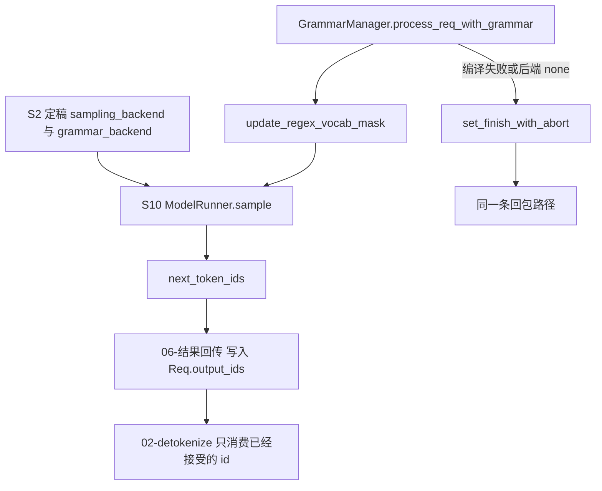

# 采样后端与语法

对应 F165、F166。树是 `297e54fd105e974cdf401e5b4d20253a22c16f90`。**源码路径推断，未实测**。

本页写 token id 在离开 logits 时走哪一个采样实现，以及语法约束怎样在进入 detokenizer 之前把请求收成 abort。`ModelRunner.sample` 在调度步的哪一次被调用，在 [05-前向与采样](../03-调度与推理/05-前向与采样.md)。语法队列的等待在 [02-队列与策略](../03-调度与推理/02-队列与策略.md)。语法库本身是特性 B48，在 [03-特性/09-其它](../../03-特性/09-其它/README.md)。旗标正文在附录 05，本页不抄字段表。

## 在框架中的位置

角色：采样后端决定从概率里取出哪个 id。语法后端决定哪些 id 的 logit 被掩掉，或在编译失败时根本不进入解码。detokenizer 不重新采样。

## F165 采样后端

位置：名字集合在 `arg_groups/choices.py` 的 `BUILT_IN_SAMPLING_BACKENDS`：`flashinfer`、`pytorch`、`ascend`、`intel_xpu`。`SAMPLING_BACKEND_CHOICES` 一开始是这个集合的副本。默认值在 `arg_groups/overrides.py` 的 `_sampling_backend_default`，由 `pipeline.py` 在平台 hook 之后以 post-process 跑。运行时对象是 `layers/sampler.py` 的 `create_sampler` 和 `Sampler.forward`。

### 名字怎么定稿

流水线里和本字段有关的写入，按 `pipeline.py` 的调用序：

| 顺序 | 函数 | 写什么 |
| --- | --- | --- |
| 平台 hook | `handle_xpu_backends` | `device == "xpu"` 且 `sampling_backend is None` 时写成 `intel_xpu` |
| 平台 hook | `handle_cpu_backends` | `device == "cpu"` 时写成 `pytorch`。不看原来是不是 None |
| 平台 hook | `handle_hpu_backends` | `device == "hpu"` 时写成 `pytorch`。同样覆盖 |
| post-process | `_sampling_backend_default` | 仍是 None 时：`get_platform().has_flashinfer` 为真则 `flashinfer`，否则 `pytorch` |
| 确定性 | `_deterministic_sampling_backend` | `enable_deterministic_inference` 且当前不是 `ascend` 时改成 `pytorch`，并打 warning |

`ascend` 在集合里，本树的 `platform_hook.py` 没有把它自动写上。NPU 上 `has_flashinfer` 是真是假，本环境没有 NPU，**待核**。用户显式把 `sampling_backend` 设成 `ascend` 之后，`Sampler.__init__` 把 `use_ascend_backend` 设为真。

`validate_device_sampling_backend`：`intel_xpu` 配上非 `xpu` 的 `device` 直接 `ValueError`。注释写这个后端的 kernel 只在 `is_xpu()` 下绑定，拿到别的设备会在第一次非贪心解码时对不上符号。MPS 的校验只接受 `None` 或 `pytorch`。

`register_sampler_backend` 把自定义名字放进 `SAMPLING_BACKEND_CHOICES`，并记下工厂。`create_sampler` 先查工厂；工厂必须返回 `Sampler`。没有工厂时，名字是 None 或属于 `BUILT_IN_SAMPLING_BACKENDS` 才构造内置 `Sampler`，否则 `ValueError`。插件在 `serve` 里、参数解析之前加载（启动篇 F18）。自定义名字能否通过 CLI choices，按那条时序推断，**未实测**。开了 watermark 时，校验拒绝不在内置集合里的后端。

### Sampler.forward 按名字分叉

`ModelRunner.sample` 调用 `self.sampler(...)`。`Sampler.forward` 在温度缩放和 softmax 之后进入 `_sample_from_probs`，贪心和带 top-k / top-p / min-p 的路径不同。

| 条件 | 采样函数 | 角色 |
| --- | --- | --- |
| `use_ascend_backend` | `_forward_ascend_backend`，内部 `top_k_top_p_min_p_sampling_from_logits_ascend` | 从 logits 直接采样，不走下面的 probs 路径 |
| 简单情形：不需要 top-p、top-k、min-p | `sampling_from_probs_torch` | flashinfer 与 pytorch 在这条上共用 PyTorch 实现 |
| 复杂情形，且后端是 `flashinfer` 或 `intel_xpu` | `min_p_sampling_from_probs`，或 `top_k_top_p_sampling_from_probs(..., filter_apply_order="joint")` | 这两个名字在这条上走同一套调用。要求 `sampling_seed is None`，否则 `assert` |
| 复杂情形，其余后端（含 `pytorch`） | `top_k_top_p_min_p_sampling_from_probs_torch` | 原生 PyTorch 的过滤和抽样 |

`flashinfer` 与 `intel_xpu` 的符号来自文件顶部对 `flashinfer.sampling` 的导入；`intel_xpu` 在 XPU 上换成对应的 kernel 名。导入失败时的具体异常本页没有逐条展开，**待核**。确定性推理把后端改成 `pytorch` 之后，走最后一行，并且 `enable_deterministic` 时 logprob 改用 `F.log_softmax`，避免 `log(softmax(x))` 和 prefill 重算对不齐。这是采样数值路径，不改变 detokenize 的输入形状：出来的仍是 `batch_next_token_ids`。

之后 `_sync_token_ids_across_tp` 让各 TP rank 拿到同一个 id。只有持有 ZMQ 的那个 rank 把 id 送进 detokenizer。空的 attention DP 组走 `IDLE`，不往请求的 `output_ids` 追加 token，也就没有新的文本块。

## F166 语法约束

位置：后端名单在 `choices.py` 的 `GRAMMAR_BACKEND_CHOICES`：`xgrammar`、`outlines`、`llguidance`、`none`。S2 的 `handle_grammar_backend`（`arg_groups/serving_hook.py`）在值是 None 时写成 `xgrammar`。实例由 `constrained/base_grammar_backend.py` 的 `create_grammar_backend` 按 `get_exec().kernel.grammar_backend` 构造。请求侧入口是 `constrained/grammar_manager.py` 的 `GrammarManager.process_req_with_grammar`。

| 名字 | 构造 |
| --- | --- |
| `xgrammar` | `XGrammarGrammarBackend`。`TokenizerNotSupportedError` 时，若开了 `enable_strict_thinking` 则 `ValueError`；否则 `override` 成 `none` 并返回 None，打 warning |
| `outlines` | `OutlinesGrammarBackend`，空白模式来自 `constrained_json_whitespace_pattern` |
| `llguidance` | `GuidanceBackend` |
| `none` | 返回 None。`enable_strict_thinking` 时 `ValueError`，因为严格思考需要能过滤 token 的后端 |
| 注册表里的自定义名 | `GRAMMAR_BACKEND_REGISTRY` 优先于上面四个名字 |

`process_req_with_grammar` 在请求进入 `waiting_queue` 之前跑。请求带 `json_schema`、`regex`、`ebnf` 或 `structural_tag` 时：

1. `grammar_backend is None`（含显式 `none`）：`req.set_finish_with_abort`，错误文案写 grammar-based generation 在 `--grammar-backend none` 下不支持。函数仍返回「不进 grammar 队列」。这条请求随后以 abort 结束，detokenizer 不会看到正常的增量 id。
2. 否则用约束类型和内容做 key，`get_cached_or_future_value`。未命中缓存则放进 `grammar_queue`，返回 True。调度篇写这个队列如何等编译完成再入 `waiting_queue`。
3. 命中 `InvalidGrammarObject`：同样 `set_finish_with_abort`，消息是编译失败。
4. 命中可用对象：`_apply_request_reasoning_config`，把思考预算和 think-end token 写到 grammar 上。

没有上述四种约束、但开了 `enable_strict_thinking` 时，走 `init_strict_reasoning_grammar`。对象非空才挂到 `req.grammar`。

采样当时，`ForwardBatch.init_new` 把 `req.grammar` 放进 `sampling_info.grammars`。`ModelRunner._preprocess_logits` 调用 `update_regex_vocab_mask`，再 `apply_logits_bias`。掩码用完置空，避免 overlap 把这份词表掩码留到下一轮。被掩掉的 id 不会出现在 `next_token_ids` 里，因此也不会出现在 `BatchTokenIDOutput.output_ids` 里。

overlap 且 batch 带 grammar 时，`sample` 推迟到上一批 `process_batch_result` 之后。原因在调度篇：掩码依赖上一批已经接受的 token。推迟只改变采样时刻，不改变本页的回包形状。

语法在接受 token 之后还会推进。decode 结果里的 `_accept_grammar_tokens` 属于调度篇 F163。推进失败把请求收成采样掩码 abort，再经流输出送出。客户端看到的仍是带 `finish_reason` 的那一次 yield。

## 和回包的边界

采样和语法都结束在 token id 或 abort 原因上。增量字符串、SSE 帧、`usage` 字段不在这两个类里产生。

返回 [本目录 README](README.md)。
