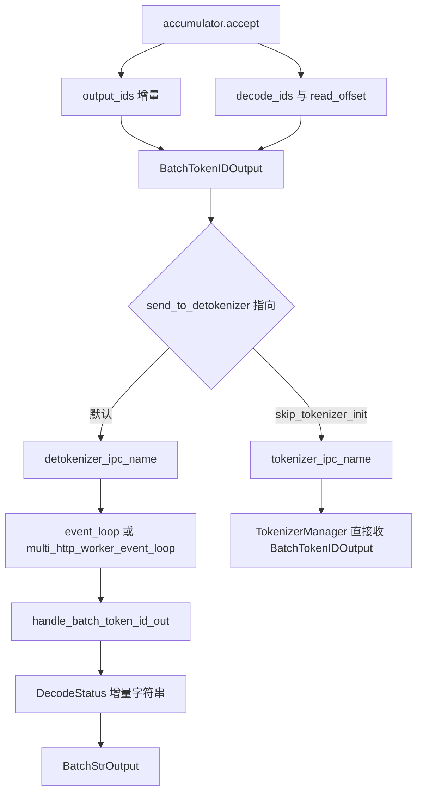

# detokenize 进程

对应 F167，并承接 F14 的文本产生。树是 `297e54fd105e974cdf401e5b4d20253a22c16f90`。**源码路径推断，未实测**。

## 在框架中的位置

角色：把「这一步新接受的 token id」变成「这一步新出现的字符串」，同时把 prompt、completion、cached 这些计数原样带给 tokenizer。tokenizer 再用这些计数填 `meta_info`。

## 进程还在不在

| 形态 | 谁拉起 | 生成 payload 去哪 | 文本 |
| --- | --- | --- | --- |
| 默认，`tokenizer_worker_num == 1` | `Engine._launch_detokenizer_subprocesses` → `run_detokenizer_process` | `detokenizer_ipc_name` 上的 PULL | `event_loop` 解完，PUSH 到 `tokenizer_ipc_name` |
| `tokenizer_worker_num > 1` | 同上，循环改走 `multi_http_worker_event_loop` | 仍从 scheduler 的 detokenizer 套接字收 | 按 `http_worker_ipcs` 分回各个 tokenizer worker。单根 `send_to_tokenizer` 在这种模式下不建 |
| `detokenizer_worker_num > 1` | 每个 worker 一个进程，前面再加 `run_multi_detokenizer_router_process` | router 占原来的 `detokenizer_ipc_name` | 路由之后仍是上面的解码循环。router 内部本页不展开 |
| `skip_tokenizer_init` | 进程照样拉起。`init_tokenizer` 把 `self.tokenizer` 设成 None | `SchedulerIpcChannels.create` 把 `send_to_detokenizer` 改绑到 `tokenizer_ipc_name` | tokenizer 收到 `BatchTokenIDOutput`，响应字典没有 `text` |
| `SGLANG_RUST_SERVER` | `_launch_subprocesses` 在拉起 detokenizer 之前返回 | `rust_server.push_generation` | Python 的 `DecodeStatus` 不跑。调度篇 F164 已写这个早退 |

`run_detokenizer_process` 把进程名设成 `sglang::detokenizer`，`publish(..., role="detokenizer")`，父进程死后自杀。异常时给父进程发 `SIGQUIT`。`tokenizer_worker_num == 1` 进 `event_loop`，否则进 `multi_http_worker_event_loop`。

`skip_tokenizer_init` 下，detokenizer 进程仍阻塞在自己的 PULL 上，生成流量不进这根套接字。`FreezeGCReq` / `ConfigureLoggingReq` 若仍从被改绑的 `send_to_detokenizer` 发出，会落到 tokenizer 而不是这个空转进程。发送端是否全部改道，本页没有逐条对完，**待核**。

## 调度侧交给它的两套 id

`_GenerationStreamAccumulator.accept`（`scheduler_components/output_streamer.py`）先决定这条请求本步出不出 payload。

| 请求 | 何时入选 |
| --- | --- |
| 已结束 | 入选，并设 `finished_output`，避免 overlap 再送一次空增量 |
| `stream` 为真 | `stream_interval` 取 `sampling_params.stream_interval`，空则用服务参数，默认 1。间隔为 1 时每步都送。否则未发送个数达到间隔，或这是第一个 token，才送。随后还要 `check_match_stop_str_prefix` 为假：尾巴可能是停止串的前缀时，这一步先压住 |
| `stream` 为假 | `len(output_ids) % SGLANG_FORCE_STREAM_INTERVAL == 0` 才送。环境变量默认 50。结束时上面的分支已经入选，不受这条限制 |

入选之后，payload 里和文本有关的是两套下标：

| 字段 | 含义 | 谁用 |
| --- | --- | --- |
| `output_ids` | `output_ids_through_stop[send_token_offset:]`，本步尚未发给客户端的新 token。然后把 `send_token_offset` 推到当前长度 | tokenizer 追加到 `ReqState.output_ids`。这是响应里的 id |
| `decode_ids` | `init_incremental_detokenize` 返回的 `surr_and_decode_ids`，再切掉已经发给 detokenizer 的前缀 | 只给增量解码做上下文 |
| `read_offsets` | `read_offset - surr_offset`。请求对象上这两个偏移只在第一次计算，所以之后每步 payload 里是同一个数。detokenizer 只在新建 `DecodeStatus` 时用它划开提示词尾巴和新输出，之后自己推进 `s.read_offset` | 同上 |
| `decoded_texts` | `req.decoded_text`。构造时是空字符串，本树没有别的赋值 | 新建 `DecodeStatus` 时的初始文本 |

`Req.init_incremental_detokenize`：第一次把 `read_offset` 设为未补齐提示词长度，`surr_offset` 设为 `max(read_offset - 5, 0)`。常量是 `INIT_INCREMENTAL_DETOKENIZATION_OFFSET = 5`。`surr_and_decode_ids` 等于提示词从 surrogate 起点起的一段，接上 `output_ids_through_stop`。之后每步只把新的输出 id 追加进这份列表。surrogate 最多覆盖 5 个提示词 token。提示词更短时这段更短。分词器先把这段和输出一起解码，再按字符串长度丢掉前缀。半个 UTF-8 若落在提示词末尾，不会被当成第一个输出字符。

停止串的判断发生在 scheduler 进程，用的是 `req.tokenizer`（`handle_generate_request` 里设成 `self.tokenizer`）。`tail_str` 和 `_locate_str_stop_finished_len` 会 `tokenizer.decode` 一小段尾巴，用来决定这一步流不流、停止串落在第几个输出 token。这是调度进程上的局部解码，产出的是 `finished_reason` 和 `finished_len`，不是客户端看到的 `text`。`skip_tokenizer_init` 时 scheduler 的 `self.tokenizer` 是 None，`tail_str` 在没有停止串时直接返回空串；有停止串再调用 `decode` 会落到空 tokenizer 上。这条组合本页没有看到单独的拒绝，**待核**。

## F167 循环

`event_loop`：`sock_recv` 期间停掉 soft watchdog，然后 `TypeBasedDispatcher`。

| 类型 | 处理 | 返回 |
| --- | --- | --- |
| `BatchTokenIDOutput` | `handle_batch_token_id_out` | `BatchStrOutput`，随即 `sock_send` |
| `BatchEmbeddingOutput` | `handle_batch_embedding_out` | 原对象。注释写 embedding 不需要 detokenize |
| `FreezeGCReq` | `freeze_gc` | None，不回送 |
| `ConfigureLoggingReq` | 改本进程 log level | 无返回值，dispatcher 得到 None 时不发送 |

`multi_http_worker_event_loop` 用 `SocketMapping`，按 `http_worker_ipcs` 把同一批拆回对应 worker。`SGLANG_BATCH_TOKENIZER_OUTPUTS` 为真时先按 ipc 分组再送。watchdog 的暂停和喂食与单 worker 循环相同。

`rid` 为空的 idle 批：`output_strs` 设成 `[]`，不进 `_decode_batch_token_id_output`。beam 批先 `decode_beam_search_output`，注释写 beam 是加法式的，普通行仍走标准解码。beam 内部的候选文本本页不展开。

## 增量解码

`DecodeStatus` 按 `rid` 放在 `LimitedCapacityDict` 里。容量 `SGLANG_DETOKENIZER_MAX_STATES`，默认 `1 << 16`。超过时丢掉最老的一项。同一次 batch 的后面插入若把前面的 rid 挤掉，第二段循环会 `KeyError`，包成 `RuntimeError`，文案要求把这个环境变量加大。

`_decode_batch_token_id_output` 对批里每一行：

1. 没有状态则新建：`decode_ids` 先 `_clamp_decode_ids`。负数或 `>= vocab_size` 的 id 收成 0。注释写多模态占位符和 radix pad 哈希只出现在 `read_offset` 之前的 surrogate 里，surr 与 read 做同样的夹取，相减后的增量文本不变。
2. 已有状态则把本步 `decode_ids` 夹取后 `extend`。
3. `read_ids` 取 `decode_ids[surr_offset:]`，再按 `finished_reasons` 做 `trim_matched_stop`。`surr_ids` 取 `[surr_offset:read_offset]`。
4. 解码。`disable_tokenizer_batch_decode` 为假时走 `_grouped_batch_decode`：空序列直接得到 `""`；tokenizer 不是 fast 时逐行 `decode_without_hf_kwargs`；fast 且每行的 `skip_special_tokens` / `spaces_between_special_tokens` 相同则一次 `batch_decode`，否则按这两个布尔分组再解。为真时逐行 `tokenizer.decode`，注释写避开 gpt-oss 一类 batch decode 的边界。
5. `new_text = read_texts[i][len(surr_texts[i]):]`。

未结束（`finished_reasons[i] is None`）：

| `new_text` | 状态 | 本步送出 |
| --- | --- | --- |
| 非空且不以 `�` 结尾 | `append_decoded_text`，`surr_offset` 收到旧的 `read_offset`，`read_offset` 收到 `len(decode_ids)`，`sent_offset` 收到已解码长度 | `new_text` 去掉 `pending`。`pending = sent_offset - decoded_text_len`，是上一拍已经发出、尚未提交的可打印前缀 |
| 空，或以 `�` 结尾 | 偏移不前进。`find_printable_text` 取可打印前缀，`sent_offset` 记到这段前缀的末尾 | 只送前缀里还没送过的部分。下一拍带着更多 token 重试 |

结束：从 `decode_status` 删掉这个 rid。`get_decoded_text() + new_text` 再 `trim_matched_stop`，送出 `output_str[sent_offset:]`。

`trim_matched_stop`：

| `matched` | `no_stop_trim` | 结果 |
| --- | --- | --- |
| 字符串，输出也是字符串 | 假 | 截到匹配起点，停止串不留在文本里 |
| 字符串 | 真 | 截到匹配终点，停止串留在文本里 |
| int，输出是 id 列表 | 假 | 丢掉最后一个 id。注释写可以假定最后一个就是命中的停止 token。gpt-oss 且最后是 `200012`，或最后落在 `tool_close_token_ids` 里时保留 |
| int | 真 | 原样返回 |
| 没有 `finished_reason`，或没有 `matched` |  | 原样返回 |

id 上的修剪发生在解码前，字符串上的修剪发生在结束时的全文上。类型对不上的那一支直接返回原对象。

`handle_batch_token_id_out` 随后把 `routed_experts` 和 `indexer_topk` 从张量收成 base64 字符串，其余计数、logprob、spec 直方图、`time_stats` 按字段抄进 `BatchStrOutput`。`placeholder_tokens_idx` / `val` 固定写成 None。这些计数还不是客户端的 `usage` 字段；挂到响应上是下一页和 HTTP 页的事。

返回 [本目录 README](README.md)。
