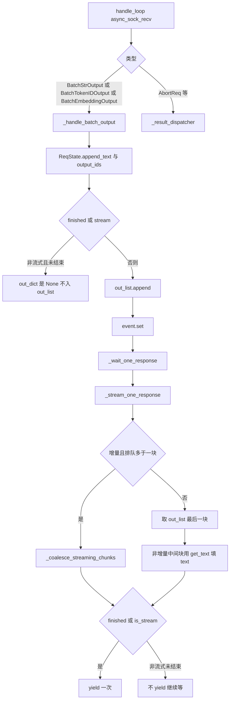
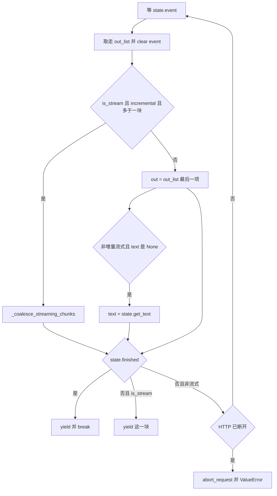

# 增量合并与 yield

对应 F168、F169、F172、F198。树是 `297e54fd105e974cdf401e5b4d20253a22c16f90`。**源码路径推断，未实测**。

detokenizer 已经把本步字符串放进 `BatchStrOutput.output_strs`。本页写 tokenizer 如何把多步拼成一份状态，以及为何流式和非流式共用 `_stream_one_response`。HTTP 帧和 Engine 的取法在 [04-HTTP与Engine回包](04-HTTP与Engine回包.md)。

## 在框架中的位置

角色：`ReqState` 是一条请求在 tokenizer 进程里的输出缓冲。`_stream_one_response` 是唯一把这份缓冲交给 HTTP 或 Engine 的生成器。流式在中途交出增量或累积文本；非流式把同一次等待留到 `finished`。

## F168 tokenizer 等回包

`TokenizerManager.generate_request` 在分词并 `_send_one_request` 之后，`async for response in self._wait_one_response(obj, request)`。`_wait_one_response` 取出 `rid_to_state[obj.rid]`，返回 `_stream_one_response`。注释写批量发送时每个 waiter 都先建好，再让任何一条往前走。

收包循环是 `handle_loop`，由 `auto_create_handle_loop` 在第一次 `generate_request` 时挂到当前 asyncio 循环上。它 `async_sock_recv(self.recv_from_detokenizer)`。三种批输出进 `_handle_batch_output`，其余进 `_result_dispatcher`（abort 在下一页）。

`_handle_batch_output` 对 `recv_obj.rids` 逐个找 `ReqState`。找不到时，健康检查前缀的 rid 直接跳过；其它 rid 打 warning 后跳过。注释写 `/health_generate` 可能在任意消息更新时间戳之后就把自己的 rid 弹掉。

每个还活着的 rid 先造 `meta_info`：

| 键 | 来源 |
| --- | --- |
| `id` | rid |
| `finish_reason` | `finished_reasons[i]`，未结束是 None |
| `prompt_tokens` | 批上的同名字段 |
| `weight_version` | tokenizer 当前配置 |
| `num_retractions` | `retraction_counts[i]` |
| `reasoning_tokens`、`completion_tokens`、`cached_tokens` | 非 embedding 时从批上抄。`completion_tokens` 在调度侧是 `len(output_ids_through_stop)`，beam 另算 |
| `cached_tokens_details`、`image_tokens`、`audio_tokens`、`video_tokens` | 批上有才写。后三个只在该请求确实非 0 时写入，避免纯文本的 `meta_info` 多出键 |
| 时间戳 | `enable_metrics` 且 `time_stats` 非空时，并上 scheduler 的 `convert_to_output_meta_info` |
| logprob、sampling mask、hidden states、routed experts | 请求旗标开着才写。`BatchStrOutput` 上的 routed experts 已是 detokenizer 编好的 base64；`BatchTokenIDOutput` 上仍是张量，这里再编 |

`state.finished` 设为 `finished_reasons[i] is not None`。然后按批的类型造 `out_dict`。

### BatchStrOutput：有文本

`delta_text = output_strs[i]`，`delta_output_ids = list(output_ids[i])`。先 `append_text`、`output_ids.extend`，再按流式与增量分支：

| 条件 | `text` | `output_ids` |
| --- | --- | --- |
| 流式且 `incremental_streaming_output` | 本步 `delta_text` | 本步 delta。`_slice_streaming_output_meta_info` 把 logprob 等列表切到 `last_output_offset` 之后，再把偏移推到当前长度 |
| 流式、非增量、已结束 | `state.get_text()` | `state.output_ids.copy()` |
| 流式、非增量、未结束 | `None` | `state.output_ids` 这个列表本身，不拷贝 |
| 非流式、已结束 | `state.get_text()` | 拷贝 |
| 非流式、未结束 | 不造 `out_dict` | 状态已经 extend，客户端还看不见 |

`get_text` 把 `text_chunks` 拼进 `text` 再清空。增量流式因此不必每步重建整段前缀。非增量的中间块把 `text` 留空，是为了避免每步 `O(n)` 拼接变成整段 `O(n^2)`。注释写了这件事。

`_INCREMENTAL_STREAMING_META_INFO_KEYS` 是切块时跟着 delta 走的键：`output_token_logprobs`、`output_top_logprobs`、`output_token_ids_logprobs`、`output_token_sampling_mask`、`output_token_sampling_logprobs`。`customized_info` 里已经累积的键也算进去。`prompt_tokens`、`completion_tokens` 不在这组里，增量块上它们仍是到目前为止的累计值。

请求带 `return_prompt_token_ids` 且 `out_dict` 非空时，附上 `state.prompt_token_ids`。

### BatchTokenIDOutput：skip_tokenizer_init

没有 `text`。流式增量只给本步 `output_ids` 并切片 `meta_info`。流式非增量的中间块把 `output_ids` 指到活列表。结束时拷贝。非流式未结束同样不造 `out_dict`。

### BatchEmbeddingOutput

`out_dict` 总是 `{"embedding", "meta_info"}`。有 pooled hidden state 时按长度区分：列表长度为 1 且请求数大于 1，说明调度侧把张量 stack 进了一个元素，这里拆开再按下标取；长度等于请求数则直接按下标取。embedding 请求没有 `stream` 属性，后面的 `is_stream` 用不到这条分支。

### 结束时多写的计数

`finished` 为真时：

1. `e2e_latency` 来自 `time_stats.get_e2e_latency`。
2. 投机算法非空时 `_calculate_spec_decoding_metrics`：`spec_accept_rate`、`spec_accept_length`，以及 verify 次数、正确草稿数。cap / block accept 只在对应数组有值时写入。
3. `enable_metrics` 时再并上 `convert_to_output_meta_info(scheduler_time_stats, completion_tokens)`。
4. `del rid_to_state[rid]`，并 `_release_lora_once`。

第一块输出把 `first_token_time` 设上。非流式且 scheduler 的 `prefill_finished_time` 落在创建时间与现在之间时，用 scheduler 的时间；否则用 tokenizer 收到这块的 `perf_counter`。流式不用 scheduler 的那个时间戳，函数开头对 `stream` 为真直接返回 None。

`out_dict` 非空才 `out_list.append` 并记入 `pending_notify`。`batch_notify_size`（默认 16）凑满就 `event.set` 并 `await asyncio.sleep(0)`，把循环让给正在等的生成器。循环结束再把剩余的 state 全部 `set`。

非增量中间块的 `output_ids` 与 `state.output_ids` 是同一个列表。`sleep(0)` 之后、HTTP `dumps_json` 之前，这个列表会不会被下一块 extend，取决于事件循环把生成器调度到哪一步。源码写出了共享引用，交错之后客户端看到的长度 **待核**。结束块用的是 `copy()`。

## F169 流式与非流式是同一个函数

`_stream_one_response`：

`is_stream = getattr(obj, "stream", False)`。`EmbeddingReqInput` 没有这个字段，所以是假。

等待：`request is None`（Engine）时只 `await state.event.wait()`。有 HTTP 请求时 `wait_for` 超时后再看 `request.is_disconnected()`。`background` 为假且已断开，调用 `abort_request` 并抛 `ValueError`，消息里写 type 1，表示还在等、客户端已经走了。超时本身不断开，继续等。

醒来后把 `out_list` 换成空列表，记下 `finished`，`event.clear()`。增量流式且排队多于一块时走合并，避免只留最后一块而丢掉中间的 token id。否则只用最后一块。非增量流式若 `customized_info_reported_keys` 非空，把累积值补进最后一块的 `meta_info`，因为中间块被丢掉了，累计的自定义键还在 `ReqState` 上。

`beam_results` 在 `finished` 之前直接 `continue`。结束时 `build_beam_search_out` 把多候选收成一份再进入下面的 yield。

`finished` 为真：补 `response_sent_to_client_ts`（只写一次），`log_finished_request`，指标导出开着就起一个写记录的 task。`finish_reason` 若是 dict，先 `_handle_abort_finish_reason`。那个函数只在 `type == "abort"` 且 `status_code` 落在 400 到 599 时接管：非流式把 400 收成 `ValueError`，其它码收成 `HTTPException`；流式返回这块 dict，生成器 yield 它然后 break。其它结束原因，包括没有 status code 的 abort，函数返回 None，生成器照常 yield 这块并 break。

未结束：只有 `is_stream` 才 yield。非流式再查一次断连（消息写 type 3，表示已经在跑），断开同样 `abort_request` 加 `ValueError`。没有断开就回到循环顶部，这一拍的状态更新已经留在 `ReqState` 里。

正常结束时，非流式的第一次 yield 就是结束那一块。HTTP 和 Engine 的 `__anext__` 取到的是全文，不是第一块 token。`finish_reason` 为带 400–599 status 的 abort 时，非流式不 yield，改抛 `ValueError` 或 `HTTPException`。那条路在 [04-HTTP与Engine回包](04-HTTP与Engine回包.md)。

## F198 为何非流式也进这个函数

调用点只有 `_wait_one_response`。单请求、批量、流式、非流式、embedding 都从这里等。分开写两套等待会把下面这些分叉再复制一遍：

| 共用的事 | 放在这一处的原因 |
| --- | --- |
| `out_list` 一次排进来多块 | 流式要合并或补文本；非流式只是在结束前不 yield |
| abort 的 status code | 流式把错误块交给 SSE；非流式把同一份 `finish_reason` 变成异常，让 HTTP 走 400 |
| 结束日志和 `response_sent_to_client_ts` | 两种模式都在真正交给调用方的那一次写 |
| 批量 | 每个子请求一个生成器。非流式 `_collect_batch_responses` 对每个生成器 `__anext__()` 再 `gather`，得到的列表由 `_handle_batch_request` yield 一次。流式 `_stream_batch_responses` 谁先完成 yield 谁，并写上 `index` |

`_handle_batch_request` 在 `parallel_sample_num == 1` 时可以整批分词再 `_send_batch_request`，或逐条 `_send_one_request`。两种都是「每条一个 `_wait_one_response`」。`parallel_sample_num > 1` 时注释写批量加并行采样的性能没有单独优化，仍是每条子请求一个生成器。

非流式因此不是另一条 IPC。它是同一个生成器上「未完成不 yield」的分支。HTTP 的 `else` 只取第一次，是因为这次 yield 已经是结束块。若生成器在结束前 yield，一次 JSON 会变成半截输出。当前分支把这件事挡在 yield 之前。

## F172 增量流

服务参数 `incremental_streaming_output` 默认 false。它只在 `is_stream` 为真时改变字典形状。非流式结束块始终是 `get_text()` 加上完整 `output_ids` 拷贝。

`_coalesce_streaming_chunks`：以最后一块为底。`text` 把各块拼起来，`output_ids` 把各块的 id 连起来。`meta_info` 用最后一块，再把 `_INCREMENTAL_STREAMING_META_INFO_KEYS` 和自定义累积键按块首尾相接。其它键，包括 `completion_tokens`、`finish_reason`，留最后一块的值。排队达到 20 块打 warning，文案写这会把受影响请求的 P99 ITL 抬高。

非增量流式不合并。yield 前若 `text is None`，改成 `state.get_text()`，于是客户端每块都看到到目前为止的全文，而 `output_ids` 在中间块上是那份活列表。

返回 [本目录 README](README.md)。
