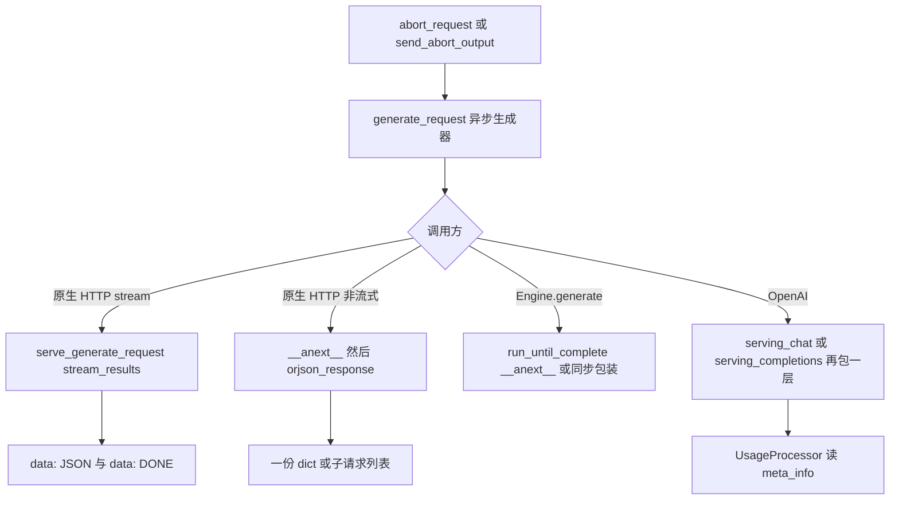
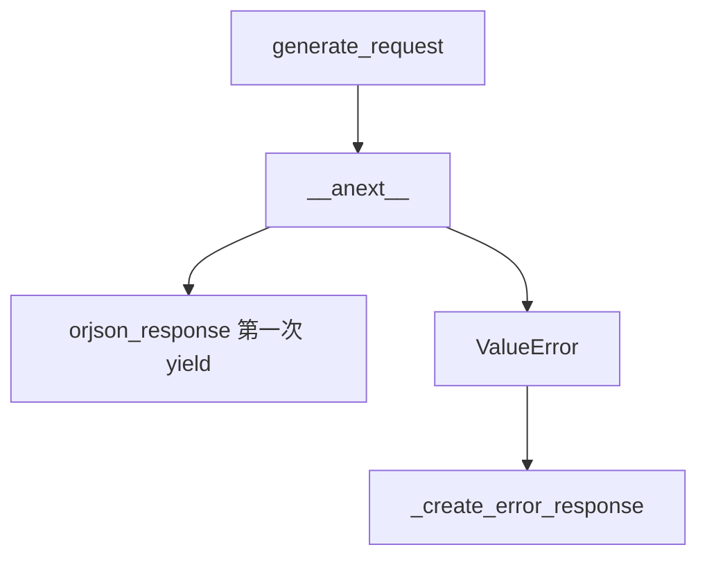
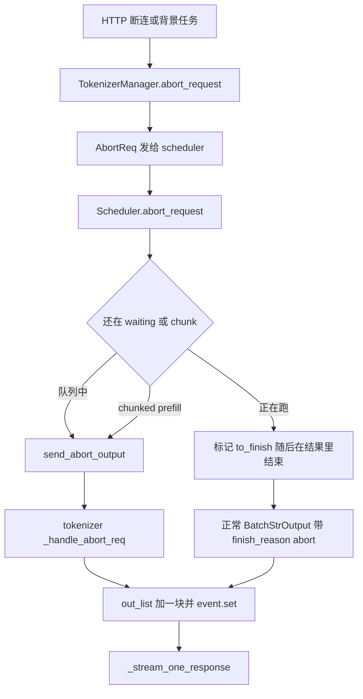

# HTTP、Engine、中止与用量

对应 F170、F171，并写中止和用量如何挂到上一页的 yield 上。树是 `297e54fd105e974cdf401e5b4d20253a22c16f90`。**源码路径推断，未实测**。

入口处 `stream` 选择哪一个路由，已经写在 [01-协议入口](../02-请求接入/01-协议入口.md)。本页写那个选择之后，生成器的产出如何变成 SSE、一次 JSON，或 Engine 的返回值，以及 abort 和 `usage` 从哪一段计数来。

## 在框架中的位置

角色：`generate_request` 已经能 yield dict。HTTP 和 Engine 只决定取几次、用什么外壳。OpenAI 在外壳上把 `meta_info` 里的计数收成协议里的 `usage`。原生 `/generate` 的 JSON 没有顶层 `usage` 键。

## F170 原生 HTTP 流式

`http_server.py` 的 `generate_request` 做完契约检查后调用 `serve_generate_request`。`obj.stream` 为真时：

| 步骤 | 函数里做的事 | 角色 |
| --- | --- | --- |
| `stream_results` | `async for out in tokenizer_manager.generate_request(obj, request)` | 消费上一页的每一次 yield |
| 每一块 | `b"data: " + dumps_json(out) + b"\n\n"` | SSE 帧。`out` 是 tokenizer 的 dict，不是 OpenAI chunk |
| 正常结束 | 再 yield `b"data: [DONE]\n\n"` | 生成器耗尽之后的终止标记 |
| `ValueError` 且 `request.is_disconnected()` | 打 info 日志并 return | 注释写断连已经在上游 abort，这里不再回 400 |
| 其它 `ValueError` | yield 一块 `error` 对象，type 为 `invalid_request_error`，然后仍然写 `[DONE]` | 流已经开始，错误也走 SSE |
| 返回值 | `StreamingResponse(..., media_type="text/event-stream", background=create_abort_task(obj))` | 响应对象。背景任务在连接结束时跑 |

`create_abort_task`：睡 2 秒，单请求用 `obj.rid`，批量用 `obj.rid` 列表。rid 仍在 `rid_to_state` 里就 `abort_request`。这是流式连接关掉之后的清扫，不是每一块之前的检查。

`SGLANG_ENABLE_REQUEST_HEADER_OVERRIDES` 为真时，`apply_header_overrides` 发生在看 `stream` 之前。请求接入已经写过。

## F171 原生 HTTP 非流式

`obj.stream` 为假：

第一次 yield 来自 `_stream_one_response` 的结束分支，所以这份 JSON 带全文 `text`（或 skip tokenizer 时只有 `output_ids`）、完整 id 拷贝，以及结束时的 `meta_info`。批量非流式时，这一次 yield 是子请求 dict 的列表，由 `_collect_batch_responses` 聚齐。

`/encode` 和 `/classify` 不看 `stream`。它们对 `generate_request(...).__anext__()` 取一次，直接返回那个对象。`decision_layout` 非空会被 `_refuse_decision_layout` 拒绝。embedding 的 `out_dict` 在上一页总是带着 `embedding`。

## HTTP 与 Engine

| | 原生 HTTP | `Engine.generate` | `Engine.async_generate` |
| --- | --- | --- | --- |
| 造请求 | FastAPI 填 `GenerateReqInput` | 函数参数填同一个类，`stream` 默认 false | 同左 |
| 传给 `generate_request` 的 request | `fastapi.Request` | `None` | `None` |
| 流式 | `StreamingResponse` | `loop.run_until_complete(__anext__())` 包成同步生成器，直到 `StopAsyncIteration` | 把异步生成器原样返回 |
| 非流式 | `__anext__` 再 `orjson_response` | `run_until_complete(__anext__())` 返回 dict | `await __anext__()` |
| 断连 | type 1 / type 3，以及流式背景任务 | `request is None`，等待分支不看断连 | 同左 |
| 外壳 | SSE 或一次 JSON | Python dict | Python dict 或异步生成器 |

`Engine.encode` 同样只取一次 `__anext__`，没有 `stream` 参数。`SGLANG_RUST_SERVER` 时 Engine 的生成入口在启动篇被拒绝，不进入这条 Python tokenizer 路径。

gRPC 的 `stream` 决定逐块回调还是一次取完，请求接入 01 已经写到 `generate_request` 为止。回调拿到的仍是这个生成器的 yield，本页不重复 Rust 侧。

## OpenAI 是另一层外壳

chat 与 completions 不经过 `serve_generate_request`。它们的 `_handle_streaming_request` / `_handle_non_streaming_request` 自己消费 `generate_request`。

| 模式 | 取数 | 用量 |
| --- | --- | --- |
| 非流式 | `__anext__()`。chat 若得到的不是 list 就包成单元素 list，再 `_build_chat_response` | `UsageProcessor.calculate_response_usage`。`completion_tokens` 对每条 choice 求和；`prompt_tokens` 和 cached 按 `n` 跨步，只加每条 prompt 的第一条 choice |
| 流式 | `async for content in generate_request` | 每块从 `meta_info` 记下 prompt、completion、reasoning、cached，以及 image / audio / video。`should_include_usage` 看 `stream_options`，没有 options 时用服务参数 `stream_response_default_include_usage`（默认 false）和 `continuous_usage_stats` false |

`include_usage` 为真时，内容块发完再 yield 一块 `choices` 为空、带 `usage` 的 SSE。`continuous_usage_stats` 为真时，每个内容 chunk 上调用 `calculate_token_usage`，把到目前为止的计数放进 `chunk.usage`。completions 的流式函数同样在结尾调用 `calculate_streaming_usage`。

`UsageInfo` 的字段：`prompt_tokens`、`completion_tokens`、`total_tokens`（二者相加）、`reasoning_tokens`。`prompt_tokens_details` 在要报告缓存或多模态计数时才有；纯文本且不报告缓存时保持 None。`completion_tokens_details.reasoning_tokens` 只在 reasoning 计数非 0 时带上。

这些数的来源是上一页写进 `meta_info` 的 `prompt_tokens`、`completion_tokens`、`reasoning_tokens`、`cached_tokens`、`image_tokens`、`audio_tokens`、`video_tokens`。`enable_cache_report` 为假时，`calculate_*` 不把 cached 放进 details。原生 `/generate` 的调用方直接看 `meta_info`，不会经过 `UsageProcessor`。

chat 流式在转换期还会拒绝 `return_prompt_token_ids`、`return_token_ids`、`return_meta_info`。那是入口校验，请求接入已经写。增量流式下，chat 若看到 `finish_reason.type == "abort"`，按 `completion_tokens` 减去已经累积的 id 数截断这一块的 `output_ids`，避免 abort 回声把最后一个 id 再算一遍。reasoning parser 和 tool parser 如何把 `text` 切成 delta，本页不展开。

Anthropic 的用量函数从 OpenAI 的 `usage` 再取 cached。它不另读 detokenizer。

## 中止

中止有两条回到客户端的路：经过 detokenizer 的正常结束块，或 scheduler 直接 `send_to_tokenizer` 的 `AbortReq`。后者不进 `DecodeStatus`。

`abort_request`（tokenizer）：空 rid 且不是 `abort_all` 时打 warning 返回，避免 `startswith` 匹配全部请求。同一 state 已经 `abort_sent` 则返回。单 worker 且 state 已经不在时也返回。否则 `AbortReq` 经 `_dispatch_to_scheduler` 送出。发送失败把 `abort_sent` 拨回。`enable_metrics` 时 `observe_one_aborted_request`。

`Scheduler.abort_request` 里和回包直接相关的几处：

| 位置 | 发送 | 说明 |
| --- | --- | --- |
| `waiting_queue` 里匹配的请求 | `send_abort_output` | 注释写这些请求还没开始算，必须回一条让 tokenizer 清状态。没有发起方的原因时，tokenizer 用默认文案 |
| chunked prefill 被延后的那条 | 释放 KV 之后 `send_abort_output` | 客户端 abort 把消息留给 tokenizer |
| dLLM 队列里被弹出的请求 | `send_abort_output` | 同样不经过生成流 |
| retract 时 `reqs_to_abort` | `send_abort_output`，带 `FINISH_ABORT.to_json()` | 抢占失败的那部分 |
| 优先级在未开启调度时被拒绝 | `send_abort_output`，status 503 | `_set_or_validate_priority` |
| 采样掩码校验失败 | `output_streamer.stream_output` | `_reject_sampling_mask_request` 走生成流，不走 `send_abort_output` |

`send_abort_output` 在 Rust 模式调用 `rust_server.push_abort`，否则 `send_to_tokenizer.send_output`。这根套接字就是 `tokenizer_ipc_name`，和 detokenizer 那根分开。

`FINISH_ABORT.to_json` 的形状是 `type: abort`，加上 `message`、`status_code`、`err_type`。`set_finish_with_abort` 默认 status 是 400。

tokenizer 的 `_handle_abort_req`：state 已经没了就打日志返回。注释写正常结束和 abort 回声会抢同一个 rid。还在的话把 `finished` 设真，`finish_reason` 用请求里带来的 dict，没有则 `{type: abort, message: abort_message 或 "Abort in waiting queue"}`。`meta_info` 带 `id`、`finish_reason`、`weight_version`、`e2e_latency`。`completion_tokens` 取当前 `state.output_ids` 的长度。增量流式且 `stream` 为真时，`output_ids` 只留最后一个 id（空则空列表），`text` 仍是 `get_text()`。然后删掉 state、释放 LoRA、把 dict 放进 `out_list` 并 `event.set`。

回到 `_stream_one_response` 时这条已经 `finished`。status code 在 400–599 的 abort：非流式抛异常，让 `serve_generate_request` 的 `except ValueError` 走 `_create_error_response`（400）或由 `HTTPException` 往外抛；流式 yield 这块错误 dict，HTTP 把它编成一帧 SSE，然后写 `[DONE]`。没有合格 status code 的 abort 当普通结束块 yield，非流式客户端会在 JSON 的 `meta_info.finish_reason` 里看到 `type: abort`。

`pause_generation` 在 `mode == "abort"` 时循环 `abort_request(abort_all=True)`，直到 `model_update_lock` 不再被占用。这是控制面，不是单条请求的 SSE。

## 用量挂在哪一层

| 层 | 有什么 | 没有什么 |
| --- | --- | --- |
| detokenizer 的 `BatchStrOutput` | `prompt_tokens`、`completion_tokens`、`reasoning_tokens`、`cached_tokens`、多模态 token 数、spec 计数 | `usage` 这个键 |
| tokenizer 的 `meta_info` | 上面这些，加上 `finish_reason`、`e2e_latency`、结束时的 spec 接受率、指标开着时的时间分解 | 顶层 `usage` |
| 原生 `/generate` JSON | `text` 或 `output_ids`，以及 `meta_info` | `UsageInfo` |
| OpenAI chat / completions | `usage` 由 `UsageProcessor` 从 `meta_info` 求和得到 | 不重新数 token |
| Prometheus | `enable_metrics` 且 `state.obj.log_metrics` 时 `collect_metrics` | 这是服务端计数，不进响应体 |

`completion_tokens` 在增量流的中间块上已经是累计长度，不是本块 delta 的长度。OpenAI 的 `continuous_usage_stats` 因此可以直接读当前块的 `meta_info`。流式结束时的额外 usage 块则把各 index 上最后记下的值再加总。

返回 [本目录 README](README.md)。
