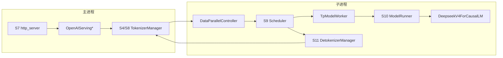

# 03 模块地图

每个模块回答四件事：它在 S0–S11 的哪一段、目的、原理、你扩展时会碰到的类型和字段。进程图先放在这里，细节在 02。

`num_dp_ranks = dp_size * attn_dp_size`。四机建议配置是 1×4，所以有 4 个 scheduler，controller 在 S8 和 S9 之间。

## 顶层目录

| 路径 | 阶段 | 目的 |
| --- | --- | --- |
| `python/sglang/srt/` | S1–S11 | LLM 运行时 |
| `python/sglang/lang/` | S7 的客户端 | `@function` 编译成多次 `/generate`。`Runtime` 在 `lang/backend/runtime_endpoint.py` |
| `python/sglang/multimodal_gen/` | 另一条启动 | 扩散。自己的 ServerArgs，不进 S2 |
| `python/sglang/cli/` | S0 | `sglang serve` |
| `sgl-router/` | S7 之前 | Rust，按 KV 把请求分到多个 engine |
| `sgl-model-gateway/` | S7 之前 | 多 worker 网关。转发，不替代 scheduler |
| `python/sglang/kernels/` | S10 | kernel 绑定 |

## `entrypoints/`：S0、S3、S7

目的：把操作系统进程和 HTTP 连到 runtime。原理：`launch_server` 不自己加载模型，它调用 `Engine._launch_subprocesses`，等 ready 再跑 uvicorn。OpenAI 层只做协议，内部请求仍是 `GenerateReqInput`。

| 类型 | 文件 | 阶段 |
| --- | --- | --- |
| `Engine` | `entrypoints/engine.py` | S3。离线 `generate` 也走这里，但不经 FastAPI |
| `launch_server` | `entrypoints/http_server.py` | S3+S7 |
| `OpenAIServingChat` | `openai/serving_chat.py` | S7→S8 |
| `OpenAIServingCompletion` | `openai/serving_completions.py` | S7→S8 |
| `PortArgs` | `server_args.py` 的 `init_new` | S3，ZMQ 名字和 NCCL 端口 |

## `arg_groups/` 与 `server_args.py`：S1、S2

目的：把几百个旗标收成一份配置，并在看到模型之后改写。原理：字段用 `A[类型, Arg(help=...)]` 声明在 `fields/`，`collect_input_fields` 拼成 `ServerArgs`。解析是一张有序 hook 表，不是在 `__post_init__` 里随手改。封口后赋值会抛错。

| 类型 | 作用 |
| --- | --- |
| `ServerArgs` | 原始输入 + 解析账本 |
| `run_resolution_pipeline` | S2 的顺序，见调研笔记 |
| `resolving_view` | hook 读到的「当前有效值」 |
| `declare_resolution` | 唯一合法的改写方式 |

扩展：新旗标加到对应命名空间。新模型的默认值用 `model_overrides/` 的 `@_register_for`，不要在 `resolve_once` 之后写属性。

## `managers/`：S4、S8、S9、S11

目的：请求的一生。原理：三个进程用 ZMQ 把 CPU 工作和 GPU 工作拆开。Tokenizer 不持有 KV；Scheduler 不写 HTTP；Detokenizer 不做采样。

| 类型 | 阶段 | 做完什么 |
| --- | --- | --- |
| `TokenizerManager` | S4、S8、S11 | 分词、下发、等回包 |
| `DataParallelController` | S8 | 把请求分到某个 `attn_dp_rank` |
| `Scheduler` | S5、S6、S9 | 建 worker、组 batch、收结果 |
| `TpModelWorker` | S5、S10 | 包一层 `ModelRunner` |
| `DetokenizerManager` | S11 | token id → 文本 |
| `Req` | S9 | 单请求状态，见 07 |
| `ScheduleBatch` | S9 | 一轮调度的请求列表和池引用 |
| `SchedulePolicy` | S9 | FCFS、LPM 等 |

IPC 名字在 `scheduler_components/ipc_channels.py`。Tokenizer PUSH 到 `scheduler_input_ipc_name`（或先到 controller）。Scheduler PUSH 到 detokenizer。Detokenizer PUSH 回 tokenizer。`skip_tokenizer_init` 时 scheduler 直接 PUSH 回 tokenizer。

## `model_executor/` 与 `models/`：S5、S10

目的：一次前向。原理：`ScheduleBatch` 在边界上变成 `ForwardBatch`，`ModelRunner.forward` 只看后者。架构类由 `ModelRegistry` 用 `EntryClass` 和类的 `__name__` 对上 config 的 `architectures`。

| 类型 | 文件 | 备注 |
| --- | --- | --- |
| `ModelRunner` | `model_executor/model_runner.py` | `load_model`、`alloc_memory_pool`、`forward` |
| `ForwardBatch` | `forward_batch_info.py` | `forward_mode`、`seq_lens`、`out_cache_loc` |
| `ForwardMode` | 同文件 | EXTEND / DECODE / MIXED / IDLE / 投机 / PREBUILT |
| `DeepseekV4ForCausalLM` | `models/deepseek_v4.py` | V4.1 的 HF 名映射到这个类 |
| `DeepseekV4ForCausalLMDSpark` | `models/deepseek_v4_dspark.py` | 只在 DSPARK draft worker |
| `DeepseekV4ForCausalLMNextN` | `models/deepseek_v4_nextn.py` | next-n 结构。V4.1 服务拒绝 NEXTN 算法名 |

`get_config` 在 `utils/hf_transformers/config.py`。V4.1 额外走 `normalize_deepseek_v41_config`。

## `layers/`：S10 的零件

| 目录 | 目的 | 关键类型 |
| --- | --- | --- |
| `attention/` | 各后端实现 | `AttentionBackend`。V4 的名字是 `dsv4` |
| `moe/` | 路由和专家计算 | `TopK`、`TopKConfig`；通信在 `token_dispatcher/deepep.py` 的 `DeepEPBuffer` |
| `dp_attention.py` | attention DP 的 rank 与 padding | `initialize_dp_attention` |
| `engram.py` | V4.1 的 n-gram 表 | 由 config 的 `engram_layer_ids` 决定，无单独 CLI |

## `mem_cache/`：S6、S9

目的：页的申请、前缀复用、可选的 host/L3。原理：token 池存张量，请求池把逻辑位置映射到页，树决定哪些页可以共享。调度器只拿引用。

| 类型 | 作用 |
| --- | --- |
| `KVCacheConfigurator` | S6 预算和选型 |
| `DeepSeekV4TokenToKVPool` | V4 的 GPU 池 |
| `RadixCache` / `UnifiedRadixCache` | 前缀树，见 08 |
| `BasePrefixCache` | `match_prefix`、`insert`、`checkpoint` |

## `sampling/` 与 `constrained/`：S9 末尾

`SamplingParams` 在 S8 规范化，S9 的 `process_batch_result` 里应用。grammar 不在 sampler 内部编译：`GrammarManager` 先给出允许集合，sampler 再套 mask。后端名字在 `GRAMMAR_BACKEND_CHOICES`（xgrammar、llguidance、outlines）。

## `speculative/`：S5 的 draft，S10 的验证

`SpeculativeAlgorithm.create_worker` 把算法名变成 worker。目标模型和草稿各有内存池，在 `init_memory_pools` 里先后分配。V4.1 的白名单在 S2 已经收成 DSPARK，走到这里时算法名已经合法。

## `distributed/`：S3 末、S10 的集合通信

`parallel_state.init_distributed_environment` 建进程组。`tp_group` 是连续 rank。MoE 组用 `moe_ep_size` 和 `moe_dp_size` 再切。DCP 组在每个 TP 组内部。这些宽度必须已经通过 S2 的恒等式，否则组建不起来。

## `disaggregation/`：S2 决定，S9 换循环

`disaggregation_mode` 为 prefill 或 decode 时，scheduler 混入 `SchedulerDisaggregationPrefillMixin` 或 decode 对应物。KV 传输在 `mooncake/`、`nixl/`。这不是第二个 HTTP 服务，除非 `encoder_only`，那会在 `run_server` 里提前离开主路径。

## `lora/`、`multimodal/`、`observability/`

| 模块 | 阶段 | 目的 |
| --- | --- | --- |
| `lora/` | S5 装载，S8 按请求选择 | `LoRAManager`、`LoRARegistry`。请求字段 `lora_path` |
| `multimodal/` | S4 处理器，S8 特征 | `processors/deepseek_v41.py`。特征进 GPU 走 `CudaVmmFeatureTransport` |
| `observability/` | 全程 | `/server_info` 的 `internal_states`，包括投机接受长度 |
| `eplb/`、`elastic_ep/` | S10 统计，HTTP 扩容 | `/scale_elastic_ep`。静态 16 卡 mori 配置不走这条 |

## 扩展时改哪里

| 想加 | 落点 | 还要过的关 |
| --- | --- | --- |
| 新架构 | `models/` 的 `EntryClass`，不认识的 config 注册到 `configs/` 和 `_CONFIG_REGISTRY` | `__name__` 必须等于 HF `architectures` 字符串 |
| 新默认值 | `model_overrides/` | 用 `declare_resolution` |
| 新 CLI | `fields/` 里对应类 | 自动进入 `ServerArgs` |
| 新 attention | `layers/attention/` + `choices.py` | S2 的兼容 hook |
| 新 MoE all-to-all | `token_dispatcher/`，名字放进 `moe_a2a_backend` | 若要求 EP 铺满 TP，加入 `_A2A_EP_SPANNING_BACKENDS` |
| 新投机 | `SpeculativeAlgorithm.register` | V4.1 还有特征白名单 |
| 新 HTTP 字段 | `openai/protocol.py` 和/或 `GenerateReqInput` | 只改一边，另一边客户端看不到 |
