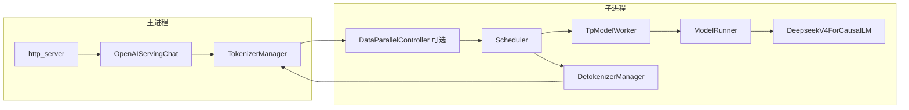

# 03 模块地图

范围是 v0.5.23 树。一行一个目录的职责，后面给扩展时会碰到的类。

## 仓库顶层

| 路径 | 职责 |
| --- | --- |
| `python/sglang/srt/` | LLM 运行时：服务、调度、执行、KV、采样 |
| `python/sglang/lang/` | 前端 DSL。`lang/api.py` 的 `@function`，`lang/backend/runtime_endpoint.py` 的 `Runtime` 通过 HTTP 调 `/generate` |
| `python/sglang/multimodal_gen/` | 扩散模型运行时，自己的 `ServerArgs`，不进 LLM 参数 |
| `python/sglang/cli/` | `sglang serve` |
| `python/sglang/kernels/` | kernel 绑定与 AOT/JIT |
| `sgl-router/` | Rust KV-aware 路由器，站在多个 engine 前面 |
| `sgl-model-gateway/` | 多 worker 网关：HTTP/gRPC、多模型、限流。转发到 worker，不替代 scheduler |
| `proto/` | gRPC / protobuf |
| `sgl-router` 与 gateway 之外的 `docs/` | 上游英文文档站，本系列不以它为准 |

## `srt/` 二级目录

| 目录 | 职责 | 先看的类型 |
| --- | --- | --- |
| `entrypoints/` | HTTP、gRPC、离线 `Engine` | `http_server.launch_server`，`engine.Engine`，`openai/serving_chat.py` 的 `OpenAIServingChat` |
| `managers/` | tokenizer、scheduler、detokenizer、DP 控制 | `TokenizerManager`，`Scheduler`，`DetokenizerManager`，`TpModelWorker`，`DataParallelController` |
| `model_executor/` | 加载后的 forward 与 CUDA graph | `ModelRunner.forward`，`forward_batch_info.ForwardBatch` |
| `models/` | 每种 HF 架构一个实现 | `deepseek_v4.py` 的 `DeepseekV4ForCausalLM` |
| `layers/` | attention、MoE、linear、norm | `attention/base_attn_backend.AttentionBackend`，`moe/token_dispatcher/deepep.py` |
| `mem_cache/` | KV 池、radix、HiCache | `RadixCache`，`UnifiedRadixCache`，`KVCacheConfigurator` |
| `sampling/` | 采样参数与 batch 状态 | `SamplingParams` |
| `constrained/` | grammar | `GrammarManager`，`XGrammarGrammarBackend` |
| `speculative/` | draft worker | `spec_info.SpeculativeAlgorithm.create_worker`，`dspark` 相关 worker |
| `distributed/` | 进程组 | `parallel_state.init_distributed_environment`，`GroupCoordinator` |
| `disaggregation/` | PD 分离与 KV 传输 | `prefill.SchedulerDisaggregationPrefillMixin`，`mooncake/`，`nixl/` |
| `lora/` | 适配器 | `LoRAManager`，`LoRARegistry` |
| `multimodal/` | VLM 预处理与特征传输 | `processors/deepseek_v41.py` |
| `arg_groups/` | 参数命名空间和解析 hook | `pipeline.run_resolution_pipeline`，`fields/` |
| `configs/` | HF config 子类 | `deepseek_v41.DeepseekV41Config` |
| `eplb/` | expert 负载均衡 | 与 MoE dispatcher 配合 |
| `elastic_ep/` | 运行中扩 EP | HTTP 在 `entrypoints/elastic_ep.py` |
| `function_call/` | tool call 解析 | `DeepSeekV41Detector` |
| `parser/` | reasoning parser 名字与实现 | `reasoning_parser_names.py` |
| `observability/` | metrics、trace | `/server_info` 里的 `internal_states` |
| `platforms/` | CUDA / HIP / NPU / XPU | `get_platform().is_hip` |

## 一条请求穿过哪些类

DP controller 只在 `num_dp_ranks > 1` 时出现。`num_dp_ranks = dp_size * attn_dp_size`（`runtime_context.num_dp_ranks_of`）。四机四卡那组配置里 `dp_size=1`、`attn_dp_size=4`，所以有 4 个 scheduler，controller 负责把请求分进去。

## 怎么扩展

| 想加什么 | 落点 |
| --- | --- |
| 新模型架构 | `srt/models/` 新文件，类上挂注册表能看见的 `EntryClass`。config 若 HF 不认识，加到 `srt/configs/` 并在 `utils/hf_transformers/common.py` 的 `_CONFIG_REGISTRY` 注册 |
| 新的启动默认值 | `arg_groups/model_overrides/` 里 `@_register_for("YourArch")`。不要在 `resolve_once` 之后写 `server_args.xxx =`，`ServerArgs.__setattr__` 会拒绝。用 `declare_resolution` |
| 新的 CLI 字段 | `arg_groups/fields/` 对应命名空间，类型写成 `A[T, "help"]` 或 `A[T, Arg(...)]`。`server_args.py` 的 `_INPUT_NAMESPACES` 已经把这些类收进去 |
| 新的 attention 后端 | `layers/attention/` 新 backend，并把名字加进 `arg_groups/choices.py` 的 `ATTENTION_BACKEND_CHOICES` |
| 新的 MoE all-to-all | `layers/moe/token_dispatcher/`，再把名字放进 `exec_.py` 的 `moe_a2a_backend` Literal。若它要求 EP 铺满 TP，还要放进 `overrides.py` 的 `_A2A_EP_SPANNING_BACKENDS` |
| 新的投机算法 | `SpeculativeAlgorithm.register`，或在 `speculative/spec_info.py` 的 `create_worker` 加分支。V4.1 还有 `validate_deepseek_v41_features` 的白名单，只加 worker 不够 |
| 新的 reasoning / tool parser | `parser/reasoning_parser_names.py` 或 `function_call/parser_names.py`，再注册 detector。CLI choices 从这两个元组来 |
| 新的 HTTP 字段 | 公开 JSON 改 `openai/protocol.py` 或 `io_struct.GenerateReqInput`。只改其中一边，另一边的客户端看不到 |
| 插件 | `srt/plugins.py` 的 `load_plugins`。`launch_server.py` 和 scheduler 子进程都会调它 |

## 模型注册这条线

`ModelConfig.from_server_args` → `get_config` → 读到 `architectures`。`model_loader/utils.py` 的 `get_model_architecture` 调 `ModelRegistry.resolve_model_cls`。DeepSeek-V4.1 的 HF 名字 `DeepseekV41ForCausalLM` 在 `configs/deepseek_v41.py` 被收成运行时的 `DeepseekV4ForCausalLM`。因此你在 `models/` 里找不到 `class DeepseekV41ForCausalLM`，这是预期的。

草稿与 MTP 结构是另外两个类，不替换主模型：

| 类 | 文件 | 何时出现 |
| --- | --- | --- |
| `DeepseekV4ForCausalLM` | `models/deepseek_v4.py` | 目标模型 |
| `DeepseekV4ForCausalLMDSpark` | `models/deepseek_v4_dspark.py` | `--speculative-algorithm DSPARK` 的 draft worker |
| `DeepseekV4ForCausalLMNextN` | `models/deepseek_v4_nextn.py` | next-n 层。V4.1 服务路径不接受 `--speculative-algorithm NEXTN` |

## 离线 API 与 HTTP 的分叉

`Engine`（`entrypoints/engine.py`）和 `sglang serve` 共用 `_launch_subprocesses`，但 `Engine.generate` 不经过 FastAPI。请求对象仍是 `GenerateReqInput`。改调度语义时两条入口都会碰到；改 HTTP 状态码、SSE 帧格式时只碰 `http_server.py` 和 `openai/serving_*.py`。
