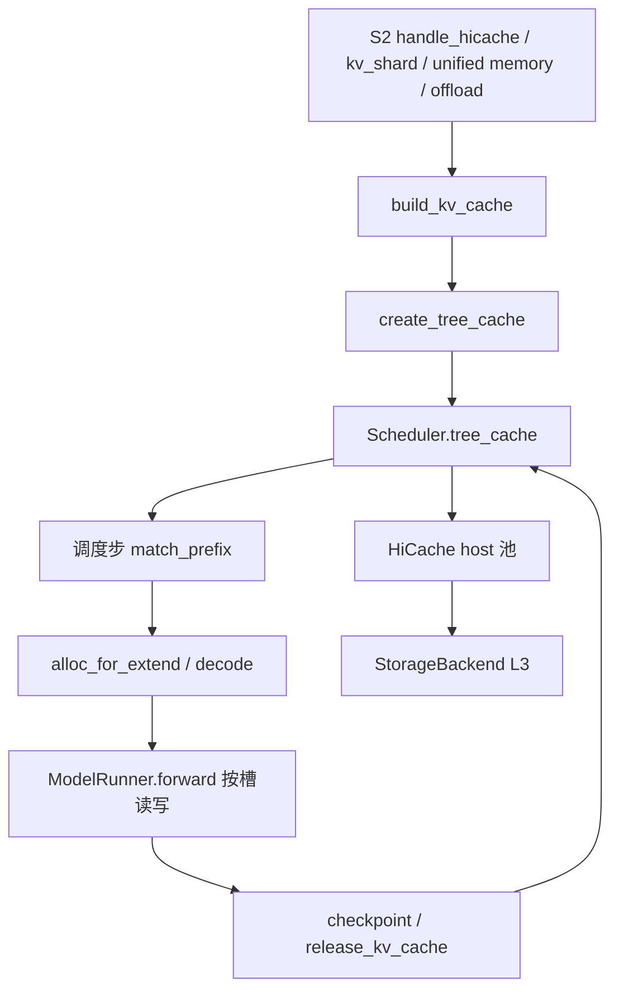
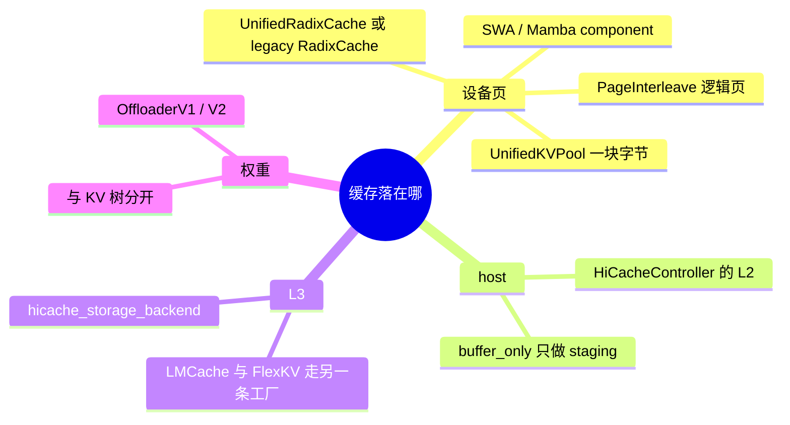

# 缓存域总览

本域覆盖清单 B23–B28、B49、B68、B69、B89。树是 `297e54fd105e974cdf401e5b4d20253a22c16f90`。运行时行为 **源码路径推断，未实测**。

前缀匹配和写回发生在调度步，正文在 [04-前缀与KV](../../02-流程/03-调度与推理/04-前缀与KV.md)（F161、F200）。池和树的启动次序在 [07-KV与前缀树](../../02-流程/01-启动/07-KV与前缀树.md)（F126–F135）。本域写每一种缓存形态自己的场景、选型条件和数据落在哪一层。

## 场景与硬件

| 场景 | 硬件或平台前提 | 页 |
| --- | --- | --- |
| 多请求共享 token 前缀 | 无统一 GPU 代数门。`UnifiedKVPool` 的 post-capture backing 要求 CUDA | [01-RadixCache](01-RadixCache.md) |
| MLA 长前缀改走分块 KV attention | prefill 后端落在 `CHUNKED_PREFIX_CACHE_SUPPORTED_ATTENTION_BACKENDS` | [02-chunked-prefix](02-chunked-prefix.md) |
| 滑窗层与全量层分开存 | 模型被判成 hybrid SWA，或纯 SWA | [03-SWA](03-SWA.md) |
| 设备页之外再要 host / L3 | `enable_hierarchical_cache`。DCP>1 只放行 MLA，并拒绝若干组合 | [04-HiCache](04-HiCache.md) |
| L3 落到文件、共享内存或远端存储 | 由 `hicache_storage_backend` 或 `--enable-lmcache` / `--enable-flexkv` 选择。NPU memcache 要求 `torch.npu` | [05-存储后端](05-存储后端.md) |
| 长提示拆成多次 EXTEND | `chunked_prefill_size` 为正。默认值按设备显存容量分档 | [06-Chunked-prefill](06-Chunked-prefill.md) |
| 多轮对话按 session 持有前缀引用 | 须是 `UnifiedRadixCache` | [07-Session](07-Session.md) |
| 多种 KV 子池共用一块字节 | post-capture 路径要求 CUDA | [08-Unified-memory](08-Unified-memory.md) |
| PD prefill 把逻辑页条带化到多卡 | 仅 `disaggregation_mode=prefill`。DSA 与 MLA 的后端白名单不同 | [09-KV分片](09-KV分片.md) |
| 权重按层组卸到 CPU | `cpu_offload_gb` 或 `offload_group_size`。与 Qwen4 PLE offload 互斥 | [10-层CPU-offload](10-层CPU-offload.md) |

## 在框架中的位置

角色：树回答「这段 token 的 KV 在不在」。分配器回答「新 token 写哪一页」。HiCache 回答「不在设备上时，host 或 L3 能不能拉回来」。层 CPU offload 动的是权重，不进这棵树。

## 选型主链

`mem_cache/registry.py` 的 `default_radix_cache_factory` 按下面的顺序选实现。后面的页展开每一支。

1. `disable_radix_cache`：纯 SWA 且 decode retraction 不是 `host_pool` 时用 `PureSWARadixCache`，否则仍建 `UnifiedRadixCache`，只是不发布前缀。
2. `enable_lmcache`：`LMCacheUnifiedRadixCache`。
3. `enable_unified_cache_external_linker`：统一树加外部 linker。与 HiCache 互斥，见 [04-HiCache](04-HiCache.md)。
4. 纯 SWA：`PureSWARadixCache`。
5. `enable_flexkv`：FlexKV 工厂。
6. 其余：`create_unified_radix_cache`。组件按模型追加 FULL、SWA、MAMBA、C128。

`enable_hierarchical_cache` 或 retraction 为 `host_pool` 时，统一树再 `init_hicache`。本树没有名为 `HiRadixCache` 的类。分层缓存是同一棵 `UnifiedRadixCache` 上的 host 池和可选 L3。

## 和流程、模型、分布式

| 邻接 | 关系 |
| --- | --- |
| F129 / F200 | 树在池和图之后挂到 `Scheduler`，前向不现查树 |
| F161 | `match_kv_cache` / `checkpoint_kv_cache` / `release_kv_cache` 是调度包装 |
| F202 | attention DP 把 `chunked_prefill_size` 除以 `attn_dp_size`，见 [06-Chunked-prefill](06-Chunked-prefill.md) 与 [Attention DP](../07-并行切分/01-Attention-DP.md) |
| B11 HiSparse | 启动校验要求同时 `--disable-radix-cache` |
| B37 PD | KV 分片只在 prefill 角色。decode radix 与 HiCache 的组合在 `validate_decode_radix_cache` |
| D06 / D07 | HiCache 对 DCP 有单独兼容函数 `resolve_hicache_dcp_compatibility` |
| 模型 V4.1 | encoder SWA replay 拒绝 radix session、unified memory、mixed chunk。拒绝表正文归 [05-模型](../../05-模型/04-模型与特性矩阵.md)，本域只引用条件 |

返回 [本目录 README](README.md)。
