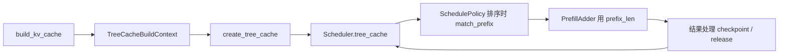
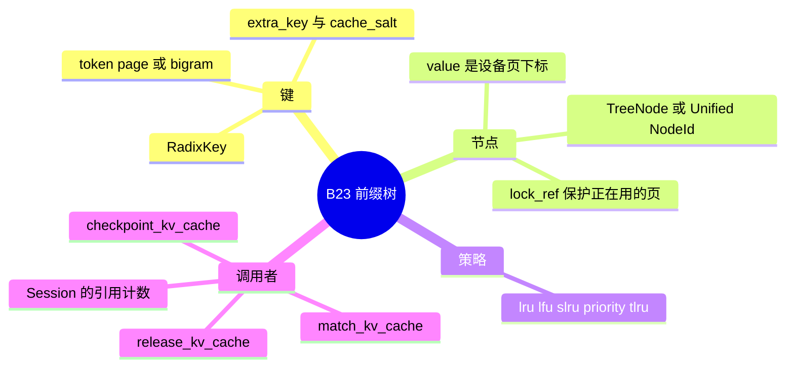

# RadixCache

对应 B23。树是 `297e54fd105e974cdf401e5b4d20253a22c16f90`。**源码路径推断，未实测**。

调度步怎么调用匹配和写回，见 [04-前缀与KV](../../02-流程/03-调度与推理/04-前缀与KV.md)。本页写树的两种实现、驱逐策略和锁。

## 场景与硬件

| 场景 | 树做什么 | 前提 |
| --- | --- | --- |
| 多请求共享系统提示或文档前缀 | 按 token 前缀找回设备页下标，extend 只算未命中的尾巴 | 默认路径。关掉用 `--disable-radix-cache` |
| 纯滑窗模型 | 只缓存 prefill 段 `[0, evict_floor)`，窗口外的页不进可匹配前缀 | `is_pure_swa`，见 [03-SWA](03-SWA.md) |
| 混合 full + SWA 或 Mamba | 同一逻辑节点上挂多个 component 的下标 | `create_unified_radix_cache` 追加 `SWA` / `MAMBA` |
| 需要按时间或优先级丢页 | 叶节点进堆，按策略弹出 | `--radix-eviction-policy` |
| HiSparse、或显式不要跨请求复用 | 工厂仍可能建统一树，但 `disable` 使 checkpoint 不发布 | `--disable-radix-cache`。HiSparse 在 `validate_hisparse` 里强制这一支 |
| 多模态 + Transformers 兜底 | `build_kv_cache` 把有效开关收成关闭，并打 warning | 架构走 `Transformers*` |

硬件：本树没有「Radix 必须某代 GPU」的统一断言。`UnifiedKVPool` 的 post-capture backing 在 `device.type != "cuda"` 时 `ValueError`，那是 [08-Unified-memory](08-Unified-memory.md) 的门，不是每棵 radix 树的门。`tlru` 策略要求实现是 `UnifiedRadixCache`，`create_tree_cache` 会校验。

## 在框架中的位置

`ModelRunner.forward` 只消费已经写进 `ForwardBatch` 的 `out_cache_loc`。树的查询在 scheduler 进程、前向之前完成。原因写在 F200。

## 原理

两条实现并存。

**主路径 `UnifiedRadixCache`。** `create_unified_radix_cache` 先放 `ComponentType.FULL`。模型是 hybrid SWA 再加 `SWA`，hybrid SSM 再加 `MAMBA`，需要 `req_to_c128_sidecar` 再加 `C128`。MLX 且带 SSM 时可以换掉 MAMBA 组件类。匹配、插入、驱逐走 `UnifiedTreeCore`。设备驱逐和 host 驱逐按 component 分步进。`mem_cache/unified_cache/components/README` 里的优先级是 Full、SWA、Mamba。

**Legacy `RadixCache`（`radix_cache.py`）。** `PureSWARadixCache` 继承它。键是 `RadixKey`（page 或 bigram、`extra_key`、`cache_salt`）。节点是 `TreeNode`：`children`、`value` 张量、`lock_ref`、hash、priority。`match_prefix` 沿树走，必要时把节点切开。`insert` / `checkpoint` 经 `_insert_cache` 写树并回写 `req_to_token`。`evict` 对 `evictable_leaves` 建堆，用 `eviction_strategy.get_priority` 弹叶，再把对应段还给 allocator。

`get_eviction_strategy`（`mem_cache/utils.py`）把 CLI 收成策略对象，定义在 `mem_cache/evict_policy.py`：

| 策略 | 类 | 弹出顺序 |
| --- | --- | --- |
| `lru` | `LRUStrategy` | `last_access_time` 越旧越先 |
| `lfu` | `LFUStrategy` | `(hit_count, last_access_time)` |
| `slru` | `SLRUStrategy` | 先分 probationary / protected（默认 `protected_threshold` 为 2），段内再 LRU |
| `priority` | `PriorityStrategy` | `(node.priority, last_access_time)`，priority 低的先出 |
| `tlru` | `TLRUStrategy` | TEL-safe 前缀记成极旧的 `(-1, time)`，其余 `(0, time)`。只允许统一树 |

锁：正在服务的请求对节点 `inc_lock_ref` / `dec_lock_ref`（基类在 `base_prefix_cache`，统一树有自己的重写）。锁住的页不进可驱逐叶。`release_kv_cache` 在 checkpoint 之后解锁并 `free_kv_row`。

`--disable-radix-cache` 并不等于「不建树对象」。`default_radix_cache_factory` 在 disable 时：纯 SWA 且 retraction 不是 `host_pool` 就建 `PureSWARadixCache`（`params.disable` 使它不缓存）；否则仍 `create_unified_radix_cache`，发布关闭，池还在。请求仍要分配新页，只是别的请求匹配不到这段前缀。

## 过程

1. `build_kv_cache` 填 `CacheInitParams`：驱逐策略、`disable`、`enable_session_radix_cache` 等。
2. `create_tree_cache` 若有 `--radix-cache-backend` 就用注册工厂，否则走域总览里的 if-ladder。
3. 准入：`SchedulePolicy._compute_prefix_matches` 调 `match_kv_cache`，包装在 `mem_cache/common.py`。键来自 `_req_radix_key`。`SGLANG_RADIX_FORCE_MISS` 在包装里把 `MatchResult` 收成零匹配，树本身不用改。
4. `Req.init_next_round_input` 在真正 `add_one_req` 之前再匹配一次。排队期间页可能已被驱逐。
5. `prepare_for_extend` 之后 `alloc_for_extend` 把前缀页下标和新建页填进 `req_to_token_pool`。
6. 前向把 KV 写入 `out_cache_loc`。页变成可被别人匹配的前缀，要等 `tree_cache.checkpoint`。中间 chunk 的页只属于这条请求的行。
7. 显存压力：`evict(EvictParams)`。锁住的节点留在树上。

## 调用栈

完成一条还要继续 decode 的请求，把已算长度挂上树：

| 函数 | 做什么 | 角色 |
| --- | --- | --- |
| `Scheduler` 的结果处理 | 判断请求未结束、且不在本轮 mixed 的 decoding 行上 | 决定该不该发布 |
| `checkpoint_kv_cache` | 调 `tree_cache.checkpoint(req, up_to=extend_end)`，再把 `req.prefix_len` 推到 `extend_end` | 调度侧包装 |
| `UnifiedRadixCache.checkpoint` 或 legacy `RadixCache.checkpoint` | 把 `[prefix, extend_end)` 插进树 | 树的写入口 |
| `tree_core.insert` 或 `_insert_cache` | 分裂或延长节点，记下页下标 | 结构更新 |
| `token_to_kv_pool_allocator` | 本步不释放还被请求握着的页。驱逐路径才 `free_segment` | 物理页 |

请求结束走 `release_kv_cache`：先按 `checkpoint` 旗标决定要不要插入到 `owned_kv_len`，再 `free_kv_row`、解锁、`req_to_token_pool.free`。

## 与相邻特性

| ID | 关系 |
| --- | --- |
| B24 | chunked prefix 不改 `match_prefix` / `insert`，改的是 MLA 前向方法 |
| B25 | SWA component 或 `PureSWARadixCache` 是这棵树的一种形态 |
| B26 | HiCache 的 host 值挂在同一 `NodeId` 上 |
| B49 | session 引用计数要求统一树打开 `enable_session_radix_cache` |
| B61 | 确定性推理若 attention 后端不在 `RADIX_SUPPORTED_DETERMINISTIC_ATTENTION_BACKEND`，hook 会关掉 radix |
| B95 | `--enable-mis` 直接关 radix |
| F200 | 树挂在 scheduler，是因为命中长度要在组 batch 和集体通信之前定下来 |

## 待核

- 非纯 SWA 的生产路径是否还有人直接 new legacy `RadixCache`。默认工厂已经进统一树。
- `slru` 的 `protected_threshold` 除默认 2 以外有没有请求级覆盖。本页只看到策略类的默认。

返回 [本目录 README](README.md)。
