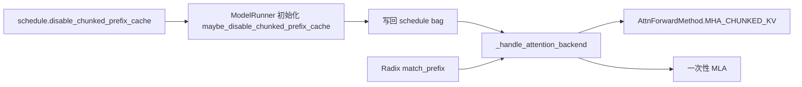
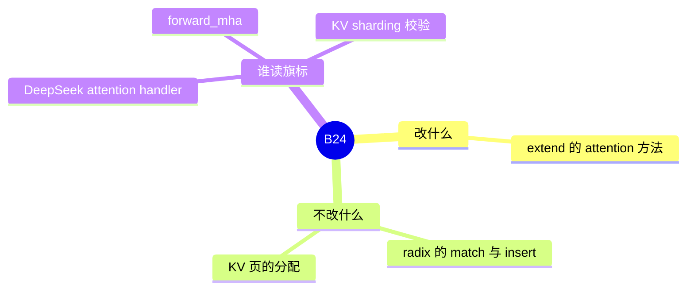

# Chunked prefix cache

对应 B24。树是 `297e54fd105e974cdf401e5b4d20253a22c16f90`。**源码路径推断，未实测**。

## 场景与硬件

DeepSeek 一类 MLA 模型在 extend prefill 上，前缀已经很长时，一次性用 ragged MLA 吃完整段前缀的开销大。Chunked prefix 把这段前缀改走 **MHA chunked-KV** attention。短序列上这层分块本身是开销，所以有单独的关闭开关。

`--disable-chunked-prefix-cache` 的 help（`fields/schedule.py`）：Disable chunked prefix cache feature for deepseek, which should save overhead for short sequences.

硬件门在 `maybe_disable_chunked_prefix_cache`（`model_runner_components/misc_utils.py`）：不是 MLA，或 prefill 后端不在支持表里，运行时就把开关收成关闭。没有按 GPU 型号再断言。`handle_attention_fa4` 在平台不是 SM100 / SM110 时走 `MHA_CHUNKED_KV`，那是 FA4 的架构分叉，和本开关叠在同一条 attention 选择上。

支持表 `CHUNKED_PREFIX_CACHE_SUPPORTED_ATTENTION_BACKENDS`（`choices.py`）：`flashinfer`，`fa3`，`fa4`，`flashmla`，`cutedsl_mla`，`trtllm_mla`。`add_chunked_prefix_cache_attention_backend` 可以再注册。

## 在框架中的位置

它坐在模型前向里，坐在 radix 命中之后。命中长度仍然由 [01-RadixCache](01-RadixCache.md) 决定。本开关只决定「已命中的前缀在 attention 里怎么读」。

## 原理

`mem_cache` 里没有引用这个旗标。效应全在 attention。

`models/deepseek_common/attention_backend_handler.py` 的 `_handle_attention_backend`：extend、且这一步没有投机时，若 `sum_extend_prefix_lens >= chunked_prefix_cache_threshold`，并且没有 `disable_chunked_prefix_cache`（或前缀长度本来就是 0），选择 `AttnForwardMethod.MHA_CHUNKED_KV`。否则走 MLA 子类型。`handle_attention_trtllm_mla` 等分支同样读 `attn.disable_chunked_prefix_cache`。`forward_mha.py` 从 schedule bag 取这个值。

KV 仍按 radix 和 allocator 的下标写入。变的是 kernel 看到的前缀布局：按块消费，而不是一次 ragged 全前缀。

## 过程

1. CLI 写入 `schedule.disable_chunked_prefix_cache`。
2. `ModelRunner.__init__` 调 `maybe_disable_chunked_prefix_cache`。MLA 且后端受支持、用户又没关，就保持开。否则把运行时 override 写成 True。override 进 `get_schedule()`，不改用户原来的 `ServerArgs` 字段。
3. Prefill batch 进 DeepSeek MLA forward，handler 用阈值和旗标选方法。
4. 选中的 kernel 按 `out_cache_loc` 读写，树的 checkpoint 仍走调度结果处理。

## 调用栈

| 函数 | 做什么 | 角色 |
| --- | --- | --- |
| `ModelRunner.__init__` | 池建好后调用 gate | 把「名义开关」收成「这一模型实际能不能用」 |
| `maybe_disable_chunked_prefix_cache` | 非 MLA 或不支持的后端则强制关闭 | 平台与架构门 |
| DeepSeek MLA forward | 把 batch 交给 handler | 前向入口 |
| `_handle_attention_backend` | 比较前缀长度和阈值 | 选择 chunked KV 或 one-shot MLA |
| `MHA_CHUNKED_KV` 路径 | 分块读已有 KV | 真正的 attention |

## 与相邻特性

KV 分片加 `trtllm_mla` 时，`handle_kv_cache_sharding` 要求 chunked prefix **开着**。`disable_chunked_prefix_cache` 为真会 `ValueError`。见 [09-KV分片](09-KV分片.md)。

和 `--disable-radix-cache` 是两个字段。一个关的是 MLA 长前缀的分块读法，一个关的是跨请求发布前缀。

和 [06-Chunked-prefill](06-Chunked-prefill.md) 也是两个开关。Chunked prefill 把一条请求的 extend 拆成多轮调度。Chunked prefix 是一轮 extend 里面 attention 怎么读已经在树上的前缀。

## 待核

阈值 `chunked_prefix_cache_threshold` 的默认数值本页没有从字段 help 再抄一遍。展开数值时对着 `fields` 里该字段的默认，不从博客推断。

返回 [本目录 README](README.md)。
