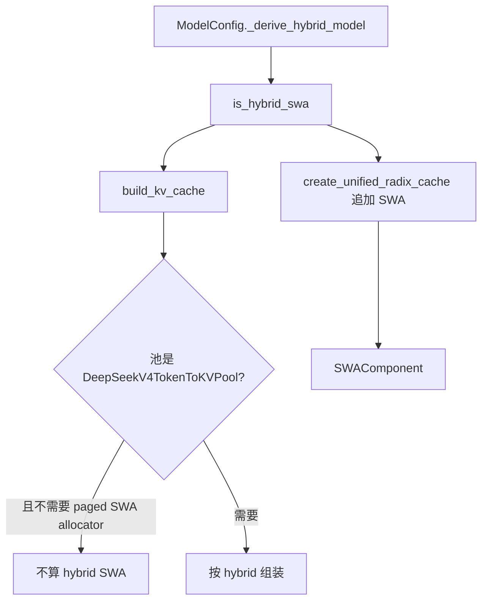
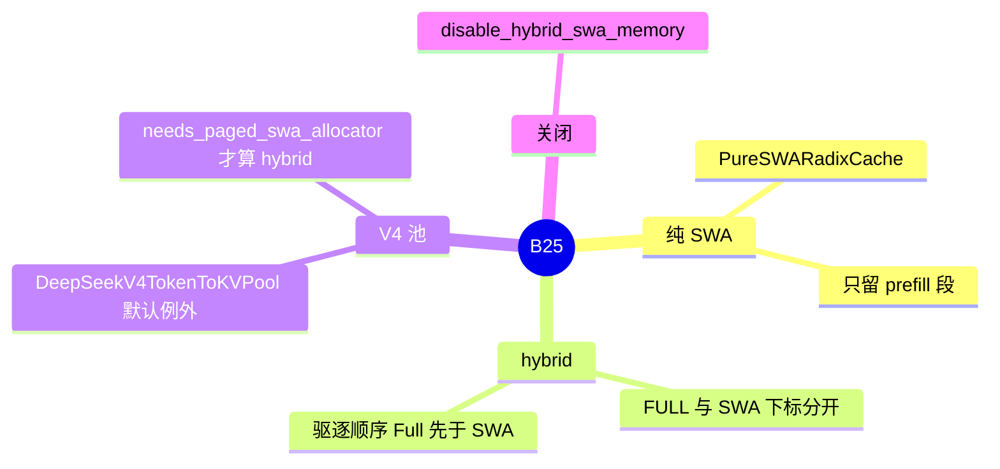

# SWA 与 hybrid 树

对应 B25。树是 `297e54fd105e974cdf401e5b4d20253a22c16f90`。**源码路径推断，未实测**。

## 场景与硬件

滑窗注意力只需要每个位置向前固定长度的 KV。全量层则要整段前缀。混合模型若把两种层塞进同一个「全量可匹配」的页语义，窗口层会多占页，全量层的命中也会被窗口驱逐拖乱。

本树用两种形态分开：

| 形态 | 何时 | 缓存范围 |
| --- | --- | --- |
| `PureSWARadixCache` | 模型是纯 SWA，且没有走到统一树的其它工厂支 | 完成时只缓存 prefill 段 `[0, evict_floor)`。窗口 KV 释放。`full_*_size` 恒为 0 |
| `SWAComponent` | hybrid：同一棵统一树上既有 FULL 又有 SWA | 同一节点两套下标。SWA 内部驱逐把 `value` 收成 tombstone（`None`），FULL 的下标留着 |

`--disable-hybrid-swa-memory` 让 `ModelConfig._derive_hybrid_model` 不再把模型标成 `is_hybrid_swa`。后面的池和 component 选型跟着这个标志走，等于不用混合 SWA 池。

硬件：通用 SWA 路径没有 GPU 代数断言。DeepSeek V4.1 打开 encoder SWA bounded replay 时，`validate_deepseek_v41_features` 要求 CUDA，或 HIP 且为 gfx950。那是 V4.1 回放路径的门，不是每一种 SWA 模型的门。

## 在框架中的位置

`build_kv_cache` 里对 `DeepSeekV4TokenToKVPool` 的判断：即便模型侧 `is_hybrid_swa`，只要不是 `needs_paged_swa_allocator`，就不按普通 hybrid SWA 池处理。`request_window is not None`（encoder replay 的请求窗）或 SWA req ring 时，`swa_gates_prefix_match=False`，滑窗不再单独卡前缀匹配。

## 原理

统一树上，FULL 的页下标和 SWA 的页下标是 component 各自的 value。匹配一条前缀时，两套长度可以不同。SWA 只承认窗口内还活着的页。窗口外的槽由 `free_swa_out_of_window_slots`（`mem_cache/common.py`）释放。

`PureSWARadixCache.evict` 用 `max(num_tokens, swa_num_tokens)` 估计要腾的量，因为纯 SWA 没有单独的 full 池尺寸。

`SWAComponent` 的注释写明：DeepSeek V4 走 HiSparse 且强制 `--disable-radix-cache` 时，这条组件只负责释放，不再把页发布成可匹配前缀。

## 过程

1. `_derive_hybrid_model`：`is_hybrid_swa_model(...)` 且没有 `--disable-hybrid-swa-memory`，才置 `is_hybrid_swa`，并记下哪些层是 SWA。
2. `build_kv_cache` 算滑窗长度、每层 token 数、`swa_gates_prefix_match`，并处理 V4 池例外。
3. 非纯 SWA 时 `create_unified_radix_cache` 追加 `ComponentType.SWA`。纯 SWA 在默认工厂里直接 `PureSWARadixCache`，除非 disable、LMCache、external linker、FlexKV 等更早的分支抢走。
4. 请求完成：`checkpoint_into_tree` 走 SWA 的 insert hook，按页对齐和窗界写入。
5. 窗外槽在 `free_swa_out_of_window_slots` 归还。驱逐按 component 级联。

## 调用栈

| 函数 | 做什么 | 角色 |
| --- | --- | --- |
| `ModelConfig._derive_hybrid_model` | 决定是不是 hybrid SWA，列出层 | 模型侧开关 |
| `build_kv_cache` | V4 池例外、请求窗、ring | 池形态 |
| `create_unified_radix_cache` | 追加 `SWAComponent` | 树的组件 |
| `release_kv_cache` | 结束时发布或释放 | 调度入口 |
| `UnifiedRadixCache.checkpoint` | `checkpoint_into_tree` | 写树 |
| `SWAComponent` 的 insert hook | 窗界和页对齐 | SWA 语义 |
| `free_swa_out_of_window_slots` | 丢掉窗口外的槽 | 回收 |

## 与相邻特性

Decode radix 同时开着 SWA 和 HiCache 时，`validate_decode_radix_cache` 拒绝 hierarchical。DeepSeek V4 的 decode radix 还要求 unified KV layout。

V4.1 encoder SWA replay 与 unified memory、radix session、mixed chunk 列在同一张拒绝表里，见 `validate_deepseek_v41_features`。模型篇展开整张表。

HiSparse 的 host 交换见 [HiSparse](../02-注意力与稀疏/01-HiSparse.md)。那条路径要求关掉 radix，SWA 组件退化为释放。

## 待核

`DeepSeekV4TokenToKVPool` 在 HiCache host pool 上的全部分支要读 `hybrid_pool_assembler` 才能列全。本页只钉 `build_kv_cache` 里「什么时候不算 hybrid」这一判断。

返回 [本目录 README](README.md)。
