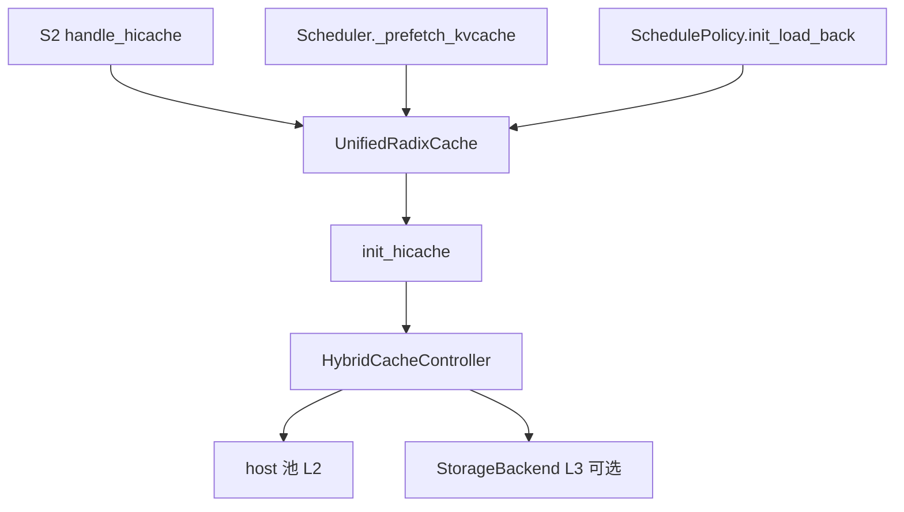
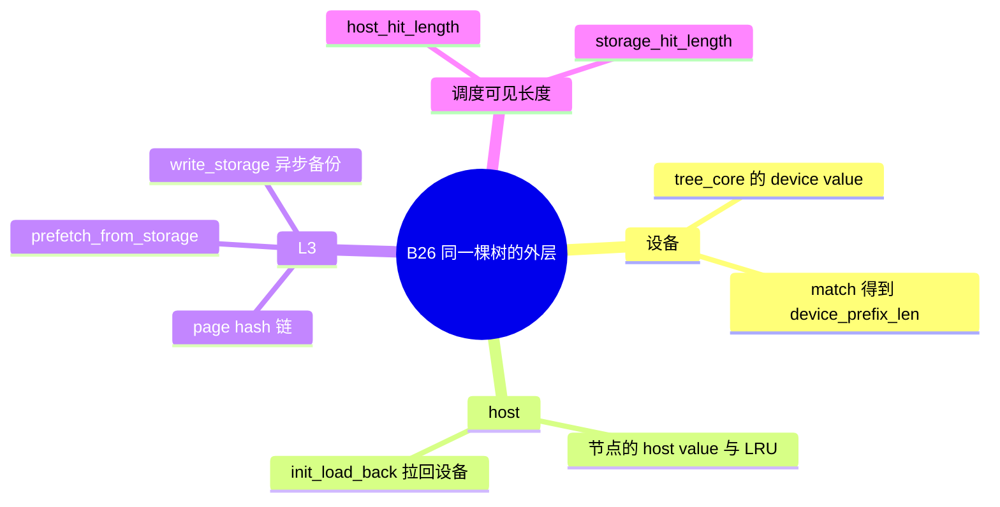

# HiCache

对应 B26。树是 `297e54fd105e974cdf401e5b4d20253a22c16f90`。**源码路径推断，未实测**。本环境没有多级缓存的实跑记录。

## 场景与硬件

设备 KV 装不下、但前缀会反复出现时，把已经算出的页留在 host，必要时再留到 L3。下一次匹配先看设备，再看 host，再向存储发预取。典型是长文档、多轮对话、PD 场景里 prefill 侧想把页送出本卡。

开关是字段 `enable_hierarchical_cache`，help 别名 `--enable-hicache`。host 的用法由 `hicache_host_memory_mode` 决定：

| 模式 | 含义 |
| --- | --- |
| `cache` | host 是持久的一层。页可以停在 host 上被再次命中 |
| `buffer_only` | host 只做 staging。持久副本在 L3。必须配置存储后端 |

硬件与组合门都在 `arg_groups/hicache_hook.py`，没有单独的「必须 H100」断言。源码明确拒绝或改写的有：

- `resolve_hicache_dcp_compatibility`：DCP>1 只允许 MLA。`buffer_only` 加 L3 在这条上不行。LMCache、HiSparse 不行。投机只放行 DSPARK 等被点名的算法。
- `validate_hicache_host_memory_mode`：decode 角色禁止 `buffer_only`。
- `resolve_unified_memory_layout_io`：统一内存且布局是 `page_first_direct` 时，收成 `page_first`，io 走 `kernel`。
- `--enable-unified-cache-external-linker` 与 `--enable-hierarchical-cache` 互斥。linker 要求 radix 开着，并禁止自定义 `radix_cache_backend`。linker 不读 `--hicache-storage-backend`。
- `buffer_only` 没有存储后端则不能成立。`write_back` 在该模式下被解析成 `write_through`。
- Mooncake、`npu_memcache` 常把 `hicache_mem_layout` 从 `layer_first` 改掉。
- KV 分片可以有 HiCache host，**L3 存储后端仍不支持**（`handle_kv_cache_sharding`）。

## 在框架中的位置

`StorageAttachment` 的注释写明：`UnifiedRadixCache` 拥有这棵树。L3 的线程和 `ongoing_prefetch` / `ongoing_backup` 记账挂在这棵树上，节点仍是原来的 `NodeId`。本树没有第三棵叫 HiCache 的前缀树，也没有 `HiRadixCache` 这个类名。

调度篇已经用到命中长度：`num_matched_prefix_tokens` 是 `min(prefix_len + host_hit_length, max_prefix_len)`。设备页怎么分配仍在 F161。本页写 host 和 L3 怎么接到同一次匹配上。

## 原理

`managers/cache_controller.py` 的 `HiCacheController` 管 L2：`start_loading` / `start_writing`、`prefetch` / `terminate_prefetch`、`write_storage`（进 `backup_queue`）、存储线程 `prefetch_thread_func`。构造时可以 `attach_storage_backend`。

`HybridCacheController` 继承它，加上多 pool 搬运、`write_storage` 的覆盖、PP prefetch ticket、以及 KV 分片时的 host。`UnifiedRadixCache.init_hicache` 经 `hybrid_pool_assembler.attach_hybrid_pool_to_unified_cache` 把控制器装上。

写策略 `hicache_write_policy` 决定完成或驱逐时是否把 host 页备份到 L3。读路径分两跳：host 命中由 `init_load_back` 绑回设备下标；L3 命中由 `prefetch_from_storage` 先把页拉到 host（或设备），调度再看 ack。

## 过程

1. `handle_hicache` 规范化布局、io、存储互斥，并处理 DCP。`handle_hicache_ratio_default` 补 host 比例的默认。
2. 建树之后 `init_hicache`：host pool group、控制器、可选 `StorageBackendFactory.create_backend`。
3. 请求进入等待队列。`match_prefix` 给出设备命中和 host 命中。设备比入队时的存储查询更短时，调度篇写的那条路径会重发存储查询并 `continue`。
4. `Scheduler._prefetch_kvcache` 对还缺的跨度调用 `tree_cache.prefetch_from_storage`。
5. 准入时 `SchedulePolicy.init_load_back` 把 host 命中绑成设备页。`check_prefetch_progress` 看存储预取是否完成。
6. 完成或驱逐：D2H，再 `write_storage`。`buffer_only` 走 staging pipeline，host 不长期持有。

## 调用栈

存储预取：

| 函数 | 做什么 | 角色 |
| --- | --- | --- |
| `Scheduler.handle_generate_request` 一带的门控 | 决定要不要为这条请求发预取 | 调度入口 |
| `Scheduler._prefetch_kvcache` | 调树的预取 | 把 L3 跨度交给控制器 |
| `UnifiedRadixCache.prefetch_from_storage` | 向控制器要 submission | 树持有的 API |
| `HybridCacheController.prefetch` | 交给存储线程 | 异步读 |
| `StorageBackend.batch_get*` | 按页从 L3 取出 | 后端 |
| `Scheduler.check_prefetch_progress` | 收 ack，决定本轮能不能上车 | 回到调度 |

写回 L3：`UnifiedRadixCache` 的 host 备份触发 `cache_controller.write_storage`，`backup_queue` 里的线程做 `_page_backup` / `page_set_*`，再到 `HiCacheStorage.batch_set*`。

## 与相邻特性

| ID | 关系 |
| --- | --- |
| B23 | 设备层仍是同一棵 radix。命中长度分 device / host |
| B27 | L3 类由存储后端页列出 |
| B11 | DCP 兼容函数拒绝 HiSparse + HiCache |
| B28 | 预取没完成的请求会在准入里被跳过，chunk 边界因此后移 |
| B37 | decode 不能用 `buffer_only`。decode radix + SWA + HiCache 被 `validate_decode_radix_cache` 拒绝 |
| B68 | 统一内存会改 HiCache 的布局和 io |
| D07 | DCP>1 的限制在 `resolve_hicache_dcp_compatibility`。并行轴正文仍在 [04-分布式](../../04-分布式/README.md) |

## 待核

`HiCacheController` 类本身没有长 docstring。行为以 `HybridCacheController` 和 `StorageAttachment` 为准。各 `hicache_write_policy` 取值的完整枚举本页没有逐项抄 help，展开时对着 `fields` 的该字段。

返回 [本目录 README](README.md)。
