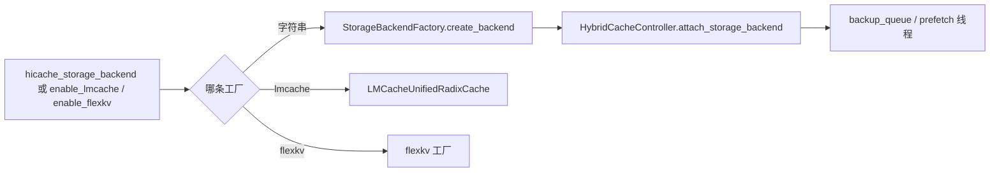
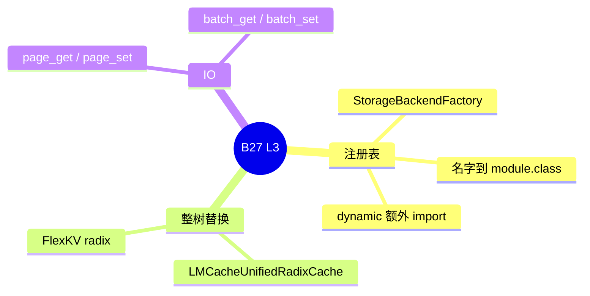

# HiCache 存储后端

对应 B27。树是 `297e54fd105e974cdf401e5b4d20253a22c16f90`。**源码路径推断，未实测**。每个后端的连接参数以字段 help 和该类构造函数为准，本页不抄旗标大全。

## 场景与硬件

L3 是 [04-HiCache](04-HiCache.md) 里 host 层外面的持久存储。`--hicache-storage-backend` 选实现。另外两条不走这个字符串：`--enable-lmcache` 和 `--enable-flexkv` 在 radix 工厂链上换成整棵缓存类。

多数后端没有 GPU 代数断言。源码里写明设备的只有少数：

| 后端 | 源码里的设备条件 |
| --- | --- |
| `npu_memcache` | `npu_memcache_store.py` 使用 `torch.npu` / `device_id`。布局只接受 `page_first` / `page_first_direct` 等，否则报错 |
| EIC | 构造配置里有 `cuda:N` 的 NIC 亲和。这是配置项，不是启动时对所有 GPU 的统一 assert |
| LMCache | `handle_unified_memory_pool` 拒绝与统一内存同时开。DCP 兼容函数也拒绝 LMCache |
| FlexKV | 与 KV 分片互斥 |

外部 linker 打开时不走 `hicache_storage_backend`。见 HiCache 页的互斥。

## 在框架中的位置

## 原理

`mem_cache/storage/backend_factory.py` 的 `StorageBackendFactory` 把名字映到类。`file` / `sim` / `nixl` / `tensorcast` 一类构造只收 `storage_config`。`mooncake`、`hf3fs` 等还要 `mem_pool_host` 或 `bytes_per_page`。控制器的 `page_get` / `page_set` 转到 `storage_backend.batch_*`。失败路径可以包一层 `hicache_storage._maybe_wrap_hicache_storage_failure_injector`。

`dynamic`：`storage_config.extra_config` 带 `backend_name`、`module_path`、`class_name`，运行时 import。这是插件式 L3，不是内置枚举的一员。

LMCache 与 FlexKV 在 `default_radix_cache_factory` 里优先于普通 HiCache 字符串。`enable_lmcache` 还要 `lmcache_config_file`。`enable_flexkv` 用 `flexkv_config_file` 或环境变量 `FLEXKV_CONFIG_PATH`。文档注释把 `--radix-cache-backend=flexkv` 说成等价入口，`enable_flexkv` 可以单独打开。

## 过程

1. `init_hicache` 读 `hicache_storage_backend` 和 extra JSON。
2. `attach_storage_backend` 调 `create_backend`。
3. 备份线程消费 `backup_queue`，预取线程消费预取队列。
4. `StorageAttachment.attach` 可以在运行时换后端。调度器需要先静默，本页没有把静默协议逐行展开。

## 调用栈

| 函数 | 做什么 | 角色 |
| --- | --- | --- |
| `HybridCacheController.attach_storage_backend` | 按名字建后端并挂上 | 启动或热挂 |
| `StorageBackendFactory._create_builtin_backend` | 内置名字到类 | 注册表 |
| `cache_controller.write_storage` | 把 host 页推进备份队列 | 写路径入口 |
| 备份线程 `_page_backup` | 调 `page_set_*` | 异步落盘或远端 |
| `HiCacheStorage.batch_set*` / `batch_get*` | 后端自己的批量 IO | L3 实现 |
| `Scheduler._prefetch_kvcache` | 读路径的调度入口 | 见 HiCache 页 |

## 各后端

每一行是一种介质。类名是工厂注册的目标。传输细节以该类构造函数为准。

| 名字 | 类 | 介质 | 在链路里的角色 |
| --- | --- | --- | --- |
| `file` | `hicache_storage.HiCacheFile` | 本地文件 | 单机落盘，无远端依赖 |
| `shm` | `storage/shm.HiCacheShm` | POSIX 共享内存 | 同机进程共享的 L3 |
| `sim` | `sim_storage.SimHiCacheStorage` | 进程内仿真 | 不代表真实容量 |
| `nixl` | `nixl/hicache_nixl.HiCacheNixl` | NIXL 传输 | 和 PD / EP 里的 NIXL 是同一类库，缓存这条用的是 HiCache 封装 |
| `mooncake` | `mooncake_store.MooncakeStore` | Mooncake 分布式 KV | 布局 hook 会改掉 `layer_first` |
| `hf3fs` | `hf3fs/storage_hf3fs.HiCacheHF3FS` | 3FS / HF3FS 文件 | 另有 usrbio 客户端与 metadata server |
| `simm` | `simm/hicache_simm.HiCacheSiMM` | SiMM | 工厂名 `simm` |
| `eic` | `eic/eic_storage.EICStorage` | EIC 远端 | NIC 亲和写在配置里 |
| `aibrix` | `aibrix_kvcache_storage.AibrixKVCacheStorage` | Aibrix KV | 外部缓存服务 |
| `seaweedfs` | `seaweedfs_store.SeaweedFSStore` | SeaweedFS 对象 | 对象存储 |
| `npu_memcache` | `npu_memcache_store.NpuMemcacheStore` | Ascend memcache | 要 NPU 设备，布局受限 |
| `tensorcast` | `tensorcast_store.TensorcastStore` | Tensorcast store daemon | UMA / daemon |
| `mori` | `umbp/umbp_store.UMBPStore` | UMBP | 注册名是 `mori`，类是 UMBP。和 MoE 的 `moe-a2a-backend mori` 不是同一个开关 |
| LMCache | `LMCacheUnifiedRadixCache` | LMCache 进程 | 替换整棵 radix，不进上面的字符串表 |
| FlexKV | `storage/flexkv` 工厂 | FlexKV | 同样替换整棵 radix |

## 与相邻特性

Mooncake 作为 L3、作为 PD 传输后端、作为 MoE all-to-all，是三套配置。缓存页只拥有 `hicache_storage_backend=mooncake` 和 `MooncakeStore`。PD 传输见 [06-调度与PD](../06-调度与PD/03-PD分离.md)。MoE 见 [04-MoE与DeepEP](../04-MoE与DeepEP/03-其它a2a.md)。

`mori` 这个存储名容易和 `MoeA2ABackend.MORI` 混。存储注册指向 `UMBPStore`。专家通信的 mori 在 `token_dispatcher/moriep.py`。

## 待核

`enable_lmcache` 或 `enable_flexkv` 与 `hicache_storage_backend` 同时设时，工厂优先级决定谁生效。有没有第二处再断言「不能同时」，本页没有逐个 hook 搜完，标待核。

返回 [本目录 README](README.md)。
