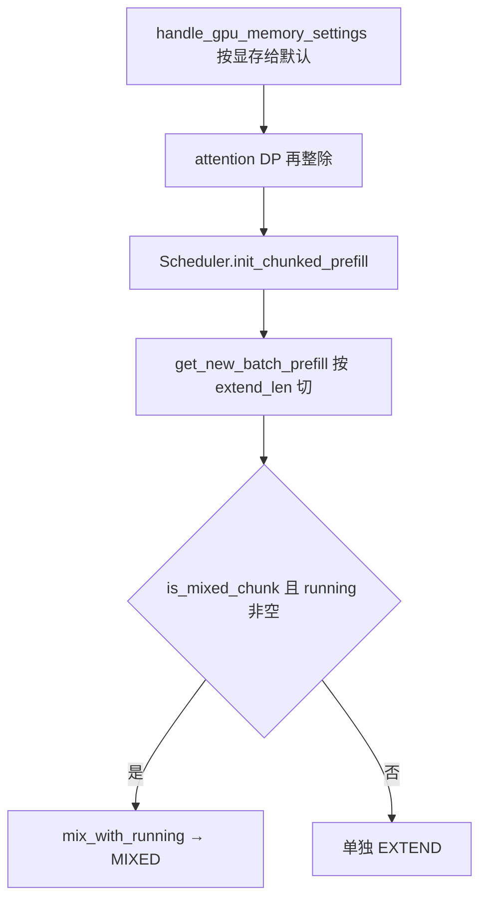
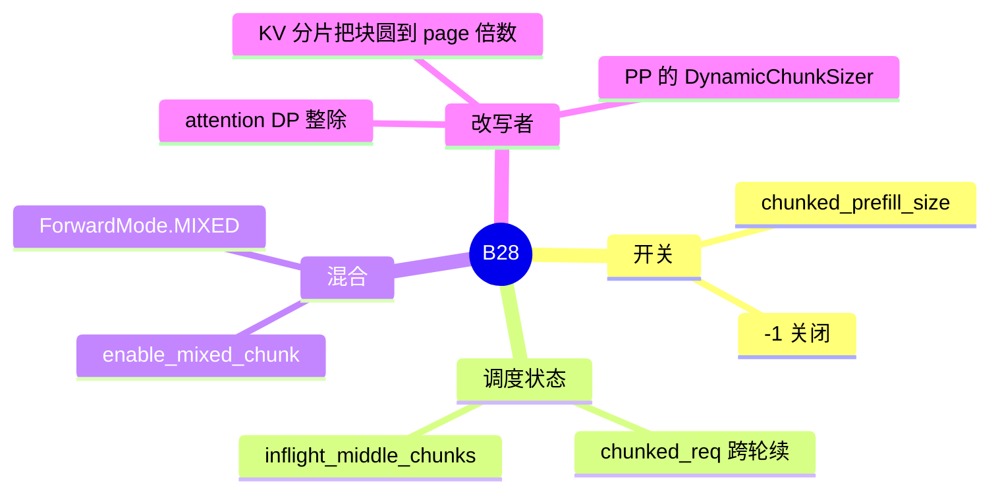

# Chunked prefill

对应 B28。树是 `297e54fd105e974cdf401e5b4d20253a22c16f90`。**源码路径推断，未实测**。

调度循环里 chunk 怎么切进 batch，见 [03-组batch](../../02-流程/03-调度与推理/03-组batch.md)（F160）。本页写开关、和 mixed chunk 的关系、以及 attention DP 怎样改写块大小。

## 场景与硬件

一条提示有上万 token 时，一次 EXTEND 会把激活和调度延迟都拉满，后面的 decode 要等它结束。Chunked prefill 把这条 extend 拆成多轮，每轮最多 `chunked_prefill_size` 个新 token。已经在跑的 decode 可以在轮与轮之间插进去。`enable_mixed_chunk` 再进一步：同一轮 forward 里既有 extend 行也有 decode 行，模式是 `ForwardMode.MIXED`。

`chunked_prefill_size = -1` 表示关闭。`Scheduler.init_chunked_prefill` 把 `<=0` 收成 `self.chunked_prefill_size = None`。多模态加 Transformers 兜底也在这里强制关掉。

默认块大小不是写死的常数。`handle_gpu_memory_settings` 按 `get_device_memory_capacity(cfg.device)` 的显存 MB 分档（源码注释点到 T4 / 4090 / H100 这一类容量阈值）。这是容量分档，不是型号白名单。NPU 上 scheduler 初始化还有 page size 与 chunk 大小的约束，见该处注释。

Attention DP 打开时，`parallel_hook._handle_data_parallelism` 把 `chunked_prefill_size // attn_dp_size`，并打 warning。清单里的 F202 指的就是这次改写。prefill CUDA graph 的 `max_bs` 会再被夹到「每个 rank 分到的 chunk」。

## 在框架中的位置

## 原理

关闭之后，一条请求的 prefill 在显存和 token 预算允许时一次做完。打开之后，`PrefillAdder` 的 extend 预算被块大小截断。没做完的请求带着 `chunked_req` 留在队列，下一轮 `init_next_round_input` 从上次的 `prefix_len` 续。中间块不把首 token 当成完成，`inflight_middle_chunks` 归零的那一轮才 `checkpoint_kv_cache`。这段时序在调度篇 F161。

`is_mixed_chunk` 的定义是：chunk 大小不是 `None`，且 `enable_mixed_chunk`。调度循环在 running batch 非空、又没有 logprob 一类冲突时调用 `ScheduleBatch.mix_with_running`，把模式设成 `MIXED`。一次 `ModelRunner.forward` 同时处理 extend 行和 decode 行。

投机侧 `supports_mixed_chunk` 为假的算法不能保持这个开关。`handle_server_args` 里 ngram、frozen KV MTP、UNO、EAGLE 族的处理函数会把 `enable_mixed_chunk` 关掉。EAGLE / EAGLE3 / DFLASH / DSPARK 的 `supports_mixed_chunk` 为真，才可能和 chunk 共存。NGRAM 的注释写明：它的 overlap relay 跳过 `output_tokens_buf`，mixed 的输入解析要读这块缓冲。

## 过程

1. 解析期按显存给默认，attention DP 再除，KV 分片可能把块圆到 `page_size` 的倍数。
2. `init_chunked_prefill` 写入 `chunked_prefill_size` 和 `is_mixed_chunk`。
3. `get_new_batch_prefill` 用块大小截 `extend_len`。
4. 可选 `mix_with_running`。
5. 结果处理区分中间块和最后一块，决定 checkpoint 时机。

## 调用栈

| 函数 | 做什么 | 角色 |
| --- | --- | --- |
| `handle_gpu_memory_settings` | 按设备显存容量声明默认块大小 | 解析期默认 |
| `_handle_data_parallelism` | `chunked_prefill_size //= attn_dp_size` | F202 的改写 |
| `Scheduler.init_chunked_prefill` | `<=0` 收成关闭，并计算 `is_mixed_chunk` | 调度器状态 |
| `get_new_batch_prefill` | 按块截断 extend | 组 batch |
| `ScheduleBatch.mix_with_running` | 与 running decode 合成 `MIXED` | 混合前向 |
| `ModelRunner.forward` | 按模式跑 extend、decode 或混合 | 计算 |

## 与相邻特性

DeepSeek V4.1 encoder SWA replay 要求 `chunked_prefill_size >= 128 + page_size`（`validate_deepseek_v41_encoder_replay_budget`），同时拒绝 mixed chunk。B24 的 chunked prefix 是 attention 方法，不是这个调度块。B30 的 two-batch overlap 是另一层重叠，V4.1 也拒绝它。

## 待核

清单写 F202。源码里没有 `F202` 这个标识符。行为对应 `_handle_data_parallelism` 里的整除。动态块在 PP 上的 `DynamicChunkSizer` 本页只点到名字，步进公式留在并行切分的 PP 页对照 `event_loop_pp`。

返回 [本目录 README](README.md)。
