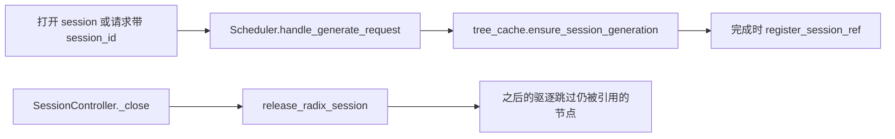
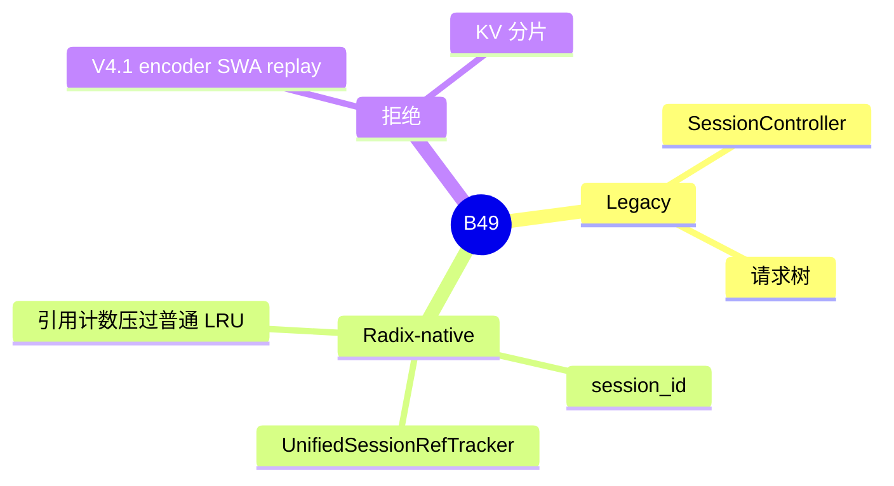

# Session

对应 B49。树是 `297e54fd105e974cdf401e5b4d20253a22c16f90`。**源码路径推断，未实测**。

## 场景与硬件

多轮对话希望下一轮接着上一轮的 KV，而不是等 LRU 碰巧还留着。本树有两套 session，硬件上没有额外 GPU 门。

| 套 | 入口 | 持有什么 |
| --- | --- | --- |
| Legacy | `SessionController`，请求上的 `session_params.id` | 一棵 `Session` / `SessionReqNode` 的请求树。关闭时调 `tree_cache.release_radix_session` 和 `release_session` |
| Radix-native | `recv_req.session_id` 且 `--enable-session-radix-cache` | 统一树上的 session 代际和引用计数。关闭只减引用，有引用的页不立刻驱逐 |

旗标字段是 `memory.enable_session_radix_cache`，CLI `--enable-session-radix-cache`。help 写的是 UnifiedRadixCache 的 session 引用和驱逐语义。`create_tree_cache` 要求缓存对象真的带上这个能力，所以实现必须是统一树。`--enable-streaming-session` 同样要求统一树。

没有单独的硬件白名单。

## 在框架中的位置

`init_running_status` 里 `SessionController` 拿的就是 `self.tree_cache`。F200 用这件事说明树必须在 scheduler 上：session 复用和准入匹配是同一棵树。

## 原理

Legacy session 持有的是请求节点，不是 radix 指针。Radix-native 在 component 上做 `session_ref`。`UnifiedTreeCore` 的驱逐优先丢掉没有引用的节点。

完成插入且不是 streaming 时，`register_session_ref(req, leaf)` 给叶子加引用。`enable_streaming_session` 的路径在 `register_session_ref` 里直接 return，流式 session 不走这套引用。

V4.1 打开 `enable_encoder_swa_bounded_replay` 时，`validate_deepseek_v41_features` 的不兼容元组含 `("radix sessions", cfg.enable_session_radix_cache)`，报错文案是 does not support radix sessions yet。`handle_kv_cache_sharding` 同样禁止这个旗标。

## 过程

1. 打开：`SessionController.open`，或第一次见到 `session_id` 时 `ensure_session_generation` 懒打开 `open_radix_session`。
2. `handle_generate_request` 计算 `radix_native_session = session_id and enable_session_radix_cache`，把 `req.session_generation` 设成树上的代际。
3. 匹配和分配仍走普通 radix。差别是完成后叶子被引用住。
4. 关闭：`_close` → `release_radix_session` 减引用。Legacy 另外释放多模态特征。引用归零之后，普通驱逐才能收这些节点。

## 调用栈

| 函数 | 做什么 | 角色 |
| --- | --- | --- |
| `Scheduler.handle_generate_request` | 识别 radix-native session，绑定代际 | 请求入口 |
| `UnifiedRadixCache.ensure_session_generation` | 没有会话就打开 | 懒初始化 |
| `register_session_ref` | 插入叶子后加引用。streaming 直接返回 | 保护页 |
| `SessionController._close` | 结束会话 | API |
| `UnifiedRadixCache.release_radix_session` | 交给 tracker | 减引用 |
| `UnifiedSessionRefTracker.release_radix_session` | 各 component `release_session_refs` | 引用归零前不可驱逐 |

## 与相邻特性

B23 的锁是「这条请求还在跑」。B49 的引用是「这个会话还可能接着问」。两者都让页留在树上，生命周期不同。B69 分片和 V4.1 encoder replay 不能加会话引用。

## 待核

streaming session 与 radix session 同时打开时，引用函数直接返回。两种会话 ID 若指向同一段前缀，页何时可驱逐，要再跟 `enable_streaming_session` 的插入路径。本页标待核。

返回 [本目录 README](README.md)。
