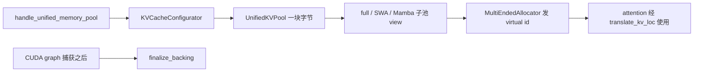
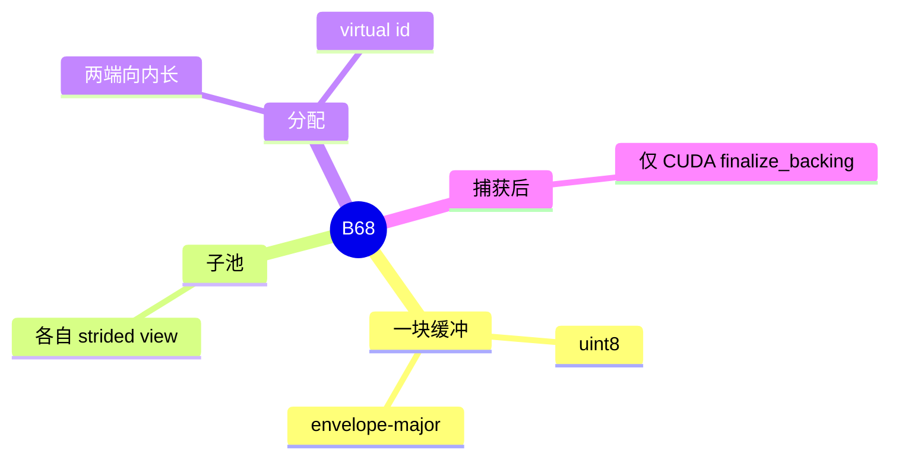

# Unified memory

对应 B68。树是 `297e54fd105e974cdf401e5b4d20253a22c16f90`。**源码路径推断，未实测**。

## 场景与硬件

混合模型同时有 full KV、SWA、Mamba 状态。若每种池各拿一块显存，空闲的那种池不能借给另一种。`--enable-unified-memory` 让这些子池共用一块 `uint8` 物理缓冲，两端向内增长，中间还可以有一块 float 池。上层保存的是 virtual slot id。compaction 只改虚到实的表，不必改写所有引用。

`UnifiedKVPool.__init__` 在 post-capture 路径上，`dev.type != "cuda"` 则 `ValueError`。这是源码里的设备门。

`kv_cache_hook.handle_unified_memory_pool` 还卡住这些组合（摘要，完整条件以该函数为准）：

| 组合 | 结果 |
| --- | --- |
| PD | 传输后端必须落在 `_unified_memory_pd_transfer_backends()`。`pp_size>1` 不行。Mooncake 加投机不行 |
| HiSparse | 拒绝 |
| 投机 | 只放行 DSPARK、EAGLE、EAGLE3、DFLASH。`eagle_topk` 要 ≤1。EAGLE 还要 hybrid SWA 或 mamba hybrid |
| LMCache、external linker、HiCache+EAGLE、two-batch overlap | 拒绝 |
| DCP | `_validate_unified_memory_dcp` 只放行 MLA |

V4.1 encoder SWA replay 的拒绝不在这个 hook 里，而在 `validate_deepseek_v41_features`：不兼容元组含 `("unified memory", cfg.enable_unified_memory)`。

## 在框架中的位置

## 原理

模块 docstring：`UnifiedKVPool` 是单块字节缓冲，每个子池是分层的 strided view。`MultiEndedAllocator` 从两端向内增长。布局是 envelope-major，便于 compaction。上层只存 virtual id，compaction 改 v2p 表。

打开统一内存会连带 `enable_page_major_kv_layout` 一类声明，具体以 hook 后半的 `declare_resolution` 为准。HiCache 若同时打开，布局 io 被收成 `page_first` + kernel io，见 [04-HiCache](04-HiCache.md)。

## 过程

1. 解析期 `handle_unified_memory_pool` 通过，或在这里抛错。
2. `KVCacheConfigurator` 建 `UnifiedKVPool` 和 unified allocator。hybrid 走 `init_unified_mamba_pools` 或 hybrid assembler。
3. Radix 和 attention 用 `translate_kv_loc*` 把 virtual id 变成物理页。
4. 计划了 post-capture 时，捕获结束后 `finalize_backing`。非 CUDA 在这里失败。

## 调用栈

| 函数 | 做什么 | 角色 |
| --- | --- | --- |
| `handle_unified_memory_pool` | 校验 PD、投机、HiCache、DCP | 启动门 |
| `KVCacheConfigurator.build_pools` | 选择统一池而不是分块池 | 装配 |
| `UnifiedKVPool.__init__` | 分配缓冲和子池 view | 存储 |
| `MultiEndedAllocator.alloc` | 发 virtual id | 分配 |
| `finalize_backing` | 捕获后把剩余显存收成真正的 backing | 仅 CUDA |

## 与相邻特性

B25 的 SWA 和 B56 的 Mamba 是子池的两类住户。B26 的 HiCache 可以共存，但布局被改写，且 EAGLE + HiCache + 统一内存在 hook 里被拒绝。B69 分片与统一内存互斥。B67 memory saver 动的是权重休眠，和这块 KV 字节不是同一个开关。

## 待核

hook 后半 `_SPEC_*_AUDITED_BACKENDS` 的完整 attention 后端白名单本页没有逐项抄出。展开时对着 `kv_cache_hook.py` 该常量。

返回 [本目录 README](README.md)。
