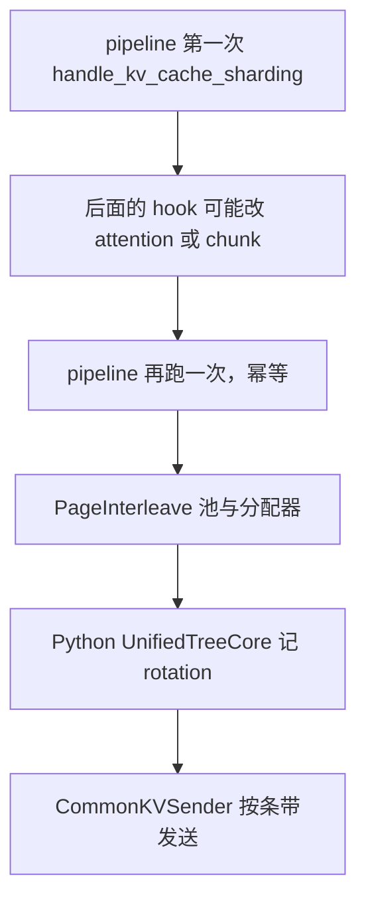
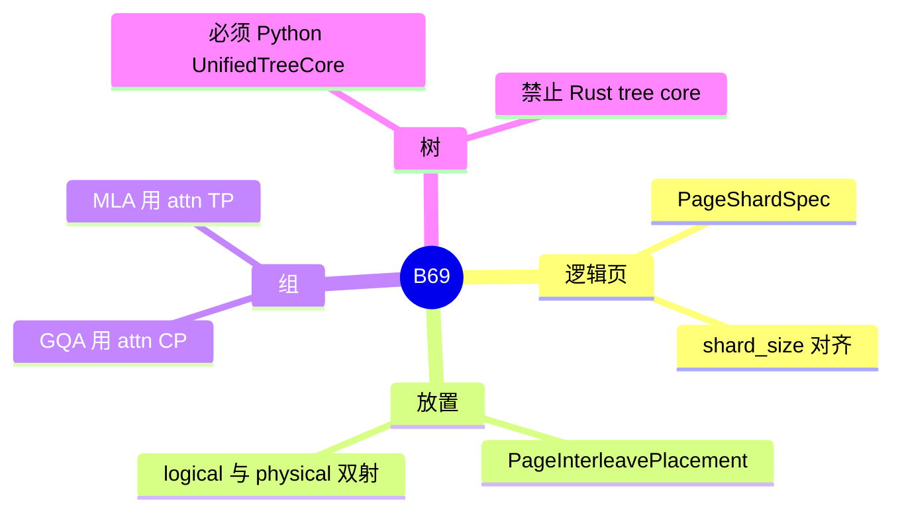

# KV 分片与 page interleave

对应 B69。树是 `297e54fd105e974cdf401e5b4d20253a22c16f90`。**源码路径推断，未实测**。

## 场景与硬件

PD 的 prefill 侧要把一条序列的 KV 按页拆到多张卡上，decode 侧再按条带组装。Radix 和分配器看到的是逻辑页。物理页在各个 rank 的池里。开关 `--enable-kv-cache-sharding`，字段 `enable_kv_cache_sharding`。

只在 `disaggregation_mode=prefill` 时成立。decode 角色打开会在 `handle_kv_cache_sharding` 被拒绝。

`validate_kv_shard_attention_backend` 的设备条件：

| 路径 | 条件 |
| --- | --- |
| DSA | `device=="cuda"`，interleave 的 prefill CP>1，PP=1，TRTLLM，`fp8_e4m3`，page 64，传输后端 Mooncake，以及函数里其余断言 |
| 其它 | prefill 后端是 `fa3`，或 `trtllm_mla`（MLA 且 `attn_cp_size==1`） |

GQA 分片要求 prefill CP>1。MLA 的 plain-TP 分片要求 `tp_size>1`，并禁止 attention DP。

`trtllm_mla` 还要求 chunked prefix 开着，见 [02-chunked-prefix](02-chunked-prefix.md)。

## 在框架中的位置

`arg_groups/pipeline.py` 在约 368–371 行注释：capability 调整可能较晚才改 attention 或 chunked prefill，所以 `handle_kv_cache_sharding` 会再跑一次。第二次应当幂等。

## 原理

一个逻辑页等于 `shard_size` 个、按 rank 对齐的物理页。`mem_cache/page_interleave.py` 的 `PageInterleavePlacement` 做逻辑下标和物理下标的双射。`PageShardSpec.scratch_rows` 给前缀、chunk 和废弃行留 scratch。`get_kv_shard_group`：GQA 走 attention CP 组，MLA 走 attention TP 组。

Radix 必须是 Python 的 `UnifiedTreeCore`，因为插入和匹配要带 rotation metadata。Rust tree core、自定义 radix 后端、external linker、streaming session、session radix、FlexKV、unified memory、`dcp_size>1`、L3 存储、LMCache、HiSparse、TBO、动态 chunk 加 PP、encoder-decoder、local attention chunk 都在 hook 里 `ValueError`。L3 不行，但 HiCache 的 host 池可以是 `PageInterleaveHostPool`。

分片会关掉 prefill CUDA graph，投机的 decode 图也关掉。`chunked_prefill_size` 可能被圆到 `page_size` 的倍数，并改 `mem_fraction_static`。

## 过程

1. 确认角色是 PD prefill，旗标打开。
2. 校验后端、CP/TP、page、chunked prefill、传输后端。
3. 必要时改块大小和显存比例，关图。
4. 运行时分配器发逻辑 id。attention 和 disagg 连接按 placement 做 gather / scatter。
5. 发送：`CommonKVSender._prepare_send_indices` 按条带把页交给 decode。

## 调用栈

| 函数 | 做什么 | 角色 |
| --- | --- | --- |
| `handle_kv_cache_sharding` | 校验并 `declare_resolution` | 启动门，pipeline 跑两次 |
| `validate_kv_shard_attention_backend` | DSA 与 MLA/GQA 两套白名单 | 硬件与后端 |
| `KVCacheConfigurator` | 建 `PageInterleaveKVPoolMixin` | 池 |
| `PageInterleavePoolAllocator.alloc` | 返回逻辑 id | 分配 |
| `UnifiedTreeCore.insert` / `match_prefix` | 在请求上记 rotation base | 树 |
| `CommonKVSender._prepare_send_indices` | 按条带准备 PD 发送 | 传输 |

## 与相邻特性

B40 的 prefill CP 在 DSA 分片路径上是前提（interleave，CP>1）。MLA 的 plain-TP 分片则要求 `attn_cp_size==1`。两条不要合成一句「分片等于 CP」。并行轴的定义在 [04-分布式](../../04-分布式/README.md)，本页只写缓存放置。

B26 的 L3 与分片互斥。B49 的 session 引用也互斥。

## 待核

DSA 与 MLA 两套 shard group 的边界条件以 `validate_kv_shard_attention_backend` 全文为准。本页按函数的两大分支写，没有把每一条 assert 的报错字符串都抄出。

返回 [本目录 README](README.md)。
