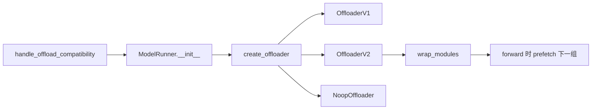
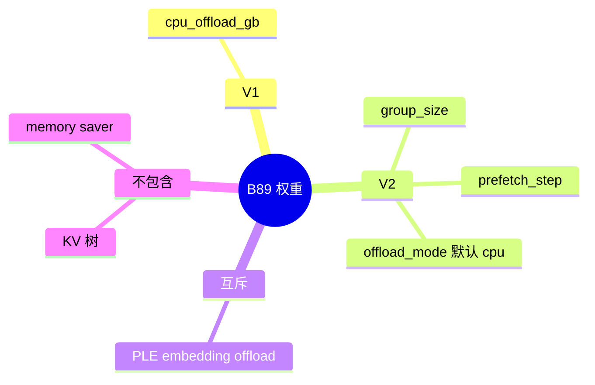

# 层 CPU offload

对应 B89。树是 `297e54fd105e974cdf401e5b4d20253a22c16f90`。**源码路径推断，未实测**。

## 场景与硬件

权重装不进显存、KV 仍然要留在设备上时，按层组把权重放在 host，前向之前预取回设备。这是权重路径，不是 HiCache 的 KV 路径，也不是 [Memory saver](../09-其它/07-Memory-saver.md) 的休眠，也不是 [Qwen4 PLE](../02-注意力与稀疏/15-PLE.md) 的 n-gram 表。

字段在 `fields/exec_.py` 的 `ExecOffload`，命名空间 `exec.offload`：

| 字段 | 作用 |
| --- | --- |
| `cpu_offload_gb` | 预留的 host 容量。大于 0 走 `OffloaderV1` |
| `offload_group_size` | 一组多少层。大于 0 且 V1 的 gb 为 0 时走 `OffloaderV2` |
| `offload_num_in_group` | 组内真正卸下的层数 |
| `offload_prefetch_step` | V2 提前几步把下一组拉回 |
| `offload_mode` | 默认 `cpu`，传给 V2 |

源码没有「host 内存必须达到多少 GB」的检查。`cpu_offload_gb` 只决定预留大小。PLE 的 `file` 后端另有设备能力门（`cudaDevAttrPageableMemoryAccessUsesHostPageTables`），那是 B81，不是本开关的全局门。

`memory_hook.handle_offload_compatibility` 拒绝 `ple_offload_embedding` 与 `cpu_offload_gb>0` 或 `offload_group_size>0` 同时打开，避免通用 offload 把 PLE 表再 staging 回设备。这个函数在流水线里跑两次（F38、F65），因为模型 override 可能改这些字段。

## 在框架中的位置

## 原理

`utils/offloader.create_offloader` 读 `get_exec().offload`。三者互斥地选出一个实现：gb>0 用 V1；否则 group_size>0 用 V2；否则 `NoopOffloader`。V1 不读 `offload_mode`。V2 把 `mode` 存下来，默认 `"cpu"`。

`ModelRunner.__init__` 里 `set_offloader(create_offloader())`。`BaseOffloader.wrap_modules` 给层挂上 load / offload。前向进行到一组时，V2 按 `prefetch_step` 去拉下一组。

## 过程

1. 解析早期跑 `handle_offload_compatibility`，模型 override 之后再跑一次。
2. `ModelRunner` 构造 offloader。
3. 包装模块。
4. 每一层的前向触发本组就位，并预取后续组。

## 调用栈

| 函数 | 做什么 | 角色 |
| --- | --- | --- |
| `handle_offload_compatibility` | PLE 与通用 offload 互斥。`file` 后端要求 PLE 旗标为真 | 解析门 |
| `ModelRunner.__init__` | `set_offloader` | 把 offloader 放进运行时 |
| `create_offloader` | 按 gb 和 group_size 选类 | 工厂 |
| `OffloaderV2.__init__` | 记下组大小、组内层数、mode | V2 状态 |
| `wrap_modules` | 挂载钩子 | 层边界 |
| 前向里的 prefetch | 把下一组权重复制回设备 | 隐藏搬运 |

## 与相邻特性

B81 的 `--ple-offload-embedding` / `--ple-offload-backend` / `--ple-offload-dir` 是 Qwen4-Exp 的嵌入表。B67 的 `enable_memory_saver` 与 post-capture KV 尺寸的关系在 `overrides.post_capture_kv_sizing_planned`：memory saver 打开时该函数返回 False。本页没有找到它和 CPU offload 的直接互斥断言，标在待核。

## 待核

`offload_mode` 取 `"cpu"` 以外的值时 V2 怎么搬，需要读 `OffloaderV2` 全文。字段默认只说明 `cpu`。memory saver 与本开关同时打开有没有别的 hook，搜索没有看到直接 `ValueError`。

返回 [本目录 README](README.md)。
