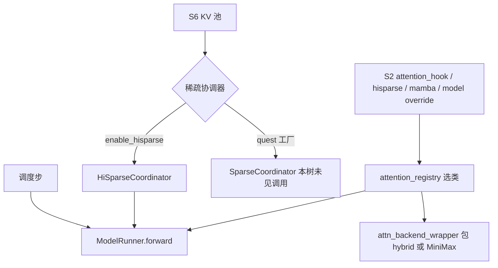
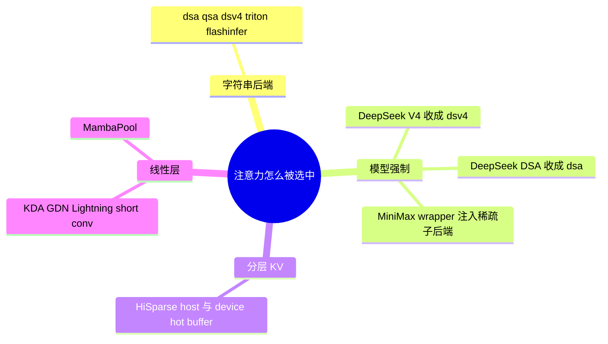

# 注意力与稀疏域总览

本域覆盖 B11–B16、B56–B58、B61、B62、B76–B81、B83、B84。树是 `297e54fd105e974cdf401e5b4d20253a22c16f90`。**源码路径推断，未实测**。

Attention DP 不在本域。请求分到多个 scheduler、头仍在 `attn_tp` 里切，见 [07-并行切分/01-Attention-DP](../07-并行切分/01-Attention-DP.md)（B17）。

## 场景与硬件

| 场景 | 前提 | 页 |
| --- | --- | --- |
| 长上下文 decode，KV 大部分在 host，热页在设备 | `--enable-hisparse`。模型是 DSA、DeepSeek V4 或 MiniMax M3。V4.1 拒绝 | [01-HiSparse](01-HiSparse.md) |
| DeepSeek indexer 选出 top-k，再做稀疏 MLA | 架构在 `is_deepseek_dsa` 且 `index_topk` 非空。默认后端收成 `dsa` | [02-DSA](02-DSA.md) |
| 同一条 DSA 再选 prefill 核，或按 CP 切层 | prefill 核是另一组旗标。切层目前 help 只写 mooncake / mooncake_tcp | [16-DSA-prefill核](16-DSA-prefill核.md)、[17-DSA-cache切层](17-DSA-cache切层.md) |
| Qwen4-Exp 的压缩 indexer | `--attention-backend qsa`。fp8 indexer 要求 CUDA 且 SM90 或 SM100 | [03-QSA](03-QSA.md)、[05-Qwen稀疏](05-Qwen稀疏.md) |
| MiniMax M3 的稀疏层 | 由模型 wrapper 注入，不靠单独的后端字符串 | [04-MiniMax稀疏](04-MiniMax稀疏.md) |
| Quest 式 page min/max | 配置 JSON 里的算法名。生产调用链待核 | [06-Quest](06-Quest.md) |
| 线性注意力 / Mamba 状态池 | `--linear-attn-backend`。部分核绑定 SM100 或 CUDA | [07-Mamba与线性注意力](07-Mamba与线性注意力.md) 及 KDA / GDN / Lightning / Short conv |
| 换一种稠密或稀疏 attention 实现 | `--attention-backend` | [12-Attention后端目录](12-Attention后端目录.md) |
| V4.1 的 n-gram 记忆或超连接残差 | 无单独 CLI，来自 config / 环境变量 | [13-Engram](13-Engram.md)、[14-mHC](14-mHC.md) |
| Qwen4-Exp 嵌入表卸到 host | CUDA + BF16 默认开。与 `--cpu-offload-gb` 互斥 | [15-PLE](15-PLE.md) |
| 要可复现的核与采样 | `--enable-deterministic-inference`。部分后端会因此关掉 radix | [18-确定性推理](18-确定性推理.md)、[19-batch-invariant](19-batch-invariant.md) |

## 在框架中的位置

前向模式（EXTEND / DECODE / TARGET_VERIFY）在 [05-前向与采样](../../02-流程/03-调度与推理/05-前向与采样.md)。本域写的是这一步 forward 里 attention 读哪些页、用哪个核。

## 和缓存、投机、模型

HiSparse 要求关掉 radix，见 [01-缓存](../01-缓存/01-RadixCache.md)。DSA 的 MTP 可以带 indexer 的 top-k，投机页写验证数据结构，本域写注意力侧的 top-k 从哪来。V4.1 拒绝 HiSparse 的原文在 `validate_deepseek_v41_features`，模型矩阵归 [05-模型](../../05-模型/04-模型与特性矩阵.md)。

返回 [本目录 README](README.md)。
